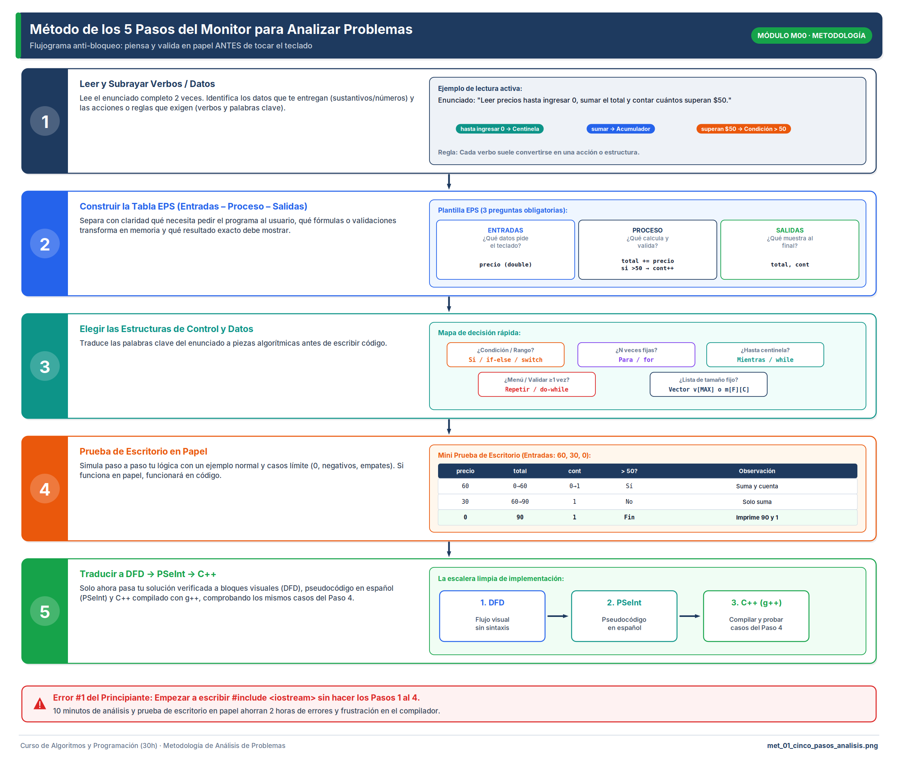
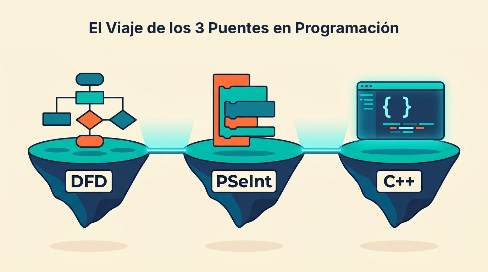

# Módulo 00: Algoritmos para Tontos (Pensar Antes de Teclar)

> **Duración estimada:** 2.5 horas (1.5 h lectura guiada y ejemplos + 1.0 h ejercicios y prueba de escritorio)  
> **Nivel:** Cero absoluto (no necesitas saber nada de programación)  
> **Progresión:** Lógica cotidiana $\rightarrow$ Análisis E-P-S $\rightarrow$ Método de los 5 Pasos $\rightarrow$ Prueba de escritorio en papel

---

## Objetivos de aprendizaje

Al terminar este módulo serás capaz de:
1. Perderle el miedo a la palabra **"algoritmo"** y entender exactamente cómo "piensa" una computadora.
2. Leer cualquier enunciado de clase o parcial y separar sus piezas usando el modelo **E-P-S (Entrada $\rightarrow$ Proceso $\rightarrow$ Salida)** y el diccionario de palabras clave.
3. Aplicar el **Método de los 5 Pasos del Monitor** para resolver problemas cotidianos y matemáticos sin quedarte en blanco frente a la pantalla.
4. Ejecutar una **prueba de escritorio en papel** para cazar errores de lógica antes de escribir una sola línea de código.

---

## Mapa Conceptual del Módulo

```text
                  [ PROBLEMA / ENUNCIADO ]
                             |
                             v
            1. Leer con lupa y subrayar datos
                             |
                             v
      +---------------------------------------------+
      | 2. Modelo E-P-S (La Licuadora del Algoritmo)|
      |   ENTRADAS -----> PROCESO -----> SALIDAS    |
      +---------------------------------------------+
                             |
                             v
         3. Elegir estructura: Secuencia / Decisión / Ciclo
                             |
                             v
         4. Prueba de escritorio en papel (cazar bugs)
                             |
                             v
         5. Traducción futura: DFD -> PSeInt -> C++
```

---

## 1. Explicado "Para Tontos" (Con Plastilina): ¿Qué es un Algoritmo?


Si alguien te dice *"diseña un algoritmo eficiente"*, suena a película de ciencia ficción o a fórmula de la NASA. Respira tranquilo: **tú ya usas algoritmos todos los días desde que eras niño**.

Un **algoritmo** es simplemente:
> **Una lista ordenada, finita y sin ambigüedades de pasos para lograr un objetivo o resolver un problema.**

Fíjate en las tres palabras mágicas de esa definición:
1. **Ordenada:** El orden importa. No puedes ponerte los zapatos antes que las medias (bueno, poder puedes, pero quedarás muy raro).
2. **Finita:** Tiene que terminar en algún momento. Si un paso te manda en círculos para siempre, nunca acabas.
3. **Sin ambigüedades (a prueba de "genios literales"):** Cero adivinanzas. No digas *"échale sal al gusto"* a un robot, porque el robot te preguntará: *"¿qué es gusto? ¿1 gramo o medio kilo?"*.

### El secreto mejor guardado: la computadora es un "Genio Literal"

Imagina que tienes un asistente súper veloz capaz de hacer un millón de sumas por segundo, pero **tiene cero sentido común**. Si le dices:
*"Unta mantequilla en el pan"*,
y no le dijiste primero *"abre la nevera, saca la mantequilla, toma un cuchillo, destapa el recipiente..."*, el genio literal aplastará el pan contra el frasco cerrado de mantequilla y te mirará orgulloso diciendo: *"¡Misión cumplida!"*.

**Moraleja del monitor:** Programar NO es ser un genio de las matemáticas; programar es **aprender a darle instrucciones tan claras y ordenadas a un robot literal, que sea imposible que se equivoque**.

---

## 2. Cinco Analogías Completas de la Vida Real

Para que el concepto quede grabado con plastilina, analicemos cinco situaciones cotidianas exactamente como las analiza un programador.

### Analogía 1: Preparar un café con leche por la mañana
* **Objetivo:** Obtener una taza de café con leche caliente.
* **Entradas (Ingredientes):** Agua, café instantáneo, leche, azúcar, una taza, una cuchara, estufa o hervidor.
* **Pasos del algoritmo (Secuencia estricta):**
  1. Inicio.
  2. Poner a calentar el agua en el hervidor hasta que hierva.
  3. Colocar la taza limpia sobre la mesa.
  4. Agregar 1 cucharadita de café en la taza.
  5. Verter el agua caliente hasta llenar $\frac{3}{4}$ de la taza.
  6. Agregar leche hasta completar la taza.
  7. Agregar 1 cucharadita de azúcar.
  8. Revolver con la cuchara durante 10 segundos.
  9. Entregar la taza lista (Salida).
  10. Fin.
* **¿Qué pasa si cambias el orden?** Si primero viertes el agua caliente sobre la mesa antes de colocar la taza (intercambias pasos 3 y 5), terminas con la mesa quemada y la taza vacía. **En programación, el orden de las líneas cambia todo el resultado.**

### Analogía 2: Pedir una hamburguesa por una app de domicilios
* **Objetivo:** Recibir tu comida en casa pagando correctamente.
* **Entradas:** Dirección de entrega, restaurante elegido, hamburguesa seleccionada, método de pago, saldo disponible.
* **Pasos del algoritmo (Aquí aparecen decisiones):**
  1. Inicio.
  2. Abrir la aplicación e ingresar la dirección.
  3. **Pregunta (Decisión):** ¿El restaurante elegido está abierto?
     * Si la respuesta es **No**: mostrar *"Restaurante cerrado"* y elegir otro o terminar.
     * Si la respuesta es **Sí**: continuar.
  4. Agregar hamburguesa al carrito.
  5. Seleccionar método de pago (tarjeta o efectivo).
  6. **Pregunta (Decisión):** ¿Pagas con tarjeta y tienes saldo suficiente?
     * Si **Sí**: confirmar pedido y descontar dinero.
     * Si **No**: pedir otro método de pago o cancelar pedido.
  7. Esperar al domiciliario y recibir el pedido (Salida).
  8. Fin.
* **Lección clave:** Los algoritmos reales no siempre van en línea recta; a veces toman caminos distintos dependiendo de una condición (`Sí` o `No`).

### Analogía 3: Retirar dinero en un cajero automático (ATM)
* **Objetivo:** Sacar efectivo de forma segura sin entregar dinero de más ni permitir robos.
* **Entradas:** Tarjeta débito, clave secreta (PIN), monto a retirar, saldo de la cuenta.
* **Pasos del algoritmo (Seguridad + Validación):**
  1. Inicio.
  2. Insertar tarjeta.
  3. Crear un contador de intentos en `0`.
  4. Pedir al usuario que digite su PIN de 4 dígitos.
  5. Si el PIN es correcto, pasar al paso 7. Si es incorrecto, sumar `1` al contador de intentos.
  6. Si el contador es menor que `3`, volver al paso 4; si llegó a `3`, retener/expulsar tarjeta y terminar por seguridad.
  7. Leer el monto que el usuario quiere retirar.
  8. **Decisión:** ¿El monto es menor o igual al saldo disponible **Y** múltiplo de \$10.000?
     * Si **Sí**: restar el monto del saldo, entregar billetes y recibo (Salidas).
     * Si **No**: mostrar mensaje de error (*"Saldo insuficiente o monto inválido"*).
  9. Devolver la tarjeta.
  10. Fin.
* **Lección clave:** Aquí ves **las 3 grandes piezas** de toda la programación juntas: **secuencia** (pasos en orden), **decisión** (¿saldo suficiente?) y **repetición/ciclo** (intentar el PIN hasta 3 veces).

### Analogía 4: Armar un mueble o una figura LEGO con manual
* **Objetivo:** Construir una silla o nave exactamente igual a la foto de la caja.
* **Entradas:** Bolsa de piezas etiquetadas (A, B, C), tornillos, destornillador, manual.
* **Pasos del algoritmo:**
  1. Contar que estén todas las piezas (validar entradas).
  2. Seguir el bloque 1 del manual antes de tocar el bloque 2.
  3. Unir la pieza A con la B usando 2 tornillos.
  4. Repetir el ajuste para las 4 patas (ciclo de 4 veces).
  5. Verificar estabilidad (prueba de escritorio).
* **Lección clave:** ¿Por qué el manual numera las bolsas? Para **no mezclar variables** ni usar una pieza antes de tiempo. En programación, si intentas multiplicar una variable antes de leer su valor, es como intentar atornillar una pata que todavía no sacaste de la caja.

### Analogía 5: Hacer la maleta para un viaje según el clima
* **Objetivo:** Llevar la ropa exacta para 4 días sin olvidar lo necesario.
* **Entradas:** Número de días del viaje (`4`), pronóstico del clima (`"lluvioso"` o `"soleado"`).
* **Pasos del algoritmo:**
  1. Inicio.
  2. Abrir maleta vacía.
  3. **Repetir 4 veces** (una por cada día): meter 1 camiseta y 1 par de medias.
  4. **Decisión:** ¿El pronóstico dice que va a llover?
     * Si **Sí**: meter chaqueta impermeable y paraguas.
     * Si **No**: meter gorra y bloqueador solar.
  5. Cerrar maleta (Salida: maleta lista para viajar).
  6. Fin.
* **Lección clave:** Un ciclo (*"repetir N veces"*) nos ahorra escribir 4 veces *"meter camiseta"*. En programación, si necesitas hacer algo 100 veces, no escribes 100 líneas iguales: usas un ciclo.

---

## 3. Cómo Analizar Problemas Desde Cero: El Modelo E-P-S

Cuando un profesor te entrega un enunciado largo en un parcial, el error #1 del estudiante novato es abrir el computador de inmediato y empezar a teclear sin entender qué le pidieron.

**Antes de pensar en código, piensa como una licuadora:**

```text
  [ ENTRADAS ]  --------->  [ PROCESO ]  --------->  [ SALIDAS ]
  (Ingredientes)           (Licuar 30 seg)          (Jugo servido)
  Lo que necesitas         Transformación y          El resultado final
  pedir o recibir          cálculos internos         que debes mostrar
```

* **ENTRADAS (E):** Los datos que vienen **desde afuera** (los digita el usuario por teclado). *Pregunta clave:* "¿Qué datos necesito preguntar al usuario para poder empezar?"
* **PROCESO (P):** Las operaciones matemáticas, fórmulas, comparaciones o transformaciones que ocurren **adentro** del programa. *Pregunta clave:* "¿Qué cuentas o decisiones debo tomar con las entradas?"
* **SALIDAS (S):** La respuesta o mensaje que el programa entrega **hacia afuera** (en pantalla). *Pregunta clave:* "¿Qué me pidió exactamente mostrar o responder el enunciado?"

> **CONSEJO DE MONITORÍA — Lee de atrás hacia adelante si te bloqueas:**  
> Empieza identificando **la SALIDA** (¿qué me piden al final?). Una vez sabes qué te piden entregar, pregúntate: *"¿Qué fórmula o condición me produce esa salida?"* (ese es tu **PROCESO**). Y luego pregúntate: *"¿Qué ingredientes le faltan a esa fórmula que el enunciado no me dio fijos?"* (esas son tus **ENTRADAS**).

### Diccionario Detective: Palabras Clave en los Enunciados

Cuando leas un problema, coge un resaltador (real o mental) y busca estas palabras:

| Si el enunciado dice... | Suele ser... | Qué significa en tu cabeza |
| :--- | :--- | :--- |
| *"Leer"*, *"Ingresar"*, *"Pedir al usuario"*, *"Digitar"*, *"Capturar"*, *"Dado un número..."*, *"El usuario suministra..."* | **ENTRADA** | Necesitas crear una cajita (variable) y pedirle ese valor a la persona por teclado. |
| *"Calcular"*, *"Determinar"*, *"Sumar"*, *"Obtener el promedio"*, *"Aplicar descuento"*, *"Convertir a..."*, *"Verificar si..."* | **PROCESO** | Aquí van tus fórmulas (`+`, `-`, `*`, `/`) o tus preguntas (`Si ... entonces ...`). |
| *"Mostrar"*, *"Imprimir"*, *"Escribir en pantalla"*, *"Reportar"*, *"Desplegar"*, *"Indicar si..."* | **SALIDA** | Es lo que el usuario finalmente verá escrito como resultado. |
| *"El IVA es del 19%"*, *"Una hora tiene 60 minutos"*, *"Se aprueba con 3.0 o más"* | **CONSTANTE / REGLA FIJA** | **¡OJO!** NO se pide por teclado; ya te lo regaló el enunciado. |

> **OJO — TRAMPA CLÁSICA DE PARCIAL:**  
> Muchos estudiantes leen: *"Calcule el total a pagar de una compra aplicando el 19% de IVA"* y cometen el error de pedirle al usuario que digite el `19%`. ¡Falso! Si el enunciado ya fija el `19%`, ese dato es una constante del proceso, **no** una entrada. Solo pides por teclado lo que cambia de un cliente a otro (por ejemplo, el valor de la compra).

---

## 4. El Método de los 5 Pasos del Monitor



Cada vez que tengas un ejercicio enfrente —desde hoy hasta tu examen final— sigue religiosamente esta receta:

1. **Paso 1: Leer con lupa y subrayar.** Lee todo el enunciado dos veces. Subraya los datos que cambian (entradas), las constantes fijas, las reglas ("si pasa esto...") y exactamente qué te piden mostrar.
2. **Paso 2: Armar la Tabla E-P-S y bautizar cajitas (variables).** Escribe en un cuadro aparte: qué entra, qué se calcula, qué sale, y dale nombres claros a tus variables (ej. `precioProducto`, `notaFinal`; nunca `x1`, `k`, `cosa`).
3. **Paso 3: Elegir la estructura lógica.** Pregúntate:
   * ¿Todos los pasos van uno detrás de otro sin bifurcaciones? $\rightarrow$ **Secuencia**.
   * ¿Hay caminos distintos según una condición (`si... entonces...`)? $\rightarrow$ **Decisión**.
   * ¿Hay que repetir una acción varias veces? $\rightarrow$ **Ciclo**.
4. **Paso 4: Hacer la Prueba de Escritorio en papel.** Inventa unos datos de ejemplo fáciles y simula tu solución paso a paso en una tabla. Luego prueba un **caso tramposo** (por ejemplo, un `0`, un número exacto en el límite o un negativo).
5. **Paso 5: Traducir a DFD, PSeInt o C++.** Solo cuando los pasos 1 al 4 funcionan en papel, pasas a dibujar el diagrama o escribir código.



---

## 5. Método de los 5 Pasos Aplicado a 4 Problemas Completos

Veamos los 5 pasos en acción con 4 problemas reales: dos cotidianos y dos matemáticos.

### Problema 1 (Cotidiano): Repartir la cuenta de una pizza entre amigos

> **Enunciado:** Un grupo de amigos pide una pizza a domicilio. El programa debe recibir el valor de la pizza, el valor del domicilio, el porcentaje de propina (por ejemplo `10` para 10%) y la cantidad de amigos que van a pagar. Debe calcular el total de la cuenta y mostrar cuánto dinero debe poner cada amigo en partes iguales.

* **Paso 1 (Leer y subrayar):**
  * Datos variables que da el usuario: valor pizza, valor domicilio, porcentaje propina, cantidad de amigos.
  * Cálculos: sumar pizza + domicilio, sacar la propina sobre la pizza (o sobre el subtotal pizza + domicilio; asumiremos propina sobre el valor de la pizza o subtotal — en el análisis siempre aclaramos la regla: aquí sobre `subtotal = valorPizza + valorDomicilio` o solo sobre `valorPizza`; ¡acláralo siempre! Usaremos propina sobre `valorPizza` y luego sumamos domicilio, o sobre `subtotal`: usemos sobre `valorPizza`? Mejor aún: sobre `valorPizza + valorDomicilio` que es el total del pedido, dejándolo explícito).
  * Qué piden mostrar: el **total de la cuenta** y la **cuota por amigo**.
* **Paso 2 (Tabla E-P-S y Variables):**

| Entradas (Teclado) | Proceso (Fórmulas) | Salidas (Pantalla) |
| :--- | :--- | :--- |
| `valorPizza` | `subtotal = valorPizza + valorDomicilio` | `totalCuenta` |
| `valorDomicilio` | `propina = subtotal * (porcPropina / 100.0)` | `cuotaAmigo` |
| `porcPropina` | `totalCuenta = subtotal + propina` | |
| `numAmigos` | `cuotaAmigo = totalCuenta / numAmigos` *(si `numAmigos > 0`)* | |

* **Paso 3 (Estructura):** Estructura **secuencial** (un cálculo tras otro). *(Nota de caso límite: ¿qué pasa si alguien escribe `0` amigos? No se puede dividir por cero; en un sistema con decisiones validaríamos `numAmigos > 0`).*
* **Paso 4 (Prueba de Escritorio en papel):**
  * *Datos de prueba:* `valorPizza = 45000`, `valorDomicilio = 5000`, `porcPropina = 10`, `numAmigos = 5`.

| Paso | Acción | `valorPizza` | `valorDomicilio` | `porcPropina` | `numAmigos` | `subtotal` | `propina` | `totalCuenta` | `cuotaAmigo` | Pantalla |
| :---: | :--- | :---: | :---: | :---: | :---: | :---: | :---: | :---: | :---: | :--- |
| 1 | Leer entradas | 45000 | 5000 | 10 | 5 | ? | ? | ? | ? | — |
| 2 | Calcular `subtotal` | 45000 | 5000 | 10 | 5 | **50000** | ? | ? | ? | — |
| 3 | Calcular `propina` | 45000 | 5000 | 10 | 5 | 50000 | **5000** | ? | ? | — |
| 4 | Calcular `totalCuenta` | 45000 | 5000 | 10 | 5 | 50000 | 5000 | **55000** | ? | — |
| 5 | Calcular `cuotaAmigo` | 45000 | 5000 | 10 | 5 | 50000 | 5000 | 55000 | **11000** | — |
| 6 | Mostrar salidas | 45000 | 5000 | 10 | 5 | 50000 | 5000 | 55000 | 11000 | Total: \$55000 / C/u: \$11000 |

* **Paso 5 (Plan de algoritmo en español claro):**
  1. Pedir y leer `valorPizza`, `valorDomicilio`, `porcPropina`, `numAmigos`.
  2. Calcular `subtotal <- valorPizza + valorDomicilio`.
  3. Calcular `propina <- subtotal * (porcPropina / 100.0)`.
  4. Calcular `totalCuenta <- subtotal + propina`.
  5. Calcular `cuotaAmigo <- totalCuenta / numAmigos`.
  6. Mostrar `totalCuenta` y `cuotaAmigo`.

---

### Problema 2 (Cotidiano con Decisión): ¿Me alcanza para ir al cine?

> **Enunciado:** Quieres ir al cine el fin de semana. La entrada cuesta \$18.000, pero si vas con un combo de crispetas debes sumar el precio del combo que elijas. Recibe cuánto dinero tienes ahorrado y cuánto vale el combo que deseas. El algoritmo debe calcular cuánto cuesta la salida y decirte si te alcanza el dinero (y cuánto te sobra o cuánto te falta).

* **Paso 1 (Leer y subrayar):**
  * Constante oculta: `PRECIO_ENTRADA = 18000` (¡NO se pide por teclado!).
  * Entradas: `dineroDisponible`, `precioCombo`.
  * Salidas: costo total de la salida, mensaje indicando si alcanza y la diferencia (sobrante o faltante).
* **Paso 2 (Tabla E-P-S):**

| Entradas | Proceso | Salidas |
| :--- | :--- | :--- |
| `dineroDisponible` | `costoTotal = 18000 + precioCombo` | `costoTotal` |
| `precioCombo` | Si `dineroDisponible >= costoTotal` $\rightarrow$ `sobrante = dineroDisponible - costoTotal` | Mensaje + `sobrante` o `faltante` |
| | Si no $\rightarrow$ `faltante = costoTotal - dineroDisponible` | |

* **Paso 3 (Estructura):** **Secuencia + Decisión Simple (`Sí / No`)**. Fíjate en el signo `>=`: si tienes exactamente lo que vale la salida, ¡sí te alcanza (te sobra `$0`)!
* **Paso 4 (Prueba de Escritorio con 2 casos):**
  * *Caso A (Alcanza):* `dineroDisponible = 50000`, `precioCombo = 24000`.
    * `costoTotal = 18000 + 24000 = 42000`.
    * ¿`50000 >= 42000`? **Verdadero**.
    * `sobrante = 50000 - 42000 = 8000`.
    * Pantalla: *"Costo: \$42000. ¡Sí te alcanza! Te sobran \$8000."*
  * *Caso B (Caso límite / No alcanza):* `dineroDisponible = 40000`, `precioCombo = 25000`.
    * `costoTotal = 18000 + 25000 = 43000`.
    * ¿`40000 >= 43000`? **Falso**.
    * `faltante = 43000 - 40000 = 3000`.
    * Pantalla: *"Costo: \$43000. No te alcanza. Te faltan \$3000."*
* **Paso 5 (Plan de algoritmo):**
  1. Definir constante `precioEntrada <- 18000`.
  2. Leer `dineroDisponible` y `precioCombo`.
  3. `costoTotal <- precioEntrada + precioCombo`.
  4. Mostrar `costoTotal`.
  5. Si `dineroDisponible >= costoTotal` entonces calcular `sobrante <- dineroDisponible - costoTotal` y mostrar que alcanza y sobra; si no, calcular `faltante <- costoTotal - dineroDisponible` y mostrar cuánto falta.

---

### Problema 3 (Matemático / Académico): Nota definitiva ponderada y aprobación

> **Enunciado:** En la universidad, la nota final de Algoritmos se calcula así: Primer Corte vale 30%, Segundo Corte vale 30% y Tercer Corte vale 40%. Una materia se aprueba con una nota definitiva mínima de `3.0` (en escala de `0.0` a `5.0`). Lee las tres notas de un estudiante, calcula su nota definitiva y muestra si aprobó o reprobó.

* **Paso 1 (Leer y subrayar):**
  * Entradas: `nota1`, `nota2`, `nota3`.
  * Constantes fijas: pesos `0.30`, `0.30`, `0.40`, y nota mínima aprobatoria `3.0`.
  * Salidas: `definitiva` y estado (`"APROBADO"` o `"REPROBADO"`).
* **Paso 2 (Tabla E-P-S):**

| Entradas | Proceso | Salidas |
| :--- | :--- | :--- |
| `nota1`, `nota2`, `nota3` | `definitiva = (nota1 * 0.30) + (nota2 * 0.30) + (nota3 * 0.40)` | `definitiva` |
| | Si `definitiva >= 3.0` $\rightarrow$ `"APROBADO"`, si no $\rightarrow$ `"REPROBADO"` | Estado textual |

* **Paso 3 (Estructura):** **Secuencia + Decisión Simple (`>= 3.0`)**.
* **Paso 4 (Prueba de Escritorio con caso normal y caso borde `3.0` exacto):**
  * *Caso A:* `nota1 = 2.0`, `nota2 = 3.0`, `nota3 = 4.0`.
    * `definitiva = (2.0 * 0.30) + (3.0 * 0.30) + (4.0 * 0.40) = 0.60 + 0.90 + 1.60 = 3.10`.
    * ¿`3.10 >= 3.0`? **Verdadero** $\rightarrow$ *"Definitiva: 3.10 - APROBADO"*.
  * *Caso B (Caso borde):* `nota1 = 3.0`, `nota2 = 3.0`, `nota3 = 3.0`.
    * `definitiva = 0.90 + 0.90 + 1.20 = 3.00`.
    * ¿`3.00 >= 3.0`? **Verdadero** $\rightarrow$ *"Definitiva: 3.00 - APROBADO"*. *(¡Por eso es `>=` y no `>`! Si pusieras `>`, reprobaría con `3.0` exacto.)*
  * *Caso C:* `nota1 = 2.5`, `nota2 = 2.5`, `nota3 = 3.2`.
    * `definitiva = 0.75 + 0.75 + 1.28 = 2.78`.
    * ¿`2.78 >= 3.0`? **Falso** $\rightarrow$ *"Definitiva: 2.78 - REPROBADO"*.
* **Paso 5 (Plan de algoritmo):**
  1. Leer `nota1`, `nota2`, `nota3`.
  2. `definitiva <- nota1 * 0.30 + nota2 * 0.30 + nota3 * 0.40`.
  3. Mostrar `definitiva`.
  4. Si `definitiva >= 3.0`, mostrar `"APROBADO"`; si no, mostrar `"REPROBADO"`.

---

### Problema 4 (Matemático / Física): Tiempo de viaje en carretera

> **Enunciado:** Un bus recorre una carretera entre dos ciudades. Conocida la distancia en kilómetros y la velocidad promedio en km/h, calcula cuánto tiempo tardará el viaje expresado en **horas** (con decimales) y también convertido a **minutos**. Ten en cuenta que la velocidad debe ser mayor que cero para evitar errores físicos o matemáticos.

* **Paso 1 (Leer y subrayar):**
  * Entradas: `distanciaKm`, `velocidadKmH`.
  * Constante oculta: `1 hora = 60 minutos`.
  * Fórmula física: $\text{tiempo} = \frac{\text{distancia}}{\text{velocidad}}$.
  * Regla de seguridad: validar que `velocidadKmH > 0`.
  * Salidas: `tiempoHoras` y `tiempoMinutos` (o aviso de velocidad inválida).
* **Paso 2 (Tabla E-P-S):**

| Entradas | Proceso | Salidas |
| :--- | :--- | :--- |
| `distanciaKm` | Si `velocidadKmH > 0`: | `tiempoHoras`, `tiempoMinutos` |
| `velocidadKmH` | `tiempoHoras = distanciaKm / velocidadKmH` | *(o mensaje de error si velocidad $\le 0$)* |
| | `tiempoMinutos = tiempoHoras * 60.0` | |

* **Paso 3 (Estructura):** **Decisión Simple de Validación + Cálculos Secuenciales**.
* **Paso 4 (Prueba de Escritorio):**
  * *Caso A:* `distanciaKm = 150`, `velocidadKmH = 60`.
    * ¿`60 > 0`? **Verdadero**.
    * `tiempoHoras = 150 / 60 = 2.5` horas.
    * `tiempoMinutos = 2.5 * 60.0 = 150.0` minutos.
    * Pantalla: *"Tiempo estimado: 2.5 horas (150 minutos)"*.
  * *Caso B (Caso tramposo):* `distanciaKm = 150`, `velocidadKmH = 0`.
    * ¿`0 > 0`? **Falso**.
    * Pantalla: *"Error: la velocidad debe ser mayor a cero (el bus no avanza)."* (¡Salvamos el programa de explotar por división entre cero!).
* **Paso 5 (Plan de algoritmo):**
  1. Leer `distanciaKm`, `velocidadKmH`.
  2. Si `velocidadKmH > 0` entonces:
     * `tiempoHoras <- distanciaKm / velocidadKmH`
     * `tiempoMinutos <- tiempoHoras * 60.0`
     * Mostrar `tiempoHoras` y `tiempoMinutos`.
  3. Si no:
     * Mostrar mensaje de error.

---

## 6. Consejos de Monitoría y Errores Clásicos (¡No Caigas!)

### Consejos de oro del monitor
1. **No abras el editor de código en los primeros 5 minutos.** Si no puedes explicarle el problema en español a un amigo con lápiz y papel, todavía NO estás listo para escribir C++.
2. **Bautiza bien tus cajas (variables).** Escribir `a`, `b`, `c` parece rápido al inicio, pero a las 20 líneas ya olvidaste qué era `b`. Usa nombres que hablen: `precioNeto`, `edadUsuario`, `totalVentas`.
3. **Siempre pregúntate por el "caso cero" y el "caso empate".** ¿Qué pasa si el usuario mete `0`? ¿Qué pasa si dos números son iguales? ¿Qué pasa si es exactamente `>=` en lugar de `>`?

### Los 5 Errores Clásicos de Principiante
1. **Confundir `=` (asignación) con `=` (igualdad matemática):**
   En matemáticas `x = x + 1` es absurdo. En programación `x <- x + 1` significa: *"Toma el valor viejo guardado en `x`, súmale 1, y guarda el nuevo resultado encima en `x`"*.
2. **Olvidar el orden de precedencia:**
   Escribir `a + b + c / 3` en lugar de `(a + b + c) / 3`. Sin paréntesis, la computadora divide primero `c / 3` y luego suma `a` y `b`. ¡Destruye tu promedio!
3. **Pedir por teclado resultados que tú debes calcular:**
   Si el problema dice *"Calcula el área de un triángulo dada su base y altura"*, jamás pidas `Leer area` por teclado. ¡El área es la **salida**, no la entrada!
4. **No probar con casos reales en papel:**
   Creer que funciona "a ojo" y descubrir en el parcial que multiplicaste cuando tocaba dividir.
5. **Tenerle miedo a los mensajes en rojo del futuro compilador C++:**
   Cuando llegues al Módulo 02 y compiles en C++, verás mensajes en inglés que parecen regaños. **Spoiler tranquilizador:** cuando el compilador te dice algo como `expected ';' before 'cout'` o `'suma' was not declared in this scope`, simplemente te está diciendo en español: *"Oye amigo, se te olvidó el punto y coma en la línea anterior"* o *"Usaste la caja `suma` sin avisarme primero que existía"*. En el Módulo 02 tendrás un traductor completo de errores de C++ al español.

---

## 7. Ejercicios Propuestos (Lógica y Análisis)

Resuelve estos **8 ejercicios en papel** usando el **Método de los 5 Pasos** (subrayado, tabla E-P-S, estructura, prueba de escritorio y algoritmo en español). **¡No mires el solucionario hasta haberlo intentado tú primero!**

1. **Ejercicio 1 (Cotidiano - Receta escalable):** Una receta de panqueques para **4 personas** necesita 2 huevos, 200 gramos de harina y 300 ml de leche. Diseña un algoritmo que reciba cuántas personas van a desayunar y calcule cuántos huevos, gramos de harina y ml de leche necesitas.
2. **Ejercicio 2 (Detective E-P-S):** Lee este enunciado y corrige al estudiante distraído: *"Calcular el precio final de un pantalón sabiendo que tiene un descuento fijo del 20% sobre su precio original."* Un estudiante puso como entradas: `precioOriginal`, `descuento = 20`, `precioFinal`. ¿Qué hizo mal y cuál es la tabla E-P-S correcta + algoritmo?
3. **Ejercicio 3 (Matemático - Conversión de tiempo):** Dado un número entero de **horas** (por ejemplo `5`), calcula a cuántos **minutos** y a cuántos **segundos** equivale.
4. **Ejercicio 4 (Financiero - Cambio de tienda):** Un cliente compra un producto de precio `P` y paga con un billete de valor `B`. Diseña el análisis y algoritmo para saber si el dinero alcanza y cuánto cambio (devuelta) entregarle, o cuánto dinero le falta.
5. **Ejercicio 5 (Lógica de orden - El vaso de jugo y el vaso de agua):** Tienes una variable `vasoA` con `"Jugo"` y una variable `vasoB` con `"Agua"`. Escribe el algoritmo paso a paso para **intercambiar** sus contenidos sin perder ninguno (¡pista: necesitas una tercera variable auxiliar!). Haz la prueba de escritorio.
6. **Ejercicio 6 (Matemático - Edad y mayoría de edad):** Dado el año de nacimiento de una persona y el año actual, calcula su edad aproximada e indica si es mayor de edad (`>= 18` años) o menor de edad.
7. **Ejercicio 7 (Detección de error en Prueba de Escritorio):** Un compañero escribió estos pasos para sacar el promedio de 2 números `a` y `b`:
   `1. Leer a, b`
   `2. promedio <- a + b / 2`
   `3. Escribir promedio`
   Haz la prueba de escritorio con `a = 10` y `b = 20`, descubre el error numérico y corrige el algoritmo.
8. **Ejercicio 8 (Cotidiano integrado - Consumo de gasolina):** Vas de viaje en moto. Conoces la distancia del viaje en km, cuántos kilómetros rinde la moto por cada galón de gasolina, y el precio de un galón de gasolina. Calcula cuántos galones consumirás y cuánto dinero gastarás en combustible.

---

## 8. Solucionario Explicado Paso a Paso

### Solución Ejercicio 1: Receta escalable de panqueques
* **Análisis E-P-S:**
  * *Entradas:* `personas` (entero positivo).
  * *Constantes ocultas (regla de tres por persona):* para 4 personas $\rightarrow$ 2 huevos (0.5 por persona), 200 g harina (50 g por persona), 300 ml leche (75 ml por persona).
  * *Proceso:* dividir entre 4 o usar factor `factor = personas / 4.0`, y multiplicar cada ingrediente por `factor`.
  * *Salidas:* `huevos`, `harinaGr`, `lecheMl`.
* **Estructura:** Secuencia (con validación opcional `personas > 0`).
* **Prueba de escritorio (`personas = 6`):**
  * `factor = 6 / 4.0 = 1.5`
  * `huevos = 2 * 1.5 = 3.0`
  * `harinaGr = 200 * 1.5 = 300`
  * `lecheMl = 300 * 1.5 = 450`
* **Algoritmo:**
  1. Leer `personas`.
  2. `factor <- personas / 4.0`.
  3. `huevos <- 2 * factor`.
  4. `harinaGr <- 200 * factor`.
  5. `lecheMl <- 300 * factor`.
  6. Mostrar `huevos`, `harinaGr`, `lecheMl`.

---

### Solución Ejercicio 2: El estudiante distraído (Pantalón con 20% fijo)
* **Errores del estudiante:**
  1. Metió `descuento = 20` como entrada del usuario, cuando el enunciado dice *"descuento fijo del 20%"* (es una constante, no se pregunta por teclado).
  2. Metió `precioFinal` como entrada, ¡pero `precioFinal` es lo que el algoritmo debe calcular y entregar como **salida**!
* **Tabla E-P-S correcta:**
  * *Entrada:* `precioOriginal`.
  * *Proceso:* `valorDescuento = precioOriginal * 0.20`, `precioFinal = precioOriginal - valorDescuento`.
  * *Salidas:* `valorDescuento` (opcional) y `precioFinal`.
* **Prueba de escritorio (`precioOriginal = 100000`):**
  * `valorDescuento = 100000 * 0.20 = 20000`
  * `precioFinal = 100000 - 20000 = 80000`.

---

### Solución Ejercicio 3: Horas a minutos y segundos
* **Tabla E-P-S:**
  * *Entrada:* `horas`.
  * *Proceso:* `minutos = horas * 60`, `segundos = horas * 3600` (o `minutos * 60`).
  * *Salidas:* `minutos`, `segundos`.
* **Prueba de escritorio (`horas = 5`):**
  * `minutos = 5 * 60 = 300`
  * `segundos = 300 * 60 = 18000`.
* **Algoritmo:** Leer `horas` $\rightarrow$ `minutos <- horas * 60` $\rightarrow$ `segundos <- minutos * 60` $\rightarrow$ Mostrar `minutos`, `segundos`.

---

### Solución Ejercicio 4: Cambio o faltante en tienda
* **Tabla E-P-S:**
  * *Entradas:* `precioProducto`, `pagoCliente`.
  * *Proceso:* comparar `pagoCliente >= precioProducto`. Si sí, `cambio = pagoCliente - precioProducto`. Si no, `faltante = precioProducto - pagoCliente`.
  * *Salida:* Mensaje de cambio o de dinero faltante.
* **Prueba de escritorio:**
  * *Caso 1 (`precioProducto = 12500`, `pagoCliente = 20000`):* `20000 >= 12500` es Verdadero $\rightarrow$ `cambio = 7500` $\rightarrow$ Muestra `"Su cambio es: $7500"`.
  * *Caso 2 (`precioProducto = 12500`, `pagoCliente = 10000`):* `10000 >= 12500` es Falso $\rightarrow$ `faltante = 2500` $\rightarrow$ Muestra `"Le faltan: $2500"`.

---

### Solución Ejercicio 5: Intercambio de dos variables (`vasoA` y `vasoB`)
* **¿Por qué falla hacerlo directo?** Si haces `vasoA <- vasoB`, el `"Jugo"` que había en `vasoA` se destruye para siempre y ambos quedan con `"Agua"`.
* **Solución con variable auxiliar (`vasoExtra`):**
  1. `vasoExtra <- vasoA` *(guardamos `"Jugo"` a salvo)*
  2. `vasoA <- vasoB` *(pasamos `"Agua"` a `vasoA`)*
  3. `vasoB <- vasoExtra` *(pasamos `"Jugo"` desde `vasoExtra` a `vasoB`)*
* **Prueba de escritorio:**

| Paso | Instrucción | `vasoA` | `vasoB` | `vasoExtra` |
| :---: | :--- | :---: | :---: | :---: |
| Inicio | Estado inicial | `"Jugo"` | `"Agua"` | *(vacío)* |
| 1 | `vasoExtra <- vasoA` | `"Jugo"` | `"Agua"` | **`"Jugo"`** |
| 2 | `vasoA <- vasoB` | **`"Agua"`** | `"Agua"` | `"Jugo"` |
| 3 | `vasoB <- vasoExtra` | `"Agua"` | **`"Jugo"`** | `"Jugo"` |

¡Intercambio perfecto sin perder ningún dato! (Este patrón de 3 líneas lo usarás muchísimo cuando ordenes datos en el Módulo 06).

---

### Solución Ejercicio 6: Edad y mayoría de edad
* **Tabla E-P-S:**
  * *Entradas:* `anioNacimiento`, `anioActual`.
  * *Proceso:* `edad = anioActual - anioNacimiento`. Decisión: ¿`edad >= 18`?
  * *Salidas:* `edad` y mensaje `"Mayor de edad"` o `"Menor de edad"`.
* **Prueba de escritorio:**
  * `anioNacimiento = 2008`, `anioActual = 2026` $\rightarrow$ `edad = 2026 - 2008 = 18` $\rightarrow$ `18 >= 18` es Verdadero $\rightarrow$ Muestra `"Edad: 18 - Mayor de edad"`.
  * `anioNacimiento = 2010`, `anioActual = 2026` $\rightarrow$ `edad = 16` $\rightarrow$ `16 >= 18` es Falso $\rightarrow$ Muestra `"Edad: 16 - Menor de edad"`.

---

### Solución Ejercicio 7: Cazar el error en el promedio
* **Prueba de escritorio del algoritmo defectuoso (`a = 10`, `b = 20`):**
  * La computadora hace primero la división `b / 2` = `20 / 2 = 10`.
  * Luego suma `a + 10` = `10 + 10 = 20`.
  * El algoritmo muestra **20** ¡cuando el promedio real de 10 y 20 es **15**!
* **Causa:** Faltaron paréntesis para forzar la suma antes que la división.
* **Corrección:** `promedio <- (a + b) / 2.0`.
* **Prueba de escritorio corregida:** `(10 + 20) / 2.0 = 30 / 2.0 = 15.0`.

---

### Solución Ejercicio 8: Consumo de gasolina en moto
* **Tabla E-P-S:**
  * *Entradas:* `distanciaKm`, `kmPorGalon`, `precioGalon`.
  * *Proceso:* `galonesNecesarios = distanciaKm / kmPorGalon` *(con `kmPorGalon > 0`)*, `costoCombustible = galonesNecesarios * precioGalon`.
  * *Salidas:* `galonesNecesarios`, `costoCombustible`.
* **Prueba de escritorio:** `distanciaKm = 240`, `kmPorGalon = 120`, `precioGalon = 15500`.
  * `galonesNecesarios = 240 / 120.0 = 2.0` galones.
  * `costoCombustible = 2.0 * 15500 = 31000`.
  * Pantalla: *"Necesitas 2 galones. Costo total: \$31000"*.
