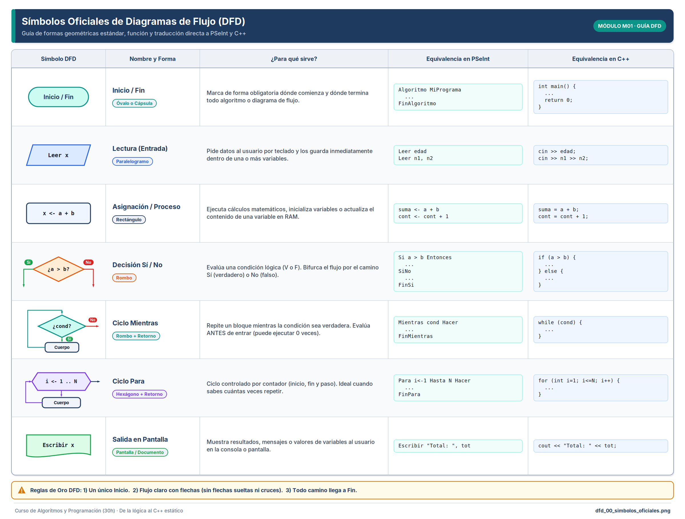
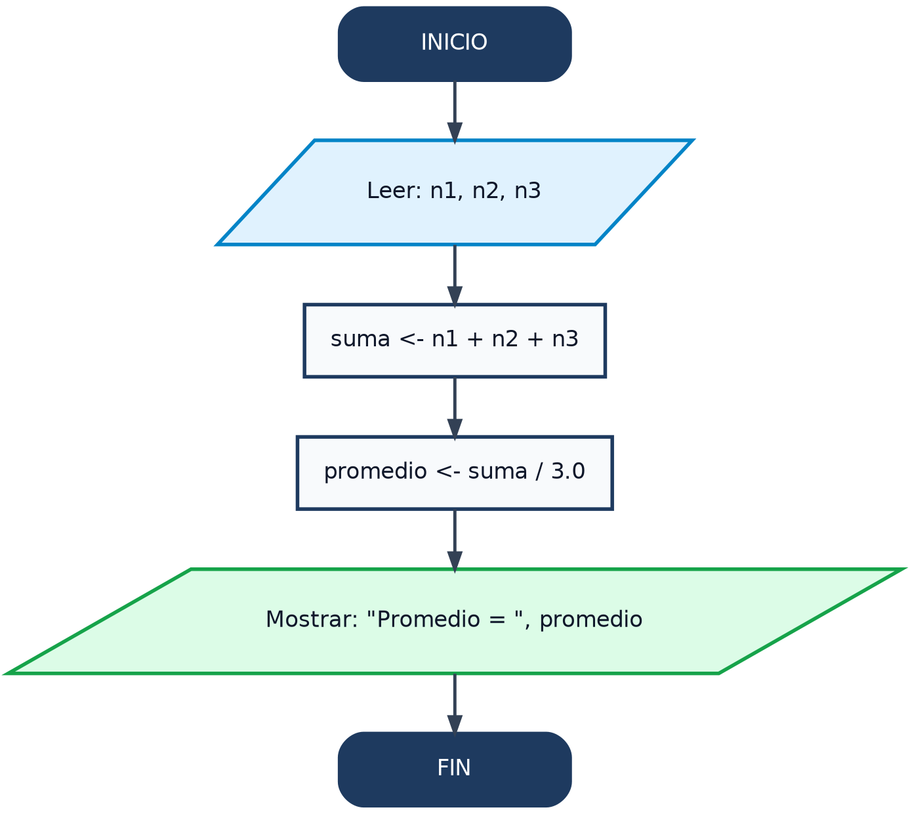
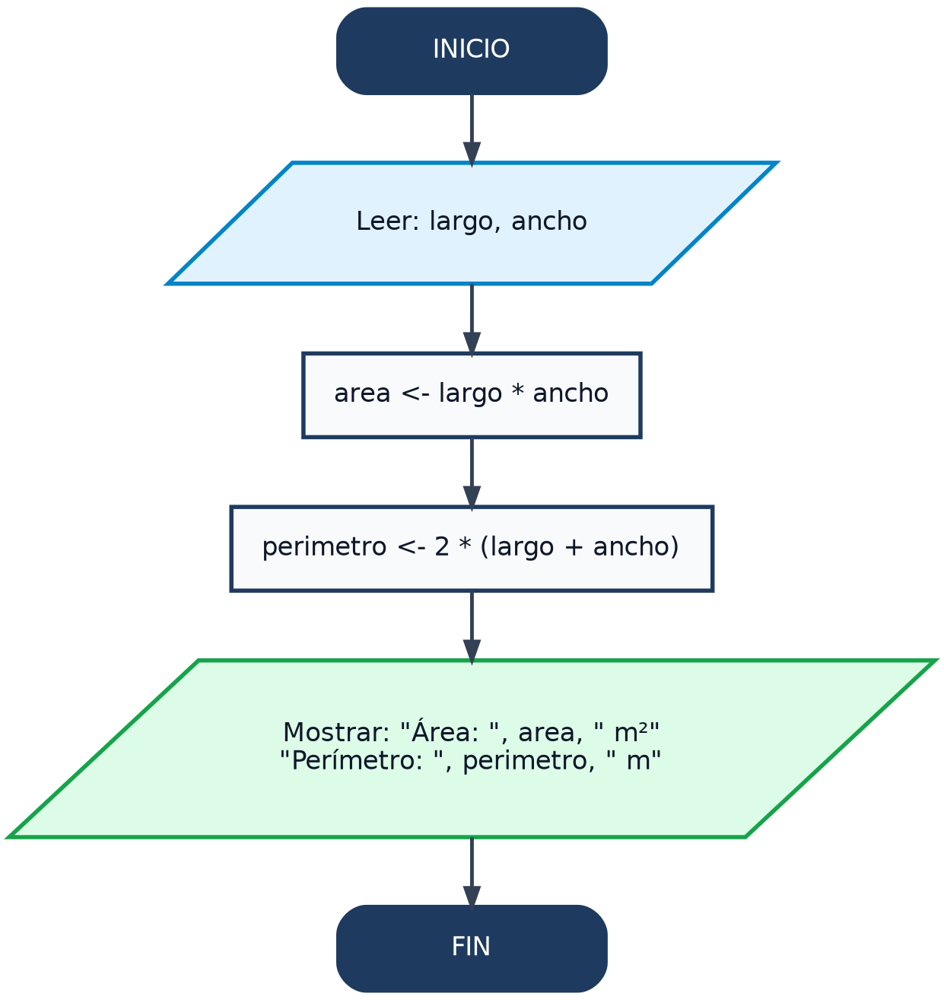
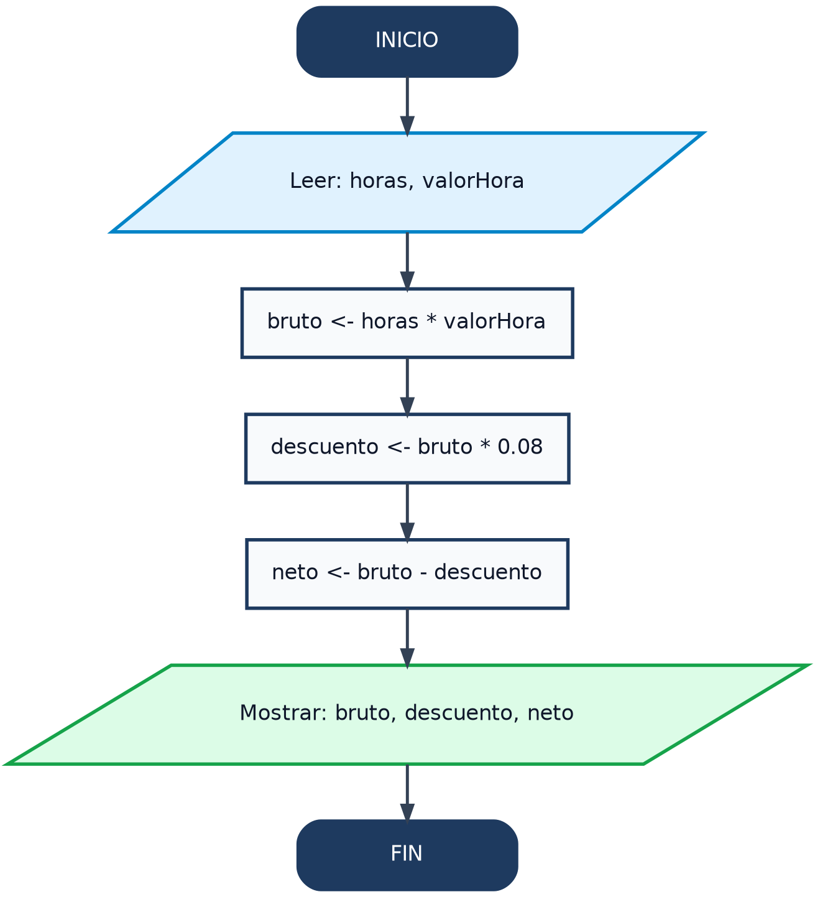
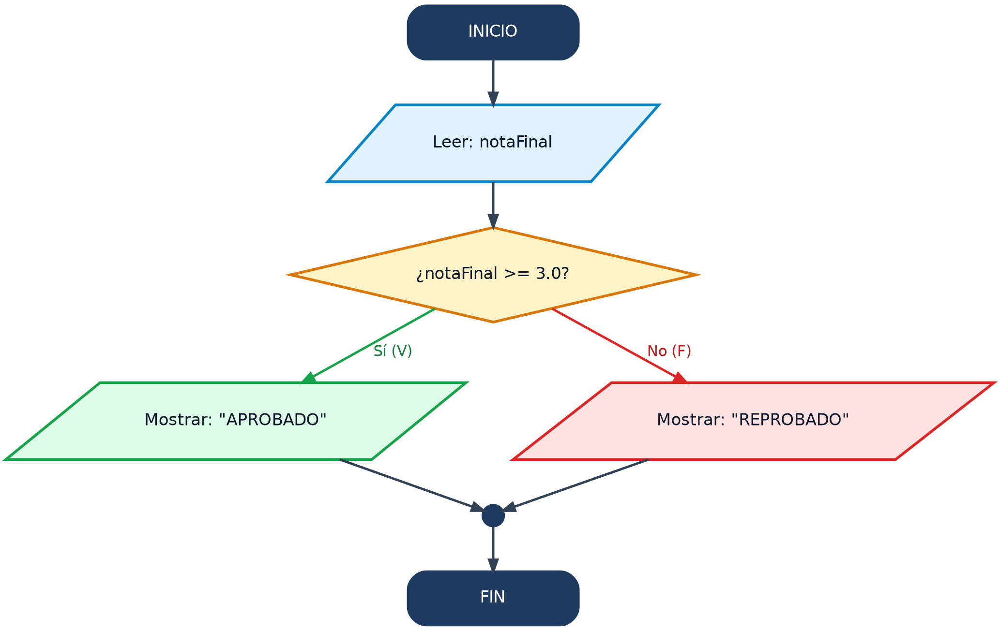
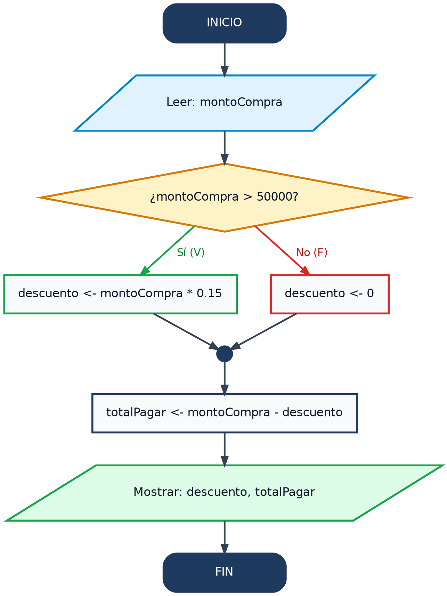
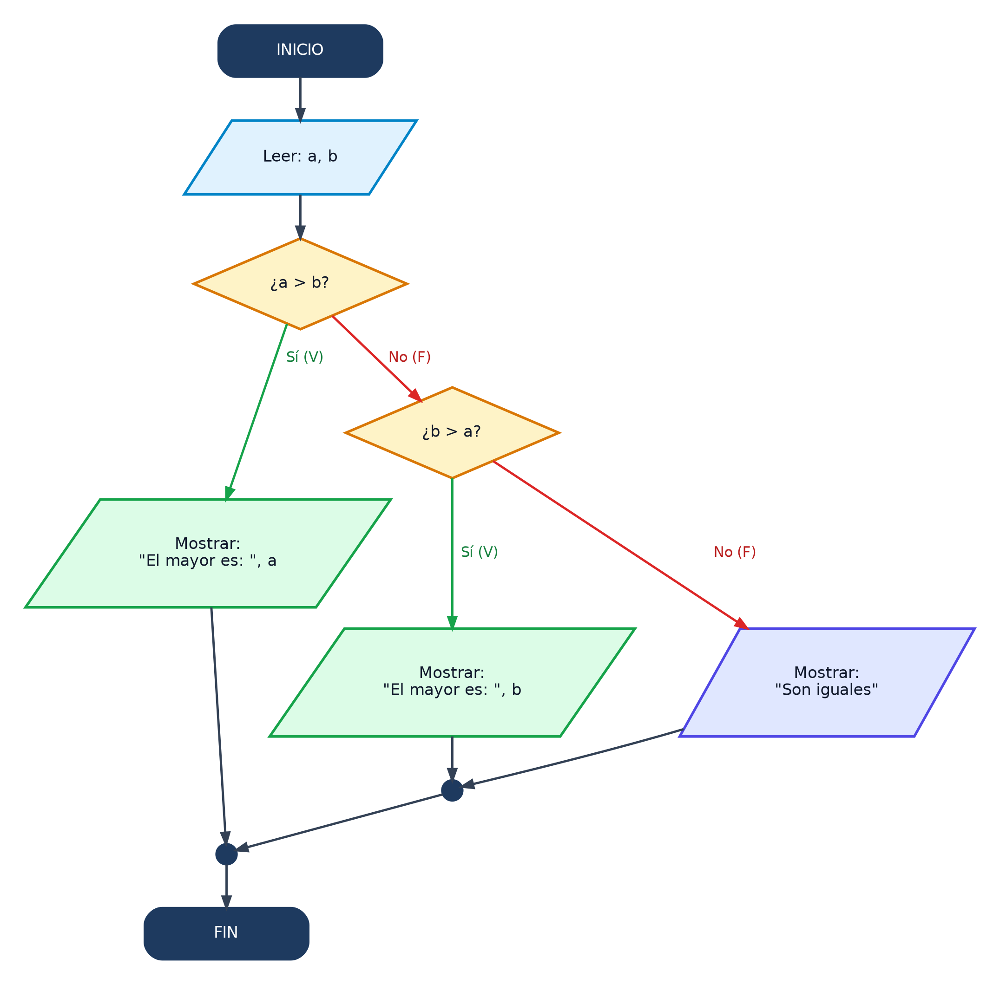
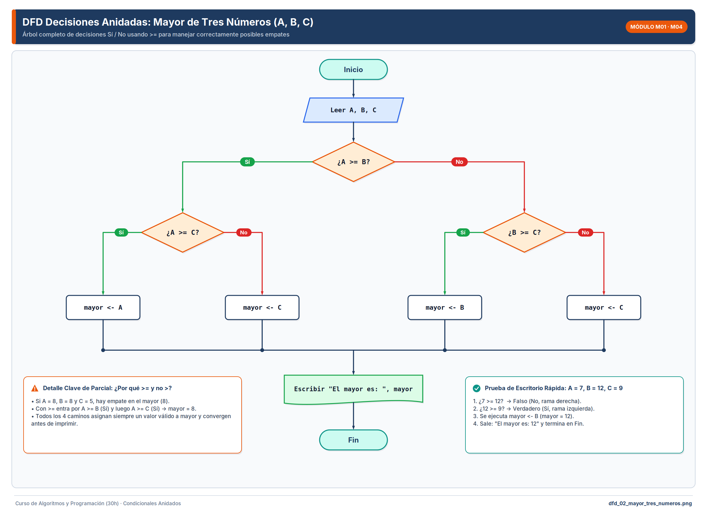

# Módulo 01: Lógica y Diagramas de Flujo de Datos (DFD)

> **Duración estimada:** 3.0 horas (1.5 h teoría guiada + ejemplos DFD + 1.5 h ejercicios y pruebas de escritorio)  
> **Nivel:** Inicial (requiere haber completado el Módulo 00: Método de los 5 Pasos y E-P-S)  
> **Progresión:** Análisis en papel (M00) $\rightarrow$ **Mapa visual DFD (M01)** $\rightarrow$ PSeInt y C++ (M02)

---

## Objetivos de aprendizaje

Al terminar este módulo serás capaz de:
1. Reconocer e interpretar todos los **símbolos oficiales de un Diagrama de Flujo de Datos (DFD)** sin confundir entrada, proceso, decisión y salida.
2. Aplicar las **7 Reglas de Oro** para dibujar DFDs limpios, sin flechas sueltas ni callejones sin salida.
3. Convertir cualquier análisis **E-P-S (Entrada $\rightarrow$ Proceso $\rightarrow$ Salida)** en un DFD **secuencial** o de **decisión simple (Sí/No)**.
4. Realizar una **prueba de escritorio** recorriendo con el dedo cada flecha del DFD y llenando la tabla de variables.

---

## Mapa Conceptual del Módulo

```text
               [ ANÁLISIS E-P-S (M00) ]
                          |
                          v
        +------------------------------------+
        |  SÍMBOLOS OFICIALES DEL DFD        |
        |  - Óvalo: Inicio / Fin             |
        |  - Paralelogramo azul: Leer        |
        |  - Rectángulo: Proceso / Asignar   |
        |  - Rombo: Decisión (Sí / No)       |
        |  - Paralelogramo verde: Mostrar    |
        +------------------------------------+
                          |
             +------------+------------+
             |                         |
             v                         v
   [ FLUJO SECUENCIAL ]      [ DECISIÓN SIMPLE ]
   (Paso 1 -> Paso 2)        (Si V -> rama A;
                              Si F -> rama B;
                              luego SE UNEN)
             |                         |
             +------------+------------+
                          |
                          v
        [ 7 REGLAS DE ORO + PRUEBA DE ESCRITORIO ]
```

---

## 1. Explicado "Para Tontos" (Con Plastilina): ¿Qué es un DFD?

Imagina que vas a construir una casa. ¿Te lanzas de una vez a pegar ladrillos y echar cemento sin un plano? ¡Jamás! Si lo haces sin plano, la puerta del baño termina dando a la calle o te falta espacio para la cocina.

Un **DFD (Diagrama de Flujo de Datos / Flujograma)** es exactamente **el plano arquitectónico de tu programa**.  
En lugar de escribir líneas raras en inglés, dibujas **cajitas con formas distintas** conectadas por **flechas** que muestran el camino que siguen los datos desde que **entran** hasta que **salen**.

¿Por qué los profesores exigen DFD antes de programar en C++?
1. **Ves la lógica de un vistazo:** Si olvidaste calcular algo o dejaste un camino sin salida, el dibujo te lo grita a la cara en 5 segundos.
2. **Cero peleas con puntos y comas:** Te concentras 100% en pensar bien el algoritmo.
3. **Es universal:** Un DFD bien hecho lo entiende cualquier programador en español, inglés o japonés.

---

## 2. Todos los Símbolos Oficiales de un DFD



Cada figura geométrica tiene un único trabajo. No puedes meter una lectura dentro de un rectángulo ni una suma dentro de un rombo. Aquí tienes la tabla maestra:

| Forma Geométrica | Nombre Técnico | Apodo "Para Tontos" | Qué se escribe adentro | Equivalencia futura (PSeInt / C++) |
| :--- | :--- | :--- | :--- | :--- |
| **Óvalo / Cápsula** | Terminal (Inicio / Fin) | *Puerta de entrada y puerta de salida* | Solo la palabra `INICIO` o `FIN`. | `Algoritmo`...`FinAlgoritmo` / `int main() {`...`}` |
| **Paralelogramo (Entrada)** *(o trapecio de lectura en FreeDFD)* | Entrada / Lectura por teclado | *Buzón que recibe datos del usuario* | `Leer: nota1, nota2` (solo nombres de variables, nunca fórmulas). | `Leer x;` / `cin >> x;` |
| **Rectángulo** | Proceso / Asignación | *La calculadora / la cocina* | Operaciones y asignaciones con flecha izquierda: `suma <- a + b`. | `suma <- a + b;` / `suma = a + b;` |
| **Rombo** | Decisión / Condicional | *El semáforo o cruce de caminos* | Una **pregunta** de Sí/No: `¿nota >= 3.0?` (nunca una orden). | `Si ... Entonces ... SiNo` / `if (...) ... else` |
| **Paralelogramo / Documento curvo (Salida)** | Salida / Impresión en pantalla | *El megáfono hacia el usuario* | Mensajes entre comillas y variables: `Mostrar: "Total: ", total`. | `Escribir ...;` / `cout << ...;` |
| **Flecha (`->`)** | Línea de flujo | *La autopista de un solo sentido* | Indica qué paso va después de cuál. | Orden vertical del código |
| **Círculo pequeño** | Conector de flujo | *El puente / glorieta* | Une ramas que vienen de un `Sí` y un `No` (o conecta páginas). | Cierre de bloque `FinSi` / `}` |
| **Hexágono / Bucle visual** *(vista previa M05)* | Ciclo `Para` / Ciclo `Mientras` | *La rotonda que repite vueltas* | Se usa cuando un bloque debe repetirse varias veces. Lo dominaremos en el **Módulo 05**. | `Para` / `Mientras` / `for` / `while` |

> **CONSEJO DE MONITORÍA — ¿Entrada y Salida usan la misma figura?**  
> En muchos libros estándar (norma ISO/ANSI), tanto **Leer** como **Mostrar** usan el paralelogramo, diferenciados por la palabra clave (`Leer:` vs `Mostrar:`) y el color (aquí usamos **azul** para Lectura y **verde** para Salida). En programas como *FreeDFD* verás un trapecio para Leer y un cono/documento curvo para Imprimir. En un examen, lo importante es usar el símbolo estándar de tu clase y escribir claramente **`Leer:`** o **`Mostrar:`**.

---

## 3. Las 7 Reglas de Oro de un DFD Impecable

Si respetas estas 7 reglas, ningún profesor te podrá bajar nota por estructura del diagrama:

1. **Un solo `INICIO` y un `FIN` claro:** Todo diagrama comienza arriba con `INICIO` y todos los caminos terminan abajo en `FIN`.
2. **Flujo ordenado (arriba $\rightarrow$ abajo, izquierda $\rightarrow$ derecha):** Nunca hagas flechas sueltas apuntando a la nada. Todo símbolo (salvo `INICIO` y `FIN`) debe estar conectado por entrada y salida.
3. **Una entrada arriba, una salida abajo en procesos/lecturas/salidas:** Un rectángulo jamás tiene dos flechas saliendo de él. Si necesitas bifurcar caminos, usa obligatoriamente un **rombo**.
4. **Todo rombo pregunta y tiene DOS salidas etiquetadas (`Sí` / `No`):** Dentro del rombo pon una pregunta con signos o expresión booleana (`¿edad >= 18?`). Jamás pongas `total <- a + b` dentro de un rombo. Y etiqueta siempre una rama con **`Sí` (`V`)** y la otra con **`No` (`F`)**.
5. **Las ramas de una decisión SIEMPRE se vuelven a unir:** Después de hacer lo del `Sí` y lo del `No`, ambas flechas convergen en un conector (o directamente al siguiente bloque común / `FIN`). Nunca dejes una rama volando en el aire.
6. **Variables bautizadas igual en todo el dibujo:** Si leíste `precioBase`, no escribas después `precio_base` ni `pb`. Para la máquina son cajas totalmente diferentes. Además, **nunca uses una variable en un cálculo antes de leerla o asignarle valor**.
7. **Jamás entregues un DFD sin Prueba de Escritorio:** Dibuja la tabla al lado y síguelo con el dedo para confirmar que no hay errores de fórmula o de condición.

> **OJO — TRAMPA CLÁSICA DE PARCIAL:**  
> Muchísimos estudiantes dibujan un `Leer` y adentro escriben `Leer: "Ingrese su edad", edad`. ¡Error! En el bloque `Leer` solo va el nombre de la variable (`Leer: edad`). Si quieres mostrar un letrero previo en pantalla, pon un bloque `Mostrar: "Ingrese su edad"` **antes** del `Leer: edad`. (Para mantener los DFDs didácticos compactos, también puedes asumir que `Leer: edad` pide el dato al usuario, o poner el mensaje explícito antes.)

---

## 4. ¿Cómo Hacer una Prueba de Escritorio a un DFD? (Con Plastilina)

Hacer la **prueba de escritorio** consiste en jugar a ser el computador con papel y lápiz:
1. Haz una columna para el **Paso / Bloque**.
2. Haz una columna para **cada variable** que exista en tu DFD.
3. Si hay decisiones, agrega una columna **Condición** para anotar `V` o `F`.
4. Haz una columna final llamada **Pantalla** para anotar exactamente lo que vería el usuario.
5. Empieza en `INICIO`, sigue la flecha con tu dedo y cada vez que una variable cambie de valor, anota el nuevo valor debajo (el valor viejo queda reemplazado).

---

## 5. Seis Problemas Resueltos Paso a Paso en DFD

A continuación tienes **6 problemas completos** (3 secuenciales y 3 de decisión simple) resueltos con el Método de los 5 Pasos, su diagrama DFD real y su prueba de escritorio completa.

---

### Problema 1 (Secuencial): Promedio de tres notas

> **Enunciado:** Diseña un DFD que lea las 3 calificaciones de un estudiante (`n1`, `n2`, `n3`), calcule su suma y su promedio aritmético, y muestre el promedio final en pantalla.

* **Análisis E-P-S:**
  * *Entradas:* `n1`, `n2`, `n3`.
  * *Proceso:* `suma <- n1 + n2 + n3`, luego `promedio <- suma / 3.0`.
  * *Salida:* `promedio`.
* **Diagrama DFD:**



* **Paso a paso:**
  1. `INICIO`.
  2. `Leer: n1, n2, n3` guarda los tres números ingresados por teclado.
  3. `suma <- n1 + n2 + n3` suma las tres cajas y guarda el resultado en `suma`.
  4. `promedio <- suma / 3.0` divide la suma entre `3.0` (nota: poner `.0` evita divisiones enteras futuras en C++).
  5. `Mostrar: "Promedio = ", promedio` imprime el resultado.
  6. `FIN`.
* **Prueba de Escritorio (`n1 = 4.0`, `n2 = 3.5`, `n3 = 4.5`):**

| Paso | Bloque DFD | `n1` | `n2` | `n3` | `suma` | `promedio` | Pantalla |
| :---: | :--- | :---: | :---: | :---: | :---: | :---: | :--- |
| 1 | `INICIO` | — | — | — | — | — | — |
| 2 | `Leer: n1, n2, n3` | **4.0** | **3.5** | **4.5** | — | — | — |
| 3 | `suma <- n1 + n2 + n3` | 4.0 | 3.5 | 4.5 | **12.0** | — | — |
| 4 | `promedio <- suma / 3.0` | 4.0 | 3.5 | 4.5 | 12.0 | **4.0** | — |
| 5 | `Mostrar: ...` | 4.0 | 3.5 | 4.5 | 12.0 | 4.0 | `Promedio = 4.0` |
| 6 | `FIN` | 4.0 | 3.5 | 4.5 | 12.0 | 4.0 | *(termina)* |

---

### Problema 2 (Secuencial): Área y perímetro de una cancha rectangular

> **Enunciado:** Un colegio quiere saber cuánta grama necesita para cubrir una cancha rectangular y cuántos metros de malla requiere para cercarla. Lee el `largo` y el `ancho` en metros, calcula el `area` y el `perimetro`, y muéstralos.

* **Análisis E-P-S:**
  * *Entradas:* `largo`, `ancho`.
  * *Proceso:* `area <- largo * ancho`, `perimetro <- 2 * (largo + ancho)`.
  * *Salidas:* `area`, `perimetro`.
* **Diagrama DFD:**



* **Prueba de Escritorio (`largo = 25`, `ancho = 12`):**

| Paso | Bloque DFD | `largo` | `ancho` | `area` | `perimetro` | Pantalla |
| :---: | :--- | :---: | :---: | :---: | :---: | :--- |
| 1 | `Leer: largo, ancho` | **25** | **12** | — | — | — |
| 2 | `area <- largo * ancho` | 25 | 12 | **300** | — | — |
| 3 | `perimetro <- 2 * (largo + ancho)` | 25 | 12 | 300 | **74** | — |
| 4 | `Mostrar: ...` | 25 | 12 | 300 | 74 | `Área: 300 m²` / `Perímetro: 74 m` |

---

### Problema 3 (Secuencial): Liquidación de salario neto con descuento del 8%

> **Enunciado:** Un monitor universitario trabaja cierto número de `horas` a la semana y le pagan un `valorHora` por cada hora. De su salario bruto le descuentan el 8% (salud y pensión). Lee `horas` y `valorHora`, calcula el salario `bruto`, el `descuento` y el salario `neto`, y muestra los tres valores.

* **Análisis E-P-S:**
  * *Entradas:* `horas`, `valorHora` *(OJO: el `0.08` es constante del enunciado, NO se pide por teclado)*.
  * *Proceso:* `bruto <- horas * valorHora`, `descuento <- bruto * 0.08`, `neto <- bruto - descuento`.
  * *Salidas:* `bruto`, `descuento`, `neto`.
* **Diagrama DFD:**



* **Prueba de Escritorio (`horas = 15`, `valorHora = 20000`):**

| Paso | Bloque DFD | `horas` | `valorHora` | `bruto` | `descuento` | `neto` | Pantalla |
| :---: | :--- | :---: | :---: | :---: | :---: | :---: | :--- |
| 1 | `Leer: horas, valorHora` | **15** | **20000** | — | — | — | — |
| 2 | `bruto <- horas * valorHora` | 15 | 20000 | **300000** | — | — | — |
| 3 | `descuento <- bruto * 0.08` | 15 | 20000 | 300000 | **24000** | — | — |
| 4 | `neto <- bruto - descuento` | 15 | 20000 | 300000 | 24000 | **276000** | — |
| 5 | `Mostrar: bruto, descuento, neto` | 15 | 20000 | 300000 | 24000 | 276000 | `300000, 24000, 276000` |

---

### Problema 4 (Decisión Simple Sí/No): ¿Aprueba o reprueba la materia?

> **Enunciado:** Lee la nota definitiva (`notaFinal`) de un estudiante. Si la nota es mayor o igual a `3.0`, muestra `"APROBADO"`; de lo contrario, muestra `"REPROBADO"`.

* **Análisis E-P-S:**
  * *Entrada:* `notaFinal`.
  * *Proceso:* Decisión simple `¿notaFinal >= 3.0?`.
  * *Salida:* Mensaje `"APROBADO"` o `"REPROBADO"`.
* **Diagrama DFD:**



* **Prueba de Escritorio (¡Probamos AMBAS ramas, incluido el caso límite `3.0`!):**
  * **Caso A (`notaFinal = 3.0` - caso límite):**

| Paso | Bloque DFD | `notaFinal` | Condición `notaFinal >= 3.0` | Rama elegida | Pantalla |
| :---: | :--- | :---: | :---: | :---: | :--- |
| 1 | `Leer: notaFinal` | **3.0** | — | — | — |
| 2 | `¿notaFinal >= 3.0?` | 3.0 | **Verdadero (Sí)** | Izquierda (`Sí`) | — |
| 3 | `Mostrar: "APROBADO"` | 3.0 | — | — | `APROBADO` |

  * **Caso B (`notaFinal = 2.9`):**

| Paso | Bloque DFD | `notaFinal` | Condición `notaFinal >= 3.0` | Rama elegida | Pantalla |
| :---: | :--- | :---: | :---: | :---: | :--- |
| 1 | `Leer: notaFinal` | **2.9** | — | — | — |
| 2 | `¿notaFinal >= 3.0?` | 2.9 | **Falso (No)** | Derecha (`No`) | — |
| 3 | `Mostrar: "REPROBADO"` | 2.9 | — | — | `REPROBADO` |

---

### Problema 5 (Decisión Simple Sí/No): Descuento en papelería

> **Enunciado:** Una papelería otorga un **15% de descuento** únicamente a los clientes cuya compra supere los **\$50.000** (estrictamente mayor a 50000). Si la compra es de \$50.000 o menos, el descuento es `0`. Lee `montoCompra`, calcula el `descuento` y el `totalPagar`, y muéstralos.

* **Análisis E-P-S:**
  * *Entrada:* `montoCompra`.
  * *Proceso:* Si `montoCompra > 50000` $\rightarrow$ `descuento <- montoCompra * 0.15`; si no $\rightarrow$ `descuento <- 0`. Luego (ya unidas las dos ramas) `totalPagar <- montoCompra - descuento`.
  * *Salidas:* `descuento`, `totalPagar`.
* **Diagrama DFD:**



* **Fíjate en un detalle genial de diseño:** La resta `totalPagar <- montoCompra - descuento` y el bloque `Mostrar` se escriben **una sola vez después de unir las ramas**, no repetidos dentro de cada rama. ¡Eso hace tu DFD mucho más limpio!
* **Prueba de Escritorio:**
  * **Caso A (`montoCompra = 80000`):** `80000 > 50000` es **Sí (V)** $\rightarrow$ `descuento = 12000` $\rightarrow$ `totalPagar = 68000` $\rightarrow$ Muestra `12000, 68000`.
  * **Caso B (`montoCompra = 50000` - caso límite exacto):** Como el enunciado dice *"supere los \$50.000"* (`>`), `50000 > 50000` es **No (F)** $\rightarrow$ `descuento = 0` $\rightarrow$ `totalPagar = 50000` $\rightarrow$ Muestra `0, 50000`.

---

### Problema 6 (Decisión Anidada Simple): El mayor de dos números (con empate)

> **Enunciado:** Lee dos números enteros `a` y `b`. Indica cuál de los dos es el mayor, o muestra `"Son iguales"` si tienen el mismo valor.

* **Análisis E-P-S:**
  * *Entradas:* `a`, `b`.
  * *Proceso:* Primer rombo: `¿a > b?`. Si Sí $\rightarrow$ mayor es `a`. Si No $\rightarrow$ todavía pueden pasar dos cosas (`b > a` o `a == b`), así que ponemos un segundo rombo `¿b > a?`. Si Sí $\rightarrow$ mayor es `b`. Si No $\rightarrow$ ¡por descarte son iguales!
  * *Salida:* Mensaje correspondiente.
* **Diagrama DFD:**



* **Prueba de Escritorio (3 casos para probar las 3 hojas del árbol):**
  * *Caso 1 (`a = 18`, `b = 7`):* `18 > 7` es **Sí** $\rightarrow$ Muestra `"El mayor es: 18"` $\rightarrow$ va al conector y `FIN`.
  * *Caso 2 (`a = 4`, `b = 12`):* `4 > 12` es **No** $\rightarrow$ entra a `¿b > a?` (`12 > 4` es **Sí**) $\rightarrow$ Muestra `"El mayor es: 12"` $\rightarrow$ conectores $\rightarrow$ `FIN`.
  * *Caso 3 (`a = 9`, `b = 9`):* `9 > 9` es **No** $\rightarrow$ `9 > 9` es **No** $\rightarrow$ Muestra `"Son iguales"` $\rightarrow$ conectores $\rightarrow$ `FIN`.

### Bonus Visual: ¿Cómo se ve cuando encadenas decisiones para 3 números (A, B, C)?

Una vez dominas comparar 2 números, el siguiente reto típico de parcial es hallar el mayor de **3 números (`A`, `B`, `C`)** cuidando los empates con `>=`. Observa cómo se conecta el árbol completo con nuestra Regla de Oro (todos los caminos se vuelven a unir antes de mostrar el resultado y llegar a `Fin`):



---

## 6. Consejos de Monitoría y Errores Clásicos en DFD (y su Futuro en C++)

### Consejos de Monitoría
1. **Dibuja primero en lápiz (con borrador a la mano):** Casi nadie hace el DFD perfecto al primer trazo. Si te quedas sin espacio en la hoja, usa un conector circular con una letra (`A`) y sigue al lado.
2. **En decisiones, piensa qué pasa después de unir las ramas:** Si ambas ramas terminan haciendo lo mismo (como `totalPagar <- montoCompra - descuento`), sácalo del `Sí`/`No` y ponlo después del conector de unión.
3. **Prueba CADA rama en tu prueba de escritorio:** Si un DFD tiene un rombo y solo probaste el caso `Sí`, tu prueba de escritorio está a medias; el error podría estar escondido en la rama `No`.

### Errores Clásicos en DFD (y cómo se ven luego en C++)
* **Error 1: Usar una variable que nunca se leyó ni se calculó.**  
  *En DFD:* Escribir `area <- base * altura` cuando arriba solo leíste `base`.  
  *Traducción a futuro error de compilación en C++:* `'altura' was not declared in this scope` (o si la declaraste vacía, ¡calcula basura aleatoria de la RAM!).
* **Error 2: Escribir cálculos al revés.**  
  *En DFD:* Escribir `a + b <- suma` en vez de `suma <- a + b`. Recuerda: **a la izquierda de la flecha siempre va la ÚNICA caja donde vas a guardar el resultado**.  
  *Traducción en C++:* `error: lvalue required as left operand of assignment` (*"¡A la izquierda del `=` solo puede ir el nombre de una variable!"*).
* **Error 3: Rombo con una sola flecha saliente o sin etiquetas `Sí` / `No`.**  
  Si el lector no sabe qué camino tomar cuando la respuesta es falsa, tu algoritmo es ambiguo y en parcial te resta puntos.
* **Error 4: Confundir `>` con `>=`.**  
  En enunciados como *"al menos 18 años"* es `>= 18`; en *"más de 50000"* es `> 50000`. Un solo signo cambia toda la respuesta en el borde.

---

## 7. Ejercicios Propuestos (Con Pistas del Monitor)

Para cada ejercicio, haz el **Análisis E-P-S**, dibuja el **DFD** en tu cuaderno siguiendo las 7 Reglas de Oro y realiza la **Prueba de Escritorio**.

1. **Ejercicio 1 (Secuencial):** Lee el lado `L` de un cuadrado, calcula su área (`L * L`) y su perímetro (`4 * L`), y muéstralos.  
   *Pista del monitor:* Dos rectángulos de proceso uno debajo del otro.
2. **Ejercicio 2 (Secuencial):** Lee una cantidad en dólares (`usd`) y la tasa de cambio actual (`tasaPeso`), calcula el equivalente en pesos y muéstralo.  
   *Pista del monitor:* Aquí la tasa SÍ cambia cada día, por eso se pide como entrada.
3. **Ejercicio 3 (Secuencial):** Lee la base y la altura de un triángulo, calcula su área con la fórmula `(base * altura) / 2.0` y muéstrala.  
   *Pista del monitor:* Respeta los paréntesis.
4. **Ejercicio 4 (Secuencial):** Lee el precio sin IVA de un producto. Sabiendo que el IVA fijo es del `19%`, calcula el valor del IVA y el precio total con IVA incluido.  
   *Pista del monitor:* El `0.19` es una constante, no lo pidas por teclado.
5. **Ejercicio 5 (Decisión simple):** Lee un número entero `n`. Muestra `"POSITIVO o CERO"` si `n >= 0`, o `"NEGATIVO"` en caso contrario.  
   *Pista del monitor:* Un solo rombo `¿n >= 0?` y recuerda unir las dos ramas antes de `FIN`.
6. **Ejercicio 6 (Decisión simple):** Lee la edad de una persona. Si tiene 18 años o más, muestra `"Puede votar"`; si no, calcula cuántos años le faltan (`18 - edad`) y muestra `"Le faltan X años para votar"`.  
   *Pista del monitor:* Dentro de la rama `No`, primero pones un rectángulo (`faltan <- 18 - edad`) y debajo el bloque `Mostrar`.
7. **Ejercicio 7 (Decisión simple):** Un parqueadero cobra \$3.000 por hora si te quedas 3 horas o menos, pero si te quedas más de 3 horas la tarifa baja a \$2.500 por hora (para todas las horas). Lee `horas` y muestra `totalPagar`.  
   *Pista del monitor:* `¿horas <= 3?` $\rightarrow$ Sí: `tarifa <- 3000`; No: `tarifa <- 2500`. Une las ramas y luego calcula `totalPagar <- horas * tarifa`.
8. **Ejercicio 8 (Decisión simple - División segura):** Lee dos números `dividendo` y `divisor`. Si `divisor` es distinto de cero (`divisor != 0`), calcula y muestra `dividendo / divisor`; si es cero, muestra `"Error: no se puede dividir entre cero"`.  
   *Pista del monitor:* La condición protege el cálculo antes de hacerlo.
9. **Ejercicio 9 (Cazar errores en DFD roto):** Un estudiante dibujó este DFD secuencial:
   `INICIO -> Leer: precio -> descuento <- precio * porc -> total <- precio - descuento -> Mostrar: total -> FIN`.
   ¿Qué dos errores graves cometió y cómo se corrigen?  
   *Pista del monitor:* Pregúntate qué valor tiene `porc` y qué pasa si el usuario no conoce el porcentaje.
10. **Ejercicio 10 (Cazar errores en DFD roto de decisión):** Un compañero dibujó un rombo `¿edad >= 18?`, sacó la rama `Sí` hacia `Mostrar: "Mayor"` y conectó esa salida a `FIN`; pero dejó el lado derecho del rombo vacío (sin flecha `No`). Además puso `resultado <- edad * 2` dentro de un óvalo. Enumera los 3 errores del compañero.  
    *Pista del monitor:* Revisa las Reglas de Oro 3, 4 y 5, más la tabla de símbolos.

---

## 8. Solucionario Paso a Paso (Ejercicios 1 al 10)

### Solución Ejercicio 1: Área y perímetro del cuadrado
* **E-P-S:** Entrada: `L` | Proceso: `area <- L * L`, `perimetro <- 4 * L` | Salidas: `area`, `perimetro`.
* **Flujo DFD:** `INICIO` $\rightarrow$ `[Leer: L]` $\rightarrow$ `[area <- L * L]` $\rightarrow$ `[perimetro <- 4 * L]` $\rightarrow$ `[Mostrar: area, perimetro]` $\rightarrow$ `FIN`.
* **Prueba de Escritorio (`L = 5`):** `area = 25`, `perimetro = 20`. Pantalla: `25, 20`.

---

### Solución Ejercicio 2: Dólares a pesos
* **E-P-S:** Entradas: `usd`, `tasaPeso` | Proceso: `pesos <- usd * tasaPeso` | Salida: `pesos`.
* **Flujo DFD:** `INICIO` $\rightarrow$ `[Leer: usd, tasaPeso]` $\rightarrow$ `[pesos <- usd * tasaPeso]` $\rightarrow$ `[Mostrar: pesos]` $\rightarrow$ `FIN`.
* **Prueba de Escritorio (`usd = 50`, `tasaPeso = 4200`):** `pesos = 210000`. Pantalla: `210000`.

---

### Solución Ejercicio 3: Área del triángulo
* **E-P-S:** Entradas: `base`, `altura` | Proceso: `area <- (base * altura) / 2.0` | Salida: `area`.
* **Flujo DFD:** `INICIO` $\rightarrow$ `[Leer: base, altura]` $\rightarrow$ `[area <- (base * altura) / 2.0]` $\rightarrow$ `[Mostrar: area]` $\rightarrow$ `FIN`.
* **Prueba de Escritorio (`base = 7`, `altura = 5`):** `area = (35) / 2.0 = 17.5`.

---

### Solución Ejercicio 4: Producto con IVA del 19%
* **E-P-S:** Entrada: `precioBase` | Proceso: `iva <- precioBase * 0.19`, `precioTotal <- precioBase + iva` | Salidas: `iva`, `precioTotal`.
* **Flujo DFD:** `INICIO` $\rightarrow$ `[Leer: precioBase]` $\rightarrow$ `[iva <- precioBase * 0.19]` $\rightarrow$ `[precioTotal <- precioBase + iva]` $\rightarrow$ `[Mostrar: iva, precioTotal]` $\rightarrow$ `FIN`.
* **Prueba de Escritorio (`precioBase = 10000`):** `iva = 1900`, `precioTotal = 11900`.

---

### Solución Ejercicio 5: Positivo o cero vs Negativo
* **E-P-S:** Entrada: `n` | Proceso: `¿n >= 0?` | Salida: `"POSITIVO o CERO"` o `"NEGATIVO"`.
* **Flujo DFD:** `INICIO` $\rightarrow$ `[Leer: n]` $\rightarrow$ `<¿n >= 0?>`:
  * **Sí:** `[Mostrar: "POSITIVO o CERO"]` $\rightarrow$ conector.
  * **No:** `[Mostrar: "NEGATIVO"]` $\rightarrow$ conector.
  * Conector $\rightarrow$ `FIN`.
* **Prueba de Escritorio:** `n = 0` $\rightarrow$ `0 >= 0` es **Sí** $\rightarrow$ `"POSITIVO o CERO"`; `n = -4` $\rightarrow$ `-4 >= 0` es **No** $\rightarrow$ `"NEGATIVO"`.

---

### Solución Ejercicio 6: Mayoría de edad para votar
* **E-P-S:** Entrada: `edad` | Proceso: `¿edad >= 18?`, si No calcular `faltan <- 18 - edad` | Salida: mensaje correspondiente.
* **Flujo DFD:** `INICIO` $\rightarrow$ `[Leer: edad]` $\rightarrow$ `<¿edad >= 18?>`:
  * **Sí:** `[Mostrar: "Puede votar"]` $\rightarrow$ conector.
  * **No:** `[faltan <- 18 - edad]` $\rightarrow$ `[Mostrar: "Le faltan ", faltan, " años para votar"]` $\rightarrow$ conector.
  * Conector $\rightarrow$ `FIN`.
* **Prueba de Escritorio:** `edad = 18` $\rightarrow$ `"Puede votar"`. `edad = 15` $\rightarrow$ `faltan = 3` $\rightarrow$ `"Le faltan 3 años para votar"`.

---

### Solución Ejercicio 7: Tarifa de parqueadero
* **E-P-S:** Entrada: `horas` | Proceso: si `horas <= 3` entonces `tarifa <- 3000`, si no `tarifa <- 2500`; luego `totalPagar <- horas * tarifa` | Salida: `totalPagar`.
* **Flujo DFD:** `INICIO` $\rightarrow$ `[Leer: horas]` $\rightarrow$ `<¿horas <= 3?>`:
  * **Sí:** `[tarifa <- 3000]` $\rightarrow$ conector.
  * **No:** `[tarifa <- 2500]` $\rightarrow$ conector.
  * Conector $\rightarrow$ `[totalPagar <- horas * tarifa]` $\rightarrow$ `[Mostrar: totalPagar]` $\rightarrow$ `FIN`.
* **Prueba de Escritorio:** `horas = 3` $\rightarrow$ `tarifa = 3000` $\rightarrow$ `totalPagar = 9000`. `horas = 4` $\rightarrow$ `tarifa = 2500` $\rightarrow$ `totalPagar = 10000`.

---

### Solución Ejercicio 8: División segura
* **E-P-S:** Entradas: `dividendo`, `divisor` | Proceso: validar `divisor != 0`; si sí, `cociente <- dividendo / divisor` | Salida: `cociente` o mensaje de error.
* **Flujo DFD:** `INICIO` $\rightarrow$ `[Leer: dividendo, divisor]` $\rightarrow$ `<¿divisor != 0?>`:
  * **Sí:** `[cociente <- dividendo / divisor]` $\rightarrow$ `[Mostrar: cociente]` $\rightarrow$ conector.
  * **No:** `[Mostrar: "Error: no se puede dividir entre cero"]` $\rightarrow$ conector.
  * Conector $\rightarrow$ `FIN`.
* **Prueba de Escritorio:** `(10, 2)` $\rightarrow$ `2 != 0` Sí $\rightarrow$ `5`; `(10, 0)` $\rightarrow$ `0 != 0` No $\rightarrow$ mensaje de error.

---

### Solución Ejercicio 9: DFD secuencial roto
* **Errores encontrados:**
  1. Se usó la variable `porc` sin haberla leído antes en el bloque `Leer` (ni haberle asignado un valor fijo en un rectángulo previo).
  2. *(Opcional según interpretación)* Si el porcentaje lo da el usuario como entero (ej. `15` por 15%), falta dividirlo por `100.0` (`descuento <- precio * (porc / 100.0)`), o bien si venía en decimal (`0.15`), igual había que leer `Leer: precio, porc`.
* **Corrección:** Cambiar el bloque de entrada a `Leer: precio, porc` (o asignar una constante `porc <- 0.15` antes de calcular `descuento`).

---

### Solución Ejercicio 10: DFD de decisión roto
* **Los 3 errores del compañero:**
  1. **Rombo incompleto (Regla de Oro 4):** Faltó la segunda salida etiquetada `No` saliendo del rombo `¿edad >= 18?`.
  2. **Ramas sin unir / flujo roto (Regla de Oro 5):** Al faltar la rama `No`, no existe cierre/conector que una ambos caminos antes de `FIN`.
  3. **Símbolo equivocado (Tabla de Símbolos):** Metió una asignación (`resultado <- edad * 2`) dentro de un óvalo, cuando el óvalo es exclusivo para `INICIO` y `FIN`; las asignaciones van siempre en un **rectángulo**.
