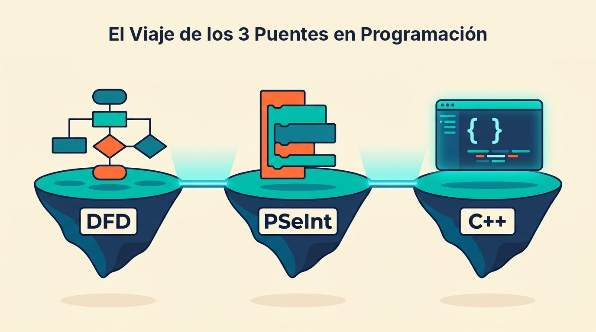
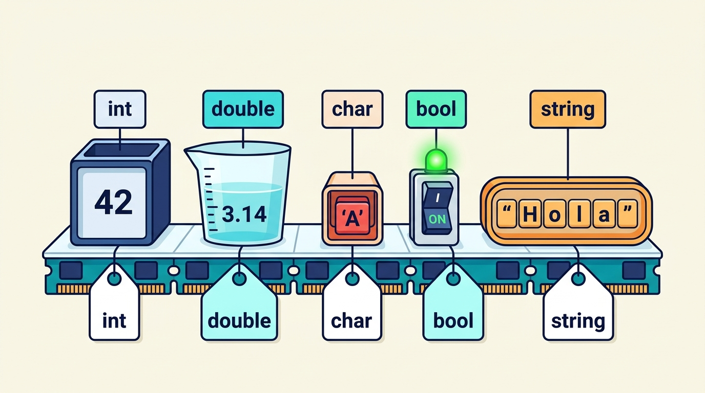
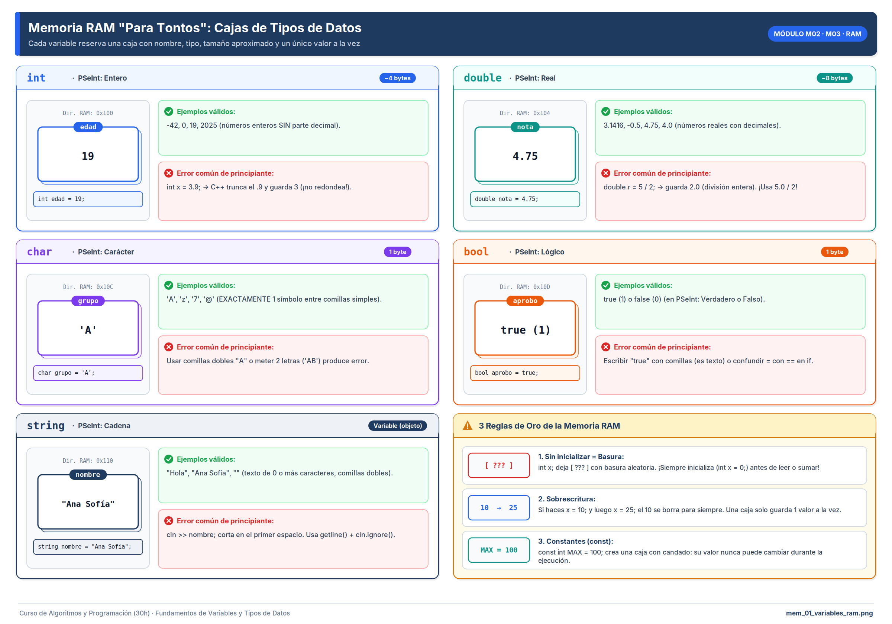

# Módulo 02: PSeInt y el Puente hacia tu Primer Programa en C++

> **Duración estimada:** 3.0 horas (1.5 h teoría, instalación y puente DFD $\rightarrow$ PSeInt $\rightarrow$ C++ + 1.5 h práctica compilada y ejercicios)  
> **Nivel:** Principiante (requiere haber visto M00 y M01)  
> **Progresión:** DFD en papel (M01) $\rightarrow$ **Pseudocódigo en PSeInt** $\rightarrow$ **C++ básico con `iostream`**

---

## Objetivos de aprendizaje

Al terminar este módulo serás capaz de:
1. Instalar, configurar y usar **PSeInt** (incluida su ejecución paso a paso y su vista de Diagrama de Flujo).
2. Traducir cualquier algoritmo secuencial desde **DFD $\rightarrow$ PSeInt $\rightarrow$ C++** usando la tabla maestra de equivalencias.
3. Entender línea por línea la **anatomía de un programa en C++** (`#include <iostream>`, `using namespace std;`, `int main()`, `cin`, `cout`, `return 0;`).
4. Compilar y ejecutar programas reales en C++ con `g++`, y **traducir al español los mensajes de error del compilador** sin entrar en pánico.

---

## Mapa Conceptual del Módulo

```text
   [ DFD EN PAPEL (M01) ]
             |
             v  (pasamos dibujos a texto en español)
   [ PSEUDOCÓDIGO EN PSEINT (.psc) ]
   - Algoritmo ... FinAlgoritmo
   - Definir ... Como Entero / Real
   - Leer / Escribir / <-
             |
             v  (puente palabra por palabra al inglés técnico)
   [ PRIMER PROGRAMA EN C++ (.cpp) ]
   - #include <iostream> + using namespace std;
   - int main() { ... return 0; }
   - int / double / cin >> / cout << / =
             |
             v
   [ COMPILAR CON g++ Y PROBAR CON CASOS REALES ]
```

---

## 1. Explicado "Para Tontos" (Con Plastilina): ¿Por Qué PSeInt Antes de C++?



Imagina que quieres aprender a montar en bicicleta de carreras:
* **DFD (Módulo 01)** fue mirar el mapa de la ruta antes de salir de casa.
* **PSeInt** es **la bicicleta con rueditas de entrenamiento**: escribes en **español** (`Leer`, `Escribir`, `Si...Entonces`), puedes ver paso a paso qué guarda cada cajita, y si te equivocas, el programa te avisa de forma amable en tu idioma.
* **C++** es **la bicicleta de carreras profesional**: es muchísimo más rápida y poderosa (con C++ se programan videojuegos, navegadores y sistemas operativos), pero **no perdona descuidos**: exige escribir en inglés (`cout`, `cin`, `int`, `double`), respetar mayúsculas/minúsculas y terminar cada orden con un punto y coma (`;`).

Si aprendiste a pensar primero en DFD y PSeInt, pasar a C++ no es empezar de cero: **es simplemente cambiar las palabras de español a inglés**.

---

## 2. Instalación y Uso Básico de PSeInt (Configuración del Monitor)

### ¿Cómo instalarlo?
1. Entra a la página oficial: **`pseint.sourceforge.net`** (gratis para Windows, Linux y macOS).
2. Descarga el instalador para tu sistema operativo e instálalo con "Siguiente, Siguiente".

### Configuración Recomendada por el Monitor (¡Clave para sufrir menos en C++!)
Al abrir PSeInt por primera vez, te pedirá elegir un **Perfil**. Muchos estudiantes dejan el perfil *Flexible*, pero en este curso te recomendamos hacer este ajuste en **Configurar $\rightarrow$ Opciones del Lenguaje (perfiles) $\rightarrow$ Personalizar**:
* Marca **"Obligar a definir los tipos de variables"** (así te acostumbras a decir si una caja guarda un `Entero` o un `Real`, igual que en C++ con `int` y `double`).
* Marca **"Controlar el uso de punto y coma al final de sentencias secuenciales"** (así nunca olvidarás el `;` al saltar a C++!).

### Los 3 Botones Mágicos de PSeInt
1. **Ejecutar (botón verde Play / F9):** Corre tu algoritmo de golpe y abre la ventana de consola para probar datos.
2. **Ejecución Paso a Paso (botón de los "piecitos"):** Va línea por línea lentamente mostrando qué ejecuta la máquina. ¡Oro puro para hacer pruebas de escritorio!
3. **Dibujar Diagrama de Flujo (botón del organigrama):** ¡Magia! Convierte tu código `.psc` en un DFD visual al instante para verificar si tu lógica coincide con lo visto en el Módulo 01.

---

## 3. Tabla Maestra de Traducción: DFD $\leftrightarrow$ PSeInt $\leftrightarrow$ C++

Guarda esta tabla como tu diccionario bilingüe de cabecera:

| Concepto | En DFD (M01) | En PSeInt (`.psc`) | En C++ Básico (`.cpp`) |
| :--- | :--- | :--- | :--- |
| **Inicio del programa** | Óvalo `INICIO` | `Algoritmo NombrePrograma` | `#include <iostream>` + `using namespace std;` + `int main() {` |
| **Fin del programa** | Óvalo `FIN` | `FinAlgoritmo` | `return 0; }` |
| **Comentario (nota)** | Anotación al margen | `// esto lo ignora la máquina` | `// esto lo ignora el compilador` |
| **Crear caja entera** | Implícito al leer/asignar | `Definir edad Como Entero;` | `int edad;` |
| **Crear caja decimal** | Implícito al leer/asignar | `Definir nota Como Real;` | `double nota;` |
| **Crear caja de 1 letra** | Implícito | `Definir letra Como Caracter;` | `char letra;` |
| **Pedir dato (Entrada)** | Paralelogramo `Leer: x` | `Leer x;` | `cin >> x;` |
| **Mostrar en pantalla (Salida)** | Paralelogramo `Mostrar: "Hola", x` | `Escribir "Hola ", x;` | `cout << "Hola " << x << endl;` |
| **Guardar cálculo (Asignación)** | Rectángulo `s <- a + b` | `s <- a + b;` | `s = a + b;` |
| **Operaciones aritméticas** | `+`, `-`, `*`, `/` | `+`, `-`, `*`, `/` | `+`, `-`, `*`, `/` *(¡cuidado con `5 / 2`!)* |
| **Decisión *(adelanto M04)*** | Rombo `¿x >= 3?` | `Si x >= 3 Entonces ... SiNo ... FinSi` | `if (x >= 3) { ... } else { ... }` |





> **CONSEJO DE MONITORÍA — El truco de las flechitas `cout <<` vs `cin >>`:**  
> ¿Siempre se te olvida para dónde apuntan los signos `<<` y `>>`? Usa este truco visual:
> * **`cout <<`**: La palabra empieza con **C-OUT** (*out* = **afuera**). Las flechas `<<` apuntan **hacia afuera** (sacan el texto desde tu programa hacia la pantalla).
> * **`cin >>`**: La palabra empieza con **C-IN** (*in* = **adentro**). Las flechas `>>` apuntan **hacia adentro** de la variable (meten lo que teclea el usuario dentro de la cajita `>> x`).

---

## 4. Anatomía de un Programa en C++ (Radiografía Línea por Línea)

Miremos un programa mínimo en C++ y entendamos qué hace **cada** pieza:

```cpp
#include <iostream>        // 1. Caja de herramientas de entrada/salida (teclado y pantalla)
using namespace std;       // 2. Evita escribir std::cout y std::cin en cada línea

int main() {               // 3. Puerta principal: aquí arranca SIEMPRE el programa
    int edad;              // 4. Creamos una caja entera llamada 'edad'

    cout << "Tu edad: ";   // 5. Mostramos mensaje en pantalla (sin salto de línea)
    cin >> edad;           // 6. Esperamos a que el usuario digite un número y presione Enter

    cout << "En 5 anios tendras: " << (edad + 5) << endl; // 7. Calculamos y saltamos línea

    return 0;              // 8. Avisamos al sistema operativo: "Todo salió bien (cero errores)"
}                          // 9. Llave que cierra el bloque principal main
```

### ¿Cómo se compila y ejecuta en C++?
A diferencia de PSeInt (que interpreta al vuelo), C++ necesita ser **traducido a idioma de procesador (binario)** antes de correr. Ese traductor se llama **compilador** (usaremos `g++`).

En la terminal (o automáticamente al presionar *Compilar y Ejecutar* en tu IDE como Code::Blocks / Dev-C++ / VS Code):
```bash
g++ -std=c++17 -Wall -Wextra programa.cpp -o programa
./programa
```
* `g++`: Llama al compilador de C++.
* `-Wall -Wextra`: Le pide al compilador que sea un buen monitor y te avise de posibles descuidos (warnings).
* `-o programa`: Nombre del archivo ejecutable que se creará.
* `./programa`: Ejecuta tu programa recién nacido.

---

## 5. Traducción de Errores de Compilación de C++ al Español

¡El momento más temido del semestre: le das a compilar y salen 12 líneas rojas en inglés! **No entres en pánico.** Casi siempre **1 solo error pequeño provoca varios mensajes en cascada**; por eso **siempre arregla el PRIMER error de arriba hacia abajo y vuelve a compilar**.

Aquí tienes el **Diccionario Traductor del Compilador `g++` al Español**:

| Lo que dice `g++` en inglés (con miedo) | Traducción "Para Tontos" al español | Cómo arreglarlo en 5 segundos |
| :--- | :--- | :--- |
| `error: expected ';' before 'cout'` *(o antes de `return` / `}`)* | *"Oye, se te olvidó poner el punto y coma `;` al final de la línea **ANTERIOR**."* | Mira la línea justo arriba del número de línea que marcó el error y pon `;`. |
| `error: 'suma' was not declared in this scope` | *"Intentaste usar la caja `suma`, pero nunca me dijiste que existía (o la escribiste mal)."* | Declara `int suma;` o `double suma;` arriba, o revisa mayúsculas (`Suma` $\neq$ `suma`). |
| `error: 'cout' was not declared in this scope` | *"No conozco `cout` (o `cin`, o `endl`)."* | Te faltó `#include <iostream>` arriba o te faltó `using namespace std;` (o pusiste `std::` mal). |
| `error: no match for 'operator>>'` o `'operator<<'` | *"Pusiste las flechas al revés (`cout >>` o `cin <<`) o mezclaste mal un operador."* | Recuerda: `cout <<` (hacia afuera) y `cin >>` (hacia adentro). |
| `error: expected '}' at end of input` | *"Abriste una llave `{` y llegaste al final del archivo sin cerrarla con `}`."* | Cuenta tus `{` y `}`; agrega el `}` que falta al final de `main`. |
| `error: stray '\303'` (o número raro) `in program` | *"Escribiste una tilde, una `ñ`, o pegaste comillas curvas de Word fuera de un texto."* | En nombres de variables y código usa solo letras ASCII sin tildes (`anio`, `numero`). Deja las tildes solo si van dentro de `"comillas"` (y evita copiar código desde Word). |
| `error: redeclaration of 'int x'` | *"Ya habías creado la caja `x` antes; no puedes crear dos cajas con el mismo nombre."* | Borra el segundo `int` si solo querías cambiar su valor (`x = 5;`, no `int x = 5;`). |
| `warning: 'x' is used uninitialized` | *"Hiciste una operación usando `x` antes de darle valor o leerla con `cin`."* | Asegúrate de hacer `cin >> x;` o `x = 0;` **antes** de usar `x` en una fórmula. |
| No da error, pero `9 / 5` da `1` en vez de `1.8` | *"División entera silenciosa: C++ ve dos enteros (`9` y `5`) y bota los decimales."* | Pon al menos un `.0`: escribe `9.0 / 5.0` (lo veremos a fondo en el Ejemplo 04 y en el Módulo 03). |

---

## 6. Seis Ejemplos Completos: Análisis $\rightarrow$ PSeInt (`.psc`) $\rightarrow$ C++ (`.cpp`)

Cada ejemplo tiene su archivo real guardado y compilado con `g++ -std=c++17 -Wall -Wextra -Werror`. ¡Ábrelos, compílalos y experimenta cambiándoles datos!

---

### Ejemplo 01: Saludo y suma de dos números enteros
*Archivos reales:* `pseint/01_saludo_y_suma.psc` y `cpp/01_saludo_y_suma.cpp`.

* **Análisis E-P-S:**
  * *Entradas:* `numero1`, `numero2` (enteros).
  * *Proceso:* `suma = numero1 + numero2`.
  * *Salida:* Mensaje con el valor de `suma`.

* **Código en PSeInt (`pseint/01_saludo_y_suma.psc`):**
```pseint
// Modulo 02 - Ejemplo 01: Suma de dos numeros enteros
Algoritmo SaludoYSuma
    Definir numero1, numero2, suma Como Entero;

    Escribir "=== MI PRIMER PROGRAMA: SUMA DE DOS NUMEROS ===";
    Escribir "Ingresa el primer numero entero:";
    Leer numero1;

    Escribir "Ingresa el segundo numero entero:";
    Leer numero2;

    suma <- numero1 + numero2;

    Escribir "La suma de ", numero1, " + ", numero2, " es: ", suma;
FinAlgoritmo
```

* **Código en C++ (`cpp/01_saludo_y_suma.cpp`):**
```cpp
// Modulo 02 - Ejemplo 01: Suma de dos numeros enteros
// Objetivo: Aprender entrada (cin), proceso (=) y salida (cout)

#include <iostream>
using namespace std;

int main() {
    int numero1;
    int numero2;
    int suma;

    cout << "=== MI PRIMER PROGRAMA: SUMA DE DOS NUMEROS ===" << endl;
    cout << "Ingresa el primer numero entero: ";
    cin >> numero1;

    cout << "Ingresa el segundo numero entero: ";
    cin >> numero2;

    suma = numero1 + numero2;

    cout << "La suma de " << numero1 << " + " << numero2 << " es: " << suma << endl;

    return 0;
}
```

* **¿Qué cambió en el puente PSeInt $\rightarrow$ C++?**
  * `Definir ... Como Entero;` se volvió `int ...;`.
  * `Escribir ..., ..., ...;` pasó a `cout << ... << ... << endl;` (con `<<` en lugar de comas).
  * `Leer numero1;` pasó a `cin >> numero1;`.
  * `<-` se convirtió en `=`.
* **Prueba de escritorio y ejecución real (`numero1 = 15`, `numero2 = 27`):**
  * `suma = 15 + 27 = 42`.
  * Consola real: `La suma de 15 + 27 es: 42`.

---

### Ejemplo 02: Promedio de tres calificaciones (`double`)
*Archivos reales:* `pseint/02_promedio_notas.psc` y `cpp/02_promedio_notas.cpp`.

* **Análisis E-P-S:**
  * *Entradas:* `nota1`, `nota2`, `nota3` (números reales/decimales).
  * *Proceso:* `suma = nota1 + nota2 + nota3`, `promedio = suma / 3.0`.
  * *Salidas:* `suma` y `promedio`.

* **Código en PSeInt (`pseint/02_promedio_notas.psc`):**
```pseint
Algoritmo PromedioNotas
    Definir nota1, nota2, nota3, suma, promedio Como Real;

    Escribir "=== CALCULADORA DE PROMEDIO DE NOTAS ===";
    Escribir "Ingresa la primera nota:";
    Leer nota1;
    Escribir "Ingresa la segunda nota:";
    Leer nota2;
    Escribir "Ingresa la tercera nota:";
    Leer nota3;

    suma <- nota1 + nota2 + nota3;
    promedio <- suma / 3.0;

    Escribir "Suma total de notas: ", suma;
    Escribir "Tu promedio final es: ", promedio;
FinAlgoritmo
```

* **Código en C++ (`cpp/02_promedio_notas.cpp`):**
```cpp
#include <iostream>
using namespace std;

int main() {
    double nota1;
    double nota2;
    double nota3;
    double suma;
    double promedio;

    cout << "=== CALCULADORA DE PROMEDIO DE NOTAS ===" << endl;
    cout << "Ingresa la primera nota: ";
    cin >> nota1;

    cout << "Ingresa la segunda nota: ";
    cin >> nota2;

    cout << "Ingresa la tercera nota: ";
    cin >> nota3;

    suma = nota1 + nota2 + nota3;
    promedio = suma / 3.0;

    cout << "Suma total de notas: " << suma << endl;
    cout << "Tu promedio final es: " << promedio << endl;

    return 0;
}
```

* **Prueba de escritorio (`4.2`, `3.5`, `4.0`):**
  * `suma = 4.2 + 3.5 + 4.0 = 11.7`
  * `promedio = 11.7 / 3.0 = 3.9`
  * Consola real: `Suma total de notas: 11.7` y `Tu promedio final es: 3.9`.

---

### Ejemplo 03: Área y perímetro de un terreno rectangular
*Archivos reales:* `pseint/03_rectangulo_terreno.psc` y `cpp/03_rectangulo_terreno.cpp`.

* **Análisis E-P-S:**
  * *Entradas:* `base`, `altura` (reales en metros).
  * *Proceso:* `area = base * altura`, `perimetro = 2.0 * (base + altura)`.
  * *Salidas:* `area`, `perimetro`.

* **Código en PSeInt (`pseint/03_rectangulo_terreno.psc`):**
```pseint
Algoritmo RectanguloTerreno
    Definir base, altura, area, perimetro Como Real;

    Escribir "=== AREA Y PERIMETRO DE UN TERRENO ===";
    Escribir "Ingresa el ancho (base) en metros:";
    Leer base;
    Escribir "Ingresa el largo (altura) en metros:";
    Leer altura;

    area <- base * altura;
    perimetro <- 2.0 * (base + altura);

    Escribir "Area del terreno: ", area, " m2";
    Escribir "Perimetro del terreno: ", perimetro, " m";
FinAlgoritmo
```

* **Código en C++ (`cpp/03_rectangulo_terreno.cpp`):**
```cpp
#include <iostream>
using namespace std;

int main() {
    double base;
    double altura;
    double area;
    double perimetro;

    cout << "=== AREA Y PERIMETRO DE UN TERRENO ===" << endl;
    cout << "Ingresa el ancho (base) en metros: ";
    cin >> base;

    cout << "Ingresa el largo (altura) en metros: ";
    cin >> altura;

    area = base * altura;
    perimetro = 2.0 * (base + altura);

    cout << "Area del terreno: " << area << " m2" << endl;
    cout << "Perimetro del terreno: " << perimetro << " m" << endl;

    return 0;
}
```

* **Prueba de escritorio (`base = 12.5`, `altura = 8`):**
  * `area = 12.5 * 8 = 100`
  * `perimetro = 2.0 * (12.5 + 8) = 2.0 * 20.5 = 41`
  * Consola real: `Area del terreno: 100 m2` / `Perimetro del terreno: 41 m`.

---

### Ejemplo 04: Conversión de temperatura (Celsius $\rightarrow$ Fahrenheit y Kelvin)
*Archivos reales:* `pseint/04_conversion_temperatura.psc` y `cpp/04_conversion_temperatura.cpp`.

* **Análisis E-P-S:**
  * *Entrada:* `celsius` (`double`).
  * *Proceso:* `fahrenheit = (9.0 / 5.0) * celsius + 32.0`, `kelvin = celsius + 273.15`.
  * *Salidas:* `fahrenheit`, `kelvin`.

> **OJO — TRAMPA CLÁSICA DE PARCIAL:**  
> Si en C++ escribes `(9 / 5) * celsius + 32`, ¡el compilador NO da error, pero tu respuesta queda **MALA**! ¿Por qué? Porque `9` y `5` son enteros y `9 / 5` en C++ da `1` (descarta el `.8`), así que multiplicarías por `1` en vez de `1.8`. Al escribir `9.0 / 5.0`, obligas a C++ a hacer división decimal real (`1.8`).

* **Código en PSeInt (`pseint/04_conversion_temperatura.psc`):**
```pseint
Algoritmo ConversionTemperatura
    Definir celsius, fahrenheit, kelvin Como Real;

    Escribir "=== CONVERSOR DE TEMPERATURA ===";
    Escribir "Ingresa la temperatura en grados Celsius:";
    Leer celsius;

    fahrenheit <- (9.0 / 5.0) * celsius + 32.0;
    kelvin <- celsius + 273.15;

    Escribir celsius, " C equivalen a ", fahrenheit, " F";
    Escribir celsius, " C equivalen a ", kelvin, " K";
FinAlgoritmo
```

* **Código en C++ (`cpp/04_conversion_temperatura.cpp`):**
```cpp
#include <iostream>
using namespace std;

int main() {
    double celsius;
    double fahrenheit;
    double kelvin;

    cout << "=== CONVERSOR DE TEMPERATURA ===" << endl;
    cout << "Ingresa la temperatura en grados Celsius: ";
    cin >> celsius;

    fahrenheit = (9.0 / 5.0) * celsius + 32.0;
    kelvin = celsius + 273.15;

    cout << celsius << " C equivalen a " << fahrenheit << " F" << endl;
    cout << celsius << " C equivalen a " << kelvin << " K" << endl;

    return 0;
}
```

* **Prueba de escritorio (`celsius = 25`):**
  * `fahrenheit = (9.0 / 5.0) * 25 + 32.0 = 1.8 * 25 + 32.0 = 45.0 + 32.0 = 77`
  * `kelvin = 25 + 273.15 = 298.15`
  * Consola real: `25 C equivalen a 77 F` y `25 C equivalen a 298.15 K`.

---

### Ejemplo 05: Factura sencilla de cafetería
*Archivos reales:* `pseint/05_factura_cafeteria.psc` y `cpp/05_factura_cafeteria.cpp`.

* **Análisis E-P-S:**
  * *Entradas:* `precioUnitario` (`double`), `cantidad` (`int`).
  * *Proceso:* `subtotal = precioUnitario * cantidad`, `propina = subtotal * 0.10`, `totalPagar = subtotal + propina`.
  * *Salidas:* `subtotal`, `propina`, `totalPagar`.

* **Código en PSeInt (`pseint/05_factura_cafeteria.psc`):**
```pseint
Algoritmo FacturaCafeteria
    Definir cantidad Como Entero;
    Definir precioUnitario, subtotal, propina, totalPagar Como Real;

    Escribir "=== CAJA REGISTRADORA DE CAFETERIA ===";
    Escribir "Ingresa el precio unitario del producto:";
    Leer precioUnitario;
    Escribir "Ingresa la cantidad comprada:";
    Leer cantidad;

    subtotal <- precioUnitario * cantidad;
    propina <- subtotal * 0.10;
    totalPagar <- subtotal + propina;

    Escribir "Subtotal: $", subtotal;
    Escribir "Propina sugerida (10%): $", propina;
    Escribir "Total a pagar: $", totalPagar;
FinAlgoritmo
```

* **Código en C++ (`cpp/05_factura_cafeteria.cpp`):**
```cpp
#include <iostream>
using namespace std;

int main() {
    int cantidad;
    double precioUnitario;
    double subtotal;
    double propina;
    double totalPagar;

    cout << "=== CAJA REGISTRADORA DE CAFETERIA ===" << endl;
    cout << "Ingresa el precio unitario del producto: ";
    cin >> precioUnitario;

    cout << "Ingresa la cantidad comprada: ";
    cin >> cantidad;

    subtotal = precioUnitario * cantidad;
    propina = subtotal * 0.10;
    totalPagar = subtotal + propina;

    cout << "Subtotal: $" << subtotal << endl;
    cout << "Propina sugerida (10%): $" << propina << endl;
    cout << "Total a pagar: $" << totalPagar << endl;

    return 0;
}
```

* **Prueba de escritorio (`precioUnitario = 4500`, `cantidad = 3`):**
  * `subtotal = 4500 * 3 = 13500`
  * `propina = 13500 * 0.10 = 1350`
  * `totalPagar = 13500 + 1350 = 14850`
  * Consola real: `Subtotal: $13500` / `Propina sugerida (10%): $1350` / `Total a pagar: $14850`.

---

### Ejemplo 06: Liquidación de salario semanal con bonificación
*Archivos reales:* `pseint/06_salario_semanal.psc` y `cpp/06_salario_semanal.cpp`.

* **Análisis E-P-S:**
  * *Entradas:* `horasTrabajadas` (`int`), `pagoPorHora` (`double`), `bonoFijo` (`double`).
  * *Proceso:* `pagoBase = horasTrabajadas * pagoPorHora`, `salarioTotal = pagoBase + bonoFijo`.
  * *Salidas:* `pagoBase`, `bonoFijo`, `salarioTotal`.

* **Código en PSeInt (`pseint/06_salario_semanal.psc`):**
```pseint
Algoritmo SalarioSemanal
    Definir horasTrabajadas Como Entero;
    Definir pagoPorHora, bonoFijo, pagoBase, salarioTotal Como Real;

    Escribir "=== LIQUIDACION DE SALARIO SEMANAL ===";
    Escribir "Ingresa las horas trabajadas en la semana:";
    Leer horasTrabajadas;
    Escribir "Ingresa el valor pagado por hora:";
    Leer pagoPorHora;
    Escribir "Ingresa el bono fijo de transporte:";
    Leer bonoFijo;

    pagoBase <- horasTrabajadas * pagoPorHora;
    salarioTotal <- pagoBase + bonoFijo;

    Escribir "Pago por horas: $", pagoBase;
    Escribir "Bono de transporte: $", bonoFijo;
    Escribir "Salario total a recibir: $", salarioTotal;
FinAlgoritmo
```

* **Código en C++ (`cpp/06_salario_semanal.cpp`):**
```cpp
#include <iostream>
using namespace std;

int main() {
    int horasTrabajadas;
    double pagoPorHora;
    double bonoFijo;
    double pagoBase;
    double salarioTotal;

    cout << "=== LIQUIDACION DE SALARIO SEMANAL ===" << endl;
    cout << "Ingresa las horas trabajadas en la semana: ";
    cin >> horasTrabajadas;

    cout << "Ingresa el valor pagado por hora: ";
    cin >> pagoPorHora;

    cout << "Ingresa el bono fijo de transporte: ";
    cin >> bonoFijo;

    pagoBase = horasTrabajadas * pagoPorHora;
    salarioTotal = pagoBase + bonoFijo;

    cout << "Pago por horas: $" << pagoBase << endl;
    cout << "Bono de transporte: $" << bonoFijo << endl;
    cout << "Salario total a recibir: $" << salarioTotal << endl;

    return 0;
}
```

* **Prueba de escritorio (`horasTrabajadas = 20`, `pagoPorHora = 18500`, `bonoFijo = 45000`):**
  * `pagoBase = 20 * 18500 = 370000`
  * `salarioTotal = 370000 + 45000 = 415000`
  * Consola real: `Pago por horas: $370000` / `Bono de transporte: $45000` / `Salario total a recibir: $415000`.

---

## 7. Consejos de Monitoría para No Morir en tu Primera Semana de C++

1. **Compila cada 5 o 10 líneas que escribas.** Si escribes 80 líneas seguidas sin compilar, tendrás 25 errores juntos. Si compilas poquito a poquito, sabes exactamente en qué línea metiste la pata.
2. **Siempre pon un mensaje claro con `cout` ANTES de cada `cin`.** Si solo pones `cin >> x;`, la pantalla aparece negra y parpadeando y nadie sabe qué debe digitar.
3. **Usa nombres sin tildes ni espacios en las variables.** Escribe `anioNacimiento` o `numeroEstudiantes`, jamás `año` ni `numero estudiantes`.
4. **Cierra siempre cada cadena de texto con comillas dobles `"` y cada línea con `;`.**

---

## 8. Ejercicios Propuestos (PSeInt $\rightarrow$ C++ y Depuración)

Resuelve estos **10 ejercicios** aplicando el Método de los 5 Pasos, escribiendo tanto la versión en **PSeInt** como en **C++** (y verificando en tu compilador). Revisa el solucionario solo cuando ya tengas tu propuesta.

1. **Ejercicio 1 (Depuración de código roto):** Encuentra y corrige los **5 errores** en este programa C++:
   ```cpp
   #include <iostream>
   int main() {
       int a, b
       cout << "Dame dos numeros: " << endl;
       cin << a >> b;
       suma = a + b;
       cout >> "Resultado: " >> suma;
       return 0
   ```
2. **Ejercicio 2 (Traducción PSeInt $\rightarrow$ C++):** Traduce a C++ compilable el siguiente pseudocódigo:
   ```pseint
   Algoritmo DobleYMitad
       Definir n Como Entero;
       Definir doble, mitad Como Real;
       Leer n;
       doble <- n * 2;
       mitad <- n / 2.0;
       Escribir "Doble: ", doble, " | Mitad: ", mitad;
   FinAlgoritmo
   ```
3. **Ejercicio 3 (Área de un círculo):** Lee el `radio` de un círculo (`double`), usa `pi = 3.14159`, calcula el área (`pi * radio * radio`) y la circunferencia (`2.0 * pi * radio`). Hazlo en PSeInt, C++ y prueba de escritorio para `radio = 4`.
4. **Ejercicio 4 (Conversor de kilómetros a metros y centímetros):** Lee una distancia en kilómetros (`double`) y conviértela a metros (`* 1000.0`) y centímetros (`* 100000.0`).
5. **Ejercicio 5 (Precio con descuento variable):** Lee el `precio` de una chaqueta y el `porcentajeDescuento` (ej. `25` para 25%). Calcula cuánto dinero se descuenta y cuál es el precio final.
6. **Ejercicio 6 (Cálculo de IMC - Índice de Masa Corporal):** Lee el `pesoKg` y la `estaturaM` (en metros, ej. `1.72`) de una persona. Calcula `imc = pesoKg / (estaturaM * estaturaM)` y muéstralo.
7. **Ejercicio 7 (Total de segundos de una canción o evento):** Lee la duración de una película en `horas`, `minutos` y `segundos` (tres enteros). Calcula y muestra el total convertido únicamente a **segundos**.
8. **Ejercicio 8 (Intercambio de dos números en C++):** Lee dos enteros `a` y `b`, muéstralos antes del intercambio, intercambia sus valores usando una variable auxiliar `aux`, y muéstralos después.
9. **Ejercicio 9 (Costo de pintura de una pared):** Un pintor cobra por metro cuadrado. Lee el `ancho`, el `alto` de una pared (en metros) y el `precioPorM2`. Calcula el área total y el costo de pintar la pared.
10. **Ejercicio 10 (Nota necesaria o promedio ponderado de laboratorio y teoría):** En una materia, la teoría vale `70%` y el laboratorio `30%`. Lee `notaTeoria` y `notaLab`, calcula la `definitiva` y muestra el resultado.

---

## 9. Solucionario Paso a Paso (Ejercicios 1 al 10)

### Solución Ejercicio 1: Los 5 errores corregidos
* **Errores encontrados:**
  1. Faltó `using namespace std;` (o usar `std::cout`/`std::cin`).
  2. Faltó `;` al final de `int a, b;`.
  3. Se usó `cin <<` en vez de `cin >>` (flechas al revés).
  4. La variable `suma` no fue declarada (`int suma;`).
  5. Se usó `cout >>` en vez de `cout <<`, faltó `;` en `return 0;` y faltó la llave de cierre `}`.
* **Código C++ corregido:**
```cpp
#include <iostream>
using namespace std;

int main() {
    int a, b, suma;
    cout << "Dame dos numeros: " << endl;
    cin >> a >> b;
    suma = a + b;
    cout << "Resultado: " << suma << endl;
    return 0;
}
```

---

### Solución Ejercicio 2: Traducción Doble y Mitad
* **E-P-S:** Entrada `n` (`int`) $\rightarrow$ Proceso `doble = n * 2`, `mitad = n / 2.0` $\rightarrow$ Salidas `doble`, `mitad`.
* **Código C++:**
```cpp
#include <iostream>
using namespace std;

int main() {
    int n;
    double doble, mitad;
    cout << "Ingresa un numero entero: ";
    cin >> n;
    doble = n * 2;
    mitad = n / 2.0;
    cout << "Doble: " << doble << " | Mitad: " << mitad << endl;
    return 0;
}
```
* **Prueba de escritorio (`n = 7`):** `doble = 14`, `mitad = 7 / 2.0 = 3.5`. *(¡Fíjate por qué pusimos `/ 2.0` y no `/ 2`!)*

---

### Solución Ejercicio 3: Área y circunferencia de un círculo
* **PSeInt:**
```pseint
Algoritmo AreaCirculo
    Definir radio, piVal, area, circunferencia Como Real;
    piVal <- 3.14159;
    Escribir "Ingresa el radio:";
    Leer radio;
    area <- piVal * radio * radio;
    circunferencia <- 2.0 * piVal * radio;
    Escribir "Area: ", area, " | Circunferencia: ", circunferencia;
FinAlgoritmo
```
* **C++:**
```cpp
#include <iostream>
using namespace std;

int main() {
    double radio, area, circunferencia;
    double piVal = 3.14159;
    cout << "Ingresa el radio del circulo: ";
    cin >> radio;
    area = piVal * radio * radio;
    circunferencia = 2.0 * piVal * radio;
    cout << "Area: " << area << " | Circunferencia: " << circunferencia << endl;
    return 0;
}
```
* **Prueba de escritorio (`radio = 4`):** `area = 3.14159 * 16 = 50.26544`, `circunferencia = 2.0 * 3.14159 * 4 = 25.13272`.

---

### Solución Ejercicio 4: Kilómetros a metros y centímetros
* **PSeInt:** `Definir km, metros, cm Como Real;` $\rightarrow$ `Leer km;` $\rightarrow$ `metros <- km * 1000.0;` $\rightarrow$ `cm <- km * 100000.0;` $\rightarrow$ `Escribir metros, cm;`.
* **C++:**
```cpp
#include <iostream>
using namespace std;

int main() {
    double km, metros, cm;
    cout << "Distancia en kilometros: ";
    cin >> km;
    metros = km * 1000.0;
    cm = km * 100000.0;
    cout << "Metros: " << metros << " m | Centimetros: " << cm << " cm" << endl;
    return 0;
}
```
* **Prueba de escritorio (`km = 2.5`):** `metros = 2500`, `cm = 250000`.

---

### Solución Ejercicio 5: Chaqueta con descuento variable
* **PSeInt:**
```pseint
Algoritmo DescuentoChaqueta
    Definir precio, porcentaje, descuento, precioFinal Como Real;
    Escribir "Precio original:";
    Leer precio;
    Escribir "Porcentaje de descuento (ej. 25):";
    Leer porcentaje;
    descuento <- precio * (porcentaje / 100.0);
    precioFinal <- precio - descuento;
    Escribir "Descuento: $", descuento, " | Precio final: $", precioFinal;
FinAlgoritmo
```
* **C++:**
```cpp
#include <iostream>
using namespace std;

int main() {
    double precio, porcentaje, descuento, precioFinal;
    cout << "Precio original: ";
    cin >> precio;
    cout << "Porcentaje de descuento: ";
    cin >> porcentaje;
    descuento = precio * (porcentaje / 100.0);
    precioFinal = precio - descuento;
    cout << "Descuento: $" << descuento << " | Precio final: $" << precioFinal << endl;
    return 0;
}
```
* **Prueba de escritorio (`precio = 120000`, `porcentaje = 25`):** `descuento = 30000`, `precioFinal = 90000`.

---

### Solución Ejercicio 6: Índice de Masa Corporal (IMC)
* **PSeInt:** `Definir pesoKg, estaturaM, imc Como Real;` $\rightarrow$ `Leer pesoKg, estaturaM;` $\rightarrow$ `imc <- pesoKg / (estaturaM * estaturaM);` $\rightarrow$ `Escribir "IMC: ", imc;`.
* **C++:**
```cpp
#include <iostream>
using namespace std;

int main() {
    double pesoKg, estaturaM, imc;
    cout << "Peso en kg: ";
    cin >> pesoKg;
    cout << "Estatura en metros (ej. 1.72): ";
    cin >> estaturaM;
    imc = pesoKg / (estaturaM * estaturaM);
    cout << "Tu IMC es: " << imc << endl;
    return 0;
}
```
* **Prueba de escritorio (`pesoKg = 68`, `estaturaM = 1.70`):** `1.70 * 1.70 = 2.89`, `imc = 68 / 2.89 = 23.5294`.

---

### Solución Ejercicio 7: Duración total en segundos
* **PSeInt:** `Definir horas, minutos, segundos, totalSeg Como Entero;` $\rightarrow$ `Leer horas, minutos, segundos;` $\rightarrow$ `totalSeg <- (horas * 3600) + (minutos * 60) + segundos;` $\rightarrow$ `Escribir totalSeg;`.
* **C++:**
```cpp
#include <iostream>
using namespace std;

int main() {
    int horas, minutos, segundos, totalSeg;
    cout << "Ingresa horas, minutos y segundos separados por espacio: ";
    cin >> horas >> minutos >> segundos;
    totalSeg = (horas * 3600) + (minutos * 60) + segundos;
    cout << "Total en segundos: " << totalSeg << " s" << endl;
    return 0;
}
```
* **Prueba de escritorio (`1 hora, 30 min, 15 seg`):** `3600 + 1800 + 15 = 5415` segundos.

---

### Solución Ejercicio 8: Intercambio de dos enteros con auxiliar
* **PSeInt:**
```pseint
Algoritmo IntercambiarVariables
    Definir a, b, aux Como Entero;
    Leer a, b;
    Escribir "Antes: a=", a, " b=", b;
    aux <- a;
    a <- b;
    b <- aux;
    Escribir "Despues: a=", a, " b=", b;
FinAlgoritmo
```
* **C++:**
```cpp
#include <iostream>
using namespace std;

int main() {
    int a, b, aux;
    cout << "Ingresa a y b: ";
    cin >> a >> b;
    cout << "Antes: a=" << a << " b=" << b << endl;
    aux = a;
    a = b;
    b = aux;
    cout << "Despues: a=" << a << " b=" << b << endl;
    return 0;
}
```
* **Prueba de escritorio (`a = 10`, `b = 25`):** `aux = 10`, luego `a = 25`, luego `b = 10` $\rightarrow$ `Despues: a=25 b=10`.

---

### Solución Ejercicio 9: Costo de pintura de una pared
* **PSeInt:** `Definir ancho, alto, precioM2, area, costoTotal Como Real;` $\rightarrow$ `Leer ancho, alto, precioM2;` $\rightarrow$ `area <- ancho * alto;` $\rightarrow$ `costoTotal <- area * precioM2;` $\rightarrow$ `Escribir area, costoTotal;`.
* **C++:**
```cpp
#include <iostream>
using namespace std;

int main() {
    double ancho, alto, precioM2, area, costoTotal;
    cout << "Ancho de la pared (m): ";
    cin >> ancho;
    cout << "Alto de la pared (m): ";
    cin >> alto;
    cout << "Precio por metro cuadrado: ";
    cin >> precioM2;
    area = ancho * alto;
    costoTotal = area * precioM2;
    cout << "Area: " << area << " m2 | Costo total: $" << costoTotal << endl;
    return 0;
}
```
* **Prueba de escritorio (`ancho = 4.0`, `alto = 2.5`, `precioM2 = 18000`):** `area = 10.0`, `costoTotal = 180000`.

---

### Solución Ejercicio 10: Nota definitiva (70% teoría, 30% laboratorio)
* **PSeInt:** `Definir notaTeoria, notaLab, definitiva Como Real;` $\rightarrow$ `Leer notaTeoria, notaLab;` $\rightarrow$ `definitiva <- (notaTeoria * 0.70) + (notaLab * 0.30);` $\rightarrow$ `Escribir definitiva;`.
* **C++:**
```cpp
#include <iostream>
using namespace std;

int main() {
    double notaTeoria, notaLab, definitiva;
    cout << "Nota de teoria (70%): ";
    cin >> notaTeoria;
    cout << "Nota de laboratorio (30%): ";
    cin >> notaLab;
    definitiva = (notaTeoria * 0.70) + (notaLab * 0.30);
    cout << "Nota definitiva: " << definitiva << endl;
    return 0;
}
```
* **Prueba de escritorio (`notaTeoria = 4.0`, `notaLab = 5.0`):** `4.0 * 0.70 + 5.0 * 0.30 = 2.8 + 1.5 = 4.3`.
