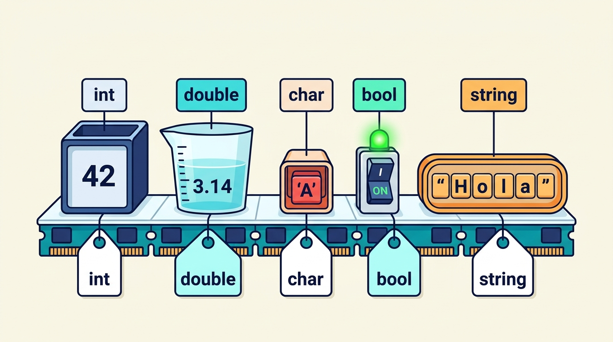

# Módulo 03: Tipos de Datos, Memoria RAM y Operadores (3.0 horas)

> **Ubicación en el curso:** Bloque 2 — Fundamentos de C++ y Manipulación de Datos  
> **Duración estimada:** 3.0 horas (1.5 h teoría guiada + 1.5 h laboratorio y taller práctico)  
> **Prerrequisitos:** Módulo 00 (Lógica y EPS), Módulo 01 (DFD), Módulo 02 (PSeInt y primer programa en C++)  
> **Archivos de práctica del módulo:** `pseint/p01_*.psc`..`p07_*.psc` y `cpp/p01_*.cpp`..`p07_*.cpp`

---

## Objetivos de Aprendizaje

Al terminar este módulo serás capaz de:
1. Visualizar una variable como una **caja etiquetada en la memoria RAM** con nombre, tipo y capacidad fija.
2. Elegir correctamente entre `int`, `float`, `double`, `char`, `bool` y `string` (y su equivalente en PSeInt).
3. Leer textos con espacios usando `getline(cin, ...)` sin caer en el error clásico del salto de línea fantasma (`cin.ignore()`).
4. Declarar constantes con `const` para evitar "números mágicos" en parciales.
5. Dominar la diferencia mortal entre **división entera** (`5 / 2 == 2`) y **división real** (`5.0 / 2 == 2.5`), así como el uso del operador módulo (`%` / `MOD`).
6. Traducir fórmulas matemáticas complejas a expresiones lineales respetando la precedencia y aplicando conversión de tipos (*casting*).

---

## 1. La Memoria RAM "Explicada Para Tontos" (Con Plastilina)

Imagina que la memoria **RAM** de tu computador es un **enorme edificio lleno de casilleros metálicos** (como los de un gimnasio o universidad). Cuando tu programa empieza a correr en C++, el sistema operativo te presta algunos casilleros para guardar información mientras el programa está vivo.

Si no pones orden en esos casilleros, nadie sabría qué hay dentro ni de qué tamaño es. Por eso, cuando declaras una **variable**, ocurren tres cosas al mismo tiempo:

1. **Pides un casillero del tamaño exacto (Tipo de dato):** No necesitas la misma caja para guardar un número de 1 cifra que para guardar una frase larga o un número con 15 decimales.
2. **Le pegas una etiqueta con un nombre (Identificador):** En lugar de recordar la dirección física del casillero (como `0x7ffee4b2`), tú lo llamas `edad`, `precio` o `promedio`.
3. **Metes un valor inicial (Inicialización):** **Regla de oro del monitor:** Si pides un casillero nuevo en C++ y *no* metes nada dentro (`int x;`), el casillero puede contener **"basura"** que dejó el programa anterior. ¡Por eso siempre inicializamos (`int x = 0;`)!

```
+-------------------------------------------------------------------+
|                        MEMORIA RAM (Casilleros)                   |
+--------------------+---------------------+------------------------+
| Etiqueta: edad     | Etiqueta: precio    | Etiqueta: aprobado     |
| Tipo: int (4 B)    | Tipo: double (8 B)  | Tipo: bool (1 B)       |
| Valor:  [ 19 ]     | Valor: [ 12500.50 ] | Valor:  [ true (1) ]   |
+--------------------+---------------------+------------------------+
```



> **Consejo de Monitoría:** Nunca confundas el **nombre** de la variable (`edad`) con su **valor** (`19`). `cout << "edad";` imprime literalmente la palabra `edad`. En cambio, `cout << edad;` abre el casillero `edad` y muestra `19`.

---

## 2. Tipos de Datos Fundamentales (PSeInt vs C++)


| Tipo en C++ | Tipo en PSeInt | ¿Qué guarda? (Con plastilina) | Tamaño aprox. | Ejemplo válido | Error clásico de parcial |
| :--- | :--- | :--- | :---: | :--- | :--- |
| `int` | `Entero` | Números enteros (positivos, negativos, cero), **sin decimales**. | 4 bytes | `int hijos = 2;` | Guardar `3.8` en un `int` (se corta el `.8` y queda `3`). |
| `float` | `Real` | Decimales de precisión sencilla (~6-7 cifras significativas). | 4 bytes | `float temp = 36.5f;` | Perder precisión en cálculos financieros o científicos largos. |
| `double` | `Real` | **El favorito del curso.** Decimales de doble precisión (~15 cifras). | 8 bytes | `double nota = 4.25;` | Escribir coma decimal `4,25` en lugar de punto `4.25`. |
| `char` | `Caracter` | **Un único carácter** (letra, dígito o símbolo) entre **comillas simples**. | 1 byte | `char grupo = 'A';` | Usar comillas dobles `"A"` (eso es texto/cadena, no `char`). |
| `bool` | `Logico` | Solo dos estados posibles: verdadero (`true`/`1`) o falso (`false`/`0`). | 1 byte | `bool activo = true;` | Imprimirlo esperando `"true"` sin usar `boolalpha` (imprime `1`). |
| `string` | `Cadena` | Texto de 0, 1 o muchos caracteres entre **comillas dobles**. Requiere `#include <string>`. | Variable | `string nombre = "Ana";` | Intentar leer nombres con espacios usando solo `cin >> nombre;`. |

### Notas rápidas sobre `char` y `bool`:
- **`char` usa comillas simples `'A'`:** Internamente guarda el código numérico ASCII (`'A'` vale `65`, `'0'` vale `48`). Nunca metas dos letras en un `char` como `'AB'`.
- **`bool` guarda verdad o falsedad:** En C++, `true` equivale internamente a `1` y `false` a `0`. Si quieres que `cout` imprima las palabras `true` o `false` en vez de `1` o `0`, escribe `cout << boolalpha << variable;`.

---

## 3. `cin >>` vs `getline()` y la Trampa del `cin.ignore()`

Este es **el error #1** en los talleres cuando se mezcla lectura de números y nombres completos.

### ¿Qué hace `cin >> nombre;`?
El operador `>>` lee **hasta encontrar el primer espacio, tabulación o Enter**. Si el usuario escribe `Laura Sofia Perez`, `cin >> nombre` solo guarda `"Laura"` y deja `"Sofia Perez"` tirado en la fila del teclado para el siguiente `cin`.

### ¿Cómo leemos una línea completa con espacios?
Usamos `getline(cin, nombreCompleto);` (incluyendo `#include <string>`).

### ¡CUIDADO! La trampa del fantasma `\n` en el buffer
Cuando haces primero una lectura con `cin >>` (por ejemplo `cin >> codigo;`) y el usuario escribe `2026` y presiona **Enter**, ocurren dos cosas:
1. `cin >> codigo` toma el `2026` y lo guarda.
2. El **Enter** (`'\n'`) se queda esperando en el teclado (buffer de entrada).
3. Cuando inmediatamente llamas a `getline(cin, nombreCompleto);`, `getline` ve ese `'\n'` sobrante, cree que el usuario ya presionó Enter con el texto vacío y **se salta la pregunta sin dejarte escribir nada**.

### La solución definitiva: `cin.ignore()`
Justo antes de pasar de `cin >>` a `getline()`, limpiamos ese Enter sobrante:

```cpp
int codigo = 0;
string nombreCompleto;

cout << "Codigo: ";
cin >> codigo;
cin.ignore(); // <-- Limpia el '\n' atrapado tras presionar Enter!

cout << "Nombre completo: ";
getline(cin, nombreCompleto);
```

> **Regla fácil de recordar:** Si justo antes de `getline(cin, ...)` hubo cualquier `cin >> ...`, coloca `cin.ignore();` en medio. Si el programa *empieza* directamente con `getline`, no necesitas `cin.ignore()`.

---

## 4. Constantes (`const`) — Prohibido los "Números Mágicos"

Una **constante** es una caja que se sella con candado al nacer: recibe su valor una vez y **nadie puede cambiarlo durante la ejecución**.

- **En C++:** `const double TASA_IVA = 0.19;` (por convención se escribe en `MAYUSCULAS_CON_GUION_BAJO`).
- **En PSeInt:** PSeInt no tiene palabra clave `Constante` en todos sus perfiles, así que definimos la variable con nombre en `MAYUSCULAS` y le asignamos su valor al inicio sin volver a modificarlo.

**¿Por qué usar `const`?**
1. Si intentas modificarla por error (`TASA_IVA = 0.20;`), el compilador te protege dando error de compilación.
2. Si mañana el IVA cambia del 19% al 21%, solo cambias una línea arriba del todo, en lugar de buscar `0.19` en 15 fórmulas distintas.

---

## 5. Operadores Aritméticos y Asignación Compuesta

### Operadores básicos
| Operación | Símbolo C++ | Símbolo PSeInt | Ejemplo | Resultado |
| :--- | :---: | :---: | :--- | :--- |
| Suma | `+` | `+` | `7 + 3` | `10` |
| Resta | `-` | `-` | `7 - 3` | `4` |
| Multiplicación | `*` | `*` | `7 * 3` | `21` |
| División | `/` | `/` | `7 / 2` | **3** en C++ (`int`), **3.5** en PSeInt |
| Módulo (residuo) | `%` | `MOD` | `7 % 2` | `1` (lo que sobra de la división entera) |

### Atajos de asignación compuesta (C++)
Cuando quieres actualizar la misma variable, C++ te da atajos limpios:
- `puntos += 5;` equivale a `puntos = puntos + 5;`
- `resto %= 10000;` equivale a `resto = resto % 10000;`
- `precio *= 1.19;` equivale a `precio = precio * 1.19;`
- `contador++;` suma `1` a `contador` (`contador = contador + 1;`).
- `vidas--;` resta `1` a `vidas` (`vidas = vidas - 1;`).

---

## 6. División Entera vs División Real (¡Trampa de Parcial #1!)

En matemáticas humanas, `5 / 2` siempre es `2.5`. **En C++, NO siempre.**

C++ decide el tipo de división mirando los **dos operandos**:
- **Entero / Entero = Entero (trunca/corta los decimales, NO redondea):**
  - `5 / 2` da `2` (el `.5` desaparece).
  - `1 / 2` da `0` (¡mortal en fórmulas como `1/2 * m * v * v`!).
  - `9 / 5` da `1` (¡mortal al convertir Celsius a Fahrenheit: `(9/5) * C + 32`!).
- **Si al menos uno es real (`double`/`float`), el resultado es Real:**
  - `5.0 / 2` da `2.5`
  - `5 / 2.0` da `2.5`
  - `5.0 / 2.0` da `2.5`

### Diferencia clave con PSeInt
En **PSeInt**, el operador `/` **siempre produce un número Real** (`5 / 2` da `2.5`). Por eso, cuando en PSeInt queremos división entera (como en el problema de los billetes o las horas), debemos usar la función `trunc(5 / 2)`, que devuelve `2`.

---

## 7. El Superpoder del Operador Módulo (`%` / `MOD`)

Cuando divides `17` entre `5` a mano en primaria:
- Cociente entero (`17 / 5`) = `3`
- Residuo (`17 % 5`) = `2` (porque `5 * 3 = 15`, y para llegar a `17` sobran `2`).

**¿Para qué sirve `%` en programación?**
1. **Saber si un número es par o impar:** `n % 2 == 0` significa que es par.
2. **Saber si es múltiplo de `k`:** `n % k == 0` significa que `n` es divisible exacto por `k`.
3. **Descomponer dinero o tiempo:** Si tengo `135` segundos, `135 / 60 = 2` minutos y `135 % 60 = 15` segundos sueltos.
4. **Extraer el último dígito de cualquier entero:** `4829 % 10` da `9`. Y `4829 / 10` quita el último dígito dejando `482`.

> **Regla inquebrantable de `%`:** En C++, el operador `%` **SOLO funciona entre números enteros** (`int`, `long`). Si escribes `5.5 % 2`, el compilador rechazará tu programa con error.

---

## 8. Precedencia de Operadores y Fórmulas Matemáticas

Cuando hay varias operaciones en una línea, C++ no las hace ciegamente de izquierda a derecha; sigue la jerarquía matemática:

1. **Paréntesis `(...)`** (siempre de adentro hacia afuera).
2. **Signo unario (`+`, `-`)** y **`static_cast`**.
3. **Multiplicación `*`, División `/` y Módulo `%`** (mismo nivel; se resuelven de izquierda a derecha).
4. **Suma `+` y Resta `-`** (mismo nivel; de izquierda a derecha).
5. **Asignación `=`, `+=`, `-=`, etc.** (al final, de derecha a izquierda).

### Ejemplo mortal de traducción matemática
Fórmula matemática: $x = \frac{a + b}{c + d}$
- **MAL:** `x = a + b / c + d;` $\rightarrow$ C++ divide primero `b / c`, luego suma `a` y `d`.
- **BIEN:** `x = (a + b) / (c + d);` $\rightarrow$ Los paréntesis obligan a sumar primero numerador y denominador.

> **Consejo de Monitoría:** Ante la menor duda sobre quién tiene prioridad, **pon paréntesis**. No cuestan nada, hacen tu código legible y evitan errores silenciosos en parciales.

---

## 9. Conversión de Tipos (*Casting* Básico)

A veces tienes datos guardados en variables `int` (como `sumaNotas` o `totalEstudiantes`) y necesitas dividirlos obteniendo decimales.

- **Conversión implícita (automática):** Cuando mezclas `int` con `double` (`int a = 5; double r = a / 2.0;`), C++ asciende temporalmente a `a` a `double` para no perder precisión. En cambio, si guardas un `double` en un `int` (`int x = 4.99;`), C++ **trunca** y guarda `4`.
- **Conversión explícita (*casting* moderno con `static_cast`):** Es la forma limpia y recomendada cuando ambos operandos son variables `int`:

```cpp
int suma = 17;
int cantidad = 4;

double mal = suma / cantidad;                         // Da 4.0 (dividió enteros primero!)
double bien = static_cast<double>(suma) / cantidad;   // Da 4.25 (convierte suma a double antes de dividir)
```

> **OJO:** Si escribes `static_cast<double>(suma / cantidad)`, ¡vuelves a cometer el error! Porque primero hace `17 / 4 = 4` dentro del paréntesis y luego lo vuelve `4.0`. El *casting* debe ir sobre **uno de los operandos** antes de dividir.

---

## 10. Siete Problemas Resueltos Paso a Paso

---

### Problema Resuelto 1: Desglose de Billetes en Cajero Automático

**Enunciado:** Un cajero automático debe entregar una cantidad entera de dinero en pesos utilizando la menor cantidad posible de billetes de `$50.000`, `$20.000`, `$10.000`, `$5.000`, `$2.000` y `$1.000`. Si sobra dinero menor a `$1.000`, debe mostrar cuánto queda en monedas.

#### Análisis EPS
- **Entradas:** `monto` (`int`, cantidad entera solicitada).
- **Proceso:** Tomar `resto = monto`. Para cada denominación de mayor a menor: dividir entero para saber cuántos billetes salen y actualizar `resto` con `%` para saber cuánto dinero sigue pendiente por entregar.
- **Salidas:** Cantidad de billetes de cada denominación (`b50`, `b20`, `b10`, `b5`, `b2`, `b1`) y `sobrante`.

#### Código PSeInt (`pseint/p01_desglose_billetes.psc`)
```pseint
Algoritmo DesgloseBilletes
    Definir monto, resto Como Entero;
    Definir b50, b20, b10, b5, b2, b1, sobrante Como Entero;

    Escribir "Ingrese el monto entero en pesos (ej. 188500): ";
    Leer monto;

    resto <- monto;
    b50 <- trunc(resto / 50000);
    resto <- resto MOD 50000;

    b20 <- trunc(resto / 20000);
    resto <- resto MOD 20000;

    b10 <- trunc(resto / 10000);
    resto <- resto MOD 10000;

    b5 <- trunc(resto / 5000);
    resto <- resto MOD 5000;

    b2 <- trunc(resto / 2000);
    resto <- resto MOD 2000;

    b1 <- trunc(resto / 1000);
    sobrante <- resto MOD 1000;

    Escribir "Billetes de $50.000 : ", b50;
    Escribir "Billetes de $20.000 : ", b20;
    Escribir "Billetes de $10.000 : ", b10;
    Escribir "Billetes de $5.000  : ", b5;
    Escribir "Billetes de $2.000  : ", b2;
    Escribir "Billetes de $1.000  : ", b1;
    Escribir "Sobrante en monedas : $", sobrante;
FinAlgoritmo
```

#### Código C++ (`cpp/p01_desglose_billetes.cpp`)
```cpp
#include <iostream>
using namespace std;

int main() {
    int monto = 0;
    int resto = 0;

    cout << "=== CAJERO AUTOMATICO: DESGLOSE DE BILLETES ===" << endl;
    cout << "Ingrese el monto entero en pesos (ej. 188500): ";
    cin >> monto;

    resto = monto;

    int b50 = resto / 50000;
    resto %= 50000;

    int b20 = resto / 20000;
    resto %= 20000;

    int b10 = resto / 10000;
    resto %= 10000;

    int b5 = resto / 5000;
    resto %= 5000;

    int b2 = resto / 2000;
    resto %= 2000;

    int b1 = resto / 1000;
    int sobrante = resto % 1000;

    cout << "\n--- Desglose optimo para $" << monto << " ---" << endl;
    cout << "Billetes de $50.000 : " << b50 << endl;
    cout << "Billetes de $20.000 : " << b20 << endl;
    cout << "Billetes de $10.000 : " << b10 << endl;
    cout << "Billetes de $5.000  : " << b5 << endl;
    cout << "Billetes de $2.000  : " << b2 << endl;
    cout << "Billetes de $1.000  : " << b1 << endl;
    cout << "Sobrante en monedas : $" << sobrante << endl;

    return 0;
}
```

#### Prueba de Escritorio (`monto = 188500`)
| Paso | Operación | Billete calculado | Valor `resto` después |
| :---: | :--- | :--- | ---: |
| 1 | Inicio (`resto = monto`) | — | `188500` |
| 2 | `188500 / 50000` y `% 50000` | `b50 = 3` | `38500` |
| 3 | `38500 / 20000` y `% 20000` | `b20 = 1` | `18500` |
| 4 | `18500 / 10000` y `% 10000` | `b10 = 1` | `8500` |
| 5 | `8500 / 5000` y `% 5000` | `b5 = 1` | `3500` |
| 6 | `3500 / 2000` y `% 2000` | `b2 = 1` | `1500` |
| 7 | `1500 / 1000` y `% 1000` | `b1 = 1` | `sobrante = 500` |

---

### Problema Resuelto 2: Conversión de Segundos a Horas, Minutos y Segundos

**Enunciado:** Dado un tiempo total medido en segundos enteros (por ejemplo `3725`), conviértelo a su formato equivalente en horas, minutos y segundos.

#### Análisis EPS
- **Entradas:** `totalSegundos` (`int`).
- **Proceso:** Usar constantes `SEG_POR_HORA = 3600` y `SEG_POR_MIN = 60`. Calcular `horas = totalSegundos / 3600`, guardar el residuo `resto = totalSegundos % 3600`, luego `minutos = resto / 60` y finalmente `segundos = resto % 60`.
- **Salidas:** `horas`, `minutos`, `segundos`.

#### Código PSeInt (`pseint/p02_conversion_tiempo.psc`)
```pseint
Algoritmo ConversionTiempo
    Definir totalSegundos, horas, resto, minutos, segundos Como Entero;
    Definir SEG_POR_HORA, SEG_POR_MIN Como Entero;

    SEG_POR_HORA <- 3600;
    SEG_POR_MIN <- 60;

    Escribir "Ingrese la cantidad total de segundos (ej. 3725): ";
    Leer totalSegundos;

    horas <- trunc(totalSegundos / SEG_POR_HORA);
    resto <- totalSegundos MOD SEG_POR_HORA;
    minutos <- trunc(resto / SEG_POR_MIN);
    segundos <- resto MOD SEG_POR_MIN;

    Escribir totalSegundos, " segundos equivalen a:";
    Escribir horas, " hora(s), ", minutos, " minuto(s) y ", segundos, " segundo(s).";
FinAlgoritmo
```

#### Código C++ (`cpp/p02_conversion_tiempo.cpp`)
```cpp
#include <iostream>
using namespace std;

int main() {
    const int SEG_POR_HORA = 3600;
    const int SEG_POR_MIN = 60;

    int totalSegundos = 0;
    cout << "=== CONVERSOR DE TIEMPO (SEGUNDOS A HH:MM:SS) ===" << endl;
    cout << "Ingrese la cantidad total de segundos (ej. 3725): ";
    cin >> totalSegundos;

    int horas = totalSegundos / SEG_POR_HORA;
    int resto = totalSegundos % SEG_POR_HORA;
    int minutos = resto / SEG_POR_MIN;
    int segundos = resto % SEG_POR_MIN;

    cout << "\n" << totalSegundos << " segundos equivalen a: "
         << horas << " hora(s), "
         << minutos << " minuto(s) y "
         << segundos << " segundo(s)." << endl;

    return 0;
}
```

#### Prueba de Escritorio (`totalSegundos = 3725`)
| Variable | Expresión | Resultado |
| :--- | :--- | ---: |
| `totalSegundos` | Leído del teclado | `3725` |
| `horas` | `3725 / 3600` | `1` |
| `resto` | `3725 % 3600` | `125` |
| `minutos` | `125 / 60` | `2` |
| `segundos` | `125 % 60` | `5` |
| **Salida:** | `1 hora(s), 2 minuto(s) y 5 segundo(s).` | Verificado (`3600 + 120 + 5 = 3725`) |

---

### Problema Resuelto 3: Promedio Ponderado con Nombre Completo (`getline` + `cin.ignore`)

**Enunciado:** Un sistema universitario pide el código numérico del estudiante (`int`), su nombre completo con apellidos (`string`), y las notas de los tres cortes (`double`): Corte 1 (30%), Corte 2 (30%) y Corte 3 (40%). Muestra el boletín con dos decimales.

#### Análisis EPS
- **Entradas:** `codigo` (`int`), `nombreCompleto` (`string`), `nota1`, `nota2`, `nota3` (`double`).
- **Proceso:** Limpiar el buffer con `cin.ignore()` después de `cin >> codigo` para que `getline(cin, nombreCompleto)` lea el nombre entero. Calcular `definitiva = nota1 * 0.30 + nota2 * 0.30 + nota3 * 0.40`.
- **Salidas:** `codigo`, `nombreCompleto`, `definitiva` (formateada a 2 decimales).

#### Código PSeInt (`pseint/p03_promedio_ponderado.psc`)
```pseint
Algoritmo PromedioPonderado
    Definir codigo Como Entero;
    Definir nombreCompleto Como Cadena;
    Definir nota1, nota2, nota3, definitiva Como Real;
    Definir PESO1, PESO2, PESO3 Como Real;

    PESO1 <- 0.30;
    PESO2 <- 0.30;
    PESO3 <- 0.40;

    Escribir "Ingrese el codigo numerico del estudiante: ";
    Leer codigo;
    Escribir "Ingrese el nombre completo del estudiante: ";
    Leer nombreCompleto;
    Escribir "Ingrese nota Corte 1 (0.0 a 5.0): ";
    Leer nota1;
    Escribir "Ingrese nota Corte 2 (0.0 a 5.0): ";
    Leer nota2;
    Escribir "Ingrese nota Corte 3 (0.0 a 5.0): ";
    Leer nota3;

    definitiva <- (nota1 * PESO1) + (nota2 * PESO2) + (nota3 * PESO3);

    Escribir "Codigo     : ", codigo;
    Escribir "Estudiante : ", nombreCompleto;
    Escribir "Definitiva : ", definitiva;
FinAlgoritmo
```

#### Código C++ (`cpp/p03_promedio_ponderado.cpp`)
```cpp
#include <iostream>
#include <string>
#include <iomanip>
using namespace std;

int main() {
    const double PESO_C1 = 0.30;
    const double PESO_C2 = 0.30;
    const double PESO_C3 = 0.40;

    int codigo = 0;
    string nombreCompleto;
    double nota1 = 0.0, nota2 = 0.0, nota3 = 0.0;

    cout << "=== CALCULO DE NOTA DEFINITIVA (30% + 30% + 40%) ===" << endl;
    cout << "Ingrese el codigo numerico del estudiante: ";
    cin >> codigo;

    // Limpia el '\n' que queda en el buffer tras presionar Enter en cin >> codigo
    cin.ignore();

    cout << "Ingrese el nombre completo del estudiante: ";
    getline(cin, nombreCompleto);

    cout << "Ingrese nota Corte 1 (0.0 a 5.0): ";
    cin >> nota1;
    cout << "Ingrese nota Corte 2 (0.0 a 5.0): ";
    cin >> nota2;
    cout << "Ingrese nota Corte 3 (0.0 a 5.0): ";
    cin >> nota3;

    double definitiva = (nota1 * PESO_C1) + (nota2 * PESO_C2) + (nota3 * PESO_C3);

    cout << "\n--- BOLETIN ACADEMICO ---" << endl;
    cout << "Codigo     : " << codigo << endl;
    cout << "Estudiante : " << nombreCompleto << endl;
    cout << fixed << setprecision(2);
    cout << "Definitiva : " << definitiva << endl;

    return 0;
}
```

#### Prueba de Escritorio (`codigo = 2026101`, `nombre = "Laura Sofia Perez"`, notas `4.2`, `3.8`, `4.5`)
| Paso | Variable | Valor | Nota técnica |
| :---: | :--- | :--- | :--- |
| 1 | `codigo` | `2026101` | Queda `\n` en el buffer |
| 2 | `cin.ignore()` | — | Descarta el `\n` |
| 3 | `nombreCompleto` | `"Laura Sofia Perez"` | `getline` lee espacios sin cortarse |
| 4 | `nota1`, `nota2`, `nota3` | `4.2`, `3.8`, `4.5` | Pesos `0.30`, `0.30`, `0.40` |
| 5 | `definitiva` | `1.26 + 1.14 + 1.80 = 4.20` | Impreso con `setprecision(2)` |

---

### Problema Resuelto 4: Física Básica (MRUV y Energía Cinética)

**Enunciado:** Lee la masa $m$ (kg), velocidad inicial $v_0$ (m/s), aceleración $a$ ($\text{m/s}^2$) y tiempo $t$ (s) de un móvil en movimiento rectilíneo uniformemente variado. Calcula:
1. Distancia recorrida: $d = v_0 t + \frac{1}{2} a t^2$
2. Velocidad final en m/s y en km/h ($v_f = v_0 + a t$, multiplicando por `3.6`)
3. Energía cinética final: $E_c = \frac{1}{2} m v_f^2$

#### Análisis EPS
- **Entradas:** `masa`, `vInicial`, `aceleracion`, `tiempo` (`double`).
- **Proceso:** Aplicar las fórmulas evitando el error mortal `1 / 2` (usar `0.5` o `1.0 / 2.0`). Usar `const double FACTOR_KMH = 3.6;`.
- **Salidas:** `distancia`, `vFinal`, `vFinalKmh`, `energiaCinetica`.

#### Código PSeInt (`pseint/p04_fisica_mru_energia.psc`)
```pseint
Algoritmo FisicaMRUV
    Definir masa, vInicial, aceleracion, tiempo Como Real;
    Definir distancia, vFinal, vFinalKmh, energiaCinetica Como Real;
    Definir FACTOR_KMH Como Real;

    FACTOR_KMH <- 3.6;

    Escribir "Ingrese masa del objeto (kg): ";
    Leer masa;
    Escribir "Ingrese velocidad inicial v0 (m/s): ";
    Leer vInicial;
    Escribir "Ingrese aceleracion constante a (m/s^2): ";
    Leer aceleracion;
    Escribir "Ingrese tiempo transcurrido t (s): ";
    Leer tiempo;

    distancia <- vInicial * tiempo + 0.5 * aceleracion * tiempo * tiempo;
    vFinal <- vInicial + aceleracion * tiempo;
    vFinalKmh <- vFinal * FACTOR_KMH;
    energiaCinetica <- 0.5 * masa * vFinal * vFinal;

    Escribir "Distancia recorrida : ", distancia, " m";
    Escribir "Velocidad final     : ", vFinal, " m/s (", vFinalKmh, " km/h)";
    Escribir "Energia cinetica    : ", energiaCinetica, " Joules";
FinAlgoritmo
```

#### Código C++ (`cpp/p04_fisica_mru_energia.cpp`)
```cpp
#include <iostream>
#include <iomanip>
using namespace std;

int main() {
    const double FACTOR_KMH = 3.6;

    double masa = 0.0, vInicial = 0.0, aceleracion = 0.0, tiempo = 0.0;

    cout << "=== SIMULADOR DE CINEMATICA Y ENERGIA (MRUV) ===" << endl;
    cout << "Ingrese masa del objeto (kg): ";
    cin >> masa;
    cout << "Ingrese velocidad inicial v0 (m/s): ";
    cin >> vInicial;
    cout << "Ingrese aceleracion constante a (m/s^2): ";
    cin >> aceleracion;
    cout << "Ingrese tiempo transcurrido t (s): ";
    cin >> tiempo;

    // OJO: 1/2 en C++ daria 0; por eso usamos 0.5
    double distancia = vInicial * tiempo + 0.5 * aceleracion * tiempo * tiempo;
    double vFinal = vInicial + aceleracion * tiempo;
    double vFinalKmh = vFinal * FACTOR_KMH;
    double energiaCinetica = 0.5 * masa * vFinal * vFinal;

    cout << fixed << setprecision(2);
    cout << "\n--- RESULTADOS FISICOS ---" << endl;
    cout << "Distancia recorrida : " << distancia << " m" << endl;
    cout << "Velocidad final     : " << vFinal << " m/s (" << vFinalKmh << " km/h)" << endl;
    cout << "Energia cinetica    : " << energiaCinetica << " Joules" << endl;

    return 0;
}
```

#### Prueba de Escritorio (`masa = 10`, `vInicial = 5`, `aceleracion = 2`, `tiempo = 4`)
| Variable | Cálculo paso a paso | Valor |
| :--- | :--- | ---: |
| `distancia` | `5 * 4 + 0.5 * 2 * 4 * 4 = 20 + 16` | `36.00` m |
| `vFinal` | `5 + 2 * 4 = 5 + 8` | `13.00` m/s |
| `vFinalKmh` | `13 * 3.6` | `46.80` km/h |
| `energiaCinetica` | `0.5 * 10 * 13 * 13 = 5 * 169` | `845.00` J |

---

### Problema Resuelto 5: Ficha Médica e Índice de Masa Corporal (IMC con Casting)

**Enunciado:** Solicita la inicial del sexo (`char`), si la persona hace deporte (`bool`: `1` o `0`), su peso en kilogramos (`double`) y su estatura en **centímetros enteros** (`int`, ej. `175`). Convierte la estatura a metros sin perder decimales y calcula $\text{IMC} = \frac{\text{peso}}{\text{estatura}^2}$.

#### Análisis EPS
- **Entradas:** `sexo` (`char`), `haceDeporte` (`bool`), `pesoKg` (`double`), `estaturaCm` (`int`).
- **Proceso:** Aplicar *casting* explícito `static_cast<double>(estaturaCm) / 100.0` (si dividieras enteros `175 / 100`, ¡daría `1` metro!), luego `imc = pesoKg / (estaturaM * estaturaM)`.
- **Salidas:** Resumen con `boolalpha`, `estaturaM` y `imc` a 2 decimales.

#### Código PSeInt (`pseint/p05_calculo_imc.psc`)
```pseint
Algoritmo CalculoIMC
    Definir sexo Como Caracter;
    Definir haceDeporte Como Logico;
    Definir estaturaCm Como Entero;
    Definir pesoKg, estaturaM, imc Como Real;

    Escribir "Ingrese inicial del sexo (M / F): ";
    Leer sexo;
    Escribir "Practica deporte regularmente? (Verdadero / Falso): ";
    Leer haceDeporte;
    Escribir "Ingrese peso en kilogramos (ej. 68.5): ";
    Leer pesoKg;
    Escribir "Ingrese estatura en CENTIMETROS enteros (ej. 175): ";
    Leer estaturaCm;

    estaturaM <- estaturaCm / 100;
    imc <- pesoKg / (estaturaM * estaturaM);

    Escribir "Sexo              : ", sexo;
    Escribir "Deportista activo : ", haceDeporte;
    Escribir "Estatura (m)      : ", estaturaM;
    Escribir "IMC calculado     : ", imc;
FinAlgoritmo
```

#### Código C++ (`cpp/p05_calculo_imc.cpp`)
```cpp
#include <iostream>
#include <iomanip>
using namespace std;

int main() {
    char sexo = ' ';
    bool haceDeporte = false;
    double pesoKg = 0.0;
    int estaturaCm = 0;

    cout << "=== FICHA MEDICA Y CALCULO DE IMC ===" << endl;
    cout << "Ingrese inicial del sexo (M / F): ";
    cin >> sexo;
    cout << "Practica deporte regularmente? (1 = Si, 0 = No): ";
    cin >> haceDeporte;
    cout << "Ingrese peso en kilogramos (ej. 68.5): ";
    cin >> pesoKg;
    cout << "Ingrese estatura en CENTIMETROS enteros (ej. 175): ";
    cin >> estaturaCm;

    double estaturaM = static_cast<double>(estaturaCm) / 100.0;
    double imc = pesoKg / (estaturaM * estaturaM);

    cout << fixed << setprecision(2);
    cout << "\n--- RESUMEN DE SALUD ---" << endl;
    cout << "Sexo              : " << sexo << endl;
    cout << "Deportista activo : " << boolalpha << haceDeporte << endl;
    cout << "Estatura (m)      : " << estaturaM << " m" << endl;
    cout << "IMC calculado     : " << imc << endl;

    return 0;
}
```

#### Prueba de Escritorio (`sexo = 'M'`, `haceDeporte = 1`, `pesoKg = 68.5`, `estaturaCm = 175`)
| Variable | Cálculo | Valor |
| :--- | :--- | :--- |
| `sexo` | `'M'` | `'M'` |
| `haceDeporte` | `1` (`true`) | Impreso como `true` por `boolalpha` |
| `estaturaM` | `static_cast<double>(175) / 100.0` | `1.75` m |
| `imc` | `68.5 / (1.75 * 1.75) = 68.5 / 3.0625` | `22.37` |

---

### Problema Resuelto 6: Factura Comercial con Descuento e IVA

**Enunciado:** Una tienda pide la letra de categoría (`char`), el nombre del producto (puede tener varias palabras), el precio unitario sin IVA, la cantidad comprada (`int`) y el porcentaje de descuento (ej. `10` para 10%). Aplica el descuento al subtotal para hallar la base gravable, calcula el IVA del 19% (`const double TASA_IVA = 0.19;`) sobre esa base y muestra la tirilla completa.

#### Análisis EPS
- **Entradas:** `categoria` (`char`), `producto` (`string`), `precioUnitario` (`double`), `cantidad` (`int`), `porcDescuento` (`double`).
- **Proceso:** `cin.ignore()` después de leer `categoria`. Luego: `subtotal = precioUnitario * cantidad`, `descuento = subtotal * (porcDescuento / 100.0)`, `baseGravable = subtotal - descuento`, `valorIva = baseGravable * TASA_IVA`, `totalPagar = baseGravable + valorIva`.
- **Salidas:** `categoria`, `producto`, `subtotal`, `descuento`, `baseGravable`, `valorIva`, `totalPagar`.

#### Código PSeInt (`pseint/p06_factura_iva.psc`)
```pseint
Algoritmo FacturaIVA
    Definir categoria Como Caracter;
    Definir producto Como Cadena;
    Definir cantidad Como Entero;
    Definir precioUnitario, porcDescuento Como Real;
    Definir subtotal, descuento, baseGravable, valorIva, totalPagar Como Real;
    Definir TASA_IVA Como Real;

    TASA_IVA <- 0.19;

    Escribir "Ingrese letra de categoria (A/B/C): ";
    Leer categoria;
    Escribir "Ingrese nombre del producto: ";
    Leer producto;
    Escribir "Ingrese precio unitario sin IVA: ";
    Leer precioUnitario;
    Escribir "Ingrese cantidad comprada: ";
    Leer cantidad;
    Escribir "Ingrese porcentaje de descuento (ej. 10 para 10%): ";
    Leer porcDescuento;

    subtotal <- precioUnitario * cantidad;
    descuento <- subtotal * (porcDescuento / 100);
    baseGravable <- subtotal - descuento;
    valorIva <- baseGravable * TASA_IVA;
    totalPagar <- baseGravable + valorIva;

    Escribir "Categoria     : ", categoria;
    Escribir "Producto      : ", producto;
    Escribir "Subtotal      : $", subtotal;
    Escribir "Descuento     : -$", descuento;
    Escribir "Base gravable : $", baseGravable;
    Escribir "IVA (19%)     : +$", valorIva;
    Escribir "TOTAL A PAGAR : $", totalPagar;
FinAlgoritmo
```

#### Código C++ (`cpp/p06_factura_iva.cpp`)
```cpp
#include <iostream>
#include <string>
#include <iomanip>
using namespace std;

int main() {
    const double TASA_IVA = 0.19;

    char categoria = ' ';
    string producto;
    double precioUnitario = 0.0;
    int cantidad = 0;
    double porcDescuento = 0.0;

    cout << "=== FACTURACION TIENDA UNIVERSITARIA ===" << endl;
    cout << "Ingrese letra de categoria (A/B/C): ";
    cin >> categoria;
    cin.ignore(); // Limpia el '\n' antes de usar getline

    cout << "Ingrese nombre del producto: ";
    getline(cin, producto);

    cout << "Ingrese precio unitario sin IVA: ";
    cin >> precioUnitario;
    cout << "Ingrese cantidad comprada: ";
    cin >> cantidad;
    cout << "Ingrese porcentaje de descuento (ej. 10 para 10%): ";
    cin >> porcDescuento;

    double subtotal = precioUnitario * cantidad;
    double descuento = subtotal * (porcDescuento / 100.0);
    double baseGravable = subtotal - descuento;
    double valorIva = baseGravable * TASA_IVA;
    double totalPagar = baseGravable + valorIva;

    cout << fixed << setprecision(2);
    cout << "\n=== TIRILLA DE PAGO ===" << endl;
    cout << "Categoria     : " << categoria << endl;
    cout << "Producto      : " << producto << endl;
    cout << "Subtotal      : $" << subtotal << endl;
    cout << "Descuento     : -$" << descuento << endl;
    cout << "Base gravable : $" << baseGravable << endl;
    cout << "IVA (19%)     : +$" << valorIva << endl;
    cout << "TOTAL A PAGAR : $" << totalPagar << endl;

    return 0;
}
```

#### Prueba de Escritorio (`categoria = 'A'`, `producto = "Cuaderno Profesional"`, `precio = 12000`, `cantidad = 3`, `porcDescuento = 10`)
| Variable | Cálculo | Valor |
| :--- | :--- | ---: |
| `subtotal` | `12000 * 3` | `$36000.00` |
| `descuento` | `36000 * (10 / 100.0)` | `$3600.00` |
| `baseGravable` | `36000 - 3600` | `$32400.00` |
| `valorIva` | `32400 * 0.19` | `$6156.00` |
| `totalPagar` | `32400 + 6156` | `$38556.00` |

---

### Problema Resuelto 7: Extracción e Inversión de Dígitos (Número de 4 Cifras)

**Enunciado:** Dado un número entero positivo de exactamente 4 cifras (ej. `4829`), extrae cada uno de sus dígitos por separado, muestra la suma de sus dígitos y construye el número invertido (`9284`).

#### Análisis EPS
- **Entradas:** `numero` (`int` de 4 cifras).
- **Proceso:**
  - `dMiles = numero / 1000`
  - `dCentenas = (numero / 100) % 10`
  - `dDecenas = (numero / 10) % 10`
  - `dUnidades = numero % 10`
  - `sumaDigitos = dMiles + dCentenas + dDecenas + dUnidades`
  - `invertido = dUnidades * 1000 + dDecenas * 100 + dCentenas * 10 + dMiles`
- **Salidas:** Los 4 dígitos, `sumaDigitos` e `invertido`.

#### Código PSeInt (`pseint/p07_digitos_numero.psc`)
```pseint
Algoritmo DigitosNumero
    Definir numero, dMiles, dCentenas, dDecenas, dUnidades Como Entero;
    Definir sumaDigitos, invertido Como Entero;

    Escribir "Ingrese un entero positivo de 4 cifras (ej. 4829): ";
    Leer numero;

    dMiles <- trunc(numero / 1000);
    dCentenas <- trunc(numero / 100) MOD 10;
    dDecenas <- trunc(numero / 10) MOD 10;
    dUnidades <- numero MOD 10;

    sumaDigitos <- dMiles + dCentenas + dDecenas + dUnidades;
    invertido <- dUnidades * 1000 + dDecenas * 100 + dCentenas * 10 + dMiles;

    Escribir "Unidades de mil : ", dMiles;
    Escribir "Centenas        : ", dCentenas;
    Escribir "Decenas         : ", dDecenas;
    Escribir "Unidades        : ", dUnidades;
    Escribir "Suma de digitos : ", sumaDigitos;
    Escribir "Numero invertido: ", invertido;
FinAlgoritmo
```

#### Código C++ (`cpp/p07_digitos_numero.cpp`)
```cpp
#include <iostream>
using namespace std;

int main() {
    int numero = 0;

    cout << "=== DESCOMPOSICION DE UN NUMERO DE 4 CIFRAS ===" << endl;
    cout << "Ingrese un entero positivo de 4 cifras (ej. 4829): ";
    cin >> numero;

    int dMiles = numero / 1000;
    int dCentenas = (numero / 100) % 10;
    int dDecenas = (numero / 10) % 10;
    int dUnidades = numero % 10;

    int sumaDigitos = dMiles + dCentenas + dDecenas + dUnidades;
    int invertido = dUnidades * 1000 + dDecenas * 100 + dCentenas * 10 + dMiles;

    cout << "\n--- ANALISIS POSICIONAL ---" << endl;
    cout << "Unidades de mil : " << dMiles << endl;
    cout << "Centenas        : " << dCentenas << endl;
    cout << "Decenas         : " << dDecenas << endl;
    cout << "Unidades        : " << dUnidades << endl;
    cout << "Suma de digitos : " << sumaDigitos << endl;
    cout << "Numero invertido: " << invertido << endl;

    return 0;
}
```

#### Prueba de Escritorio (`numero = 4829`)
| Variable | Paso intermedio | Resultado |
| :--- | :--- | ---: |
| `dMiles` | `4829 / 1000` | `4` |
| `dCentenas` | `(4829 / 100) % 10 = 48 % 10` | `8` |
| `dDecenas` | `(4829 / 10) % 10 = 482 % 10` | `2` |
| `dUnidades` | `4829 % 10` | `9` |
| `sumaDigitos` | `4 + 8 + 2 + 9` | `23` |
| `invertido` | `9*1000 + 2*100 + 8*10 + 4` | `9284` |

---

## 11. Doce Ejercicios Propuestos (Taller de Práctica)

Resuelve primero cada ejercicio en papel (EPS + prueba de escritorio) y luego impleméntalo en PSeInt y C++. Todos deben resolverse de forma **puramente secuencial** (sin `if` ni ciclos todavía).

1. **Conversor Térmico:** Lee una temperatura en grados Celsius (`double`) y muéstrala convertida a Fahrenheit ($F = \frac{9}{5}C + 32$) y Kelvin ($K = C + 273.15$).  
   *Pista del Monitor:* ¡Cuidado con `9 / 5` en C++! Usa `9.0 / 5.0` y define `const double CERO_KELVIN = 273.15;`.
2. **Reparto de Dulces:** Se tienen `D` dulces enteros para repartir equitativamente entre `N` niños (`int`). Muestra cuántos dulces recibe cada niño y cuántos sobran en la bolsa.  
   *Pista del Monitor:* Usa división entera `/` para los que recibe cada uno y `%` para los sobrantes.
3. **Colilla de Nómina:** Lee el documento (`int`), el nombre completo del empleado (`string`), su salario base (`double`) y horas extras diurnas (`int`, pagadas a `$12500` constantes). Descuenta 4% de salud y 4% de pensión sobre el total devengado.  
   *Pista del Monitor:* No olvides `cin.ignore()` después de leer el documento antes de usar `getline`.
4. **Área de un Trapecio:** Lee base mayor `B`, base menor `b` y altura `h` como `double` y calcula el área $A = \frac{(B + b) \cdot h}{2}$.  
   *Pista del Monitor:* Si olvidas los paréntesis en `(B + b)`, C++ multiplicará primero `b * h`.
5. **Calendario Simplificado:** Dado un número entero de días (ej. `800`), calcula a cuántos años completos (de 365 días), semanas completas (de 7 días) y días sueltos equivale.  
   *Pista del Monitor:* Es el mismo patrón encadenado del problema de los segundos: primero `/ 365` y `% 365`, luego `/ 7` y `% 7`.
6. **Intercambio de Casilleros (Swap):** Lee dos enteros `a` y `b`, muéstralos antes del intercambio, intercambia sus contenidos usando una tercera variable auxiliar `aux` y muéstralos después. *Reto extra:* haz el intercambio sin variable auxiliar usando sumas y restas.  
   *Pista del Monitor:* Si haces `a = b;` antes de guardar `a` en `aux`, ¡pierdes el valor original de `a` para siempre!
7. **Predicción de Precedencia (En Papel y Comprobación en C++):** Dados `int x = 7, y = 2;` y `double z = 3.0;`, predice el valor exacto de:  
   a) `x / y + z`  
   b) `static_cast<double>(x) / y`  
   c) `x % y * 4 + 1`  
   d) `(x + y) / 2`  
   *Pista del Monitor:* Revisa qué operadores tienen ambos lados `int` antes de hacer la operación.
8. **Distancia entre Dos Puntos:** Lee las coordenadas `(x1, y1)` y `(x2, y2)` como `double` y calcula la distancia euclidiana $d = \sqrt{(x_2 - x_1)^2 + (y_2 - y_1)^2}$.  
   *Pista del Monitor:* Incluye `#include <cmath>` para usar `sqrt(...)` y puedes escribir `(x2 - x1) * (x2 - x1)` o `pow(x2 - x1, 2)`.
9. **Cuenta de Restaurante entre Amigos:** Lee el valor total de la cuenta (`double`), el porcentaje de propina voluntaria (`double`, ej. `10`) y la cantidad de amigos (`int`). Muestra el total con propina y cuánto paga cada amigo.  
   *Pista del Monitor:* Aunque `totalConPropina` ya es `double`, practica haciendo explícito `static_cast<double>(amigos)` si quisieras calcular promedios con variables enteras.
10. **Ficha de Paciente Veterinario:** Lee la edad del perro en años (`int`), su nombre completo (`string`), inicial del tamaño (`char`: `P`/`M`/`G`), si tiene vacunas al día (`bool`: `1` o `0`) y su peso en kg (`double`). Imprime toda la ficha formateada con `boolalpha` y 1 decimal.  
    *Pista del Monitor:* ¡Atento al `cin.ignore()` justo entre la edad y el nombre!
11. **Inversión de Extremos en 3 Cifras:** Dado un entero positivo de 3 cifras (ej. `378`), intercambia únicamente la cifra de las centenas con la de las unidades (resultado `873`) y calcula el producto de sus 3 dígitos.  
    *Pista del Monitor:* Extrae `c = n / 100`, `d = (n / 10) % 10`, `u = n % 10`, y arma `u * 100 + d * 10 + c`.
12. **Costo de Viaje por Kilómetro:** Lee la distancia del viaje en kilómetros (`double`), los galones de gasolina consumidos (`double`) y define una constante `PRECIO_GALON = 15800.0`. Calcula el rendimiento (km/galón), el costo total de gasolina y el costo por cada kilómetro recorrido.  
    *Pista del Monitor:* El costo por kilómetro es `costoTotal / distancia`.

---

## 12. Solucionario Completo Paso a Paso de los 12 Ejercicios

### Solución Ejercicio 1: Conversor Térmico
- **Análisis EPS:** Entrada: `celsius` (`double`). Constantes: `OFFSET_KELVIN = 273.15`. Proceso: `fahrenheit = (9.0 / 5.0) * celsius + 32.0`, `kelvin = celsius + OFFSET_KELVIN`. Salida: `fahrenheit`, `kelvin`.
```cpp
#include <iostream>
#include <iomanip>
using namespace std;
int main() {
    const double OFFSET_KELVIN = 273.15;
    double celsius = 0.0;
    cout << "Temperatura en Celsius: ";
    cin >> celsius;
    double fahrenheit = (9.0 / 5.0) * celsius + 32.0;
    double kelvin = celsius + OFFSET_KELVIN;
    cout << fixed << setprecision(2);
    cout << "Fahrenheit: " << fahrenheit << " F" << endl;
    cout << "Kelvin    : " << kelvin << " K" << endl;
    return 0;
}
```
- **Prueba de escritorio (`celsius = 25.0`):** `(9.0 / 5.0) * 25.0 + 32.0 = 1.8 * 25.0 + 32.0 = 45.0 + 32.0 = 77.00 F`; `kelvin = 25.0 + 273.15 = 298.15 K`.

### Solución Ejercicio 2: Reparto de Dulces
- **Análisis EPS:** Entradas: `dulces`, `ninos` (`int`). Proceso: `porNino = dulces / ninos`, `sobran = dulces % ninos`. Salida: `porNino`, `sobran`.
```cpp
#include <iostream>
using namespace std;
int main() {
    int dulces = 0, ninos = 0;
    cout << "Cantidad de dulces y cantidad de ninos: ";
    cin >> dulces >> ninos;
    int porNino = dulces / ninos;
    int sobran = dulces % ninos;
    cout << "Cada nino recibe: " << porNino << " dulce(s)" << endl;
    cout << "Sobran en bolsa : " << sobran << " dulce(s)" << endl;
    return 0;
}
```
- **Prueba de escritorio (`dulces = 47`, `ninos = 6`):** `porNino = 47 / 6 = 7`, `sobran = 47 % 6 = 5` (porque `6 * 7 + 5 = 47`).

### Solución Ejercicio 3: Colilla de Nómina
- **Análisis EPS:** Entradas: `doc` (`int`), `nombre` (`string`), `salarioBase` (`double`), `horasExtra` (`int`). Constantes: `VALOR_EXTRA = 12500.0`, `PORC_SALUD = 0.04`, `PORC_PENSION = 0.04`.
```cpp
#include <iostream>
#include <string>
#include <iomanip>
using namespace std;
int main() {
    const double VALOR_EXTRA = 12500.0;
    const double PORC_SALUD = 0.04;
    const double PORC_PENSION = 0.04;
    int doc = 0, horasExtra = 0;
    string nombre;
    double salarioBase = 0.0;

    cout << "Documento: "; cin >> doc;
    cin.ignore();
    cout << "Nombre completo: "; getline(cin, nombre);
    cout << "Salario base y horas extra: "; cin >> salarioBase >> horasExtra;

    double devengado = salarioBase + (horasExtra * VALOR_EXTRA);
    double salud = devengado * PORC_SALUD;
    double pension = devengado * PORC_PENSION;
    double neto = devengado - salud - pension;

    cout << fixed << setprecision(2);
    cout << "Empleado: " << nombre << " (Doc " << doc << ")" << endl;
    cout << "Devengado: $" << devengado << " | Neto: $" << neto << endl;
    return 0;
}
```
- **Prueba de escritorio (`salarioBase = 1500000`, `horasExtra = 4`):** `devengado = 1500000 + 50000 = 1550000`, `salud = 62000`, `pension = 62000`, `neto = 1426000.00`.

### Solución Ejercicio 4: Área de un Trapecio
- **Análisis EPS:** Entradas: `baseMayor`, `baseMenor`, `altura` (`double`). Proceso: `area = ((baseMayor + baseMenor) * altura) / 2.0`.
```cpp
#include <iostream>
#include <iomanip>
using namespace std;
int main() {
    double baseMayor = 0.0, baseMenor = 0.0, altura = 0.0;
    cout << "Base mayor, base menor y altura: ";
    cin >> baseMayor >> baseMenor >> altura;
    double area = ((baseMayor + baseMenor) * altura) / 2.0;
    cout << fixed << setprecision(2) << "Area del trapecio: " << area << endl;
    return 0;
}
```
- **Prueba de escritorio (`B = 10`, `b = 6`, `h = 4`):** `((10 + 6) * 4) / 2.0 = (16 * 4) / 2.0 = 64 / 2.0 = 32.00`.

### Solución Ejercicio 5: Calendario Simplificado
- **Análisis EPS:** Entrada: `totalDias` (`int`). Constantes: `DIAS_ANIO = 365`, `DIAS_SEMANA = 7`.
```cpp
#include <iostream>
using namespace std;
int main() {
    const int DIAS_ANIO = 365;
    const int DIAS_SEMANA = 7;
    int totalDias = 0;
    cout << "Total de dias: "; cin >> totalDias;
    int anios = totalDias / DIAS_ANIO;
    int resto = totalDias % DIAS_ANIO;
    int semanas = resto / DIAS_SEMANA;
    int dias = resto % DIAS_SEMANA;
    cout << anios << " anio(s), " << semanas << " semana(s), " << dias << " dia(s)." << endl;
    return 0;
}
```
- **Prueba de escritorio (`totalDias = 800`):** `anios = 800 / 365 = 2`; `resto = 800 % 365 = 70`; `semanas = 70 / 7 = 10`; `dias = 70 % 7 = 0`.

### Solución Ejercicio 6: Intercambio de Casilleros (Swap)
- **Análisis EPS:** Entradas: `a`, `b` (`int`). Proceso: `aux = a; a = b; b = aux;`. (Sin auxiliar: `a = a + b; b = a - b; a = a - b;`).
```cpp
#include <iostream>
using namespace std;
int main() {
    int a = 0, b = 0;
    cout << "Ingrese a y b: "; cin >> a >> b;
    cout << "Antes  => a=" << a << ", b=" << b << endl;
    int aux = a;
    a = b;
    b = aux;
    cout << "Despues => a=" << a << ", b=" << b << endl;
    return 0;
}
```
- **Prueba de escritorio (`a = 12`, `b = 99`):** `aux = 12`, `a = 99`, `b = 12`. Imprime `a=99, b=12`.

### Solución Ejercicio 7: Predicción de Precedencia (`x = 7, y = 2, z = 3.0`)
| Expresión | Orden real de evaluación | Resultado |
| :--- | :--- | :--- |
| a) `x / y + z` | Primero `7 / 2` (enteros = `3`), luego `3 + 3.0` | `6.0` (`double`) |
| b) `static_cast<double>(x) / y` | Primero convierte `7` a `7.0`, luego `7.0 / 2` | `3.5` (`double`) |
| c) `x % y * 4 + 1` | Izquierda a derecha: `7 % 2 = 1`, luego `1 * 4 = 4`, luego `4 + 1` | `5` (`int`) |
| d) `(x + y) / 2` | Paréntesis: `7 + 2 = 9`, luego `9 / 2` (enteros!) | `4` (`int`) |

### Solución Ejercicio 8: Distancia entre Dos Puntos
- **Análisis EPS:** Entradas: `x1, y1, x2, y2` (`double`). Proceso: `dx = x2 - x1`, `dy = y2 - y1`, `distancia = sqrt(dx * dx + dy * dy)`.
```cpp
#include <iostream>
#include <cmath>
#include <iomanip>
using namespace std;
int main() {
    double x1 = 0.0, y1 = 0.0, x2 = 0.0, y2 = 0.0;
    cout << "Punto 1 (x1 y1): "; cin >> x1 >> y1;
    cout << "Punto 2 (x2 y2): "; cin >> x2 >> y2;
    double dx = x2 - x1;
    double dy = y2 - y1;
    double distancia = sqrt(dx * dx + dy * dy);
    cout << fixed << setprecision(2) << "Distancia: " << distancia << endl;
    return 0;
}
```
- **Prueba de escritorio (`(1, 2)` y `(4, 6)`):** `dx = 3`, `dy = 4`, `sqrt(9 + 16) = sqrt(25) = 5.00`.

### Solución Ejercicio 9: Cuenta de Restaurante entre Amigos
- **Análisis EPS:** Entradas: `cuenta`, `porcPropina` (`double`), `amigos` (`int`).
```cpp
#include <iostream>
#include <iomanip>
using namespace std;
int main() {
    double cuenta = 0.0, porcPropina = 0.0;
    int amigos = 1;
    cout << "Valor cuenta, % propina y numero de amigos: ";
    cin >> cuenta >> porcPropina >> amigos;
    double total = cuenta + cuenta * (porcPropina / 100.0);
    double porPersona = total / static_cast<double>(amigos);
    cout << fixed << setprecision(2);
    cout << "Total con propina: $" << total << " | Cada uno paga: $" << porPersona << endl;
    return 0;
}
```
- **Prueba de escritorio (`cuenta = 100000`, `porcPropina = 10`, `amigos = 4`):** `total = 110000.00`, `porPersona = 27500.00`.

### Solución Ejercicio 10: Ficha de Paciente Veterinario
- **Análisis EPS:** Entradas: `edad` (`int`), `nombre` (`string`), `tamano` (`char`), `vacunado` (`bool`), `peso` (`double`).
```cpp
#include <iostream>
#include <string>
#include <iomanip>
using namespace std;
int main() {
    int edad = 0;
    string nombre;
    char tamano = ' ';
    bool vacunado = false;
    double peso = 0.0;
    cout << "Edad (anios): "; cin >> edad;
    cin.ignore();
    cout << "Nombre completo mascota: "; getline(cin, nombre);
    cout << "Tamano (P/M/G), vacunado (1/0) y peso (kg): ";
    cin >> tamano >> vacunado >> peso;
    cout << fixed << setprecision(1);
    cout << "Mascota: " << nombre << " | Edad: " << edad
         << " | Tamano: " << tamano << " | Vacunado: " << boolalpha << vacunado
         << " | Peso: " << peso << " kg" << endl;
    return 0;
}
```
- **Prueba de escritorio (`edad=3`, `nombre="Max Luna"`, `tamano='M'`, `vacunado=1`, `peso=14.5`):** Muestra `Mascota: Max Luna | Edad: 3 | Tamano: M | Vacunado: true | Peso: 14.5 kg`.

### Solución Ejercicio 11: Inversión de Extremos en 3 Cifras
- **Análisis EPS:** Entrada: `n` (`int` de 3 cifras). Proceso: `c = n / 100`, `d = (n / 10) % 10`, `u = n % 10`, `nuevoNum = u * 100 + d * 10 + c`, `producto = c * d * u`.
```cpp
#include <iostream>
using namespace std;
int main() {
    int n = 0;
    cout << "Numero de 3 cifras: "; cin >> n;
    int c = n / 100;
    int d = (n / 10) % 10;
    int u = n % 10;
    int invertido = u * 100 + d * 10 + c;
    int producto = c * d * u;
    cout << "Invertido: " << invertido << " | Producto digitos: " << producto << endl;
    return 0;
}
```
- **Prueba de escritorio (`n = 378`):** `c = 3`, `d = 7`, `u = 8`; `invertido = 800 + 70 + 3 = 873`; `producto = 3 * 7 * 8 = 168`.

### Solución Ejercicio 12: Costo de Viaje por Kilómetro
- **Análisis EPS:** Entradas: `km`, `galones` (`double`). Constante: `PRECIO_GALON = 15800.0`.
```cpp
#include <iostream>
#include <iomanip>
using namespace std;
int main() {
    const double PRECIO_GALON = 15800.0;
    double km = 0.0, galones = 0.0;
    cout << "Distancia (km) y galones consumidos: ";
    cin >> km >> galones;
    double rendimiento = km / galones;
    double costoTotal = galones * PRECIO_GALON;
    double costoPorKm = costoTotal / km;
    cout << fixed << setprecision(2);
    cout << "Rendimiento: " << rendimiento << " km/gal | Costo total: $"
         << costoTotal << " | Costo/km: $" << costoPorKm << endl;
    return 0;
}
```
- **Prueba de escritorio (`km = 300`, `galones = 8`):** `rendimiento = 37.50 km/gal`, `costoTotal = 126400.00`, `costoPorKm = 421.33`.
