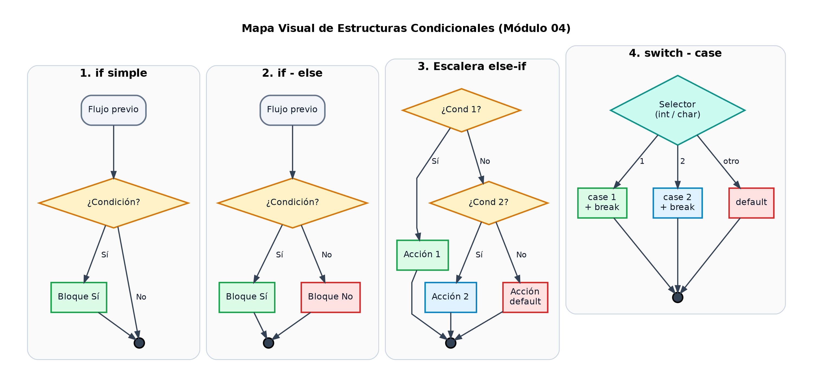
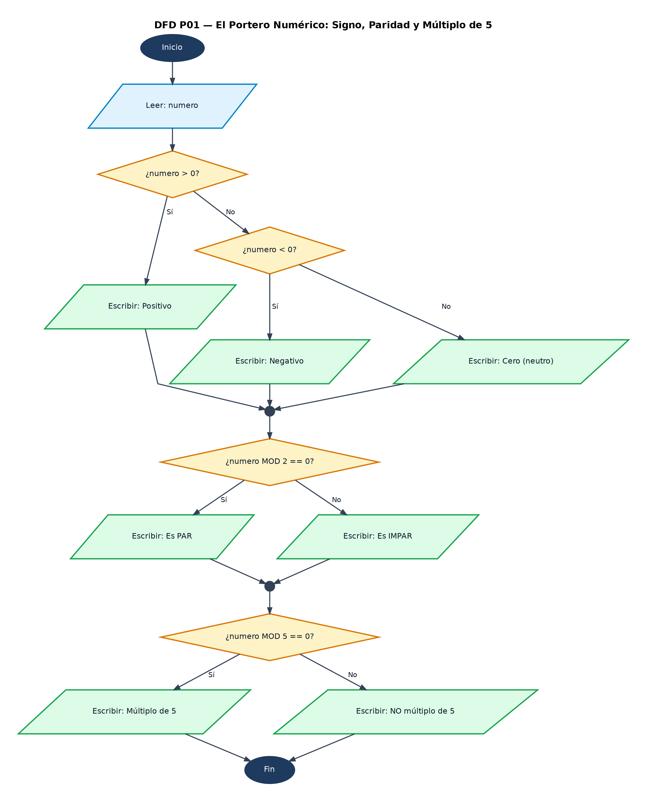
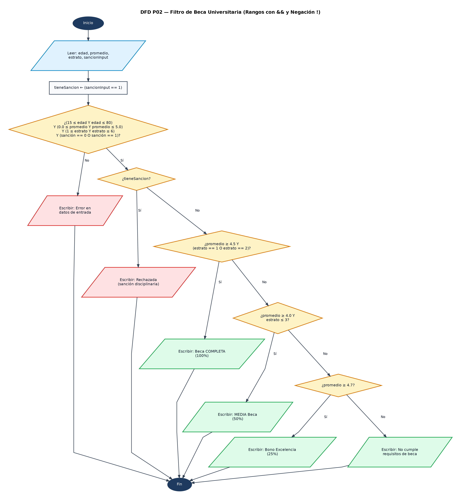
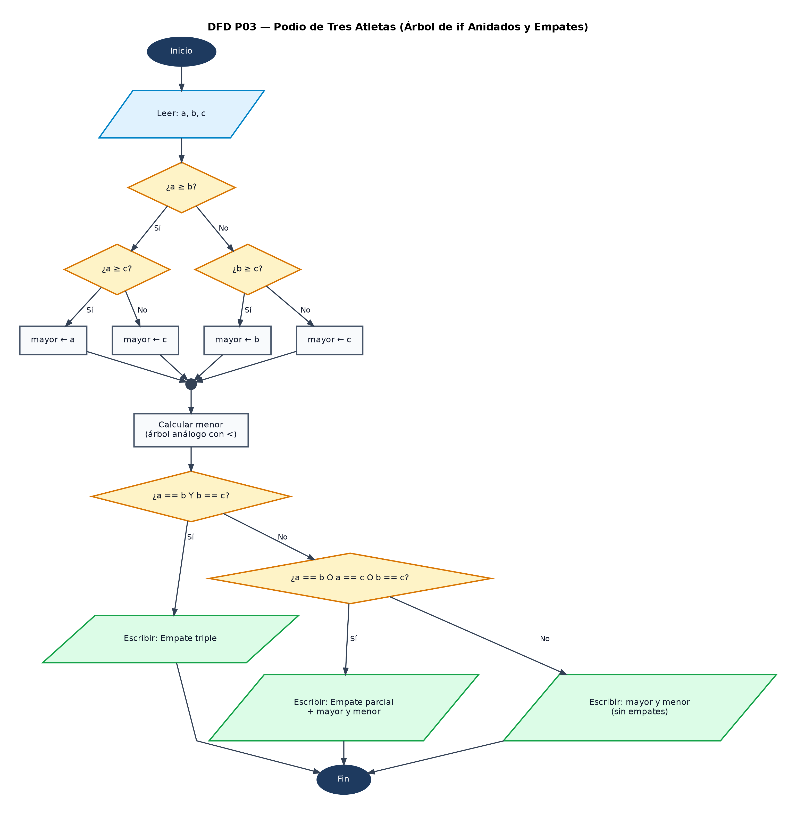
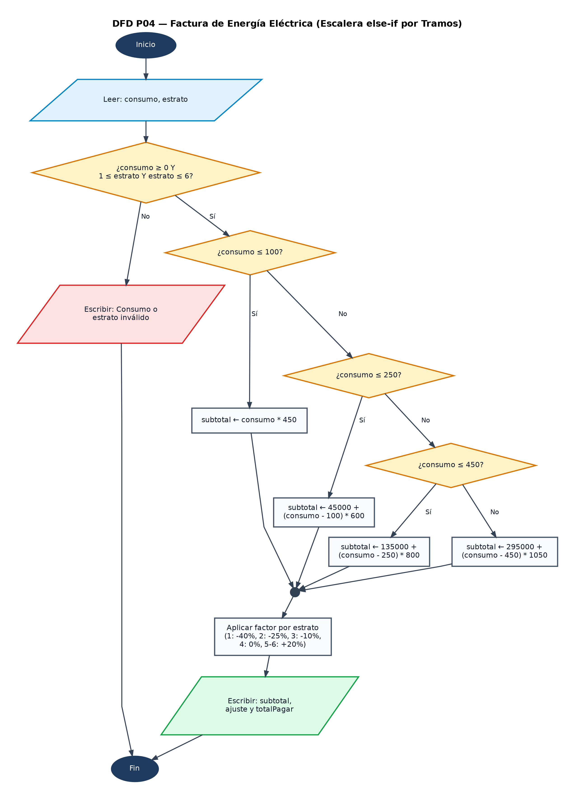
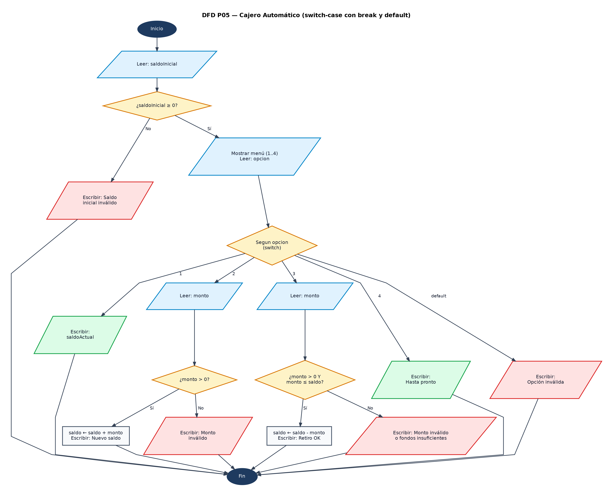
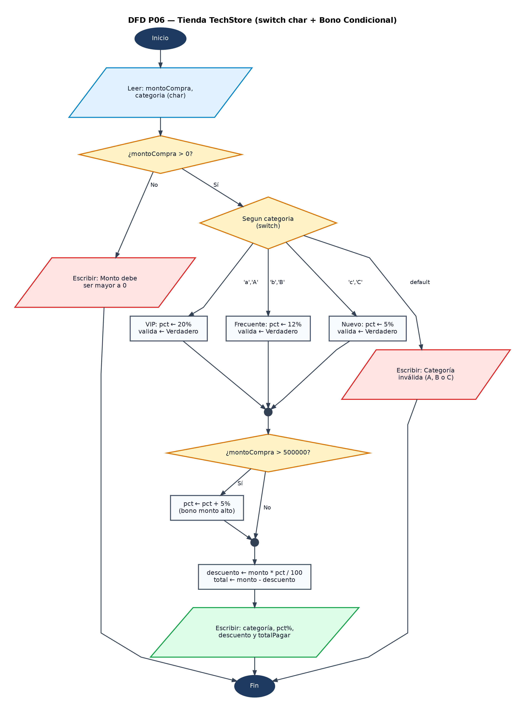
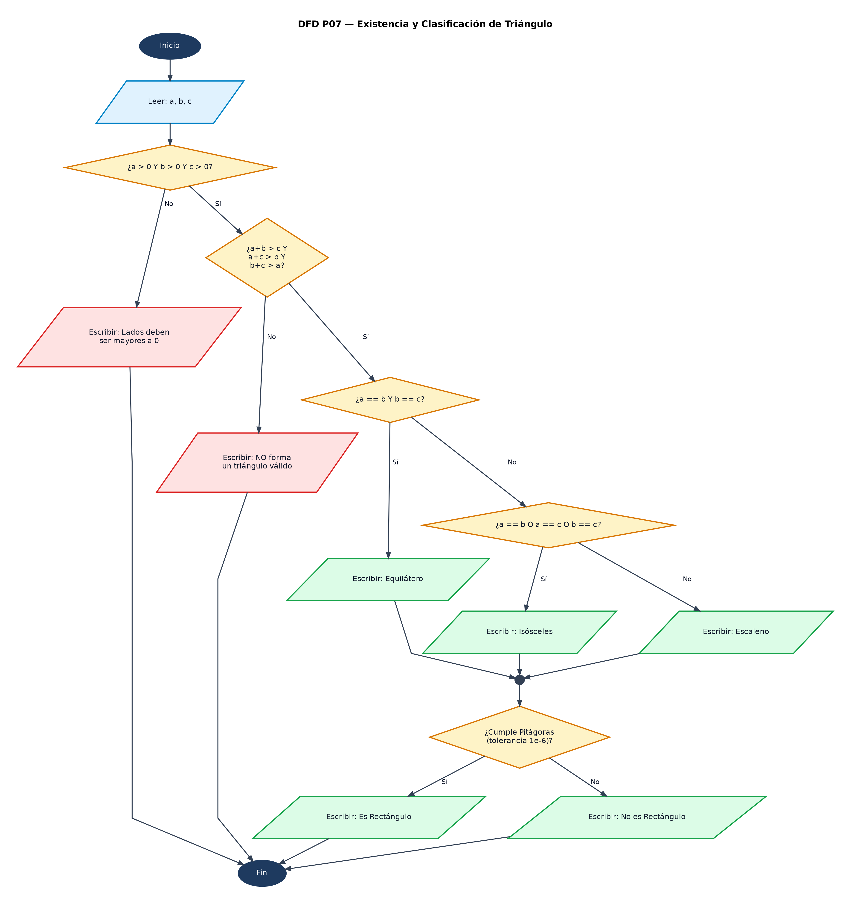
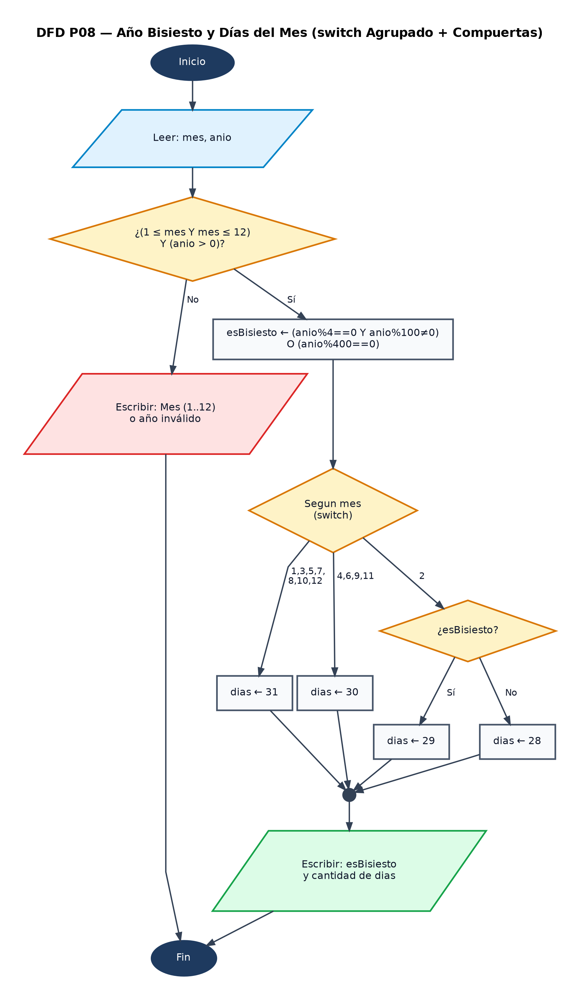

# Módulo 04: Estructuras Condicionales (`if`, `else-if`, `if` anidados y `switch-case`)

> **Duración estimada en monitoría:** 3.5 horas (210 minutos)  
> **Ruta pedagógica:** Problema real ⇒ Análisis EPS ⇒ DFD ⇒ PSeInt ⇒ C++ básico ⇒ Prueba de escritorio  
> **Prerrequisitos:** Módulos 00–03 (variables `int`, `double`, `char`, `bool`, `string`, operadores aritméticos y división/módulo `%`).  
> **Regla de alcance del módulo:** En este módulo **NO** usamos ciclos repetitivos (llegarán en el Módulo 05) ni arreglos (llegarán en los Módulos 06 y 07). Todo se resuelve con decisiones puras y variables simples.

---

## Guía Rápida del Monitor (Distribución de las 3.5 Horas)

| Bloque | Tema central | Tiempo sugerido |
| :--- | :--- | :---: |
| **Bloque 1** | ¿Por qué decidir? Lógica booleana y tablas de verdad "con plastilina" | 45 min |
| **Bloque 2** | Trampa mortal de rangos (`10 <= x <= 20`) y operadores relacionales | 25 min |
| **Bloque 3** | Las 5 formas condicionales (`if`, `if-else`, `else-if`, anidados, `switch`) | 55 min |
| **Bloque 4** | Diccionario traductor de parciales y errores de compilación al español | 25 min |
| **Bloque 5** | Taller guiado: 8 problemas resueltos completos (EPS + DFD + PSeInt + C++) | 40 min |
| **Bloque 6** | Práctica autónoma y cierre con los 14 ejercicios propuestos | 20 min |

---

## 1. Explicado Para Tontos / Con Plastilina: ¿Qué es una Decisión en Programación?

Hasta el Módulo 03, todos nuestros programas parecían un **tren sobre un único riel recto**: leían datos, hacían cuentas y mostraban el resultado de arriba hacia abajo, línea por línea, sin saltarse jamás una sola instrucción.

Pero en la vida real casi nada funciona en línea recta:
- Si tienes saldo suficiente, el cajero entrega el billete; **si no**, muestra *"Fondos insuficientes"*.
- Si tu promedio es mayor o igual a `3.0`, apruebas la materia; **si no**, la pierdes.
- Según el botón que presiones en un ascensor (`1`, `2`, `3`, `4`), el motor sube o baja a un piso distinto.

Una **estructura condicional** es simplemente un **desvío de rieles** (un rombo en el DFD). El programa evalúa una pregunta cuya única respuesta posible es **Verdadero (`true`)** o **Falso (`false`)** y, dependiendo de esa respuesta, toma un camino o toma otro.

> **Analogía del Portero de Discoteca:**  
> Cada `if` es un portero en la puerta de un salón con una pregunta de *"Sí o No"* en su libreta. Si respondes **Sí (`true`)**, te abre la puerta y ejecutas las instrucciones que están dentro de las llaves `{ ... }`. Si respondes **No (`false`)**, el portero te cierra esa puerta y sigues de largo al siguiente bloque del programa.

---

## 2. Lógica Booleana y Tablas de Verdad sin Enredos

Antes de escribir un `if`, necesitamos saber formular **preguntas exactas** que la computadora entienda sin ambigüedades.

### 2.1 Operadores Relacionales (Las 6 preguntas básicas)

| Significado en español | Matemática | PSeInt | C++ | Ejemplo (`x = 10`) | Resultado |
| :--- | :---: | :---: | :---: | :--- | :---: |
| ¿Es **igual** a? | $=$ | `=` | `==` | `x == 10` | `true` |
| ¿Es **diferente / distinto** de? | $\neq$ | `<>` | `!=` | `x != 10` | `false` |
| ¿Es **menor** que? | $<$ | `<` | `<` | `x < 20` | `true` |
| ¿Es **menor o igual** que? | $\le$ | `<=` | `<=` | `x <= 10` | `true` |
| ¿Es **mayor** que? | $>$ | `>` | `>` | `x > 10` | `false` |
| ¿Es **mayor o igual** que? | $\ge$ | `>=` | `>=` | `x >= 10` | `true` |

> **OJO — Trampa Clásica de Parcial #1 (`=` vs `==`):**  
> En C++:
> - Un solo igual `=` significa **ORDEN DE GUARDAR** (`x = 5;` mete el `5` dentro de la caja `x`).
> - Doble igual `==` significa **PREGUNTA DE COMPARACIÓN** (`x == 5` pregunta *"¿lo que hay en `x` vale 5?"*).
>
> Si por descuido escribes `if (x = 5)`, C++ **borra** lo que tenía `x`, le guarda un `5`, y como `5` es distinto de cero, la condición se considera **siempre verdadera**. ¡En un parcial esto te daña toda la lógica! Compilar con `-Wall -Wextra` te avisa, pero acostúmbrate desde ya a leer `==` como *"¿es igual a?"*.

### 2.2 Operadores Lógicos: `&&` (`Y`), `||` (`O`) y `!` (`NO`)

Muchas veces una sola pregunta no alcanza. Por ejemplo: *"Para pasar a la montaña rusa debes medir al menos 1.40 m **Y** no tener problemas cardíacos"*. Para unir o invertir condiciones usamos los tres conectores lógicos:

1. **`&&` (En PSeInt: `Y`) — Analogía de los dos candados en serie:**  
   Imagina una caja fuerte cerrada con **dos candados seguidos** (`A` y `B`). Solo puedes abrir la caja si tienes la llave del candado `A` **Y** también la llave del candado `B`. Si falta aunque sea uno, la caja NO abre.
2. **`||` (En PSeInt: `O`) — Analogía de las dos puertas paralelas:**  
   Imagina un salón con **dos puertas de entrada independientes** (`A` y `B`). Basta con que **al menos una** esté abierta para que puedas entrar al salón. Solo te quedas afuera si AMBAS están cerradas.
3. **`!` (En PSeInt: `NO`) — El botón "al revés":**  
   Convierte `true` en `false` y `false` en `true`. Si `tieneSancion` es `false`, entonces `!tieneSancion` es `true` (*"NO tiene sanción"*).

#### Tablas de Verdad Completas (Versión de Bolsillo)

| `A` | `B` | `A && B` (`A Y B`) | `A \|\| B` (`A O B`) | `!A` (`NO A`) |
| :---: | :---: | :---: | :---: | :---: |
| `true` (V) | `true` (V) | **`true` (V)** | **`true` (V)** | `false` (F) |
| `true` (V) | `false` (F) | `false` (F) | **`true` (V)** | `false` (F) |
| `false` (F) | `true` (V) | `false` (F) | **`true` (V)** | `true` (V) |
| `false` (F) | `false` (F) | `false` (F) | `false` (F) | `true` (V) |

**Resumen con plastilina:**
- `&&` solo da `true` cuando **TODOS** son `true`. (Si hay un `false`, todo cae).
- `||` da `true` con que **UNO SOLO** sea `true`. (Solo da `false` si todos son `false`).
- `!` invierte el resultado lógico.

### 2.3 Precedencia y Cortocircuito Lógico

¿En qué orden resuelve C++ una expresión larga si no hay paréntesis?
1. Primero el **`!`** (negación) y operaciones aritméticas (`*`, `/`, `%`, `+`, `-`).
2. Luego las **relacionales** (`<`, `<=`, `>`, `>=`, `==`, `!=`).
3. Luego **`&&`** (tiene más prioridad que `||`).
4. Por último **`||`**.

> **Consejo de Monitoría:** No confíes tu nota de parcial a la memoria de precedencia. **Cuando mezcles `&&` y `||` en un mismo `if`, pon paréntesis explícitos siempre:**
> `(promedio >= 4.5 && (estrato == 1 || estrato == 2))`  
> Sin paréntesis significa otra cosa completamente distinta.

**¿Qué es el cortocircuito lógico (y por qué te salva la vida)?**  
En C++, las expresiones `&&` y `||` se evalúan **de izquierda a derecha** y se detienen apenas saben la respuesta definitiva:
- En `(b != 0 && a / b > 2)`: si `b` vale `0`, la parte izquierda `b != 0` es `false`. Como en `&&` un `false` ya hace imposible que todo sea `true`, C++ **ni siquiera ejecuta `a / b`** y evita que el programa explote por división entre cero.
- ¡Ojo al orden! Si lo escribes al revés `(a / b > 2 && b != 0)`, primero intenta dividir por `0` y el programa falla antes de mirar `b != 0`.

---

## 3. OJO: La Trampa Mortal de los Rangos en C++ (`10 <= x <= 20`)

Esta es probablemente **la falla silenciosa #1 de los estudiantes en su primer parcial de C++**.

Supón que el enunciado dice: *"Verifique si `x` está entre 10 y 20 inclusive"*.  
En tu cuaderno de cálculo escribes: $10 \le x \le 20$.  
Entonces llegas al computador y escribes en C++:

```cpp
// ❌ ERROR MORTAL SILENCIOSO EN C++ (NO HACE LO QUE CREES)
if (10 <= x <= 20) {
    cout << "Esta en el rango";
}
```

**¿Por qué esto es un desastre total? Explicado paso a paso con plastilina:**  
C++ **NO** sabe leer desigualdades encadenadas como en matemáticas. C++ solo sabe comparar **de dos en dos**, de izquierda a derecha, y además en C++ `false` vale numéricamente **`0`** y `true` vale numéricamente **`1`**.

Hagamos la prueba con **`x = 50`** (que claramente **NO** está entre 10 y 20):
1. C++ agrupa los dos primeros: `(10 <= 50) <= 20`.
2. Evalúa `10 <= 50` ⇒ es verdadero (`true`), que internamente vale **`1`**.
3. Ahora reemplaza ese resultado y evalúa **`1 <= 20`**.
4. ¿`1` es menor o igual que `20`? **¡SÍ (`true`)!**
5. Resultado: C++ dice que **`50` SÍ está entre 10 y 20**. ¡Absurdo!

Y si probamos con **`x = -500`**:
1. `(10 <= -500)` ⇒ es `false`, que vale **`0`**.
2. Luego evalúa **`0 <= 20`** ⇒ **¡`true`!**
3. ¡La condición `10 <= x <= 20` es **siempre verdadera para TODOS los números del universo**!

**La forma ÚNICA y CORRECTA en C++ y PSeInt:**

```cpp
// ✅ CORRECTO EN C++: partir el rango en DOS preguntas unidas con &&
if (10 <= x && x <= 20) {
    cout << "Esta en el rango [10, 20]";
}
```

```text
// ✅ CORRECTO EN PSEINT:
Si 10 <= x Y x <= 20 Entonces
    Escribir "Esta en el rango [10, 20]";
FinSi
```

Y su hermana gemela (igual de tramposa): **"¿Cómo pregunto si `x` está FUERA del rango `[10, 20]`?"**
- ❌ **Mal:** `if (x < 10 && x > 20)` ⇒ ¡Imposible! Ningún número puede ser menor que 10 y mayor que 20 al mismo tiempo. Esto **nunca** se cumple.
- ✅ **Bien:** `if (x < 10 || x > 20)` ⇒ O se pasó por abajo (`< 10`), **O** se pasó por arriba (`> 20`).

---

## 4. Las 5 Estructuras Condicionales (DFD ⇔ PSeInt ⇔ C++)

Observa el mapa visual de los cuatro patrones principales antes de ver el código de cada uno:



### 4.1 Tabla Maestra de Traducción

| Estructura | Cuándo usarla | PSeInt | C++ |
| :--- | :--- | :--- | :--- |
| **`if` simple** | Hacer algo extra solo si se cumple una condición; si no, seguir normal. | `Si cond Entonces ... FinSi` | `if (cond) { ... }` |
| **`if-else`** | Bifurcación obligatoria: hay exactamente dos caminos excluyentes (A o B). | `Si cond Entonces ... SiNo ... FinSi` | `if (cond) { ... } else { ... }` |
| **Escalera `else-if`** | Varias condiciones en cascada (ej. rangos de notas o tarifas por consumo). | `Si c1 Entonces ... SiNo Si c2 Entonces ... SiNo ... FinSi FinSi` | `if (c1) { ... } else if (c2) { ... } else { ... }` |
| **`if` anidados** | Una segunda pregunta que solo tiene sentido si la primera ya fue verdadera. | `Si c1 Entonces Si c2 Entonces ... FinSi FinSi` | `if (c1) { if (c2) { ... } }` |
| **`switch-case`** | Menús o códigos discretos exactos (`1, 2, 3` o `'A', 'B', 'C'`). | `Segun var Hacer 1: ... De Otro Modo: ... FinSegun` | `switch (var) { case 1: ... break; default: ... }` |

### 4.2 Escalera `else-if`: Por qué el ORDEN lo es todo (y por qué NO usar varios `if` sueltos)

Imagina que calificas una nota (`0.0` a `5.0`) así:
- `>= 4.5`: Excelente
- `>= 4.0`: Sobresaliente
- `>= 3.0`: Aceptable
- `< 3.0`: Reprobado

Mira este **desastre clásico** al poner varios `if` sueltos sin `else`:
```cpp
// ❌ ERROR: si nota = 4.8, imprime los TRES mensajes porque 4.8 cumple los tres!
if (nota >= 4.5) cout << "Excelente";
if (nota >= 4.0) cout << "Sobresaliente";
if (nota >= 3.0) cout << "Aceptable";
```

Y mira este segundo desastre al poner `else if` en **orden invertido**:
```cpp
// ❌ ERROR DE ORDEN: si nota = 4.8, entra en >= 3.0 y NUNCA llega a >= 4.5!
if (nota >= 3.0) {
    cout << "Aceptable";
} else if (nota >= 4.0) {
    cout << "Sobresaliente";
} else if (nota >= 4.5) {
    cout << "Excelente";
} else {
    cout << "Reprobado";
}
```

**Regla de oro de las escaleras `else-if`:**  
En una escalera `else-if`, la computadora sale apenas encuentra la **primera** puerta verdadera. Por eso, si evalúas cotas abiertas (`>=`), ve de **mayor a menor** (`>= 4.5`, luego `>= 4.0`, luego `>= 3.0`); si evalúas cotas superiores (`<=`), ve de **menor a mayor** (`<= 100`, luego `<= 250`, luego `<= 450`), o escribe los dos extremos explícitos (`4.0 <= nota && nota < 4.5`).

### 4.3 `if` Anidados vs `&&`: ¿Cuándo conviene cada uno?

- Usa **`&&`** cuando la consecuencia de fallar cualquiera de las condiciones sea la **misma** (ej. *"acceso denegado"*).
- Usa **`if` anidados** cuando:
  1. Debas mostrar un **mensaje de error diferente** según cuál filtro falló (ej. primero validas saldo, y adentro validas el monto).
  2. La segunda pregunta dependa de un dato que **todavía no has leído** hasta que pase la primera puerta.

> **Consejo de Monitoría (Regla de las Llaves `{ }`):**  
> Aunque C++ permite omitir las llaves `{ }` cuando un `if` o `else` tiene una sola línea, **pon SIEMPRE llaves `{ }`**. Omitirlas produce el famoso bug del *"`else` colgante"*: si anidas un `if` sin llaves dentro de otro `if`, el `else` se pega al `if` más cercano por dentro, no al de afuera como aparentaba tu indentación.

### 4.4 `switch-case`: El Selector de Ascensor (con `break` y `default`)

El `switch` compara **una sola variable** contra valores constantes exactos.

**Reglas inquebrantables del `switch` en C++:**
1. **Solo tipos enteros o caracteres:** funciona con `int`, `char` (o `bool`/`enum`), **NO** funciona con `double`, **NO** funciona con `string`, y **NO** acepta comparaciones ni rangos (`case x > 10:` da error de compilación). Para rangos o `string`, usa siempre escalera `else-if`.
2. **La caída en cascada (*fall-through*) si olvidas `break;`:**  
   En C++, el `case` es apenas una **etiqueta de entrada**, no una pared. Una vez entra a un `case`, C++ sigue ejecutando hacia abajo **todo lo que encuentre**, entrando incluso a los `case` siguientes, hasta chocar con un `break;` o con la llave `}` final del `switch`.
   - **Cuando es un bug mortal:** En un menú de cajero, si olvidas el `break;` al final del `case 2:` (Consignar), el programa consigna y **de inmediato ejecuta el `case 3:` (Retirar)** sin preguntar.
   - **Cuando es útil intencionalmente:** Para agrupar valores que comparten exactamente el mismo bloque, como aceptar mayúsculas y minúsculas (`case 'a': case 'A':`) o agrupar los meses de 31 días (`case 1: case 3: case 5: ...`).
3. **La red de seguridad `default:`:**  
   Se ejecuta si el valor no coincidió con ningún `case`. Sirve para atrapar opciones inválidas del usuario.
4. **Diferencia clave frente a PSeInt:**  
   En PSeInt, `Segun var Hacer` **SÍ se detiene automáticamente** al final de cada caso (no existe caída en cascada ni palabra `break`), y varios valores se agrupan en la misma línea separados por comas (`1, 3, 5:`).

---

## 5. Diccionario Traductor de Enunciados de Parcial

Cuando leas un enunciado largo en el examen, subraya las palabras clave y tradúcelas con esta tabla antes de programar:

| Frase típica en el parcial | Significado matemático | PSeInt | C++ |
| :--- | :---: | :--- | :--- |
| *"al menos X"*, *"como mínimo X"*, *"no menor que X"* | $n \ge X$ | `n >= X` | `n >= X` |
| *"supera X"*, *"mayor a X"*, *"más de X"*, *"por encima de X"* | $n > X$ | `n > X` | `n > X` |
| *"a lo sumo X"*, *"como máximo X"*, *"hasta X"*, *"no excede X"* | $n \le X$ | `n <= X` | `n <= X` |
| *"inferior a X"*, *"menor a X"*, *"por debajo de X"* | $n < X$ | `n < X` | `n < X` |
| *"entre A y B inclusive"*, *"de A hasta B"* | $A \le x \le B$ | `A <= x Y x <= B` | `A <= x && x <= B` |
| *"estrictamente entre A y B"* | $A < x < B$ | `A < x Y x < B` | `A < x && x < B` |
| *"fuera del rango [A, B]"* | $x < A \lor x > B$ | `x < A O x > B` | `x < A || x > B` |
| *"es múltiplo de k"*, *"es divisible por k"* | $k \mid x$ | `x MOD k = 0` | `x % k == 0` |
| *"es par"* / *"es impar"* | $2 \mid x$ / $2 \nmid x$ | `x MOD 2 = 0` / `<> 0` | `x % 2 == 0` / `!= 0` |
| *"termina en 7"* (entero $\ge 0$) | resto al dividir por 10 | `x MOD 10 = 7` | `x % 10 == 7` |
| *"descuento según categoría ('A', 'B', 'C')"* | casos discretos | `Segun cat Hacer` | `switch (cat)` |
| *"tarifa según tramo o rango"* | tramos continuos | Escalera `Si...SiNo` | Escalera `else if` |

### Traductor de Errores Clásicos de C++ al Español del Monitor

| Lo que escribiste (Error) | Qué te dice `g++` o qué pasa | Traducción del monitor y solución |
| :--- | :--- | :--- |
| `if (x > 0); { ... }` | Compila, pero SIEMPRE ejecuta `{ ... }` | Pusiste un `;` justo después del paréntesis. Ese `;` cierra un `if` vacío y las llaves quedan sueltas. **Borra ese `;`**. |
| `if (x = 5)` | Warning: *suggest parentheses around assignment* | Escribiste asignación `=` en vez de comparación `==`. **Cámbialo por `==`**. |
| `if x > 0` | Error: *expected '(' before 'x'* | En PSeInt no hay paréntesis, pero en C++ son obligatorios alrededor de la condición: `if (x > 0)`. |
| `else (x < 0) { ... }` | Error: *expected ';' before '{'* | El `else` NO lleva condición. Si quieres otra pregunta debes escribir **`else if (x < 0)`**. |
| `case "A":` | Error: *case label does not reduce to an integer constant* | Usaste comillas dobles `"A"` (eso es un texto/`string`). Para un `char` en `switch` usa comillas simples: **`case 'A':`**. |
| `switch (nota)` siendo `nota` `double` | Error: *switch quantity not an integer* | `switch` no acepta decimales (`double`/`float`). Usa escalera `if / else if`. |
| `10 <= x <= 20` | Warning: *comparisons like 'X<=Y<=Z' do not have their mathematical meaning* | Trampa de rangos: evalúa `(10 <= x)` como `0` o `1` y luego compara con `20`. Usa **`10 <= x && x <= 20`**. |

---

## 6. Taller Resuelto Paso a Paso (8 Problemas Completos)

> En cada problema seguiremos estrictamente el **Método de los 5 Pasos del Monitor**:
> 1. **Análisis EPS** (Entradas, Proceso, Salidas) y justificación de estructura.
> 2. **Diagrama DFD** (flujo visual).
> 3. **Código PSeInt** (archivo en `pseint/`).
> 4. **Código C++** compilado sin warnings (archivo en `cpp/`).
> 5. **Prueba de Escritorio** paso a paso (tabla de variables).

---

### Problema Resuelto 01: El Portero Numérico (Signo, Paridad y Múltiplo de 5)

**Enunciado:**  
Diseña un algoritmo que lea un número entero y determine tres cosas sobre él:
1. Si es **positivo**, **negativo** o **cero (neutro)**.
2. Si es **par** o **impar**.
3. Si es **múltiplo de 5** o no.

#### 1) Análisis EPS y Elección de Estructura
- **Entradas:** `numero` (entero).
- **Proceso:**
  - Para el **signo**: las tres opciones (`> 0`, `< 0`, `== 0`) son **mutuamente excluyentes** (ningún número es positivo y negativo a la vez), así que usamos una escalera `if / else if / else`.
  - Para **paridad** (`numero % 2 == 0`) y **múltiplo de 5** (`numero % 5 == 0`): son preguntas **independientes** respecto al signo (por ejemplo, `-15` es negativo, impar Y múltiplo de 5 al mismo tiempo). Por eso van en dos bloques `if-else` separados después del signo.
- **Salidas:** Tres mensajes claros indicando signo, paridad y divisibilidad por 5.

#### 2) Diagrama DFD


#### 3) Código en PSeInt (`pseint/p01_par_multiplo_signo.psc`)
```text
Algoritmo PorteroNumerico
    Definir numero Como Entero;

    Escribir "=== EL PORTERO NUMERICO ===";
    Escribir "Ingrese un numero entero (ej. -15, 0, 10, 7): ";
    Leer numero;

    Si numero > 0 Entonces
        Escribir "1. Signo      : El numero es POSITIVO.";
    SiNo
        Si numero < 0 Entonces
            Escribir "1. Signo      : El numero es NEGATIVO.";
        SiNo
            Escribir "1. Signo      : El numero es CERO (neutro).";
        FinSi
    FinSi

    Si numero MOD 2 = 0 Entonces
        Escribir "2. Paridad    : Es PAR.";
    SiNo
        Escribir "2. Paridad    : Es IMPAR.";
    FinSi

    Si numero MOD 5 = 0 Entonces
        Escribir "3. Multiplo 5 : SI es multiplo de 5.";
    SiNo
        Escribir "3. Multiplo 5 : NO es multiplo de 5.";
    FinSi
FinAlgoritmo
```

#### 4) Código en C++ (`cpp/p01_par_multiplo_signo.cpp`)
```cpp
#include <iostream>
using namespace std;

int main() {
    int numero = 0;

    cout << "=== EL PORTERO NUMERICO ===" << endl;
    cout << "Ingrese un numero entero (ej. -15, 0, 10, 7): ";
    if (!(cin >> numero)) {
        cout << "ERROR: Entrada no valida. Debe ingresar un numero entero." << endl;
        return 1;
    }

    if (numero > 0) {
        cout << "1. Signo      : El numero es POSITIVO." << endl;
    } else if (numero < 0) {
        cout << "1. Signo      : El numero es NEGATIVO." << endl;
    } else {
        cout << "1. Signo      : El numero es CERO (neutro)." << endl;
    }

    if (numero % 2 == 0) {
        cout << "2. Paridad    : Es PAR." << endl;
    } else {
        cout << "2. Paridad    : Es IMPAR." << endl;
    }

    if (numero % 5 == 0) {
        cout << "3. Multiplo 5 : SI es multiplo de 5." << endl;
    } else {
        cout << "3. Multiplo 5 : NO es multiplo de 5." << endl;
    }

    return 0;
}
```

#### 5) Prueba de Escritorio Paso a Paso

| Corrida | `numero` | `numero > 0` | `numero < 0` | `numero % 2 == 0` | `numero % 5 == 0` | Salida en pantalla |
| :---: | :---: | :---: | :---: | :---: | :---: | :--- |
| **1** | `-15` | `false` | `true` | `false` (`-15 % 2 = -1`) | `true` (`-15 % 5 = 0`) | NEGATIVO, IMPAR, SI es multiplo de 5 |
| **2** | `0` | `false` | `false` | `true` (`0 % 2 = 0`) | `true` (`0 % 5 = 0`) | CERO (neutro), PAR, SI es multiplo de 5 |
| **3** | `14` | `true` | (no evalúa) | `true` (`14 % 2 = 0`) | `false` (`14 % 5 = 4`) | POSITIVO, PAR, NO es multiplo de 5 |

---

### Problema Resuelto 02: Filtro de Beca Universitaria (Rangos y Lógica Booleana)

**Enunciado:**  
La universidad evalúa solicitudes de beca pidiendo: `edad` (entero, válida de 15 a 80), `promedio` (real, válido de `0.0` a `5.0`), `estrato` (entero, válido de 1 a 6) y `sancionInput` (`1` = tiene sanción disciplinaria vigente, `0` = no tiene).  
- Si algún dato está fuera de su rango permitido, informar el error exacto.
- Si tiene sanción disciplinaria (`!tieneSancion` es falso), rechazar inmediatamente.
- Si no tiene sanción, asignar el mayor beneficio que cumpla:
  - **Beca Completa (100%):** promedio $\ge 4.5$ **Y** estrato 1 o 2.
  - **Media Beca (50%):** promedio $\ge 4.0$ **Y** estrato $\le 3$.
  - **Bono Excelencia (25%):** promedio $\ge 4.7$ (sin importar estrato).
  - En otro caso, informar que no cumple requisitos.

#### 1) Análisis EPS y Elección de Estructura
- **Entradas:** `edad` (`int`), `promedio` (`double`), `estrato` (`int`), `sancionInput` (`int`).
- **Proceso:**
  1. Validar rangos con expresiones booleanas compuestas (`15 <= edad && edad <= 80`, `0.0 <= promedio && promedio <= 5.0`, `1 <= estrato && estrato <= 6`, `sancionInput == 0 || sancionInput == 1`), evitando la trampa `0.0 <= promedio <= 5.0`.
  2. Usar `!datosValidos` con `if` internos para detallar qué campo falló.
  3. Usar escalera `else-if` ordenada de mayor beneficio (`100%`) a menor (`50%`, `25%`).
- **Salidas:** Diagnóstico de error o resultado exacto de la beca.

#### 2) Diagrama DFD


#### 3) Código en PSeInt (`pseint/p02_beca_universitaria_rangos.psc`)
```text
Algoritmo FiltroBecaUniversitaria
    Definir edad, estrato, sancionInput Como Entero;
    Definir promedio Como Real;
    Definir tieneSancion, datosValidos Como Logico;

    Escribir "=== FILTRO DE BECA UNIVERSITARIA ===";
    Escribir "Edad del estudiante (15 a 80): ";
    Leer edad;
    Escribir "Promedio acumulado (0.0 a 5.0): ";
    Leer promedio;
    Escribir "Estrato socioeconomico (1 a 6): ";
    Leer estrato;
    Escribir "Tiene sancion disciplinaria vigente? (1 = Si, 0 = No): ";
    Leer sancionInput;

    datosValidos <- (15 <= edad Y edad <= 80) Y (0.0 <= promedio Y promedio <= 5.0) Y (1 <= estrato Y estrato <= 6) Y (sancionInput = 0 O sancionInput = 1);

    Si NO datosValidos Entonces
        Escribir "ERROR: Alguno de los datos ingresados esta fuera de rango.";
    SiNo
        tieneSancion <- (sancionInput = 1);

        Si tieneSancion Entonces
            Escribir "RESULTADO: Beca RECHAZADA por sancion disciplinaria vigente.";
        SiNo
            Si promedio >= 4.5 Y (estrato = 1 O estrato = 2) Entonces
                Escribir "RESULTADO: Beca COMPLETA (100% de la matricula).";
            SiNo
                Si promedio >= 4.0 Y estrato <= 3 Entonces
                    Escribir "RESULTADO: MEDIA Beca (50% de la matricula).";
                SiNo
                    Si promedio >= 4.7 Entonces
                        Escribir "RESULTADO: Bono de EXCELENCIA ACADEMICA (25%).";
                    SiNo
                        Escribir "RESULTADO: No cumple requisitos de promedio/estrato.";
                    FinSi
                FinSi
            FinSi
        FinSi
    FinSi
FinAlgoritmo
```

#### 4) Código en C++ (`cpp/p02_beca_universitaria_rangos.cpp`)
```cpp
#include <iostream>
using namespace std;

int main() {
    int edad = 0;
    double promedio = 0.0;
    int estrato = 0;
    int sancionInput = 0;

    cout << "=== FILTRO DE BECA UNIVERSITARIA ===" << endl;
    cout << "Edad del estudiante (15 a 80): ";
    cin >> edad;
    cout << "Promedio acumulado (0.0 a 5.0): ";
    cin >> promedio;
    cout << "Estrato socioeconomico (1 a 6): ";
    cin >> estrato;
    cout << "Tiene sancion disciplinaria vigente? (1 = Si, 0 = No): ";
    cin >> sancionInput;

    bool edadValida = (15 <= edad && edad <= 80);
    bool promedioValido = (0.0 <= promedio && promedio <= 5.0);
    bool estratoValido = (1 <= estrato && estrato <= 6);
    bool sancionValida = (sancionInput == 0 || sancionInput == 1);

    bool datosValidos = edadValida && promedioValido && estratoValido && sancionValida;

    if (!datosValidos) {
        cout << "ERROR: Datos fuera de rango permitido." << endl;
        if (!edadValida) {
            cout << "  - La edad debe estar entre 15 y 80." << endl;
        }
        if (!promedioValido) {
            cout << "  - El promedio debe estar entre 0.0 y 5.0." << endl;
        }
        if (!estratoValido) {
            cout << "  - El estrato debe estar entre 1 y 6." << endl;
        }
        if (!sancionValida) {
            cout << "  - El indicador de sancion debe ser 0 o 1." << endl;
        }
        return 0;
    }

    bool tieneSancion = (sancionInput == 1);

    if (tieneSancion) {
        cout << "RESULTADO: Beca RECHAZADA por sancion disciplinaria vigente." << endl;
    } else if (promedio >= 4.5 && (estrato == 1 || estrato == 2)) {
        cout << "RESULTADO: Beca COMPLETA (100% de la matricula)." << endl;
    } else if (promedio >= 4.0 && estrato <= 3) {
        cout << "RESULTADO: MEDIA Beca (50% de la matricula)." << endl;
    } else if (promedio >= 4.7) {
        cout << "RESULTADO: Bono de EXCELENCIA ACADEMICA (25%)." << endl;
    } else {
        cout << "RESULTADO: No cumple los requisitos de promedio o estrato." << endl;
    }

    return 0;
}
```

#### 5) Prueba de Escritorio Paso a Paso

| Corrida | `edad` | `promedio` | `estrato` | `sancionInput` | `datosValidos` | `tieneSancion` | Salida |
| :---: | :---: | :---: | :---: | :---: | :---: | :---: | :--- |
| **1** | `20` | `4.6` | `2` | `0` | `true` | `false` | `Beca COMPLETA (100%)` |
| **2** | `20` | `5.5` | `2` | `0` | `false` | (sale antes) | `ERROR: El promedio debe estar entre 0.0 y 5.0.` |
| **3** | `19` | `4.8` | `5` | `0` | `true` | `false` | `Bono de EXCELENCIA ACADEMICA (25%)` |
| **4** | `21` | `4.9` | `1` | `1` | `true` | `true` | `Beca RECHAZADA por sancion disciplinaria` |

---

### Problema Resuelto 03: Podio de Tres Atletas (`if` Anidados y Empates)

**Enunciado:**  
Dados tres puntajes reales `a`, `b` y `c` de tres atletas, encuentra el puntaje mayor, el menor y reporta si existe empate triple, empate parcial o si los tres puntajes son distintos (sin usar arreglos ni ciclos).

#### 1) Análisis EPS y Elección de Estructura
- **Entradas:** `a`, `b`, `c` (`double`).
- **Proceso:**
  - Para hallar `mayor` con un árbol binario de decisiones limpias: primero preguntamos `if (a >= b)`; en cada rama preguntamos contra `c`. Lo mismo (con `<=`) para `menor`.
  - Para detectar empates: primero descartamos el empate triple (`a == b && b == c`) y luego el parcial (`a == b || a == c || b == c`) en una escalera `else-if`.
- **Salidas:** `mayor`, `menor` (con 2 decimales) y estado de empate.

#### 2) Diagrama DFD


#### 3) Código en PSeInt (`pseint/p03_podio_tres_atletas.psc`)
```text
Algoritmo PodioTresAtletas
    Definir a, b, c, mayor, menor Como Real;

    Escribir "=== PODIO DE TRES ATLETAS ===";
    Escribir "Ingrese el puntaje del atleta A: ";
    Leer a;
    Escribir "Ingrese el puntaje del atleta B: ";
    Leer b;
    Escribir "Ingrese el puntaje del atleta C: ";
    Leer c;

    Si a >= b Entonces
        Si a >= c Entonces
            mayor <- a;
        SiNo
            mayor <- c;
        FinSi
    SiNo
        Si b >= c Entonces
            mayor <- b;
        SiNo
            mayor <- c;
        FinSi
    FinSi

    Si a <= b Entonces
        Si a <= c Entonces
            menor <- a;
        SiNo
            menor <- c;
        FinSi
    SiNo
        Si b <= c Entonces
            menor <- b;
        SiNo
            menor <- c;
        FinSi
    FinSi

    Escribir "Mayor puntaje registrado: ", mayor;
    Escribir "Menor puntaje registrado: ", menor;

    Si a = b Y b = c Entonces
        Escribir "Estado del podio: EMPATE TRIPLE (todos tienen ", mayor, ").";
    SiNo
        Si a = b O a = c O b = c Entonces
            Escribir "Estado del podio: EMPATE PARCIAL entre dos atletas.";
        SiNo
            Escribir "Estado del podio: Sin empates, los tres puntajes son distintos.";
        FinSi
    FinSi
FinAlgoritmo
```

#### 4) Código en C++ (`cpp/p03_podio_tres_atletas.cpp`)
```cpp
#include <iomanip>
#include <iostream>
using namespace std;

int main() {
    double a = 0.0;
    double b = 0.0;
    double c = 0.0;
    double mayor = 0.0;
    double menor = 0.0;

    cout << "=== PODIO DE TRES ATLETAS ===" << endl;
    cout << "Ingrese el puntaje del atleta A: ";
    cin >> a;
    cout << "Ingrese el puntaje del atleta B: ";
    cin >> b;
    cout << "Ingrese el puntaje del atleta C: ";
    cin >> c;

    if (a >= b) {
        if (a >= c) {
            mayor = a;
        } else {
            mayor = c;
        }
    } else {
        if (b >= c) {
            mayor = b;
        } else {
            mayor = c;
        }
    }

    if (a <= b) {
        if (a <= c) {
            menor = a;
        } else {
            menor = c;
        }
    } else {
        if (b <= c) {
            menor = b;
        } else {
            menor = c;
        }
    }

    cout << fixed << setprecision(2);
    cout << "\nMayor puntaje registrado: " << mayor << endl;
    cout << "Menor puntaje registrado: " << menor << endl;

    if (a == b && b == c) {
        cout << "Estado del podio: EMPATE TRIPLE (todos empatados en " << mayor << ")." << endl;
    } else if (a == b || a == c || b == c) {
        cout << "Estado del podio: EMPATE PARCIAL entre al menos dos atletas." << endl;
    } else {
        cout << "Estado del podio: Sin empates, los tres puntajes son distintos." << endl;
    }

    return 0;
}
```

#### 5) Prueba de Escritorio Paso a Paso

| Corrida | `a` | `b` | `c` | `a >= b` | Rama interna mayor | `mayor` | `menor` | Estado de empate |
| :---: | :---: | :---: | :---: | :---: | :--- | :---: | :---: | :--- |
| **1** | `9.5` | `12.0` | `9.5` | `false` | `12.0 >= 9.5` (`true`) | `12.00` | `9.50` | `EMPATE PARCIAL` |
| **2** | `8.0` | `8.0` | `8.0` | `true` | `8.0 >= 8.0` (`true`) | `8.00` | `8.00` | `EMPATE TRIPLE` |
| **3** | `7.1` | `9.4` | `10.2` | `false` | `9.4 >= 10.2` (`false`) | `10.20` | `7.10` | `Sin empates` |

---

### Problema Resuelto 04: Factura Escalonada de Energía Eléctrica

**Enunciado:**  
Una empresa cobra el consumo eléctrico mensual (`consumo` entero en kWh $\ge 0$) por **tramos marginales**:
- Los primeros `100` kWh a `$450` cada uno.
- De `101` a `250` kWh a `$600` cada uno.
- De `251` a `450` kWh a `$800` cada uno.
- Más de `450` kWh a `$1050` cada uno.

Luego, según el `estrato` (`1` a `6`):
- Estrato 1: subsidio del `40%` (`factor = 0.60`).
- Estrato 2: subsidio del `25%` (`factor = 0.75`).
- Estrato 3: subsidio del `10%` (`factor = 0.90`).
- Estrato 4: sin ajuste (`factor = 1.00`).
- Estratos 5 y 6: contribución solidaria del `+20%` (`factor = 1.20`).

#### 1) Análisis EPS y Elección de Estructura
- **Entradas:** `consumo` (`int`), `estrato` (`int`).
- **Proceso:**
  - Validar `consumo >= 0` y `1 <= estrato && estrato <= 6`.
  - Como los tramos son rangos continuos, usamos una **escalera `else-if` ordenada de menor a mayor** (`<= 100`, `<= 250`, `<= 450`, `else`), acumulando el valor exacto de los tramos anteriores.
  - Para el estrato (un entero discreto `1..6`), un `switch` con `case 5: case 6:` es limpio y expresivo.
- **Salidas:** `subtotal`, `ajuste` (negativo si es subsidio, positivo si es contribución) y `totalPagar`.

#### 2) Diagrama DFD


#### 3) Código en PSeInt (`pseint/p04_factura_energia_escalera.psc`)
```text
Algoritmo FacturaEnergiaElectrica
    Definir consumo, estrato Como Entero;
    Definir subtotal, factor, ajuste, totalPagar Como Real;

    Escribir "=== FACTURA DE ENERGIA ELECTRICA ===";
    Escribir "Consumo del mes en kWh (entero >= 0): ";
    Leer consumo;
    Escribir "Estrato socioeconomico (1 a 6): ";
    Leer estrato;

    Si consumo < 0 O estrato < 1 O estrato > 6 Entonces
        Escribir "ERROR: El consumo debe ser >= 0 y el estrato entre 1 y 6.";
    SiNo
        Si consumo <= 100 Entonces
            subtotal <- consumo * 450.0;
        SiNo
            Si consumo <= 250 Entonces
                subtotal <- (100 * 450.0) + (consumo - 100) * 600.0;
            SiNo
                Si consumo <= 450 Entonces
                    subtotal <- (100 * 450.0) + (150 * 600.0) + (consumo - 250) * 800.0;
                SiNo
                    subtotal <- (100 * 450.0) + (150 * 600.0) + (200 * 800.0) + (consumo - 450) * 1050.0;
                FinSi
            FinSi
        FinSi

        Segun estrato Hacer
            1:
                factor <- 0.60;
            2:
                factor <- 0.75;
            3:
                factor <- 0.90;
            4:
                factor <- 1.00;
            De Otro Modo:
                factor <- 1.20;
        FinSegun

        totalPagar <- subtotal * factor;
        ajuste <- totalPagar - subtotal;

        Escribir "--- RESUMEN DE FACTURA ---";
        Escribir "Subtotal base      : $", subtotal;
        Escribir "Ajuste por estrato : $", ajuste;
        Escribir "TOTAL A PAGAR      : $", totalPagar;
    FinSi
FinAlgoritmo
```

#### 4) Código en C++ (`cpp/p04_factura_energia_escalera.cpp`)
```cpp
#include <iomanip>
#include <iostream>
using namespace std;

int main() {
    int consumo = 0;
    int estrato = 0;
    double subtotal = 0.0;
    double factor = 1.0;

    cout << "=== FACTURA DE ENERGIA ELECTRICA ===" << endl;
    cout << "Consumo del mes en kWh (entero >= 0): ";
    cin >> consumo;
    cout << "Estrato socioeconomico (1 a 6): ";
    cin >> estrato;

    if (consumo < 0 || estrato < 1 || estrato > 6) {
        cout << "ERROR: El consumo debe ser >= 0 y el estrato estar entre 1 y 6." << endl;
        return 0;
    }

    if (consumo <= 100) {
        subtotal = consumo * 450.0;
    } else if (consumo <= 250) {
        subtotal = (100 * 450.0) + (consumo - 100) * 600.0;
    } else if (consumo <= 450) {
        subtotal = (100 * 450.0) + (150 * 600.0) + (consumo - 250) * 800.0;
    } else {
        subtotal = (100 * 450.0) + (150 * 600.0) + (200 * 800.0) + (consumo - 450) * 1050.0;
    }

    switch (estrato) {
        case 1:
            factor = 0.60;
            break;
        case 2:
            factor = 0.75;
            break;
        case 3:
            factor = 0.90;
            break;
        case 4:
            factor = 1.00;
            break;
        case 5:
        case 6:
            factor = 1.20;
            break;
        default:
            factor = 1.00;
            break;
    }

    double totalPagar = subtotal * factor;
    double ajuste = totalPagar - subtotal;

    cout << fixed << setprecision(2);
    cout << "\n--- RESUMEN DE FACTURA ---" << endl;
    cout << "Subtotal base      : $" << subtotal << endl;
    cout << "Ajuste por estrato : $" << ajuste << endl;
    cout << "TOTAL A PAGAR      : $" << totalPagar << endl;

    return 0;
}
```

#### 5) Prueba de Escritorio Paso a Paso

| Corrida | `consumo` | `estrato` | Tramo aplicado | `subtotal` | `factor` | `ajuste` | `totalPagar` |
| :---: | :---: | :---: | :--- | :---: | :---: | :---: | :---: |
| **1** | `320` | `2` | `<= 450`: `45000 + 90000 + 70*800` | `191000.00` | `0.75` | `-47750.00` | `143250.00` |
| **2** | `80` | `5` | `<= 100`: `80*450` | `36000.00` | `1.20` | `+7200.00` | `43200.00` |
| **3** | `-10` | `3` | (Inválido) | — | — | — | `ERROR: consumo >= 0...` |

---
### Problema Resuelto 05: Cajero Automático de Una Operación (`switch-case` con `int`, `break` y `default`)

**Enunciado:**  
Implementa un cajero automático de **una sola transacción** (en el Módulo 05 le agregaremos un ciclo para repetir operaciones). El usuario ingresa su saldo inicial ($\ge 0$) y elige una opción del menú:  
- `1`: Consultar saldo  
- `2`: Consignar dinero (validar monto $> 0$)  
- `3`: Retirar dinero (validar monto $> 0$ y que no supere el saldo)  
- `4`: Salir  
- Cualquier otro valor: mostrar mensaje de opción inválida usando `default:`.

#### 1) Análisis EPS y Elección de Estructura
- **Entradas:** `saldo` (`double`), `opcion` (`int`), y condicionalmente `monto` (`double`) solo en los casos `2` y `3`.
- **Proceso:**
  - Primero validamos `saldo >= 0`.
  - Como el menú tiene opciones enteras discretas (`1, 2, 3, 4`), `switch (opcion)` es la estructura ideal.
  - **Cuidado crítico con `break;`:** si olvidáramos `break;` al final del `case 2:`, después de consignar el programa caería al `case 3:` y pediría un retiro. Cada caso termina con su `break;` obligatorio.
  - Dentro de `case 2:` y `case 3:` anidamos `if / else if / else` para proteger la cuenta contra montos negativos o sobregiros.
- **Salidas:** Mensaje de resultado de la transacción o diagnóstico de error.

#### 2) Diagrama DFD


#### 3) Código en PSeInt (`pseint/p05_cajero_menu_switch.psc`)
```text
Algoritmo CajeroMenuSwitch
    Definir saldo, monto Como Real;
    Definir opcion Como Entero;

    Escribir "=== CAJERO AUTOMATICO (1 OPERACION) ===";
    Escribir "Ingrese el saldo inicial de la cuenta: ";
    Leer saldo;

    Si saldo < 0 Entonces
        Escribir "ERROR: El saldo inicial no puede ser negativo.";
    SiNo
        Escribir "--- MENU DE OPERACIONES ---";
        Escribir "1. Consultar saldo";
        Escribir "2. Consignar dinero";
        Escribir "3. Retirar dinero";
        Escribir "4. Salir";
        Escribir "Elija una opcion (1 a 4): ";
        Leer opcion;

        Segun opcion Hacer
            1:
                Escribir "Su saldo actual es: $", saldo;
            2:
                Escribir "Ingrese el monto a consignar: ";
                Leer monto;
                Si monto > 0 Entonces
                    saldo <- saldo + monto;
                    Escribir "Consignacion exitosa. Nuevo saldo: $", saldo;
                SiNo
                    Escribir "ERROR: El monto a consignar debe ser mayor a cero.";
                FinSi
            3:
                Escribir "Ingrese el monto a retirar: ";
                Leer monto;
                Si monto <= 0 Entonces
                    Escribir "ERROR: El monto a retirar debe ser mayor a cero.";
                SiNo
                    Si monto > saldo Entonces
                        Escribir "ERROR: Fondos insuficientes. Saldo disponible: $", saldo;
                    SiNo
                        saldo <- saldo - monto;
                        Escribir "Retiro exitoso. Nuevo saldo: $", saldo;
                    FinSi
                FinSi
            4:
                Escribir "Gracias por usar nuestro cajero. Hasta pronto.";
            De Otro Modo:
                Escribir "ERROR: Opcion invalida. Debe elegir entre 1 y 4.";
        FinSegun
    FinSi
FinAlgoritmo
```

#### 4) Código en C++ (`cpp/p05_cajero_menu_switch.cpp`)
```cpp
#include <iomanip>
#include <iostream>
using namespace std;

int main() {
    double saldo = 0.0;
    double monto = 0.0;
    int opcion = 0;

    cout << "=== CAJERO AUTOMATICO (1 OPERACION) ===" << endl;
    cout << "Ingrese el saldo inicial de la cuenta: ";
    cin >> saldo;

    if (saldo < 0.0) {
        cout << "ERROR: El saldo inicial no puede ser negativo." << endl;
        return 0;
    }

    cout << "\n--- MENU DE OPERACIONES ---" << endl;
    cout << "1. Consultar saldo" << endl;
    cout << "2. Consignar dinero" << endl;
    cout << "3. Retirar dinero" << endl;
    cout << "4. Salir" << endl;
    cout << "Elija una opcion (1 a 4): ";
    cin >> opcion;

    cout << fixed << setprecision(2);

    switch (opcion) {
        case 1:
            cout << "Su saldo actual es: $" << saldo << endl;
            break;

        case 2:
            cout << "Ingrese el monto a consignar: ";
            cin >> monto;
            if (monto > 0.0) {
                saldo = saldo + monto;
                cout << "Consignacion exitosa. Nuevo saldo: $" << saldo << endl;
            } else {
                cout << "ERROR: El monto a consignar debe ser mayor a cero." << endl;
            }
            break;

        case 3:
            cout << "Ingrese el monto a retirar: ";
            cin >> monto;
            if (monto <= 0.0) {
                cout << "ERROR: El monto a retirar debe ser mayor a cero." << endl;
            } else if (monto > saldo) {
                cout << "ERROR: Fondos insuficientes. Saldo disponible: $" << saldo << endl;
            } else {
                saldo = saldo - monto;
                cout << "Retiro exitoso. Nuevo saldo: $" << saldo << endl;
            }
            break;

        case 4:
            cout << "Gracias por usar nuestro cajero. Hasta pronto." << endl;
            break;

        default:
            cout << "ERROR: Opcion invalida. Debe elegir entre 1 y 4." << endl;
            break;
    }

    return 0;
}
```

#### 5) Prueba de Escritorio Paso a Paso

| Corrida | `saldo` inicial | `opcion` | `monto` | Rama ejecutada | `saldo` final | Salida |
| :---: | :---: | :---: | :---: | :--- | :---: | :--- |
| **1** | `500000.0` | `3` | `120000.0` | `case 3` ⇒ `else` válido | `380000.00` | `Retiro exitoso. Nuevo saldo: $380000.00` |
| **2** | `100000.0` | `3` | `250000.0` | `case 3` ⇒ `monto > saldo` | `100000.00` | `ERROR: Fondos insuficientes...` |
| **3** | `200000.0` | `9` | (no lee) | `default:` | `200000.00` | `ERROR: Opcion invalida. Debe elegir entre 1 y 4.` |

---

### Problema Resuelto 06: Tienda TechStore (`switch` con `char` y Bono Adicional)

**Enunciado:**  
Una tienda de tecnología aplica descuento según la categoría del cliente (ingresada como una letra, aceptando tanto minúscula como mayúscula):
- `'A'` o `'a'` (VIP): `20%` de descuento.
- `'B'` o `'b'` (Frecuente): `12%` de descuento.
- `'C'` o `'c'` (Nuevo): `5%` de descuento.
- Cualquier otra letra: reportar categoría inválida.

Además, si el monto de la compra **supera** `$500.000`, el cliente recibe un **bono extra del 5%** acumulable sobre su porcentaje de descuento.

#### 1) Análisis EPS y Elección de Estructura
- **Entradas:** `montoCompra` (`double`), `categoria` (`char`).
- **Proceso:**
  - Validar `montoCompra > 0`.
  - Usar `switch (categoria)` demostrando la **caída en cascada controlada**: `case 'a': case 'A':` sin `break` entre ellas para que ambas ejecuten exactamente el mismo descuento VIP.
  - Usar una bandera booleana `categoriaValida` para abortar limpio si cayó en `default:`.
  - Si es válida, aplicar un `if (montoCompra > 500000.0)` independiente para sumar el bono del `5%`.
- **Salidas:** Nombre de categoría, indicador de bono, porcentaje final, valor descontado y total a pagar.

#### 2) Diagrama DFD


#### 3) Código en PSeInt (`pseint/p06_descuento_categoria_char.psc`)
```text
Algoritmo DescuentoCategoriaChar
    Definir montoCompra, porcentaje, descuento, totalPagar Como Real;
    Definir categoria Como Caracter;
    Definir nombreCat Como Cadena;
    Definir categoriaValida, bonoAplicado Como Logico;

    Escribir "=== TIENDA TECHSTORE ===";
    Escribir "Ingrese el monto de la compra ($): ";
    Leer montoCompra;
    Escribir "Categoria del cliente (A = VIP, B = Frecuente, C = Nuevo): ";
    Leer categoria;

    Si montoCompra <= 0 Entonces
        Escribir "ERROR: El monto de compra debe ser mayor a cero.";
    SiNo
        categoriaValida <- Verdadero;
        porcentaje <- 0.0;
        nombreCat <- "";

        Segun categoria Hacer
            'a', 'A':
                porcentaje <- 20.0;
                nombreCat <- "VIP";
            'b', 'B':
                porcentaje <- 12.0;
                nombreCat <- "Frecuente";
            'c', 'C':
                porcentaje <- 5.0;
                nombreCat <- "Nuevo";
            De Otro Modo:
                categoriaValida <- Falso;
        FinSegun

        Si NO categoriaValida Entonces
            Escribir "ERROR: Categoria no reconocida. Use A, B o C.";
        SiNo
            bonoAplicado <- Falso;
            Si montoCompra > 500000.0 Entonces
                porcentaje <- porcentaje + 5.0;
                bonoAplicado <- Verdadero;
            FinSi

            descuento <- montoCompra * (porcentaje / 100.0);
            totalPagar <- montoCompra - descuento;

            Escribir "--- TIRILLA DE COMPRA ---";
            Escribir "Categoria         : ", nombreCat;
            Escribir "Bono > $500.000   : ", bonoAplicado;
            Escribir "Descuento total % : ", porcentaje, "%";
            Escribir "Valor descontado  : $", descuento;
            Escribir "TOTAL A PAGAR     : $", totalPagar;
        FinSi
    FinSi
FinAlgoritmo
```

#### 4) Código en C++ (`cpp/p06_descuento_categoria_char.cpp`)
```cpp
#include <iomanip>
#include <iostream>
#include <string>
using namespace std;

int main() {
    double montoCompra = 0.0;
    double porcentaje = 0.0;
    char categoria = ' ';
    string nombreCat = "";
    bool categoriaValida = true;
    bool bonoAplicado = false;

    cout << "=== TIENDA TECHSTORE ===" << endl;
    cout << "Ingrese el monto de la compra ($): ";
    cin >> montoCompra;
    cout << "Categoria del cliente (A = VIP, B = Frecuente, C = Nuevo): ";
    cin >> categoria;

    if (montoCompra <= 0.0) {
        cout << "ERROR: El monto de compra debe ser mayor a cero." << endl;
        return 0;
    }

    switch (categoria) {
        case 'a':
        case 'A':
            porcentaje = 20.0;
            nombreCat = "VIP";
            break;

        case 'b':
        case 'B':
            porcentaje = 12.0;
            nombreCat = "Frecuente";
            break;

        case 'c':
        case 'C':
            porcentaje = 5.0;
            nombreCat = "Nuevo";
            break;

        default:
            categoriaValida = false;
            break;
    }

    if (!categoriaValida) {
        cout << "ERROR: Categoria no reconocida. Use A, B o C." << endl;
        return 0;
    }

    if (montoCompra > 500000.0) {
        porcentaje = porcentaje + 5.0;
        bonoAplicado = true;
    }

    double descuento = montoCompra * (porcentaje / 100.0);
    double totalPagar = montoCompra - descuento;

    cout << fixed << setprecision(2);
    cout << "\n--- TIRILLA DE COMPRA ---" << endl;
    cout << "Categoria         : " << nombreCat << endl;
    cout << "Bono > $500.000   : " << (bonoAplicado ? "SI (+5%)" : "NO") << endl;
    cout << "Descuento total % : " << porcentaje << "%" << endl;
    cout << "Valor descontado  : $" << descuento << endl;
    cout << "TOTAL A PAGAR     : $" << totalPagar << endl;

    return 0;
}
```

#### 5) Prueba de Escritorio Paso a Paso

| Corrida | `montoCompra` | `categoria` | `categoriaValida` | `bonoAplicado` | `porcentaje` | `descuento` | `totalPagar` |
| :---: | :---: | :---: | :---: | :---: | :---: | :---: | :---: |
| **1** | `600000` | `'a'` | `true` | `true` | `25.0%` | `150000.00` | `450000.00` |
| **2** | `300000` | `'B'` | `true` | `false` | `12.0%` | `36000.00` | `264000.00` |
| **3** | `150000` | `'Z'` | `false` | — | — | — | `ERROR: Categoria no reconocida` |

---

### Problema Resuelto 07: Existencia y Clasificación de Triángulos

**Enunciado:**  
Dados tres lados reales `a`, `b`, `c`:
1. Verifica que los tres sean positivos (`> 0`).
2. Verifica que cumplan la **desigualdad triangular**: la suma de cualesquiera dos lados debe ser estrictamente mayor al tercero (`a + b > c && a + c > b && b + c > a`).
3. Si el triángulo existe, clasifícalo por sus lados (**Equilátero**, **Isósceles** o **Escaleno**) y determina si además es un **triángulo rectángulo** (cumple el teorema de Pitágoras con alguna orientación, usando tolerancia flotante `1e-6`).

#### 1) Análisis EPS y Elección de Estructura
- **Entradas:** `a`, `b`, `c` (`double`).
- **Proceso:**
  - Primero dos filtros de validación temprana: lados positivos y desigualdad triangular.
  - Escalera `else-if` para tipo por lados: es obligatorio revisar **Equilátero (`a == b && b == c`) ANTES que Isósceles (`a == b || a == c || b == c`)**, porque todo triángulo equilátero también cumple tener dos lados iguales!
  - Para triángulo rectángulo con `double`: como los decimales en computador tienen pequeños errores de redondeo (ej. `sqrt(2)`), no comparamos `x == y` exacto sino `fabs(x - y) < 1e-6` en los 3 posibles roles de hipotenusa (`a`, `b` o `c`), unidos con `||`.
- **Salidas:** Existencia, clasificación por lados y si es rectángulo o no.

#### 2) Diagrama DFD


#### 3) Código en PSeInt (`pseint/p07_clasificador_triangulo.psc`)
```text
Algoritmo ClasificadorTriangulo
    Definir a, b, c, eps Como Real;
    Definir rectA, rectB, rectC Como Logico;

    eps <- 0.000001;

    Escribir "=== CLASIFICADOR DE TRIANGULOS ===";
    Escribir "Ingrese lado a: ";
    Leer a;
    Escribir "Ingrese lado b: ";
    Leer b;
    Escribir "Ingrese lado c: ";
    Leer c;

    Si a <= 0 O b <= 0 O c <= 0 Entonces
        Escribir "ERROR: Todos los lados deben ser estrictamente positivos (> 0).";
    SiNo
        Si NO ((a + b > c) Y (a + c > b) Y (b + c > a)) Entonces
            Escribir "NO EXISTE: Los lados no cumplen la desigualdad triangular.";
        SiNo
            Si a = b Y b = c Entonces
                Escribir "Tipo por lados    : EQUILATERO (tres lados iguales).";
            SiNo
                Si a = b O a = c O b = c Entonces
                    Escribir "Tipo por lados    : ISOSCELES (dos lados iguales).";
                SiNo
                    Escribir "Tipo por lados    : ESCALENO (todos los lados distintos).";
                FinSi
            FinSi

            rectA <- abs((b * b + c * c) - (a * a)) < eps;
            rectB <- abs((a * a + c * c) - (b * b)) < eps;
            rectC <- abs((a * a + b * b) - (c * c)) < eps;

            Si rectA O rectB O rectC Entonces
                Escribir "Angulo recto      : SI es un triangulo RECTANGULO.";
            SiNo
                Escribir "Angulo recto      : NO es un triangulo rectangulo.";
            FinSi
        FinSi
    FinSi
FinAlgoritmo
```

#### 4) Código en C++ (`cpp/p07_clasificador_triangulo.cpp`)
```cpp
#include <cmath>
#include <iostream>
using namespace std;

int main() {
    const double EPS = 1e-6;
    double a = 0.0;
    double b = 0.0;
    double c = 0.0;

    cout << "=== CLASIFICADOR DE TRIANGULOS ===" << endl;
    cout << "Ingrese lado a: ";
    cin >> a;
    cout << "Ingrese lado b: ";
    cin >> b;
    cout << "Ingrese lado c: ";
    cin >> c;

    if (a <= 0.0 || b <= 0.0 || c <= 0.0) {
        cout << "ERROR: Todos los lados deben ser estrictamente positivos (> 0)." << endl;
        return 0;
    }

    bool existeTriangulo = (a + b > c) && (a + c > b) && (b + c > a);
    if (!existeTriangulo) {
        cout << "NO EXISTE: Los lados no cumplen la desigualdad triangular." << endl;
        return 0;
    }

    if (a == b && b == c) {
        cout << "Tipo por lados : EQUILATERO (tres lados iguales)." << endl;
    } else if (a == b || a == c || b == c) {
        cout << "Tipo por lados : ISOSCELES (dos lados iguales)." << endl;
    } else {
        cout << "Tipo por lados : ESCALENO (todos los lados distintos)." << endl;
    }

    bool rectA = fabs((b * b + c * c) - (a * a)) < EPS;
    bool rectB = fabs((a * a + c * c) - (b * b)) < EPS;
    bool rectC = fabs((a * a + b * b) - (c * c)) < EPS;

    if (rectA || rectB || rectC) {
        cout << "Angulo recto   : SI es un triangulo RECTANGULO." << endl;
    } else {
        cout << "Angulo recto   : NO es un triangulo rectangulo." << endl;
    }

    return 0;
}
```

#### 5) Prueba de Escritorio Paso a Paso

| Corrida | `a, b, c` | `existeTriangulo` | Tipo por lados | `rectA \| rectB \| rectC` | Salida |
| :---: | :---: | :---: | :--- | :---: | :--- |
| **1** | `3, 4, 5` | `true` (`7>5, 8>4, 9>3`) | `ESCALENO` | `true` (`rectC: 9+16-25=0`) | `ESCALENO` + `SI es RECTANGULO` |
| **2** | `5, 5, 5` | `true` | `EQUILATERO` | `false` (`50-25=25`) | `EQUILATERO` + `NO es rectangulo` |
| **3** | `1, 2, 10` | `false` (`1+2 > 10` es `false`) | — | — | `NO EXISTE` |

---

### Problema Resuelto 08: Año Bisiesto y Días del Mes (`switch` Agrupado + Compuertas)

**Enunciado:**  
Dado un número de mes (`1` a `12`) y un año (`> 0`), determina:
1. Si el año es **bisiesto** según el calendario gregoriano: es divisible por 4 **y no** por 100, **o** es divisible por 400.
2. Cuántos días tiene ese mes en ese año (`31`, `30`, `29` o `28`).

#### 1) Análisis EPS y Elección de Estructura
- **Entradas:** `mes` (`int`), `anio` (`int`).
- **Proceso:**
  - Validar `1 <= mes && mes <= 12` y `anio > 0`.
  - Evaluar la regla booleana compuesta: `esBisiesto = (anio % 4 == 0 && anio % 100 != 0) || (anio % 400 == 0);`.
  - Usar `switch (mes)` **agrupando múltiples `case` sin `break` intermedio** para los meses de 31 días (`1, 3, 5, 7, 8, 10, 12`) y los de 30 días (`4, 6, 9, 11`), y colocar un `if-else` dentro de `case 2:` para distinguir febrero de 29 o 28 días.
- **Salidas:** Si el año es bisiesto y cantidad exacta de días del mes.

#### 2) Diagrama DFD


#### 3) Código en PSeInt (`pseint/p08_bisiesto_dias_mes.psc`)
```text
Algoritmo BisiestoDiasMes
    Definir mes, anio, dias Como Entero;
    Definir esBisiesto Como Logico;

    Escribir "=== CALENDARIO MAESTRO: BISIESTO Y DIAS DEL MES ===";
    Escribir "Ingrese el numero del mes (1 a 12): ";
    Leer mes;
    Escribir "Ingrese el anio (entero > 0): ";
    Leer anio;

    Si (mes < 1 O mes > 12) O anio <= 0 Entonces
        Escribir "ERROR: El mes debe estar entre 1 y 12, y el anio debe ser > 0.";
    SiNo
        esBisiesto <- (anio MOD 4 = 0 Y anio MOD 100 <> 0) O (anio MOD 400 = 0);

        Segun mes Hacer
            1, 3, 5, 7, 8, 10, 12:
                dias <- 31;
            4, 6, 9, 11:
                dias <- 30;
            2:
                Si esBisiesto Entonces
                    dias <- 29;
                SiNo
                    dias <- 28;
                FinSi
        FinSegun

        Si esBisiesto Entonces
            Escribir "El anio ", anio, " SI es bisiesto.";
        SiNo
            Escribir "El anio ", anio, " NO es bisiesto.";
        FinSi
        Escribir "El mes ", mes, " del anio ", anio, " tiene ", dias, " dias.";
    FinSi
FinAlgoritmo
```

#### 4) Código en C++ (`cpp/p08_bisiesto_dias_mes.cpp`)
```cpp
#include <iostream>
using namespace std;

int main() {
    int mes = 0;
    int anio = 0;
    int dias = 0;

    cout << "=== CALENDARIO MAESTRO: BISIESTO Y DIAS DEL MES ===" << endl;
    cout << "Ingrese el numero del mes (1 a 12): ";
    cin >> mes;
    cout << "Ingrese el anio (entero > 0): ";
    cin >> anio;

    if (mes < 1 || mes > 12 || anio <= 0) {
        cout << "ERROR: El mes debe estar entre 1 y 12, y el anio debe ser > 0." << endl;
        return 0;
    }

    bool esBisiesto = (anio % 4 == 0 && anio % 100 != 0) || (anio % 400 == 0);

    switch (mes) {
        case 1:
        case 3:
        case 5:
        case 7:
        case 8:
        case 10:
        case 12:
            dias = 31;
            break;

        case 4:
        case 6:
        case 9:
        case 11:
            dias = 30;
            break;

        case 2:
            if (esBisiesto) {
                dias = 29;
            } else {
                dias = 28;
            }
            break;

        default:
            dias = 0;
            break;
    }

    if (esBisiesto) {
        cout << "El anio " << anio << " SI es bisiesto." << endl;
    } else {
        cout << "El anio " << anio << " NO es bisiesto." << endl;
    }
    cout << "El mes " << mes << " del anio " << anio << " tiene " << dias << " dias." << endl;

    return 0;
}
```

#### 5) Prueba de Escritorio Paso a Paso

| Corrida | `mes` | `anio` | `anio%4==0` | `anio%100!=0` | `anio%400==0` | `esBisiesto` | `dias` | Salida |
| :---: | :---: | :---: | :---: | :---: | :---: | :---: | :---: | :--- |
| **1** | `2` | `2024` | `true` | `true` | `false` | `true` | `29` | `SI es bisiesto` / `29 dias` |
| **2** | `2` | `1900` | `true` | `false` | `false` | `false` | `28` | `NO es bisiesto` / `28 dias` |
| **3** | `2` | `2000` | `true` | `false` | `true` | `true` | `29` | `SI es bisiesto` / `29 dias` |
| **4** | `4` | `2025` | `false` | `true` | `false` | `false` | `30` | `NO es bisiesto` / `30 dias` |

---

## 7. Ejercicios Propuestos para Práctica (14 Retos con Pista del Monitor)

> **Instrucción del Monitor:** Antes de mirar el Solucionario de la Sección 8, aplica el método EPS en papel para cada ejercicio, dibuja un boceto de DFD y haz una prueba de escritorio con al menos 2 casos (uno normal y uno extremo).

### Nivel Básico (E01 – E05)

1. **Ejercicio 01 — Votación y Licencia de Conducción:**  
   Lee la edad entera de una persona (`0` a `120`). Si está fuera de ese rango, muestra un error. De lo contrario, indica si puede votar (`>= 18`), si puede sacar licencia particular (`>= 16`) y si es adulto mayor (`>= 65`).  
   *Pista del Monitor:* No uses escalera `else-if` para los mensajes de edad, porque alguien de `70` años puede votar, conducir Y es adulto mayor al mismo tiempo.

2. **Ejercicio 02 — Calculadora de 4 Operaciones con `switch`:**  
   Lee dos números reales (`num1`, `num2`) y un carácter operador (`'+'`, `'-'`, `'*'`, `'/'`). Usa `switch (op)` para calcular el resultado. Si el operador es `'/'` y `num2 == 0`, muestra un error en lugar de dividir.  
   *Pista del Monitor:* Recuerda proteger la división por cero con un `if` anidado dentro de `case '/':`, y usa `default:` para operadores desconocidos.

3. **Ejercicio 03 — Conversor de Nota Cuantitativa a Cualitativa:**  
   Lee una nota real entre `0.0` y `5.0`. Valida el rango (`0.0 <= nota && nota <= 5.0`) y luego clasifícala así: `4.5 a 5.0` ⇒ *Excelente*, `4.0 a 4.49` ⇒ *Sobresaliente*, `3.0 a 3.99` ⇒ *Aceptable*, `2.0 a 2.99` ⇒ *Insuficiente*, `0.0 a 1.99` ⇒ *Deficiente*.  
   *Pista del Monitor:* Aquí las categorías SÍ son excluyentes. Usa escalera `else-if` ordenada de mayor a menor (`>= 4.5`, luego `>= 4.0`, etc.).

4. **Ejercicio 04 — Tarifa de Parqueadero por Tipo de Vehículo:**  
   Lee el tipo de vehículo (`'M'` moto a `$2000`/hora, `'C'` carro a `$4500`/hora, `'P'` pesado a `$8000`/hora; acepta minúsculas y mayúsculas) y la cantidad entera de horas (`horas >= 1`). Si permanece **más de 5 horas**, aplica un descuento del `10%` sobre el total.  
   *Pista del Monitor:* Agrupa `'m'`/`'M'`, `'c'`/`'C'`, `'p'`/`'P'` en el `switch`, y luego aplica el descuento con un `if (horas > 5)`.

5. **Ejercicio 05 — Múltiplo Mutuo Protegido:**  
   Lee dos números enteros `a` y `b`. Indica si `a` es múltiplo de `b`, si `b` es múltiplo de `a`, si ambos son cero o si ninguno divide al otro. ¡Cuidado con hacer `x % 0`!  
   *Pista del Monitor:* Usa cortocircuito lógico: `(b != 0 && a % b == 0)` evita que el programa falle cuando `b` sea `0`.

### Nivel Intermedio (E06 – E10)

6. **Ejercicio 06 — Ubicación en el Plano Cartesiano:**  
   Lee dos coordenadas reales `(x, y)` e indica en cuál de las 7 regiones exactas está el punto: **Origen**, **Eje X**, **Eje Y**, **Cuadrante I**, **Cuadrante II**, **Cuadrante III** o **Cuadrante IV**.  
   *Pista del Monitor:* Evalúa primero los casos especiales (`x == 0 && y == 0`, luego `x == 0`, luego `y == 0`) antes de los cuatro cuadrantes.

7. **Ejercicio 07 — Salario Semanal con Horas Extra Escalonadas:**  
   Lee las horas trabajadas en la semana (`horas >= 0`) y el valor de la hora normal (`tarifa > 0`). Hasta `40` horas se pagan a tarifa normal (`1.0x`); las horas entre `41` y `50` se pagan a `1.5x`; cualquier hora por encima de `50` se paga a `2.0x`.  
   *Pista del Monitor:* Es el mismo patrón de tramos marginales de la factura eléctrica: si `horas > 50`, las primeras 40 van a `1.0x`, las siguientes 10 van a `1.5x` y solo `(horas - 50)` van a `2.0x`.

8. **Ejercicio 08 — Semáforo de Presión Arterial Sistólica/Diastólica:**  
   Lee presión sistólica (`sis`) y diastólica (`dia`), enteros positivos. Clasifica según el criterio médico simplificado:
   - *Crisis hipertensiva:* `sis >= 180 || dia >= 120`
   - *Hipertensión:* `sis >= 140 || dia >= 90`
   - *Elevada:* `120 <= sis && sis < 140 && dia < 90`
   - *Normal:* en otro caso (si `sis >= 90 && dia >= 60`)
   - *Hipotensión:* `sis < 90 || dia < 60`  
   *Pista del Monitor:* Coloca primero los casos extremos (`Crisis`, luego `Hipertensión`) antes de `Elevada`, y valida signos vitales `> 0`.

9. **Ejercicio 09 — Ordenar Tres Enteros Sin Arreglos ni Ciclos:**  
   Lee tres números enteros `a`, `b`, `c` y muéstralos ordenados de menor a mayor (`menor <= medio <= mayor`) usando únicamente condicionales e intercambios con una variable auxiliar `aux`.  
   *Pista del Monitor:* Aplica 3 comparaciones secuenciales con `if` simples: si `a > b` intercambia `a` y `b`; luego si `a > c` intercambia `a` y `c` (ya aseguraste el menor en `a`!); por último si `b > c` intercambia `b` y `c`.

10. **Ejercicio 10 — Clasificador de Carácter ASCII:**  
    Lee un solo carácter `ch` e indica si es: **vocal mayúscula**, **vocal minúscula**, **consonante mayúscula**, **consonante minúscula**, **dígito numérico (`'0'` a `'9'`)** o **símbolo especial**.  
    *Pista del Monitor:* Los caracteres tienen orden ASCII continuo: puedes preguntar `'a' <= ch && ch <= 'z'` para minúsculas y `'0' <= ch && ch <= '9'` para dígitos.

### Nivel Parcial (E11 – E14)

11. **Ejercicio 11 — Ecuación Cuadrática Completa ($ax^2 + bx + c = 0$):**  
    Lee coeficientes reales `a`, `b`, `c`. Contempla TODOS los casos matemáticos:
    - Si `a == 0` y `b == 0`: sin incógnita (indica si es identidad `0=0` o contradicción).
    - Si `a == 0` y `b != 0`: ecuación lineal única $x = -c / b$.
    - Si `a != 0`: calcula discriminante $D = b^2 - 4ac$; si $D > 0$ dos raíces reales distintas; si $D == 0$ raíz real única doble; si $D < 0$ dos raíces complejas conjugadas `real ± imag i`.  
    *Pista del Monitor:* Usa `<cmath>` (`sqrt`) y cuida que cuando `D < 0`, calcules `sqrt(-D)` para que no sea raíz de un número negativo.

12. **Ejercicio 12 — Validador Completo de Fecha (`dia/mes/anio`):**  
    Lee tres enteros `dia`, `mes`, `anio` e indica si conforman una fecha válida del calendario gregoriano (`anio >= 1`, `1 <= mes <= 12`, y `1 <= dia <= maxDiasMes`, teniendo en cuenta febrero de 29 días en años bisiestos!).  
    *Pista del Monitor:* Reutiliza la lógica del Problema Resuelto 08 para hallar `maxDias`, y al final valida `1 <= dia && dia <= maxDias`.

13. **Ejercicio 13 — Peaje Inteligente:**  
    Lee la categoría vehicular (`1`: Automóvil `$12.000`, `2`: Bus `$18.500`, `3`: Camión 2 ejes `$26.000`, `4`: Camión 3+ ejes `$39.000`), si viaja en horario nocturno (`'S'`/`'N'`, recargo `+10%`) y si tiene telepeaje (`'S'`/`'N'`, descuento `-15%` aplicado después del recargo). Valida todas las entradas.  
    *Pista del Monitor:* Usa `switch` para la tarifa base y luego dos `if` independientes para recargo nocturno y descuento de telepeaje.

14. **Ejercicio 14 — Reloj Digital: Un Minuto Después (`hh:mm + 1`):**  
    Lee la hora actual en formato militar (`hh` entero `0..23`, `mm` entero `0..59`). Valida los rangos y muestra la hora exacta **un minuto después**, conservando dos dígitos (ej. `09:59` ⇒ `10:00`, `23:59` ⇒ `00:00`).  
    *Pista del Monitor:* Si `mm < 59`, solo suma `1` a `mm`. Si `mm == 59`, pon `mm = 0` y revisa adentro si `hh == 23` (en ese caso `hh = 0`) o si no `hh = hh + 1`.

---

## 8. Solucionario Completo Paso a Paso (Ejercicios E01 – E14)

> Cada solución incluye análisis EPS, elección de estructura, código C++ completo (100% libre de ciclos y arreglos) y prueba de escritorio resumida.

---

### Solución E01: Votación y Licencia de Conducción
- **EPS:** Entrada `edad` (`int`). Proceso: validar `0 <= edad && edad <= 120`; luego 3 `if` simples independientes (`>= 16`, `>= 18`, `>= 65`). Salida: permisos aplicables.
```cpp
#include <iostream>
using namespace std;

int main() {
    int edad = 0;
    cout << "Edad (0 a 120): ";
    cin >> edad;

    if (edad < 0 || edad > 120) {
        cout << "ERROR: Edad fuera de rango." << endl;
        return 0;
    }

    if (edad < 16) {
        cout << "Menor sin licencia ni voto." << endl;
    }
    if (edad >= 16) {
        cout << "- Puede tramitar licencia particular." << endl;
    }
    if (edad >= 18) {
        cout << "- Puede votar en elecciones." << endl;
    }
    if (edad >= 65) {
        cout << "- Aplica a beneficios de adulto mayor." << endl;
    }
    return 0;
}
```
| Caso | `edad` | Rango válido | Salida |
| :---: | :---: | :---: | :--- |
| 1 | `17` | `true` | Licencia particular |
| 2 | `70` | `true` | Licencia + Votar + Adulto mayor |
| 3 | `-3` | `false` | `ERROR: Edad fuera de rango.` |

---

### Solución E02: Calculadora de 4 Operaciones con `switch`
- **EPS:** Entradas `num1`, `num2` (`double`), `op` (`char`). Proceso: `switch (op)` con `+`, `-`, `*`, `/` (protegiendo `num2 == 0.0`). Salida: resultado o error.
```cpp
#include <iomanip>
#include <iostream>
using namespace std;

int main() {
    double num1 = 0.0;
    double num2 = 0.0;
    char op = ' ';
    cout << "Ingrese numero 1, operador (+ - * /) y numero 2: ";
    cin >> num1 >> op >> num2;

    cout << fixed << setprecision(2);
    switch (op) {
        case '+':
            cout << "Resultado: " << (num1 + num2) << endl;
            break;
        case '-':
            cout << "Resultado: " << (num1 - num2) << endl;
            break;
        case '*':
            cout << "Resultado: " << (num1 * num2) << endl;
            break;
        case '/':
            if (num2 == 0.0) {
                cout << "ERROR: Division por cero imposible." << endl;
            } else {
                cout << "Resultado: " << (num1 / num2) << endl;
            }
            break;
        default:
            cout << "ERROR: Operador no valido." << endl;
            break;
    }
    return 0;
}
```
| Caso | `num1`, `op`, `num2` | Rama | Salida |
| :---: | :---: | :--- | :--- |
| 1 | `10 / 4` | `case '/'` (`num2 != 0`) | `Resultado: 2.50` |
| 2 | `8 / 0` | `case '/'` (`num2 == 0`) | `ERROR: Division por cero imposible.` |

---

### Solución E03: Conversor de Nota Cuantitativa a Cualitativa
- **EPS:** Entrada `nota` (`double`). Proceso: validar `0.0 <= nota && nota <= 5.0` y escalera `else-if` descendente. Salida: categoría cualitativa.
```cpp
#include <iostream>
using namespace std;

int main() {
    double nota = 0.0;
    cout << "Ingrese la nota (0.0 a 5.0): ";
    cin >> nota;

    if (nota < 0.0 || nota > 5.0) {
        cout << "ERROR: La nota debe estar entre 0.0 y 5.0." << endl;
    } else if (nota >= 4.5) {
        cout << "Calificacion: Excelente" << endl;
    } else if (nota >= 4.0) {
        cout << "Calificacion: Sobresaliente" << endl;
    } else if (nota >= 3.0) {
        cout << "Calificacion: Aceptable" << endl;
    } else if (nota >= 2.0) {
        cout << "Calificacion: Insuficiente" << endl;
    } else {
        cout << "Calificacion: Deficiente" << endl;
    }
    return 0;
}
```
| Caso | `nota` | Primera condición cumplida | Salida |
| :---: | :---: | :--- | :--- |
| 1 | `4.25` | `nota >= 4.0` | `Sobresaliente` |
| 2 | `5.4` | `nota > 5.0` | `ERROR: La nota debe estar entre 0.0 y 5.0.` |

---

### Solución E04: Tarifa de Parqueadero por Tipo de Vehículo
- **EPS:** Entradas `tipo` (`char`), `horas` (`int`). Proceso: validar `horas >= 1`, `switch (tipo)` agrupando minúscula/mayúscula, y `if (horas > 5)` para `10%` de descuento. Salida: total a pagar.
```cpp
#include <iomanip>
#include <iostream>
using namespace std;

int main() {
    char tipo = ' ';
    int horas = 0;
    double tarifaHora = 0.0;
    bool tipoValido = true;

    cout << "Tipo de vehiculo (M=Moto, C=Carro, P=Pesado): ";
    cin >> tipo;
    cout << "Horas enteras de permanencia (>= 1): ";
    cin >> horas;

    if (horas < 1) {
        cout << "ERROR: Las horas deben ser al menos 1." << endl;
        return 0;
    }

    switch (tipo) {
        case 'm':
        case 'M':
            tarifaHora = 2000.0;
            break;
        case 'c':
        case 'C':
            tarifaHora = 4500.0;
            break;
        case 'p':
        case 'P':
            tarifaHora = 8000.0;
            break;
        default:
            tipoValido = false;
            break;
    }

    if (!tipoValido) {
        cout << "ERROR: Tipo de vehiculo no valido." << endl;
        return 0;
    }

    double total = horas * tarifaHora;
    if (horas > 5) {
        total = total * 0.90;
    }

    cout << fixed << setprecision(2);
    cout << "Total a pagar: $" << total << endl;
    return 0;
}
```
| Caso | `tipo` | `horas` | `tarifaHora` | Descuento 10% | `total` |
| :---: | :---: | :---: | :---: | :---: | :---: |
| 1 | `'c'` | `6` | `4500` | Sí (`27000 * 0.9`) | `$24300.00` |
| 2 | `'M'` | `3` | `2000` | No | `$6000.00` |

---

### Solución E05: Múltiplo Mutuo Protegido
- **EPS:** Entradas `a`, `b` (`int`). Proceso: proteger `== 0` con cortocircuito lógico `!= 0 && ... % ... == 0`. Salida: relación de divisibilidad.
```cpp
#include <iostream>
using namespace std;

int main() {
    int a = 0;
    int b = 0;
    cout << "Ingrese dos enteros a y b: ";
    cin >> a >> b;

    if (a == 0 && b == 0) {
        cout << "Ambos numeros son cero; ninguno puede dividir al otro." << endl;
    } else {
        bool aMultB = (b != 0 && a % b == 0);
        bool bMultA = (a != 0 && b % a == 0);

        if (aMultB) {
            cout << a << " ES multiplo de " << b << "." << endl;
        }
        if (bMultA) {
            cout << b << " ES multiplo de " << a << "." << endl;
        }
        if (!aMultB && !bMultA) {
            cout << "Ninguno es multiplo del otro." << endl;
        }
    }
    return 0;
}
```
| Caso | `a` | `b` | `aMultB` | `bMultA` | Salida |
| :---: | :---: | :---: | :---: | :---: | :--- |
| 1 | `0` | `5` | `true` (`0 % 5 == 0`) | `false` (cortocircuito `a!=0`) | `0 ES multiplo de 5.` |
| 2 | `6` | `6` | `true` | `true` | Ambos mensajes de múltiplo |

---

### Solución E06: Ubicación en el Plano Cartesiano
- **EPS:** Entradas `x`, `y` (`double`). Proceso: escalera `else-if` evaluando origen, ejes y luego los 4 cuadrantes. Salida: región exacta.
```cpp
#include <iostream>
using namespace std;

int main() {
    double x = 0.0;
    double y = 0.0;
    cout << "Ingrese coordenadas x y: ";
    cin >> x >> y;

    if (x == 0.0 && y == 0.0) {
        cout << "Punto en el ORIGEN (0, 0)." << endl;
    } else if (x == 0.0) {
        cout << "Punto sobre el EJE Y." << endl;
    } else if (y == 0.0) {
        cout << "Punto sobre el EJE X." << endl;
    } else if (x > 0.0 && y > 0.0) {
        cout << "Cuadrante I (+, +)." << endl;
    } else if (x < 0.0 && y > 0.0) {
        cout << "Cuadrante II (-, +)." << endl;
    } else if (x < 0.0 && y < 0.0) {
        cout << "Cuadrante III (-, -)." << endl;
    } else {
        cout << "Cuadrante IV (+, -)." << endl;
    }
    return 0;
}
```
| Caso | `(x, y)` | Rama ejecutada | Salida |
| :---: | :---: | :--- | :--- |
| 1 | `(0, -4.5)` | `x == 0.0` | `Punto sobre el EJE Y.` |
| 2 | `(-2, -3)` | `x < 0 && y < 0` | `Cuadrante III (-, -).` |

---

### Solución E07: Salario Semanal con Horas Extra Escalonadas
- **EPS:** Entradas `horas` (`int`), `tarifa` (`double`). Proceso: validar `horas >= 0 && tarifa > 0`, escalera `else-if` por los 3 tramos (`<= 40`, `<= 50`, `> 50`). Salida: salario semanal.
```cpp
#include <iomanip>
#include <iostream>
using namespace std;

int main() {
    int horas = 0;
    double tarifa = 0.0;
    double salario = 0.0;

    cout << "Horas trabajadas en la semana (>= 0): ";
    cin >> horas;
    cout << "Valor por hora normal (> 0): ";
    cin >> tarifa;

    if (horas < 0 || tarifa <= 0.0) {
        cout << "ERROR: Horas y tarifa invalidas." << endl;
        return 0;
    }

    if (horas <= 40) {
        salario = horas * tarifa;
    } else if (horas <= 50) {
        salario = (40 * tarifa) + (horas - 40) * (tarifa * 1.5);
    } else {
        salario = (40 * tarifa) + (10 * tarifa * 1.5) + (horas - 50) * (tarifa * 2.0);
    }

    cout << fixed << setprecision(2);
    cout << "Salario semanal total: $" << salario << endl;
    return 0;
}
```
| Caso | `horas` | `tarifa` | Tramo | `salario` |
| :---: | :---: | :---: | :--- | :---: |
| 1 | `45` | `10000` | `40*10000 + 5*15000` | `$475000.00` |
| 2 | `52` | `10000` | `400000 + 150000 + 2*20000` | `$590000.00` |

---
### Solución E08: Semáforo de Presión Arterial
- **EPS:** Entradas `sis`, `dia` (`int`). Proceso: validar `sis > 0 && dia > 0`, escalera `else-if` desde los casos críticos (`Crisis` ⇒ `Hipertensión` ⇒ `Elevada` ⇒ `Hipotensión` ⇒ `Normal`). Salida: categoría médica.
```cpp
#include <iostream>
using namespace std;

int main() {
    int sis = 0;
    int dia = 0;
    cout << "Presion sistolica y diastolica (enteros > 0): ";
    cin >> sis >> dia;

    if (sis <= 0 || dia <= 0) {
        cout << "ERROR: Valores de presion invalidos." << endl;
    } else if (sis >= 180 || dia >= 120) {
        cout << "Alerta ROJA: Crisis hipertensiva." << endl;
    } else if (sis >= 140 || dia >= 90) {
        cout << "Alerta NARANJA: Hipertension." << endl;
    } else if (120 <= sis && sis < 140 && dia < 90) {
        cout << "Alerta AMARILLA: Presion elevada." << endl;
    } else if (sis < 90 || dia < 60) {
        cout << "Alerta AZUL: Hipotension." << endl;
    } else {
        cout << "Estado VERDE: Presion arterial normal." << endl;
    }
    return 0;
}
```
| Caso | `sis`, `dia` | Primera condición cumplida | Salida |
| :---: | :---: | :--- | :--- |
| 1 | `135, 92` | `dia >= 90` | `Hipertension` |
| 2 | `118, 76` | `else` | `Presion arterial normal` |

---

### Solución E09: Ordenar Tres Enteros Sin Arreglos ni Ciclos
- **EPS:** Entradas `a`, `b`, `c` (`int`). Proceso: tres `if` simples consecutivos intercambiando parejas fuera de orden mediante una variable temporal `aux`. Salida: `a`, `b`, `c` ordenados.
```cpp
#include <iostream>
using namespace std;

int main() {
    int a = 0;
    int b = 0;
    int c = 0;
    int aux = 0;

    cout << "Ingrese tres enteros a, b, c: ";
    cin >> a >> b >> c;

    if (a > b) {
        aux = a;
        a = b;
        b = aux;
    }
    if (a > c) {
        aux = a;
        a = c;
        c = aux;
    }
    if (b > c) {
        aux = b;
        b = c;
        c = aux;
    }

    cout << "Orden ascendente: " << a << ", " << b << ", " << c << endl;
    return 0;
}
```
| Paso | `a` | `b` | `c` | Acción (entrada `30, 10, 20`) |
| :--- | :---: | :---: | :---: | :--- |
| Inicio | `30` | `10` | `20` | — |
| `if (a > b)` | `10` | `30` | `20` | Intercambia `30` y `10` |
| `if (a > c)` | `10` | `30` | `20` | `10 > 20` es `false` (no cambia) |
| `if (b > c)` | `10` | `20` | `30` | Intercambia `30` y `20` |

---

### Solución E10: Clasificador de Carácter ASCII
- **EPS:** Entrada `ch` (`char`). Proceso: usar rangos ASCII (`'A' <= ch && ch <= 'Z'`, `'a' <= ch && ch <= 'z'`, `'0' <= ch && ch <= '9'`) y verificar vocales. Salida: tipo de carácter.
```cpp
#include <iostream>
using namespace std;

int main() {
    char ch = ' ';
    cout << "Ingrese un solo caracter: ";
    cin >> ch;

    if ('A' <= ch && ch <= 'Z') {
        if (ch == 'A' || ch == 'E' || ch == 'I' || ch == 'O' || ch == 'U') {
            cout << "Vocal mayuscula." << endl;
        } else {
            cout << "Consonante mayuscula." << endl;
        }
    } else if ('a' <= ch && ch <= 'z') {
        if (ch == 'a' || ch == 'e' || ch == 'i' || ch == 'o' || ch == 'u') {
            cout << "Vocal minuscula." << endl;
        } else {
            cout << "Consonante minuscula." << endl;
        }
    } else if ('0' <= ch && ch <= '9') {
        cout << "Digito numerico." << endl;
    } else {
        cout << "Simbolo especial." << endl;
    }
    return 0;
}
```
| Caso | `ch` | Rama externa | Rama interna | Salida |
| :---: | :---: | :--- | :--- | :--- |
| 1 | `'e'` | `'a' <= ch && ch <= 'z'` | `ch == 'e'` | `Vocal minuscula.` |
| 2 | `'7'` | `'0' <= ch && ch <= '9'` | — | `Digito numerico.` |

---

### Solución E11: Ecuación Cuadrática Completa ($ax^2 + bx + c = 0$)
- **EPS:** Entradas `a`, `b`, `c` (`double`). Proceso: analizar `a == 0` (lineal o degenerada) y luego discriminante `D = b*b - 4*a*c`. Salida: raíces reales o complejas.
```cpp
#include <cmath>
#include <iomanip>
#include <iostream>
using namespace std;

int main() {
    double a = 0.0;
    double b = 0.0;
    double c = 0.0;
    cout << "Ingrese coeficientes a, b, c: ";
    cin >> a >> b >> c;

    cout << fixed << setprecision(4);

    if (a == 0.0) {
        if (b == 0.0) {
            if (c == 0.0) {
                cout << "Identidad 0 = 0 (infinitas soluciones)." << endl;
            } else {
                cout << "Ecuacion inconsistente (sin solucion)." << endl;
            }
        } else {
            double x = -c / b;
            cout << "Ecuacion lineal. Unica raiz x = " << x << endl;
        }
    } else {
        double disc = (b * b) - (4.0 * a * c);
        if (disc > 0.0) {
            double x1 = (-b + sqrt(disc)) / (2.0 * a);
            double x2 = (-b - sqrt(disc)) / (2.0 * a);
            cout << "Dos raices reales: x1 = " << x1 << ", x2 = " << x2 << endl;
        } else if (disc == 0.0) {
            double x = -b / (2.0 * a);
            cout << "Raiz real doble: x = " << x << endl;
        } else {
            double realPart = -b / (2.0 * a);
            double imagPart = sqrt(-disc) / (2.0 * a);
            if (imagPart < 0.0) {
                imagPart = -imagPart;
            }
            cout << "Raices complejas: " << realPart << " +/- " << imagPart << "i" << endl;
        }
    }
    return 0;
}
```
| Caso | `a, b, c` | `disc` | Salida |
| :---: | :---: | :---: | :--- |
| 1 | `1, -5, 6` | `1.0` | `x1 = 3.0000, x2 = 2.0000` |
| 2 | `1, 0, 4` | `-16.0` | `0.0000 +/- 2.0000i` |

---

### Solución E12: Validador Completo de Fecha (`dia/mes/anio`)
- **EPS:** Entradas `dia`, `mes`, `anio` (`int`). Proceso: validar `anio >= 1`, `1 <= mes && mes <= 12`, calcular `maxDias` con `switch (mes)` y bisiesto, y verificar `1 <= dia && dia <= maxDias`. Salida: fecha válida o inválida.
```cpp
#include <iostream>
using namespace std;

int main() {
    int dia = 0;
    int mes = 0;
    int anio = 0;
    int maxDias = 0;

    cout << "Ingrese dia, mes y anio: ";
    cin >> dia >> mes >> anio;

    if (anio < 1 || mes < 1 || mes > 12) {
        cout << "FECHA INVALIDA (anio o mes fuera de rango)." << endl;
        return 0;
    }

    bool esBisiesto = (anio % 4 == 0 && anio % 100 != 0) || (anio % 400 == 0);

    switch (mes) {
        case 1:
        case 3:
        case 5:
        case 7:
        case 8:
        case 10:
        case 12:
            maxDias = 31;
            break;
        case 4:
        case 6:
        case 9:
        case 11:
            maxDias = 30;
            break;
        case 2:
            maxDias = esBisiesto ? 29 : 28;
            break;
        default:
            maxDias = 0;
            break;
    }

    if (1 <= dia && dia <= maxDias) {
        cout << "FECHA VALIDA." << endl;
    } else {
        cout << "FECHA INVALIDA (el mes " << mes << " tiene maximo " << maxDias << " dias)." << endl;
    }
    return 0;
}
```
| Caso | `dia/mes/anio` | `esBisiesto` | `maxDias` | Salida |
| :---: | :---: | :---: | :---: | :--- |
| 1 | `29/2/2023` | `false` | `28` | `FECHA INVALIDA (maximo 28 dias)` |
| 2 | `29/2/2024` | `true` | `29` | `FECHA VALIDA.` |

---

### Solución E13: Peaje Inteligente
- **EPS:** Entradas `categoria` (`int`), `nocturno` (`char`), `telepeaje` (`char`). Proceso: `switch (categoria)` para tarifa base, validación de caracteres `'S'`/`'N'`, luego aplicar `+10%` y `-15%`. Salida: valor final.
```cpp
#include <iomanip>
#include <iostream>
using namespace std;

int main() {
    int cat = 0;
    char nocturno = ' ';
    char telepeaje = ' ';
    double total = 0.0;

    cout << "Categoria (1=Auto, 2=Bus, 3=Camion 2E, 4=Camion 3+E): ";
    cin >> cat;
    cout << "Horario nocturno? (S/N): ";
    cin >> nocturno;
    cout << "Tiene telepeaje? (S/N): ";
    cin >> telepeaje;

    switch (cat) {
        case 1:
            total = 12000.0;
            break;
        case 2:
            total = 18500.0;
            break;
        case 3:
            total = 26000.0;
            break;
        case 4:
            total = 39000.0;
            break;
        default:
            cout << "ERROR: Categoria invalida." << endl;
            return 0;
    }

    bool nocValido = (nocturno == 'S' || nocturno == 's' || nocturno == 'N' || nocturno == 'n');
    bool telValido = (telepeaje == 'S' || telepeaje == 's' || telepeaje == 'N' || telepeaje == 'n');

    if (!nocValido || !telValido) {
        cout << "ERROR: Responda S o N para horario y telepeaje." << endl;
        return 0;
    }

    if (nocturno == 'S' || nocturno == 's') {
        total = total * 1.10;
    }
    if (telepeaje == 'S' || telepeaje == 's') {
        total = total * 0.85;
    }

    cout << fixed << setprecision(2);
    cout << "Total peaje a pagar: $" << total << endl;
    return 0;
}
```
| Caso | `cat` | `nocturno` | `telepeaje` | Cálculo | `total` |
| :---: | :---: | :---: | :---: | :--- | :---: |
| 1 | `1` | `'S'` | `'S'` | `12000 * 1.10 * 0.85` | `$11220.00` |
| 2 | `3` | `'N'` | `'N'` | `26000` | `$26000.00` |

---

### Solución E14: Reloj Digital — Un Minuto Después (`hh:mm + 1`)
- **EPS:** Entradas `hh`, `mm` (`int`). Proceso: validar `0 <= hh && hh <= 23` y `0 <= mm && mm <= 59`. Luego `if` anidados para manejar el desbordamiento de minuto `59` y hora `23`. Salida: nueva hora con cero a la izquierda (`< 10`).
```cpp
#include <iostream>
using namespace std;

int main() {
    int hh = 0;
    int mm = 0;
    cout << "Ingrese hora militar hh y minutos mm: ";
    cin >> hh >> mm;

    if (hh < 0 || hh > 23 || mm < 0 || mm > 59) {
        cout << "ERROR: Hora invalida (hh 0..23, mm 0..59)." << endl;
        return 0;
    }

    if (mm < 59) {
        mm = mm + 1;
    } else {
        mm = 0;
        if (hh == 23) {
            hh = 0;
        } else {
            hh = hh + 1;
        }
    }

    cout << "Un minuto despues: ";
    if (hh < 10) {
        cout << "0";
    }
    cout << hh << ":";
    if (mm < 10) {
        cout << "0";
    }
    cout << mm << endl;
    return 0;
}
```
| Caso | Entrada `hh:mm` | Rama | Salida |
| :---: | :---: | :--- | :---: |
| 1 | `09:59` | `mm == 59`, `hh != 23` | `10:00` |
| 2 | `23:59` | `mm == 59`, `hh == 23` | `00:00` |
| 3 | `07:04` | `mm < 59` | `07:05` |

---

## Checklist Final antes de Pasar al Módulo 05

- [ ] Sé explicar la diferencia entre `=` (asignar) y `==` (comparar).
- [ ] Nunca escribo `10 <= x <= 20` en C++; siempre escribo `10 <= x && x <= 20`.
- [ ] Entiendo cuándo usar `if` independientes vs escalera `else-if` vs `if` anidados vs `switch`.
- [ ] No olvido poner `break;` al final de cada `case` en `switch` (salvo cuando agrupo intencionalmente, como `'a'` y `'A'`) y siempre incluyo `default:`.
- [ ] Domino el Diccionario Traductor de Parciales (*"al menos"*, *"supera"*, *"a lo sumo"*, *"múltiplo"*).
