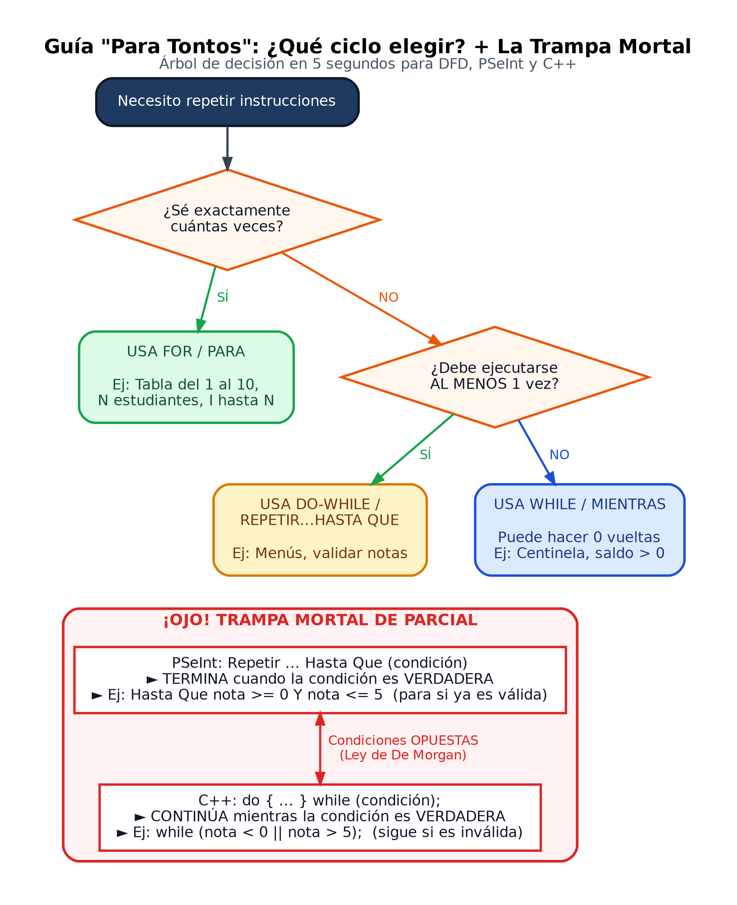
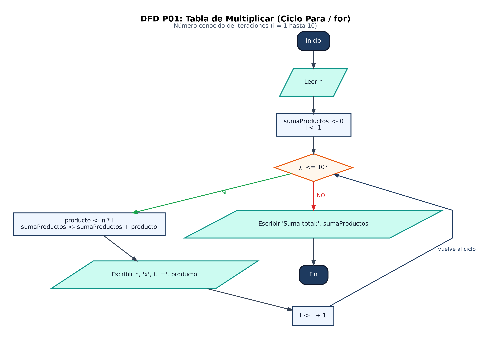
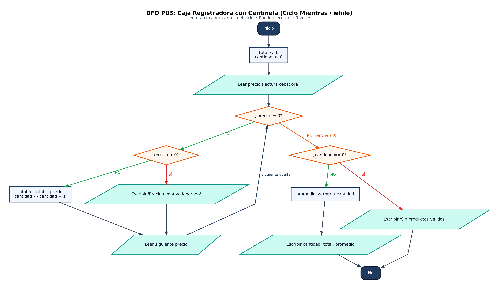
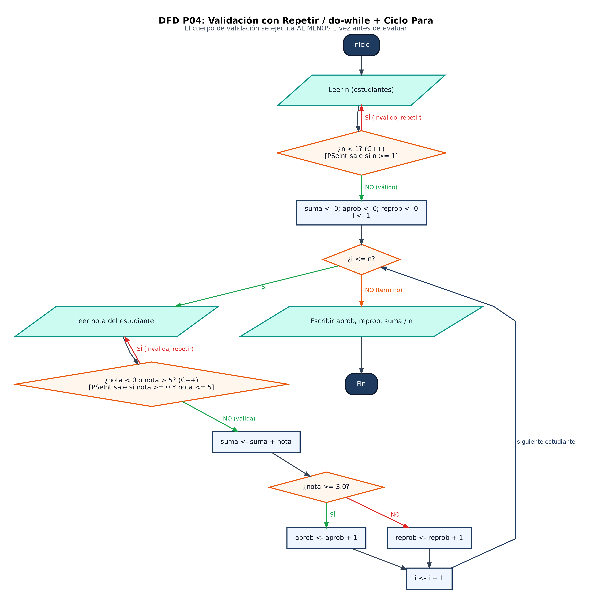
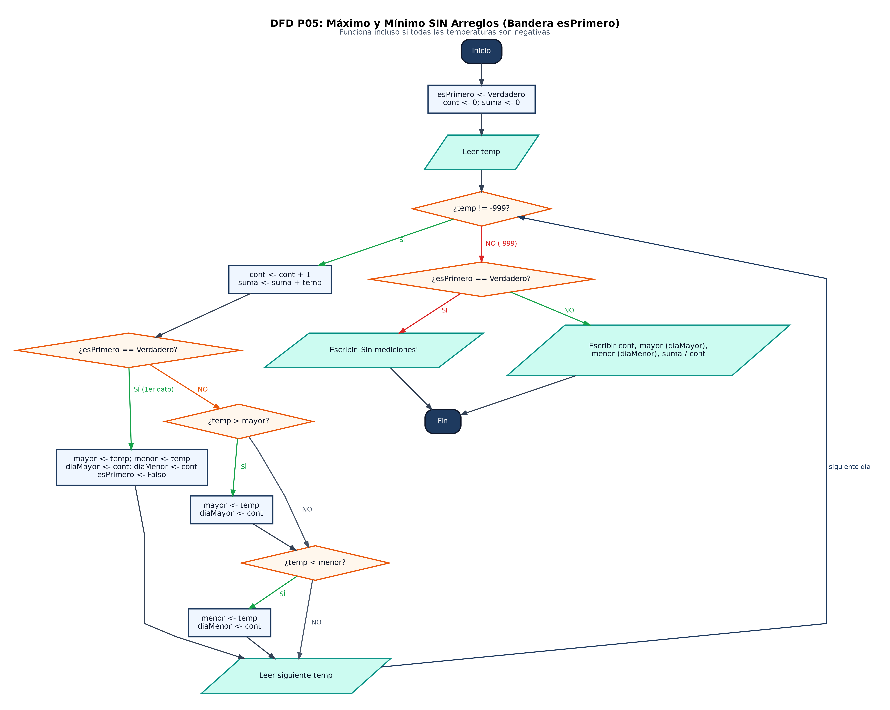
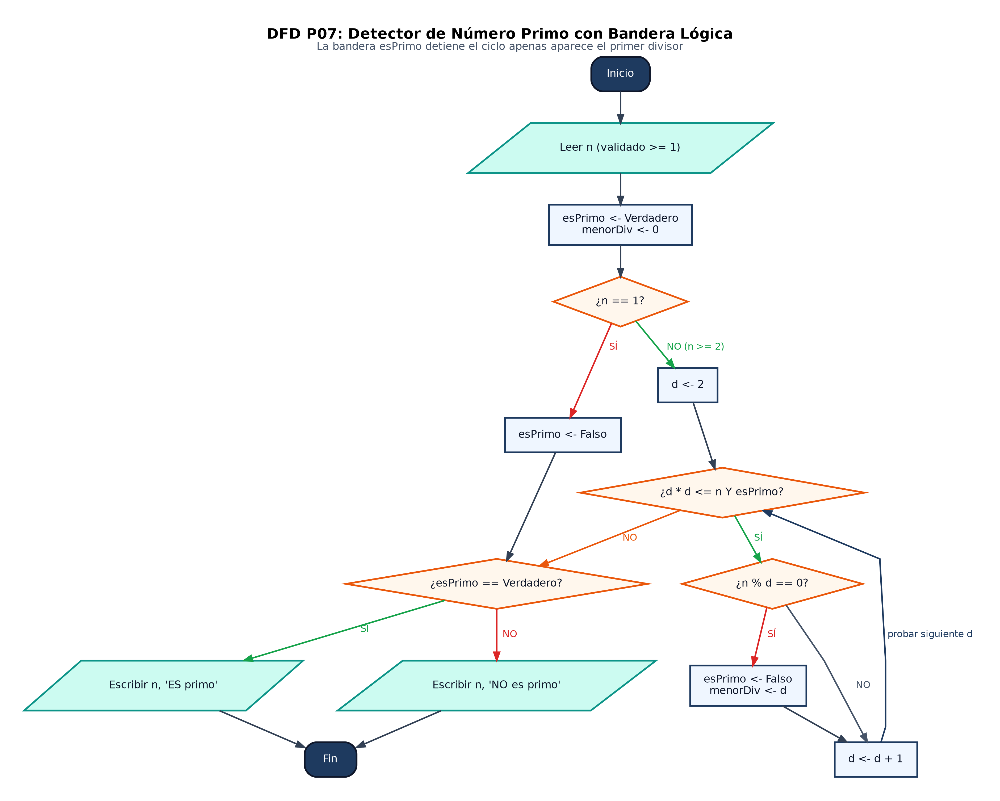
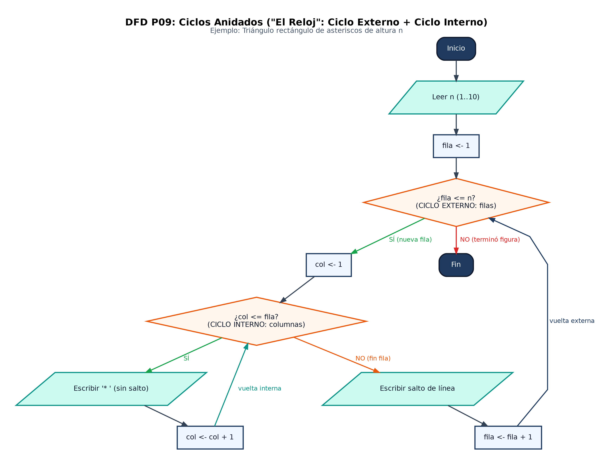
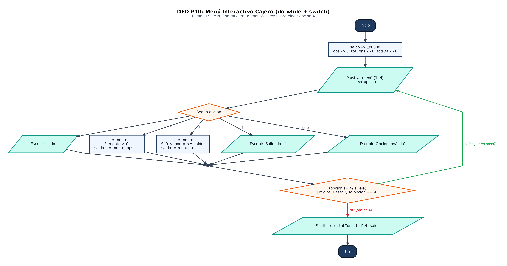

# Módulo 05: Ciclos y Bucles (`while`, `do-while`, `for`) — Dominando la Repetición SIN Arreglos

> **Duración estimada:** 4.0 horas (2 sesiones de monitoría de 2 horas: Teoría + Patrones Clave + Práctica Guiada)  
> **Ruta de aprendizaje:** Logica cotidiana => DFD => PSeInt (`Mientras`, `Repetir...Hasta Que`, `Para`) => C++ Básico (`while`, `do-while`, `for`)  
> **Prerrequisitos:** M00–M04 (Variables, Tipos de Datos, Operadores y Condicionales)  
> **Regla de alcance del módulo:** En todo M05 trabajaremos **exclusivamente con variables simples** (todavía NO existen arreglos, vectores ni matrices; esos llegan en M06). Aprenderás a procesar secuencias largas de datos **"al vuelo"**, dato por dato, sin guardar listas en memoria.

---

## Tabla de Contenidos

1. [Explicado "Para Tontos" / Con Plastilina: ¿Qué es un ciclo y por qué salva tu vida?](#1-explicado-para-tontos--con-plastilina-qué-es-un-ciclo-y-por-qué-salva-tu-vida)
2. [Los 3 Ingredientes Obligatorios de Todo Ciclo (El Triángulo de Supervivencia)](#2-los-3-ingredientes-obligatorios-de-todo-ciclo)
3. [Los 3 Ciclos Frente a Frente (DFD, PSeInt y C++)](#3-los-3-ciclos-frente-a-frente-dfd-pseint-y-c)
4. [Guía "Para Tontos" de CUÁNDO Usar Cada Ciclo](#4-guía-para-tontos-de-cuándo-usar-cada-ciclo)
5. [¡OJO! LA TRAMPA MORTAL DE PARCIAL: `Repetir...Hasta Que` vs `do...while`](#5-ojo-la-trampa-mortal-de-parcial-repetirhasta-que-vs-dowhile)
6. [Los 6 Errores Clásicos de Parcial (y Cómo Evitarlos)](#6-los-6-errores-clásicos-de-parcial-y-cómo-evitarlos)
7. [Caja de Herramientas: Técnicas Clave SIN Arreglos](#7-caja-de-herramientas-técnicas-clave-sin-arreglos)
8. [10 Problemas Resueltos Completos (EPS + DFD + PSeInt + C++ + Prueba de Escritorio)](#8-10-problemas-resueltos-completos)
9. [16 Ejercicios Propuestos (con Pista del Monitor)](#9-16-ejercicios-propuestos-con-pista-del-monitor)
10. [Solucionario Completo Paso a Paso (Ejercicios 1 al 16)](#10-solucionario-completo-paso-a-paso)

---

## 1. Explicado "Para Tontos" / Con Plastilina: ¿Qué es un ciclo y por qué salva tu vida?

Imagina que el profesor te castiga y te dice:  
*"Escribe en el tablero 500 veces: 'Debo inicializar mis acumuladores en cero'"*.

Si solo supieras lo que viste en M04 (`if`, `else`, `cout`), tendrías que escribir 500 líneas de `cout << ...;` copiando y pegando. Y si luego te piden las notas de 2,000 estudiantes, tu archivo sería un monstruo inmanejable.

**Un ciclo (o bucle) es una orden que le dice al computador:**
> *"Repite este bloque de instrucciones una y otra vez, mientras (o hasta que) se cumpla una condición."*

### Analogías cotidianas con plastilina

1. **El ciclo `for` (`Para`) — "Dar 5 vueltas exactas a la cancha":**  
   El entrenador te dice: *"Da 5 vueltas a la pista"*. Tú cuentas: vuelta 1, vuelta 2, vuelta 3, vuelta 4, vuelta 5... ¡Listo, paras! **Sabías desde el principio cuántas veces ibas a repetir.**
2. **El ciclo `while` (`Mientras`) — "Lavar platos mientras haya platos sucios":**  
   Te paras frente al lavaplatos. **Antes** de agarrar la esponja, miras si hay platos sucios. ¿Hay 0 platos? No lavas ninguno (0 repeticiones) y te vas a jugar. ¿Hay 12? Lavas uno, revisas otra vez, lavas otro... hasta que quede vacío.
3. **El ciclo `do-while` (`Repetir...Hasta Que`) — "Pedir la contraseña del WiFi":**  
   **Primero** intentas escribir la contraseña (al menos 1 vez tienes que intentarlo). **Después** el sistema revisa si estuvo mal para volver a pedírtela. No tiene sentido revisar si la escribiste mal antes de que la escribas por primera vez.

---

## 2. Los 3 Ingredientes Obligatorios de Todo Ciclo

Para que un ciclo funcione bien y **NO se quede colgado por toda la eternidad** (el temido *bucle infinito*), casi siempre necesita 3 piezas clave en memoria RAM:

| Ingrediente | Pregunta que responde | Ejemplo con contador | Ejemplo con centinela |
| :--- | :--- | :--- | :--- |
| **1. Inicialización** | ¿Cómo arranca la variable de control *antes* de entrar al ciclo? | `int i = 1;` | `cin >> precio;` (lectura cebadora) |
| **2. Condición** | ¿Qué pregunta de `Verdadero/Falso` decide si hay otra vuelta? | `i <= 10` | `precio != 0` |
| **3. Actualización** | ¿Qué cambia *dentro* del ciclo para acercarme al final? | `i++` (suma 1) | `cin >> precio;` (leer el siguiente) |

> **Consejo de Monitoria:** Si tu programa "se congeló" en la consola y no imprime nada ni termina, revisa de inmediato el **Ingrediente #3 (Actualización)**. En el 90% de los casos, olvidaste cambiar la variable que está dentro de la condición del ciclo.

---

## 3. Los 3 Ciclos Frente a Frente (DFD, PSeInt y C++)

### 3.1 El Ciclo `while` / `Mientras` ("El Portero Estricto")

Primero pregunta, después ejecuta. Si la condición es `Falsa` desde la primera vez, el cuerpo del ciclo **se ejecuta 0 veces**.

- **PSeInt:**
```pseint
Mientras condicion Hacer
    // Instrucciones que se repiten mientras condicion sea Verdadero
FinMientras
```

- **C++:**
```cpp
while (condicion) {
    // Instrucciones que se repiten mientras condicion sea true
}
```

**Ejemplo con plastilina (contar del 1 al 3 con `while`):**
```cpp
int i = 1;           // 1. Inicialización
while (i <= 3) {     // 2. Condición (¿i es menor o igual a 3?)
    cout << i << endl;
    i++;             // 3. Actualización (sin esto, imprime 1 infinito!)
}
```

### 3.2 El Ciclo `do-while` / `Repetir...Hasta Que` ("El Mesero Amable")

Primero ejecuta el cuerpo **al menos 1 vez**, y al final evalúa si debe volver a repetir o si ya puede salir.

- **PSeInt:**
```pseint
Repetir
    // Instrucciones (se ejecutan al menos 1 vez)
Hasta Que condicion_de_SALIDA
```

- **C++:**
```cpp
do {
    // Instrucciones (se ejecutan al menos 1 vez)
} while (condicion_de_CONTINUACION);   // <-- ¡OJO CON EL PUNTO Y COMA AL FINAL!
```

### 3.3 El Ciclo `for` / `Para` ("La Máquina Contadora Automática")

Empaqueta en una sola cabecera los 3 ingredientes (inicio, condición y paso). Es el favorito cuando conocemos el inicio, el fin y de cuánto en cuánto avanzamos.

- **PSeInt:**
```pseint
Para i <- inicio Hasta fin Con Paso incremento Hacer
    // Instrucciones
FinPara
```
*(Nota: en PSeInt el límite `Hasta fin` es **inclusivo** y `Con Paso 1` puede omitirse si va de 1 en 1; para ir hacia atrás se usa `Con Paso -1`.)*

- **C++:**
```cpp
for (int i = inicio; i <= fin; i++) {
    // Instrucciones
}
```
**¿En qué orden exacto ejecuta C++ un `for (A; B; C)`?**
1. Ejecuta **`A`** (`int i = inicio`) **una sola vez** al comienzo.
2. Evalúa **`B`** (`i <= fin`). Si es `false`, sale del ciclo inmediatamente.
3. Si `B` es `true`, ejecuta todas las instrucciones dentro de `{ ... }`.
4. Al terminar el cuerpo, ejecuta **`C`** (`i++`) y vuelve al paso 2 (`B`).

### 3.4 Tabla Maestra de Traducción DFD ↔ PSeInt ↔ C++

| Concepto | En DFD (flujo) | En PSeInt (español) | En C++ |
| :--- | :--- | :--- | :--- |
| Ciclo pre-evaluado | Rombo *antes* del cuerpo; flecha `Sí` entra y vuelve al rombo | `Mientras cond Hacer ... FinMientras` | `while (cond) { ... }` |
| Ciclo post-evaluado | Cuerpo *primero*; rombo *al final* decide si vuelve arriba | `Repetir ... Hasta Que cond_salida` | `do { ... } while (cond_seguir);` |
| Ciclo con contador | `i <- ini`, rombo `i <= fin`, cuerpo, `i <- i + paso` | `Para i <- ini Hasta fin Con Paso p Hacer ... FinPara` | `for (int i = ini; i <= fin; i += p) { ... }` |

---

## 4. Guía "Para Tontos" de CUÁNDO Usar Cada Ciclo

Cuando leas un enunciado de parcial, hazte estas dos preguntas en orden:

1. **¿Sé exactamente cuántas veces se va a repetir (o tengo un `N` leído antes de empezar el ciclo)?**
   - **SÍ** => Usa **`for`** (`Para`).  
     *Ejemplos:* Imprimir la tabla del 1 al 10; leer exactamente `N` notas; sumar los números del 1 al 100; dibujar un triángulo de `N` filas.
2. **NO sé cuántas veces se repetirá (depende del usuario o de un cálculo). Entonces pregúntate: ¿el bloque DEBE ejecutarse al menos 1 vez sí o sí?**
   - **SÍ** => Usa **`do-while`** (`Repetir...Hasta Que`).  
     *Ejemplos:* Mostrar un menú de opciones hasta que elija "Salir"; pedir una nota hasta que esté entre `0.0` y `5.0` (¡tienes que pedirla primero para saber si está mala!).
   - **NO** (puede ocurrir **0 veces** si desde el inicio la condición no se cumple) => Usa **`while`** (`Mientras`).  
     *Ejemplos:* Sumar precios hasta que el cajero escriba `0` (si de entrada escribe `0`, compró 0 cosas); contar dígitos dividiendo entre 10 mientras `n > 0`; calcular el MCD por Euclides mientras `b != 0`.



### Mini-quiz del Monitor (¡Ponte a prueba en 10 segundos!)

- *"Leer las edades de 35 personas y calcular su promedio."* => **`for`**, sabemos que son 35.
- *"Leer edades hasta que el usuario digite `-1`."* => **`while`**, no sabemos cuántas ingresará y podría digitar `-1` de entrada (0 datos).
- *"Pedir el PIN del cajero y repetir si es incorrecto."* => **`do-while`**, primero debe digitar el PIN al menos 1 vez.

---

## 5. ¡OJO! LA TRAMPA MORTAL DE PARCIAL: `Repetir...Hasta Que` vs `do...while`

Esta es **LA causa #1 de ceros en parciales** cuando los estudiantes traducen de PSeInt a C++. Grábate esto con fuego:

- En **PSeInt**, `Repetir ... Hasta Que <condición>` significa: **"Repite y DETENTE CUANDO la condición sea VERDADERA"** (es decir, es una condición de **SALIDA / ÉXITO**).
- En **C++**, `do { ... } while (<condición>);` significa: **"Haz esto y CONTINÚA MIENTRAS la condición sea VERDADERA"** (es decir, es una condición de **PERMANENCIA / ERROR**).

**¡LAS CONDICIONES SON EXACTAMENTE OPUESTAS!** Si traduces la condición de PSeInt sin negarla (aplicando la **Ley de De Morgan** vista en M04), tu programa en C++ quedará atrapado para siempre cuando el dato sea bueno, ¡y saldrá cuando el dato sea malo!

### Tabla Traductora Anti-Trampa (Leyes de De Morgan)

| Situación | PSeInt: `Repetir ... Hasta Que` *(¿Cuándo PARO?)* | C++: `do { ... } while (...);` *(¿Cuándo SIGO?)* | Error mortal si NO niegas |
| :--- | :--- | :--- | :--- |
| Validar número positivo | `Hasta Que n > 0` | `while (n <= 0);` | Escribir `while (n > 0);` (atrapa positivos!) |
| Validar nota entre `0.0` y `5.0` | `Hasta Que nota >= 0 Y nota <= 5` | `while (nota < 0 || nota > 5);` | Dejar `&&` en vez de `||` (nunca se cumple!) |
| Repetir menú hasta opción `4` | `Hasta Que opcion = 4` | `while (opcion != 4);` | Escribir `while (opcion == 4);` (sale con 1,2,3!) |
| Máximo 3 intentos o acierto | `Hasta Que intentos = 3 O acierto` | `while (intentos < 3 && !acierto);` | Olvidar voltear `O` por `&&` |

> **Truco mnemotécnico del Monitor:**  
> - **PSeInt dice "HASTA QUE..."** => *"Camina **hasta que** veas el semáforo en verde"* (paras cuando es **VERDADERO**).  
> - **C++ dice "MIENTRAS (while)..."** => *"Camina **mientras** el semáforo esté en rojo"* (sigues cuando es **VERDADERO**).

---

## 6. Los 6 Errores Clásicos de Parcial (y Cómo Evitarlos)

1. **El punto y coma asesino (`;`):**
   ```cpp
   for (int i = 1; i <= 5; i++); {   // <-- ESE ';' MATA EL FOR!
       cout << i << endl;            // i ni siquiera existe aqui o imprime 1 vez
   }
   ```
   En `for (...)` y `while (...)` **NO va `;`** después del paréntesis. El único que lleva `;` obligatorio al final es `do { ... } while (...);`.
2. **El bucle infinito por olvido de actualización:**
   ```cpp
   int i = 1;
   while (i <= 5) {
       cout << i << endl;
       // Olvidaste i++; => imprime 1 hasta el fin de los tiempos!
   }
   ```
3. **Inicializar un acumulador multiplicativo en `0`:**  
   Si haces `long long factorial = 0;` y luego `factorial *= i;`, cualquier número multiplicado por `0` da `0`. Todo producto o factorial arranca en **`1`** (neutro multiplicativo). Toda suma arranca en **`0`** (neutro aditivo).
4. **Inicializar `mayor = 0` para buscar el máximo:**  
   Si todas las temperaturas ingresadas son negativas (`-12`, `-4`, `-18`), ¡tu programa dirá que la temperatura máxima fue `0` (un número que nadie ingresó)! **Solución:** inicializa `mayor` y `menor` con el **primer dato real** usando una bandera `bool esPrimero = true;`.
5. **Sumar o contar el valor centinela:**  
   Si dentro de un `while (x != -1)` lees `cin >> x;` y *inmediatamente* haces `suma += x; cont++;` antes de volver arriba a evaluar `x != -1`, ¡acabarás sumando el `-1` y contándolo como dato válido! **Solución:** usa **lectura cebadora** antes del ciclo y lee el siguiente dato *al final* del cuerpo del `while`.
6. **Error "Uno más o uno menos" (*Off-by-one*):**  
   Confundir `for (int i = 0; i < n; i++)` (`n` vueltas: `0..n-1`) con `for (int i = 0; i <= n; i++)` (`n + 1` vueltas: `0..n`), o `i = 1; i < n` (`n - 1` vueltas). Cuenta siempre con los dedos para un ejemplo pequeño como `n = 3`.

---

## 7. Caja de Herramientas: Técnicas Clave SIN Arreglos

En este módulo no guardamos listas de datos. Cada dato entra por `cin`, lo procesamos en el acto con variables simples, y dejamos listo el estado para el siguiente dato. Estas son las 6 técnicas maestras que debes dominar:

### 7.1 Contadores vs. Acumuladores

| Concepto | ¿Para qué sirve? | Cómo se inicializa | Cómo se actualiza dentro del ciclo |
| :--- | :--- | :--- | :--- |
| **Contador** | Contar *cuántos* eventos ocurren (cantidad fija de paso `1`) | `int cont = 0;` | `cont = cont + 1;` o `cont++;` |
| **Acumulador aditivo** | Sumar valores variables (precios, notas, edades) | `double suma = 0.0;` | `suma = suma + dato;` o `suma += dato;` |
| **Acumulador multiplicativo** | Multiplicar factores (factorial, potencias) | `long long prod = 1;` | `prod = prod * factor;` o `prod *= factor;` |

### 7.2 Banderas Booleanas (`bool` / `Logico`)

Una bandera es una variable `bool` que actúa como un **interruptor de luz** (encendido/apagado) para recordar si algo ya pasó o para detener un ciclo antes de tiempo.

- **Bandera de detección ("¿Hubo al menos un...?"):** Inicia en `false`, y si alguna vuelta cumple la condición, se vuelve `true` (y nunca vuelve a `false`).
- **Bandera de validez o primalidad ("¿Sigue siendo válido/primo?"):** Inicia en `true`, y si encontramos un contraejemplo (un divisor, una falla), cambia a `false` y puede cortar el ciclo en la condición (`&& esPrimo`).

### 7.3 Hallar Máximo y Mínimo SIN Arreglos

Como no tenemos un arreglo donde guardar todos los números para revisarlos después, mantenemos en memoria únicamente **el campeón actual (`mayor`) y el menor actual (`menor`)**. Al llegar el primer dato (`esPrimero == true`), ese dato es automáticamente tanto el mayor como el menor hasta ese momento, y bajamos la bandera (`esPrimero = false;`). Desde el segundo dato en adelante, cada nuevo valor compite contra `mayor` y contra `menor`.

### 7.4 Validación de Entradas y Lectura Segura en Consola (`EOF`)

En pruebas automáticas o cuando alguien cierra el flujo de entrada estándar (`Ctrl+D` en Linux / `Ctrl+Z` en Windows), `cin >> x` falla y devuelve `false`. Si un `while` o `do-while` no comprueba si `cin >> x` tuvo éxito, puede quedarse atrapado repitiendo el último valor de `x` infinitamente.

**Patrón limpio y seguro en C++:**
```cpp
if (!(cin >> x)) {
    break; // Sale limpiamente si termina el flujo de entrada (EOF)
}
```
Todos los programas `.cpp` de este módulo incluyen esta buena práctica para que nunca se cuelguen ni siquiera en pruebas automatizadas por consola.

### 7.5 Ciclos Anidados ("El Reloj")

Cuando pones un ciclo dentro de otro, funcionan exactamente como un reloj analógico:
- El **ciclo externo** es la aguja de las **horas** (ej. recorre cada `fila` de 1 a `n`).
- El **ciclo interno** es el **minutero** (ej. recorre cada `columna` de 1 a `m`).
- **Regla de oro:** Por **cada 1 paso** del ciclo externo, el ciclo interno da **todas sus vueltas completas** desde el principio hasta el final.

---

## 8. 10 Problemas Resueltos Completos

> Todos los códigos PSeInt (`pseint/p01_*.psc` .. `p10_*.psc`) y C++ (`cpp/p01_*.cpp` .. `p10_*.cpp`) de esta sección están guardados en archivos reales, compilados sin advertencias con `g++ -std=c++17 -Wall -Wextra -Werror` y verificados ejecutando casos de prueba reales por consola.

---

### Problema 01: Tabla de Multiplicar y Suma de Productos (`for` / `Para`)

**Enunciado:**  
Diseña un algoritmo que lea un número entero `n`, imprima su tabla de multiplicar del `1` al `10` (en formato `n x i = resultado`) y al final muestre la suma de los 10 productos generados.

#### Análisis EPS y Elección del Ciclo
- **Entradas:** `n` (entero ingresado por el usuario).
- **Proceso:** Repetir `i` desde `1` hasta `10`. En cada paso calcular `producto = n * i`, imprimir la línea de la tabla y acumular `sumaProductos += producto`.
- **Salidas:** Las 10 líneas de la tabla y el entero `sumaProductos`.
- **¿Qué ciclo elegir y por qué?** Sabemos exactamente antes de iniciar que son **10 repeticiones** (del `1` al `10`). Por eso elegimos **`for` / `Para`**.

#### Diagrama DFD



#### Código PSeInt — [`pseint/p01_tabla_multiplicar.psc`](pseint/p01_tabla_multiplicar.psc)

```pseint
Algoritmo TablaMultiplicar
    Definir n, i, producto, sumaProductos Como Entero;

    sumaProductos <- 0;
    Escribir "=== TABLA DE MULTIPLICAR (CICLO PARA) ===";
    Escribir "Ingrese un numero entero para ver su tabla del 1 al 10:";
    Leer n;

    Escribir "Tabla del ", n, ":";
    Para i <- 1 Hasta 10 Con Paso 1 Hacer
        producto <- n * i;
        Escribir n, " x ", i, " = ", producto;
        sumaProductos <- sumaProductos + producto;
    FinPara

    Escribir "Suma de los 10 productos: ", sumaProductos;
FinAlgoritmo
```

#### Código C++ — [`cpp/p01_tabla_multiplicar.cpp`](cpp/p01_tabla_multiplicar.cpp)

```cpp
#include <iostream>

using namespace std;

int main() {
    int n = 0;
    int sumaProductos = 0;

    cout << "=== TABLA DE MULTIPLICAR (CICLO FOR) ===" << endl;
    cout << "Ingrese un numero entero para ver su tabla del 1 al 10: ";
    if (!(cin >> n)) {
        return 0;
    }

    cout << "\nTabla del " << n << ":" << endl;
    for (int i = 1; i <= 10; i++) {
        int producto = n * i;
        cout << n << " x " << i << " = " << producto << endl;
        sumaProductos += producto;
    }

    cout << "Suma de los 10 productos: " << sumaProductos << endl;
    return 0;
}
```

#### Prueba de Escritorio (`n = 7`)

| Paso | `n` | `i` | `i <= 10` | `producto` | `sumaProductos` | Salida en pantalla |
| :---: | :---: | :---: | :---: | :---: | :---: | :--- |
| Inicio | `7` | `-` | `-` | `-` | `0` | `"Tabla del 7:"` |
| Vuelta 1 | `7` | `1` | `true` | `7` | `7` | `7 x 1 = 7` |
| Vuelta 2 | `7` | `2` | `true` | `14` | `21` | `7 x 2 = 14` |
| Vuelta 3 | `7` | `3` | `true` | `21` | `42` | `7 x 3 = 21` |
| Vuelta 4 | `7` | `4` | `true` | `28` | `70` | `7 x 4 = 28` |
| Vuelta 5 | `7` | `5` | `true` | `35` | `105` | `7 x 5 = 35` |
| Vuelta 6 | `7` | `6` | `true` | `42` | `147` | `7 x 6 = 42` |
| Vuelta 7 | `7` | `7` | `true` | `49` | `196` | `7 x 7 = 49` |
| Vuelta 8 | `7` | `8` | `true` | `56` | `252` | `7 x 8 = 56` |
| Vuelta 9 | `7` | `9` | `true` | `63` | `315` | `7 x 9 = 63` |
| Vuelta 10 | `7` | `10` | `true` | `70` | `385` | `7 x 10 = 70` |
| Fin | `7` | `11` | `false` | `70` | `385` | `Suma de los 10 productos: 385` |

---

### Problema 02: Suma de `1` a `n` y Factorial `n!` (`do-while` + `for`)

**Enunciado:**  
Solicita un número entero `n` validado entre `0` y `20` (para que `n!` quepa en `long long`). Calcula la sumatoria $1 + 2 + \dots + n$ y el factorial $n!$, recordando que por definición $0! = 1$.

#### Análisis EPS y Elección de Ciclos
- **Entradas:** `n` (entero validado entre `0` y `20`).
- **Proceso:**
  1. Validar `n` con **`do-while`** (`Repetir...Hasta Que`) porque debemos leer `n` al menos 1 vez antes de saber si está fuera de rango.
  2. Inicializar `suma = 0` (neutro aditivo) y `factorial = 1` (neutro multiplicativo).
  3. Recorrer `i` desde `1` hasta `n` con **`for`** (`Para`). Si `n = 0`, el `for` hace 0 vueltas y quedan exactamente `suma = 0` y `factorial = 1`.
- **Salidas:** `suma` y `factorial`.

#### Flujo DFD (Estructura)
`Inicio` => `[Repetir: Leer n -> ¿n < 0 o n > 20?]` => `suma <- 0; factorial <- 1; i <- 1` => `[Mientras i <= n: suma += i; factorial *= i; i++]` => `Escribir suma, factorial` => `Fin`.

#### Código PSeInt — [`pseint/p02_suma_y_factorial.psc`](pseint/p02_suma_y_factorial.psc)

```pseint
Algoritmo SumaYFactorial
    Definir n, i Como Entero;
    Definir suma, factorial Como Real;

    Escribir "=== SUMA Y FACTORIAL DE 1 A N ===";

    // En PSeInt: Hasta Que indica la condicion de SALIDA (cuando n es valido)
    Repetir
        Escribir "Ingrese un entero n (entre 0 y 20):";
        Leer n;
        Si n < 0 O n > 20 Entonces
            Escribir "Valor fuera de rango. Intente nuevamente.";
        FinSi
    Hasta Que n >= 0 Y n <= 20

    suma <- 0;
    factorial <- 1;

    Para i <- 1 Hasta n Con Paso 1 Hacer
        suma <- suma + i;
        factorial <- factorial * i;
    FinPara

    Escribir "Resultados para n = ", n, ":";
    Escribir "Suma de 1 hasta ", n, " = ", suma;
    Escribir "Factorial ", n, "! = ", factorial;
FinAlgoritmo
```

#### Código C++ — [`cpp/p02_suma_y_factorial.cpp`](cpp/p02_suma_y_factorial.cpp)

```cpp
#include <iostream>

using namespace std;

int main() {
    int n = 0;
    bool entradaOk = true;

    cout << "=== SUMA Y FACTORIAL DE 1 A N ===" << endl;

    // Validacion con do-while: se ejecuta al menos 1 vez
    // Condicion en C++: CONTINUA mientras n sea invalido
    do {
        cout << "Ingrese un entero n (entre 0 y 20): ";
        if (!(cin >> n)) {
            entradaOk = false;
            break;
        }
        if (n < 0 || n > 20) {
            cout << "Valor fuera de rango. Intente nuevamente." << endl;
        }
    } while (n < 0 || n > 20);

    if (!entradaOk) {
        return 0;
    }

    long long suma = 0;        // Neutro aditivo = 0
    long long factorial = 1;   // Neutro multiplicativo = 1 (0! = 1)

    for (int i = 1; i <= n; i++) {
        suma += i;
        factorial *= i;
    }

    cout << "\nResultados para n = " << n << ":" << endl;
    cout << "Suma de 1 hasta " << n << " = " << suma << endl;
    cout << "Factorial " << n << "! = " << factorial << endl;

    return 0;
}
```

#### Prueba de Escritorio (Entrada: `-3`, luego `5`)

| Fase | `n` | Condición validación (`C++`) | `i` | `suma` | `factorial` | Salida |
| :--- | :---: | :---: | :---: | :---: | :---: | :--- |
| Leer `n` (1er intento) | `-3` | `-3 < 0 \|\| -3 > 20` => `true` | `-` | `-` | `-` | `"Valor fuera de rango..."` |
| Leer `n` (2do intento) | `5` | `5 < 0 \|\| 5 > 20` => `false` | `-` | `0` | `1` | Sale de validación |
| `for` vuelta 1 | `5` | `1 <= 5` => `true` | `1` | `1` | `1` | `-` |
| `for` vuelta 2 | `5` | `2 <= 5` => `true` | `2` | `3` | `2` | `-` |
| `for` vuelta 3 | `5` | `3 <= 5` => `true` | `3` | `6` | `6` | `-` |
| `for` vuelta 4 | `5` | `4 <= 5` => `true` | `4` | `10` | `24` | `-` |
| `for` vuelta 5 | `5` | `5 <= 5` => `true` | `5` | `15` | `120` | `-` |
| Fin `for` | `5` | `6 <= 5` => `false` | `6` | `15` | `120` | `Suma = 15`, `5! = 120` |

*(Caso borde `n = 0`: el `for` evalúa `1 <= 0` => `false`, no hace vueltas e imprime `Suma de 1 hasta 0 = 0` y `0! = 1`.)*

---

### Problema 03: Caja Registradora con Centinela `0` (`while` / `Mientras`)

**Enunciado:**  
Una tienda necesita registrar los precios de los productos de un cliente hasta que el cajero digite `0` (valor centinela). Si por error el cajero digita un precio negativo, el sistema debe mostrar una advertencia y **NO sumarlo ni contarlo**. Al finalizar, debe mostrar la cantidad de productos válidos, el total a pagar y el precio promedio (cuidando de no dividir por cero si no registró ningún producto).

#### Análisis EPS y Elección del Ciclo
- **Entradas:** Secuencia indeterminada de precios reales terminada en `0`.
- **Proceso:** Leer un primer precio (**lectura cebadora**). Mientras `precio != 0`: si `precio < 0`, advertir; si no, sumar a `total` e incrementar `cantidad`. Al final de la vuelta, leer el siguiente precio. Al salir, si `cantidad == 0`, avisar; si no, calcular `promedio = total / cantidad`.
- **Salidas:** `cantidad`, `total`, `promedio` (o mensaje de compra vacía).
- **¿Qué ciclo elegir y por qué?** No sabemos cuántos productos lleva el cliente y el ciclo puede hacer **0 vueltas** (si digita `0` de entrada). Es el escenario clásico del **`while` / `Mientras` con centinela**.

#### Diagrama DFD



#### Código PSeInt — [`pseint/p03_caja_centinela.psc`](pseint/p03_caja_centinela.psc)

```pseint
Algoritmo CajaCentinela
    Definir precio, total, promedio Como Real;
    Definir cantidad Como Entero;

    total <- 0;
    cantidad <- 0;

    Escribir "=== CAJA REGISTRADORA CON CENTINELA (CICLO MIENTRAS) ===";
    Escribir "Ingrese el precio de cada producto (0 para terminar):";
    Leer precio;

    Mientras precio <> 0 Hacer
        Si precio < 0 Entonces
            Escribir "Advertencia: precio negativo ignorado (", precio, ").";
        SiNo
            total <- total + precio;
            cantidad <- cantidad + 1;
        FinSi
        Escribir "Ingrese siguiente precio (0 para terminar):";
        Leer precio;
    FinMientras

    Escribir "=== RESUMEN DE COMPRA ===";
    Si cantidad = 0 Entonces
        Escribir "No se registraron productos validos.";
    SiNo
        promedio <- total / cantidad;
        Escribir "Productos validos: ", cantidad;
        Escribir "Total a pagar: $", total;
        Escribir "Precio promedio: $", promedio;
    FinSi
FinAlgoritmo
```

#### Código C++ — [`cpp/p03_caja_centinela.cpp`](cpp/p03_caja_centinela.cpp)

```cpp
#include <iomanip>
#include <iostream>

using namespace std;

int main() {
    double precio = 0.0;
    double total = 0.0;
    int cantidad = 0;

    cout << "=== CAJA REGISTRADORA CON CENTINELA (CICLO WHILE) ===" << endl;
    cout << "Ingrese el precio de cada producto (0 para terminar): ";

    // Lectura cebadora: si el usuario ingresa 0 de una vez, el ciclo hace 0 vueltas
    if (!(cin >> precio)) {
        return 0;
    }

    while (precio != 0.0) {
        if (precio < 0.0) {
            cout << "Advertencia: precio negativo ignorado (" << precio << ")." << endl;
        } else {
            total += precio;
            cantidad++;
        }

        cout << "Ingrese siguiente precio (0 para terminar): ";
        if (!(cin >> precio)) {
            break;
        }
    }

    cout << fixed << setprecision(2);
    cout << "\n=== RESUMEN DE COMPRA ===" << endl;
    if (cantidad == 0) {
        cout << "No se registraron productos validos." << endl;
    } else {
        double promedio = total / cantidad;
        cout << "Productos validos: " << cantidad << endl;
        cout << "Total a pagar:     $" << total << endl;
        cout << "Precio promedio:   $" << promedio << endl;
    }

    return 0;
}
```

#### Prueba de Escritorio (Entradas: `1500`, `-200`, `3500`, `1000`, `0`)

| Paso | `precio` leído | `precio != 0` | `precio < 0` | `cantidad` | `total` | Acción / Salida |
| :--- | :---: | :---: | :---: | :---: | :---: | :--- |
| Cebador | `1500` | `-` | `-` | `0` | `0.00` | Entra al `while` |
| Vuelta 1 | `1500` | `true` | `false` | `1` | `1500.00` | Lee `-200` al final |
| Vuelta 2 | `-200` | `true` | `true` | `1` | `1500.00` | Imprime `"Advertencia..."`; lee `3500` |
| Vuelta 3 | `3500` | `true` | `false` | `2` | `5000.00` | Lee `1000` al final |
| Vuelta 4 | `1000` | `true` | `false` | `3` | `6000.00` | Lee `0` al final |
| Evaluación | `0` | `false` | `-` | `3` | `6000.00` | Sale; `promedio = 2000.00` |

---

### Problema 04: Validación de Notas y Estadísticas de Grupo (`do-while` vs `Repetir...Hasta Que`)

**Enunciado:**  
Un docente necesita ingresar la cantidad de estudiantes `n` (`n >= 1`, validada) y luego pedir la nota de cada estudiante validando que esté entre `0.0` y `5.0`. Al final mostrará cuántos aprobaron (`>= 3.0`), cuántos reprobaron y el promedio del grupo.

#### Análisis EPS y Elección de Ciclos
- **Entradas:** `n` (entero `>= 1`) y `n` notas reales en `0.0..5.0`.
- **Proceso:**
  - Validar `n` con **`do-while` / `Repetir...Hasta Que`**.
  - Recorrer `i = 1..n` con **`for` / `Para`** (ya sabemos que son `n` estudiantes).
  - Dentro del `for`, validar cada `nota` con **`do-while` / `Repetir...Hasta Que`**. ¡Mira cómo la condición en PSeInt (`nota >= 0.0 Y nota <= 5.0`) es exactamente la opuesta de C++ (`nota < 0.0 || nota > 5.0`)!
- **Salidas:** `aprobados`, `reprobados` y `promedio`.

#### Diagrama DFD



#### Código PSeInt — [`pseint/p04_validacion_notas_grupo.psc`](pseint/p04_validacion_notas_grupo.psc)

```pseint
Algoritmo ValidacionNotasGrupo
    Definir n, i, aprobados, reprobados Como Entero;
    Definir nota, sumaNotas, promedio Como Real;

    Escribir "=== REGISTRO DE NOTAS CON VALIDACION ===";

    // TRAMPA: en PSeInt TERMINA cuando n >= 1 es VERDADERO
    Repetir
        Escribir "Cuantos estudiantes hay en el grupo? (>= 1):";
        Leer n;
        Si n < 1 Entonces
            Escribir "Error: debe haber al menos 1 estudiante.";
        FinSi
    Hasta Que n >= 1

    sumaNotas <- 0;
    aprobados <- 0;
    reprobados <- 0;

    Para i <- 1 Hasta n Con Paso 1 Hacer
        // TRAMPA: en PSeInt TERMINA cuando la nota ya esta entre 0.0 y 5.0
        Repetir
            Escribir "Nota del estudiante ", i, " (0.0 a 5.0):";
            Leer nota;
            Si nota < 0.0 O nota > 5.0 Entonces
                Escribir "Nota invalida. Debe estar entre 0.0 y 5.0.";
            FinSi
        Hasta Que nota >= 0.0 Y nota <= 5.0

        sumaNotas <- sumaNotas + nota;
        Si nota >= 3.0 Entonces
            aprobados <- aprobados + 1;
        SiNo
            reprobados <- reprobados + 1;
        FinSi
    FinPara

    promedio <- sumaNotas / n;
    Escribir "=== REPORTE DEL GRUPO ===";
    Escribir "Estudiantes procesados: ", n;
    Escribir "Aprobados (>= 3.0): ", aprobados;
    Escribir "Reprobados (< 3.0): ", reprobados;
    Escribir "Promedio del grupo: ", promedio;
FinAlgoritmo
```

#### Código C++ — [`cpp/p04_validacion_notas_grupo.cpp`](cpp/p04_validacion_notas_grupo.cpp)

```cpp
#include <iomanip>
#include <iostream>

using namespace std;

int main() {
    int n = 0;
    bool entradaOk = true;

    cout << "=== REGISTRO DE NOTAS CON VALIDACION ===" << endl;

    // En PSeInt: Repetir ... Hasta Que n >= 1 (termina cuando es VERDADERO)
    // En C++:    do { ... } while (n < 1);    (continua mientras es VERDADERO)
    do {
        cout << "Cuantos estudiantes hay en el grupo? (>= 1): ";
        if (!(cin >> n)) {
            entradaOk = false;
            break;
        }
        if (n < 1) {
            cout << "Error: debe haber al menos 1 estudiante." << endl;
        }
    } while (n < 1);

    if (!entradaOk) {
        return 0;
    }

    double sumaNotas = 0.0;
    int aprobados = 0;
    int reprobados = 0;

    for (int i = 1; i <= n; i++) {
        double nota = 0.0;
        do {
            cout << "Nota del estudiante " << i << " (0.0 a 5.0): ";
            if (!(cin >> nota)) {
                entradaOk = false;
                break;
            }
            if (nota < 0.0 || nota > 5.0) {
                cout << "Nota invalida. Debe estar entre 0.0 y 5.0." << endl;
            }
        } while (nota < 0.0 || nota > 5.0);

        if (!entradaOk) {
            break;
        }

        sumaNotas += nota;
        if (nota >= 3.0) {
            aprobados++;
        } else {
            reprobados++;
        }
    }

    int procesados = aprobados + reprobados;
    cout << fixed << setprecision(2);
    cout << "\n=== REPORTE DEL GRUPO ===" << endl;
    if (procesados == 0) {
        cout << "No se completaron registros." << endl;
    } else {
        cout << "Estudiantes procesados: " << procesados << endl;
        cout << "Aprobados (>= 3.0):     " << aprobados << endl;
        cout << "Reprobados (< 3.0):     " << reprobados << endl;
        cout << "Promedio del grupo:     " << (sumaNotas / procesados) << endl;
    }

    return 0;
}
```

#### Prueba de Escritorio (Entradas: `n`: `0`, `3`; notas: `6.0`, `4.0`, `-1`, `2.5`, `3.0`)

| Paso | `n` | `i` | `nota` leída | Validación | `sumaNotas` | `aprobados` | `reprobados` |
| :--- | :---: | :---: | :---: | :--- | :---: | :---: | :---: |
| Validar `n` | `0` | `-` | `-` | `0 < 1` => repite (Error) | `-` | `-` | `-` |
| Validar `n` | `3` | `-` | `-` | `3 < 1` => `false` (sale) | `0.0` | `0` | `0` |
| Est. 1 (intento 1) | `3` | `1` | `6.0` | `6.0 > 5.0` => repite | `0.0` | `0` | `0` |
| Est. 1 (intento 2) | `3` | `1` | `4.0` | Válida (`>= 3.0`) | `4.0` | `1` | `0` |
| Est. 2 (intento 1) | `3` | `2` | `-1.0` | `-1.0 < 0.0` => repite | `4.0` | `1` | `0` |
| Est. 2 (intento 2) | `3` | `2` | `2.5` | Válida (`< 3.0`) | `6.5` | `1` | `1` |
| Est. 3 | `3` | `3` | `3.0` | Válida (`>= 3.0`) | `9.5` | `2` | `1` |
| Reporte final | `3` | `4` | `-` | `aprobados=2`, `reprobados=1`, `promedio = 9.5 / 3 = 3.17` | `9.5` | `2` | `1` |

---

### Problema 05: Máximo, Mínimo y Día de Ocurrencia SIN Arreglos (`while` + Bandera `esPrimero`)

**Enunciado:**  
Una estación climática registra temperaturas diarias (pueden ser todas negativas en invierno!) hasta que el operario ingrese el centinela `-999`. Determina, **sin usar arreglos**, la temperatura máxima, la temperatura mínima, en qué día (`1, 2, 3...`) ocurrió cada una y el promedio general. Si el primer dato es `-999`, informa que no hubo mediciones.

#### Análisis EPS y Elección del Ciclo
- **Entradas:** Secuencia de temperaturas reales terminada en `-999`.
- **Proceso:** Usar **`while`** con lectura cebadora. Mantener `bool esPrimero = true;`. Al procesar el primer dato válido, inicializar `mayor = temp`, `menor = temp`, `diaMayor = 1`, `diaMenor = 1`, y apagar la bandera `esPrimero = false`. Para los datos siguientes, comparar con `mayor` y `menor`.
- **Salidas:** `contador`, `mayor` (`diaMayor`), `menor` (`diaMenor`) y `promedio`.

#### Diagrama DFD



#### Código PSeInt — [`pseint/p05_maximo_minimo_temperaturas.psc`](pseint/p05_maximo_minimo_temperaturas.psc)

```pseint
Algoritmo MaximoMinimoTemperaturas
    Definir temp, mayor, menor, suma, promedio Como Real;
    Definir diaMayor, diaMenor, contador Como Entero;
    Definir esPrimero Como Logico;

    mayor <- 0;
    menor <- 0;
    suma <- 0;
    diaMayor <- 0;
    diaMenor <- 0;
    contador <- 0;
    esPrimero <- Verdadero;

    Escribir "=== MAXIMO Y MINIMO DE TEMPERATURAS (CENTINELA -999) ===";
    Escribir "Ingrese temperatura del dia 1 (-999 para terminar):";
    Leer temp;

    Mientras temp <> -999 Hacer
        contador <- contador + 1;
        suma <- suma + temp;

        Si esPrimero Entonces
            mayor <- temp;
            menor <- temp;
            diaMayor <- contador;
            diaMenor <- contador;
            esPrimero <- Falso;
        SiNo
            Si temp > mayor Entonces
                mayor <- temp;
                diaMayor <- contador;
            FinSi
            Si temp < menor Entonces
                menor <- temp;
                diaMenor <- contador;
            FinSi
        FinSi

        Escribir "Ingrese temperatura del dia ", contador + 1, " (-999 para terminar):";
        Leer temp;
    FinMientras

    Escribir "=== ESTADISTICAS TERMOMETRICAS ===";
    Si esPrimero Entonces
        Escribir "No se ingresaron temperaturas.";
    SiNo
        promedio <- suma / contador;
        Escribir "Dias registrados: ", contador;
        Escribir "Temperatura maxima: ", mayor, " C (dia ", diaMayor, ")";
        Escribir "Temperatura minima: ", menor, " C (dia ", diaMenor, ")";
        Escribir "Promedio general: ", promedio, " C";
    FinSi
FinAlgoritmo
```

#### Código C++ — [`cpp/p05_maximo_minimo_temperaturas.cpp`](cpp/p05_maximo_minimo_temperaturas.cpp)

```cpp
#include <iomanip>
#include <iostream>

using namespace std;

int main() {
    double temp = 0.0;
    double mayor = 0.0;
    double menor = 0.0;
    double suma = 0.0;
    int diaMayor = 0;
    int diaMenor = 0;
    int contador = 0;
    bool esPrimero = true;

    cout << "=== MAXIMO Y MINIMO DE TEMPERATURAS (CENTINELA -999) ===" << endl;
    cout << "Ingrese temperatura del dia 1 (-999 para terminar): ";
    if (!(cin >> temp)) {
        return 0;
    }

    while (temp != -999.0) {
        contador++;
        suma += temp;

        // Tecnica de la bandera esPrimero: funciona incluso con todos negativos
        if (esPrimero) {
            mayor = temp;
            menor = temp;
            diaMayor = contador;
            diaMenor = contador;
            esPrimero = false;
        } else {
            if (temp > mayor) {
                mayor = temp;
                diaMayor = contador;
            }
            if (temp < menor) {
                menor = temp;
                diaMenor = contador;
            }
        }

        cout << "Ingrese temperatura del dia " << (contador + 1) << " (-999 para terminar): ";
        if (!(cin >> temp)) {
            break;
        }
    }

    cout << fixed << setprecision(2);
    cout << "\n=== ESTADISTICAS TERMOMETRICAS ===" << endl;
    if (esPrimero) {
        cout << "No se ingresaron temperaturas." << endl;
    } else {
        cout << "Dias registrados: " << contador << endl;
        cout << "Temperatura maxima: " << mayor << " C (dia " << diaMayor << ")" << endl;
        cout << "Temperatura minima: " << menor << " C (dia " << diaMenor << ")" << endl;
        cout << "Promedio general:   " << (suma / contador) << " C" << endl;
    }

    return 0;
}
```

#### Prueba de Escritorio (Entradas: `-12.5`, `-4.0`, `-18.2`, `-999`)

| Paso | `temp` | `contador` | `esPrimero` | `mayor (dia)` | `menor (dia)` | `suma` |
| :--- | :---: | :---: | :---: | :---: | :---: | :---: |
| Cebador | `-12.5` | `0` | `true` | `0 (0)` | `0 (0)` | `0.0` |
| Día 1 | `-12.5` | `1` | `true => false` | `-12.5 (1)` | `-12.5 (1)` | `-12.5` |
| Día 2 | `-4.0` | `2` | `false` | `-4.0 (2)` | `-12.5 (1)` | `-16.5` |
| Día 3 | `-18.2` | `3` | `false` | `-4.0 (2)` | `-18.2 (3)` | `-34.7` |
| Centinela | `-999` | `3` | `false` | **`-4.0 (día 2)`** | **`-18.2 (día 3)`** | `-34.7` (Prom: **`-11.57`**) |

*(¡Fíjate en la magia! Si hubiéramos iniciado `mayor = 0`, habría reportado `0` en lugar de `-4.0`. Con `esPrimero`, nunca falla!)*

---

### Problema 06: Análisis de Dígitos y Número Capicúa (`do-while` / `Repetir` con `% 10` y `/ 10`)

**Enunciado:**  
Dado un número entero no negativo `n` (`n >= 0`, validado), calcula: (a) cuántos dígitos tiene, (b) la suma de sus dígitos, (c) el número invertido, y (d) si es **capicúa** (palíndromo numérico: se lee igual de izquierda a derecha que de derecha a izquierda, como `12321` o `0`).

#### Análisis EPS y Elección del Ciclo
- **Entradas:** `n` (entero `>= 0`).
- **Proceso:**
  1. Copiar `aux = n` para **no destruir `n`** (lo necesitamos intacto al final para comparar `invertido == n`).
  2. Usar **`do-while`** sobre `aux` para extraer el último dígito con `aux % 10` y recortar el número con división entera `aux / 10` (en PSeInt: `trunc(aux / 10)` porque `/` es división real!). ¿Por qué `do-while`? Porque si `n = 0`, un `while (aux > 0)` haría 0 vueltas y diría que `0` tiene 0 dígitos; con `do-while`, el `0` da exactamente **1 vuelta** (1 dígito!).
- **Salidas:** `cantidadDigitos`, `sumaDigitos`, `invertido` y si es capicúa (`SI`/`NO`).

#### Flujo DFD (Estructura)
`Inicio` => `[Validar n >= 0]` => `aux <- n; cant <- 0; suma <- 0; inv <- 0` => `[Hacer: dig <- aux % 10; cant++; suma += dig; inv <- inv * 10 + dig; aux <- trunc(aux / 10) -> ¿aux > 0?]` => `[Si inv == n -> SI, SiNo -> NO]` => `Fin`.

#### Código PSeInt — [`pseint/p06_digitos_y_capicua.psc`](pseint/p06_digitos_y_capicua.psc)

```pseint
Algoritmo DigitosYCapicua
    Definir n, aux, cantidadDigitos, sumaDigitos, invertido, digito Como Entero;

    Escribir "=== ANALISIS DE DIGITOS Y NUMERO CAPICUA ===";
    Repetir
        Escribir "Ingrese un numero entero no negativo (>= 0):";
        Leer n;
        Si n < 0 Entonces
            Escribir "Error: el numero debe ser mayor o igual a 0.";
        FinSi
    Hasta Que n >= 0

    aux <- n;
    cantidadDigitos <- 0;
    sumaDigitos <- 0;
    invertido <- 0;

    // Usamos Repetir...Hasta Que para que n = 0 tambien cuente 1 digito
    Repetir
        digito <- aux MOD 10;
        cantidadDigitos <- cantidadDigitos + 1;
        sumaDigitos <- sumaDigitos + digito;
        invertido <- invertido * 10 + digito;
        aux <- trunc(aux / 10);
    Hasta Que aux = 0

    Escribir "Resultados para n = ", n, ":";
    Escribir "Cantidad de digitos: ", cantidadDigitos;
    Escribir "Suma de digitos: ", sumaDigitos;
    Escribir "Numero invertido: ", invertido;
    Si invertido = n Entonces
        Escribir "Es capicua: SI";
    SiNo
        Escribir "Es capicua: NO";
    FinSi
FinAlgoritmo
```

#### Código C++ — [`cpp/p06_digitos_y_capicua.cpp`](cpp/p06_digitos_y_capicua.cpp)

```cpp
#include <iostream>

using namespace std;

int main() {
    long long n = 0;
    bool entradaOk = true;

    cout << "=== ANALISIS DE DIGITOS Y NUMERO CAPICUA ===" << endl;
    do {
        cout << "Ingrese un numero entero no negativo (>= 0): ";
        if (!(cin >> n)) {
            entradaOk = false;
            break;
        }
        if (n < 0) {
            cout << "Error: el numero debe ser mayor o igual a 0." << endl;
        }
    } while (n < 0);

    if (!entradaOk) {
        return 0;
    }

    long long aux = n;
    int cantidadDigitos = 0;
    long long sumaDigitos = 0;
    long long invertido = 0;

    // Usamos do-while para que el caso n = 0 tambien ejecute 1 vez (1 digito)
    do {
        long long digito = aux % 10;
        cantidadDigitos++;
        sumaDigitos += digito;
        invertido = invertido * 10 + digito;
        aux = aux / 10;
    } while (aux > 0);

    cout << "\nResultados para n = " << n << ":" << endl;
    cout << "Cantidad de digitos: " << cantidadDigitos << endl;
    cout << "Suma de digitos:     " << sumaDigitos << endl;
    cout << "Numero invertido:    " << invertido << endl;
    if (invertido == n) {
        cout << "Es capicua:          SI" << endl;
    } else {
        cout << "Es capicua:          NO" << endl;
    }

    return 0;
}
```

#### Prueba de Escritorio (`n = 12321`)

| Vuelta | `aux` (inicio) | `digito = aux % 10` | `cantidadDigitos` | `sumaDigitos` | `invertido` | `aux` (fin) | `aux > 0` |
| :---: | :---: | :---: | :---: | :---: | :---: | :---: | :---: |
| 1 | `12321` | `1` | `1` | `1` | `1` | `1232` | `true` |
| 2 | `1232` | `2` | `2` | `3` | `12` | `123` | `true` |
| 3 | `123` | `3` | `3` | `6` | `123` | `12` | `true` |
| 4 | `12` | `2` | `4` | `8` | `1232` | `1` | `true` |
| 5 | `1` | `1` | `5` | `9` | `12321` | `0` | `false` (sale) |

- **Comparación final:** `invertido (12321) == n (12321)` => **Es capicúa: SI**.  
- **Caso borde `n = 0`:** hace 1 vuelta (`digito = 0`, `cantidadDigitos = 1`, `sumaDigitos = 0`, `invertido = 0`, `aux = 0` => sale), dando `1 dígito`, `capicúa: SI`.  
- **Caso `n = 1230`:** `invertido = 321`, `321 != 1230` => `NO` es capicúa.

---

### Problema 07: Detector de Número Primo con Bandera `bool` (`for` / `Mientras` con parada temprana)

**Enunciado:**  
Solicita un número entero positivo `n` (`n >= 1`, validado) y determina si es un **número primo** (recuerda que `1` NO es primo y `2` SÍ lo es). Si no es primo y `n > 1`, indica además cuál es su menor divisor mayor que `1`.

#### Análisis EPS y Elección del Ciclo
- **Entradas:** `n` (entero `>= 1`).
- **Proceso:**
  - Inicializar la bandera `bool esPrimo = true;`.
  - Si `n == 1`, cambiar `esPrimo = false` inmediatamente.
  - Si `n >= 2`, probar divisores `d` desde `2` mientras `d * d <= n` (es decir `d <= n / d` en C++ para evitar desbordamientos). ¿Por qué hasta $\sqrt{n}$? Porque si `n = a * b`, al menos uno de los dos factores debe ser $\le \sqrt{n}$; si no hay divisor hasta $\sqrt{n}$, ¡tampoco habrá después!
  - Incluir `&& esPrimo` en la condición del ciclo para **cortar inmediatamente** apenas encontremos el primer divisor.
  - *Nota PSeInt vs C++:* En PSeInt `Para` no admite `Y esPrimo` en la cabecera, por eso en PSeInt usamos `Mientras d * d <= n Y esPrimo Hacer`; en C++ el `for` sí lo permite directamente en la condición!
- **Salidas:** Mensaje indicando si es primo o compuesto (con su menor divisor).

#### Diagrama DFD



#### Código PSeInt — [`pseint/p07_numero_primo_bandera.psc`](pseint/p07_numero_primo_bandera.psc)

```pseint
Algoritmo NumeroPrimoBandera
    Definir n, d, menorDivisor Como Entero;
    Definir esPrimo Como Logico;

    Escribir "=== DETECTOR DE NUMERO PRIMO CON BANDERA LOGICA ===";
    Repetir
        Escribir "Ingrese un entero positivo (>= 1):";
        Leer n;
        Si n < 1 Entonces
            Escribir "Error: ingrese un numero mayor o igual a 1.";
        FinSi
    Hasta Que n >= 1

    esPrimo <- Verdadero;
    menorDivisor <- 0;

    Si n = 1 Entonces
        esPrimo <- Falso;
    SiNo
        d <- 2;
        Mientras d * d <= n Y esPrimo Hacer
            Si n MOD d = 0 Entonces
                esPrimo <- Falso;
                menorDivisor <- d;
            FinSi
            d <- d + 1;
        FinMientras
    FinSi

    Escribir "Resultado para ", n, ":";
    Si esPrimo Entonces
        Escribir n, " ES un numero primo.";
    SiNo
        Si n = 1 Entonces
            Escribir "1 NO es primo por definicion (solo tiene un divisor).";
        SiNo
            Escribir n, " NO es primo (es compuesto). Menor divisor > 1: ", menorDivisor;
        FinSi
    FinSi
FinAlgoritmo
```

#### Código C++ — [`cpp/p07_numero_primo_bandera.cpp`](cpp/p07_numero_primo_bandera.cpp)

```cpp
#include <iostream>

using namespace std;

int main() {
    long long n = 0;
    bool entradaOk = true;

    cout << "=== DETECTOR DE NUMERO PRIMO CON BANDERA BOOL ===" << endl;
    do {
        cout << "Ingrese un entero positivo (>= 1): ";
        if (!(cin >> n)) {
            entradaOk = false;
            break;
        }
        if (n < 1) {
            cout << "Error: ingrese un numero mayor o igual a 1." << endl;
        }
    } while (n < 1);

    if (!entradaOk) {
        return 0;
    }

    bool esPrimo = true;
    long long menorDivisor = 0;

    if (n == 1) {
        esPrimo = false;
    } else {
        // Basta probar divisores d hasta la raiz de n (d <= n / d)
        // La bandera esPrimo detiene el ciclo apenas hallamos un divisor
        for (long long d = 2; d <= n / d && esPrimo; d++) {
            if (n % d == 0) {
                esPrimo = false;
                menorDivisor = d;
            }
        }
    }

    cout << "\nResultado para " << n << ":" << endl;
    if (esPrimo) {
        cout << n << " ES un numero primo." << endl;
    } else if (n == 1) {
        cout << "1 NO es primo por definicion (solo tiene un divisor)." << endl;
    } else {
        cout << n << " NO es primo (es compuesto). Menor divisor > 1: " << menorDivisor << endl;
    }

    return 0;
}
```

#### Prueba de Escritorio (`n = 91`)

| Vuelta | `d` | `d <= 91 / d` | `esPrimo` (inicio) | `91 % d == 0` | `esPrimo` (fin) | `menorDivisor` |
| :---: | :---: | :---: | :---: | :---: | :---: | :---: |
| 1 | `2` | `2 <= 45` (`true`) | `true` | `91 % 2 = 1` (`false`) | `true` | `0` |
| 2 | `3` | `3 <= 30` (`true`) | `true` | `91 % 3 = 1` (`false`) | `true` | `0` |
| 3 | `4` | `4 <= 22` (`true`) | `true` | `91 % 4 = 3` (`false`) | `true` | `0` |
| 4 | `5` | `5 <= 18` (`true`) | `true` | `91 % 5 = 1` (`false`) | `true` | `0` |
| 5 | `6` | `6 <= 15` (`true`) | `true` | `91 % 6 = 1` (`false`) | `true` | `0` |
| 6 | `7` | `7 <= 13` (`true`) | `true` | `91 % 7 = 0` (`true`) | **`false`** | **`7`** |
| Fin | `8` | `-` | `false` (`&& esPrimo` falla) | `-` | `false` | `7` |

- **Salida:** `91 NO es primo (es compuesto). Menor divisor > 1: 7`.  
- *(Con `n = 29`: revisa `d = 2, 3, 4, 5`; al llegar a `d = 6`, `6 <= 29/6 (4)` es `false` y termina reportando `29 ES un numero primo`.)*

---

### Problema 08: Serie de Fibonacci con Variables Deslizantes (`for` / `Para`, SIN Arreglos)

**Enunciado:**  
Pide un entero `n` validado entre `1` y `50`. Imprime los primeros `n` términos de la serie de Fibonacci (`0, 1, 1, 2, 3, 5, 8, ...`), calcula la suma total de esos `n` términos e informa cuántos de ellos son números pares. **Prohibido usar arreglos.**

#### Análisis EPS y Elección del Ciclo
- **Entradas:** `n` (`1 <= n <= 50`).
- **Proceso:**
  - Validar `n` con **`do-while`**.
  - Usar dos variables de estado `a = 0` y `b = 1` ("ventana deslizante"). En cada una de las `n` vueltas de un ciclo **`for` / `Para`**:
    1. Imprimir `a` (el término actual).
    2. Acumular `sumaTotal += a` y contar si `a % 2 == 0`.
    3. Avanzar la ventana: `siguiente = a + b`, luego `a = b`, luego `b = siguiente`.
  - ¡Observa qué elegante! Este truco funciona incluso cuando `n = 1` o `n = 2` sin `if` especiales.
- **Salidas:** Los `n` términos, `sumaTotal` y `cantidadPares`.

#### Flujo DFD (Estructura)
`Inicio` => `[Validar 1 <= n <= 50]` => `a <- 0; b <- 1; suma <- 0; pares <- 0` => `[Para i = 1..n: Escribir a; suma += a; Si a % 2 == 0 -> pares++; sig <- a + b; a <- b; b <- sig]` => `Escribir suma, pares` => `Fin`.

#### Código PSeInt — [`pseint/p08_fibonacci_deslizante.psc`](pseint/p08_fibonacci_deslizante.psc)

```pseint
Algoritmo FibonacciDeslizante
    Definir n, i, cantidadPares Como Entero;
    Definir a, b, siguiente, sumaTotal Como Real;

    Escribir "=== SERIE DE FIBONACCI CON VARIABLES DESLIZANTES ===";
    Repetir
        Escribir "Cuantos terminos desea generar? (1 a 50):";
        Leer n;
        Si n < 1 O n > 50 Entonces
            Escribir "Error: elija un valor entre 1 y 50.";
        FinSi
    Hasta Que n >= 1 Y n <= 50

    a <- 0;
    b <- 1;
    sumaTotal <- 0;
    cantidadPares <- 0;

    Escribir "Serie (", n, " terminos):";
    Para i <- 1 Hasta n Con Paso 1 Hacer
        Si i < n Entonces
            Escribir Sin Saltar a, ", ";
        SiNo
            Escribir a;
        FinSi

        sumaTotal <- sumaTotal + a;
        Si a MOD 2 = 0 Entonces
            cantidadPares <- cantidadPares + 1;
        FinSi

        siguiente <- a + b;
        a <- b;
        b <- siguiente;
    FinPara

    Escribir "Suma de los ", n, " terminos: ", sumaTotal;
    Escribir "Terminos pares en la serie: ", cantidadPares;
FinAlgoritmo
```

#### Código C++ — [`cpp/p08_fibonacci_deslizante.cpp`](cpp/p08_fibonacci_deslizante.cpp)

```cpp
#include <iostream>

using namespace std;

int main() {
    int n = 0;
    bool entradaOk = true;

    cout << "=== SERIE DE FIBONACCI CON VARIABLES DESLIZANTES ===" << endl;
    do {
        cout << "Cuantos terminos desea generar? (1 a 50): ";
        if (!(cin >> n)) {
            entradaOk = false;
            break;
        }
        if (n < 1 || n > 50) {
            cout << "Error: elija un valor entre 1 y 50." << endl;
        }
    } while (n < 1 || n > 50);

    if (!entradaOk) {
        return 0;
    }

    long long a = 0;
    long long b = 1;
    long long sumaTotal = 0;
    int cantidadPares = 0;

    cout << "\nSerie (" << n << " terminos):" << endl;
    for (int i = 1; i <= n; i++) {
        cout << a;
        if (i < n) {
            cout << ", ";
        }

        sumaTotal += a;
        if (a % 2 == 0) {
            cantidadPares++;
        }

        // Deslizamos la ventana: el siguiente es a + b
        long long siguiente = a + b;
        a = b;
        b = siguiente;
    }
    cout << endl;

    cout << "Suma de los " << n << " terminos: " << sumaTotal << endl;
    cout << "Terminos pares en la serie: " << cantidadPares << endl;

    return 0;
}
```

#### Prueba de Escritorio (`n = 7`)

| `i` | Imprime (`a`) | `sumaTotal` | `a % 2 == 0` | `cantidadPares` | `siguiente = a + b` | Nuevo `a` | Nuevo `b` |
| :---: | :---: | :---: | :---: | :---: | :---: | :---: | :---: |
| 1 | `0` | `0` | `true` | `1` | `1` | `1` | `1` |
| 2 | `1` | `1` | `false` | `1` | `2` | `1` | `2` |
| 3 | `1` | `2` | `false` | `1` | `3` | `2` | `3` |
| 4 | `2` | `4` | `true` | `2` | `5` | `3` | `5` |
| 5 | `3` | `7` | `false` | `2` | `8` | `5` | `8` |
| 6 | `5` | `12` | `false` | `2` | `13` | `8` | `13` |
| 7 | `8` | `20` | `true` | `3` | `21` | `13` | `21` |

- **Salida final:** `0, 1, 1, 2, 3, 5, 8`, `Suma = 20`, `Terminos pares = 3`.

---

### Problema 09: Ciclos Anidados — Figuras de Asteriscos y Tabla Cruzada (`for` dentro de `for`)

**Enunciado:**  
Solicita un tamaño entero `n` validado entre `1` y `10`, e imprime usando ciclos anidados:
1. Un **triángulo rectángulo** de asteriscos de `n` filas.
2. Una **pirámide centrada** de asteriscos de `n` filas.
3. Una **cuadrícula de tablas de multiplicar** de `1` hasta `n` (dimensiones `n x n`, calculada en vivo sin usar matrices!).

#### Análisis EPS y Elección de Ciclos
- **Entradas:** `n` (`1 <= n <= 10`).
- **Proceso:**
  - Validar `n` con `do-while`.
  - Cada una de las 3 figuras conoce exactamente cuántas filas (`n`) y cuántas columnas tiene por fila, por lo que todas usan **`for` anidados**:
    - **Triángulo:** en la fila `fila` (`1..n`), imprimimos `fila` asteriscos (`col` de `1` a `fila`).
    - **Pirámide:** en la fila `fila` (`1..n`), imprimimos primero `n - fila` espacios y luego `2 * fila - 1` asteriscos (¡dos ciclos internos consecutivos dentro del mismo `for` de filas!).
    - **Tabla `n x n`:** para cada `i` de `1` a `n`, recorremos `j` de `1` a `n` e imprimimos `i * j` alineado con `setw(4)`.
- **Salidas:** Las 3 estructuras impresas en pantalla.

#### Diagrama DFD (Esquema de Ciclos Anidados — Parte 1)



#### Código PSeInt — [`pseint/p09_ciclos_anidados_figuras_tablas.psc`](pseint/p09_ciclos_anidados_figuras_tablas.psc)

```pseint
Algoritmo CiclosAnidadosFigurasTablas
    Definir n, fila, col, esp, ast, i, j Como Entero;

    Escribir "=== CICLOS ANIDADOS: FIGURAS Y TABLA DE MULTIPLICAR ===";
    Repetir
        Escribir "Ingrese el tamano n (1 a 10):";
        Leer n;
        Si n < 1 O n > 10 Entonces
            Escribir "Error: n debe estar entre 1 y 10.";
        FinSi
    Hasta Que n >= 1 Y n <= 10

    Escribir "--- 1. Triangulo Rectangulo (", n, " filas) ---";
    Para fila <- 1 Hasta n Con Paso 1 Hacer
        Para col <- 1 Hasta fila Con Paso 1 Hacer
            Escribir Sin Saltar "* ";
        FinPara
        Escribir "";
    FinPara

    Escribir "--- 2. Piramide Centrada (", n, " filas) ---";
    Para fila <- 1 Hasta n Con Paso 1 Hacer
        Para esp <- 1 Hasta n - fila Con Paso 1 Hacer
            Escribir Sin Saltar " ";
        FinPara
        Para ast <- 1 Hasta 2 * fila - 1 Con Paso 1 Hacer
            Escribir Sin Saltar "*";
        FinPara
        Escribir "";
    FinPara

    Escribir "--- 3. Tabla de Multiplicar Cruzada (1..", n, ") ---";
    Para i <- 1 Hasta n Con Paso 1 Hacer
        Para j <- 1 Hasta n Con Paso 1 Hacer
            Escribir Sin Saltar i * j, "   ";
        FinPara
        Escribir "";
    FinPara
FinAlgoritmo
```

#### Código C++ — [`cpp/p09_ciclos_anidados_figuras_tablas.cpp`](cpp/p09_ciclos_anidados_figuras_tablas.cpp)

```cpp
#include <iomanip>
#include <iostream>

using namespace std;

int main() {
    int n = 0;
    bool entradaOk = true;

    cout << "=== CICLOS ANIDADOS: FIGURAS Y TABLA DE MULTIPLICAR ===" << endl;
    do {
        cout << "Ingrese el tamano n (1 a 10): ";
        if (!(cin >> n)) {
            entradaOk = false;
            break;
        }
        if (n < 1 || n > 10) {
            cout << "Error: n debe estar entre 1 y 10." << endl;
        }
    } while (n < 1 || n > 10);

    if (!entradaOk) {
        return 0;
    }

    // 1. Triangulo rectangulo de asteriscos
    cout << "\n--- 1. Triangulo Rectangulo (" << n << " filas) ---" << endl;
    for (int fila = 1; fila <= n; fila++) {
        for (int col = 1; col <= fila; col++) {
            cout << "* ";
        }
        cout << endl;
    }

    // 2. Piramide centrada de asteriscos
    cout << "\n--- 2. Piramide Centrada (" << n << " filas) ---" << endl;
    for (int fila = 1; fila <= n; fila++) {
        for (int esp = 1; esp <= n - fila; esp++) {
            cout << " ";
        }
        for (int ast = 1; ast <= 2 * fila - 1; ast++) {
            cout << "*";
        }
        cout << endl;
    }

    // 3. Cuadricula de tablas de multiplicar de 1 a n
    cout << "\n--- 3. Tabla de Multiplicar Cruzada (1.." << n << ") ---" << endl;
    for (int i = 1; i <= n; i++) {
        for (int j = 1; j <= n; j++) {
            cout << setw(4) << (i * j);
        }
        cout << endl;
    }

    return 0;
}
```

#### Prueba de Escritorio (Pirámide y Tabla para `n = 4`)

| `fila` | Espacios (`n - fila`) | Asteriscos (`2 * fila - 1`) | Fila dibujada (Pirámide) | Fila `i` de Tabla `4x4` |
| :---: | :---: | :---: | :--- | :--- |
| `1` | `3` | `1` | `"   *"` | `1   2   3   4` |
| `2` | `2` | `3` | `"  ***"` | `2   4   6   8` |
| `3` | `1` | `5` | `" *****"` | `3   6   9  12` |
| `4` | `0` | `7` | `"*******"` | `4   8  12  16` |

---

### Problema 10: Menú Interactivo de Cajero Automático (`do-while` + `switch` + Acumuladores)

**Enunciado:**  
Crea un simulador de cajero automático que arranque con saldo inicial de `$100,000.00` y presente un menú repetitivo:
1. Consultar saldo
2. Consignar dinero (validar `monto > 0`)
3. Retirar dinero (validar `monto > 0` y que no supere el `saldo`)
4. Salir  
Al elegir `4. Salir`, debe imprimir cuántas transacciones monetarias exitosas se hicieron, el total consignado, el total retirado y el saldo final.

#### Análisis EPS y Elección del Ciclo
- **Entradas:** `opcion` entera (`1..4`) repetidamente, más `monto` real cuando elige consignar o retirar.
- **Proceso:** Un menú siempre debe desplegarse **al menos 1 vez** antes de saber qué opción quiere el usuario => **`do-while`** en C++ (`while (opcion != 4);`) / **`Repetir...Hasta Que opcion = 4`** en PSeInt. Adentro usamos **`switch` / `Segun`** para despachar cada opción limpiamente.
- **Salidas:** Mensajes de cada operación y resumen final de cierre.

#### Diagrama DFD



#### Código PSeInt — [`pseint/p10_menu_cajero_interactivo.psc`](pseint/p10_menu_cajero_interactivo.psc)

```pseint
Algoritmo MenuCajeroInteractivo
    Definir saldo, totalConsignado, totalRetirado, monto Como Real;
    Definir operacionesExitosas, opcion Como Entero;

    saldo <- 100000;
    totalConsignado <- 0;
    totalRetirado <- 0;
    operacionesExitosas <- 0;

    Escribir "=== CAJERO AUTOMATICO (MENU REPETIR + SEGUN) ===";

    // TRAMPA: en PSeInt TERMINA cuando opcion = 4 es VERDADERO
    Repetir
        Escribir "--- MENU PRINCIPAL ---";
        Escribir "1. Consultar saldo";
        Escribir "2. Consignar dinero";
        Escribir "3. Retirar dinero";
        Escribir "4. Salir";
        Escribir "Elija una opcion (1-4):";
        Leer opcion;

        Segun opcion Hacer
            1:
                Escribir "Saldo actual disponible: $", saldo;
            2:
                Escribir "Ingrese monto a consignar:";
                Leer monto;
                Si monto <= 0 Entonces
                    Escribir "Error: el monto a consignar debe ser positivo.";
                SiNo
                    saldo <- saldo + monto;
                    totalConsignado <- totalConsignado + monto;
                    operacionesExitosas <- operacionesExitosas + 1;
                    Escribir "Consignacion exitosa. Nuevo saldo: $", saldo;
                FinSi
            3:
                Escribir "Ingrese monto a retirar:";
                Leer monto;
                Si monto <= 0 Entonces
                    Escribir "Error: el monto a retirar debe ser positivo.";
                SiNo
                    Si monto > saldo Entonces
                        Escribir "Fondos insuficientes. Saldo disponible: $", saldo;
                    SiNo
                        saldo <- saldo - monto;
                        totalRetirado <- totalRetirado + monto;
                        operacionesExitosas <- operacionesExitosas + 1;
                        Escribir "Retiro exitoso. Nuevo saldo: $", saldo;
                    FinSi
                FinSi
            4:
                Escribir "Saliendo del cajero...";
            De Otro Modo:
                Escribir "Opcion invalida. Por favor elija entre 1 y 4.";
        FinSegun
    Hasta Que opcion = 4

    Escribir "=== RESUMEN DE SESION ===";
    Escribir "Transacciones monetarias exitosas: ", operacionesExitosas;
    Escribir "Total consignado: $", totalConsignado;
    Escribir "Total retirado: $", totalRetirado;
    Escribir "Saldo final: $", saldo;
FinAlgoritmo
```

#### Código C++ — [`cpp/p10_menu_cajero_interactivo.cpp`](cpp/p10_menu_cajero_interactivo.cpp)

```cpp
#include <iomanip>
#include <iostream>

using namespace std;

int main() {
    double saldo = 100000.0;
    double totalConsignado = 0.0;
    double totalRetirado = 0.0;
    int operacionesExitosas = 0;
    int opcion = 0;

    cout << fixed << setprecision(2);
    cout << "=== CAJERO AUTOMATICO (MENU DO-WHILE + SWITCH) ===" << endl;

    // El menu debe mostrarse al menos 1 vez => do-while
    // En C++ continua mientras opcion != 4 (en PSeInt: Hasta Que opcion = 4)
    do {
        cout << "\n--- MENU PRINCIPAL ---" << endl;
        cout << "1. Consultar saldo" << endl;
        cout << "2. Consignar dinero" << endl;
        cout << "3. Retirar dinero" << endl;
        cout << "4. Salir" << endl;
        cout << "Elija una opcion (1-4): ";

        if (!(cin >> opcion)) {
            cout << "\nFin de entrada detectado. Cerrando sesion." << endl;
            break;
        }

        switch (opcion) {
            case 1:
                cout << "Saldo actual disponible: $" << saldo << endl;
                break;

            case 2: {
                double monto = 0.0;
                cout << "Ingrese monto a consignar: $";
                if (!(cin >> monto)) {
                    opcion = 4;
                    break;
                }
                if (monto <= 0.0) {
                    cout << "Error: el monto a consignar debe ser positivo." << endl;
                } else {
                    saldo += monto;
                    totalConsignado += monto;
                    operacionesExitosas++;
                    cout << "Consignacion exitosa. Nuevo saldo: $" << saldo << endl;
                }
                break;
            }

            case 3: {
                double monto = 0.0;
                cout << "Ingrese monto a retirar: $";
                if (!(cin >> monto)) {
                    opcion = 4;
                    break;
                }
                if (monto <= 0.0) {
                    cout << "Error: el monto a retirar debe ser positivo." << endl;
                } else if (monto > saldo) {
                    cout << "Fondos insuficientes. Saldo disponible: $" << saldo << endl;
                } else {
                    saldo -= monto;
                    totalRetirado += monto;
                    operacionesExitosas++;
                    cout << "Retiro exitoso. Nuevo saldo: $" << saldo << endl;
                }
                break;
            }

            case 4:
                cout << "Saliendo del cajero..." << endl;
                break;

            default:
                cout << "Opcion invalida. Por favor elija entre 1 y 4." << endl;
                break;
        }
    } while (opcion != 4);

    cout << "\n=== RESUMEN DE SESION ===" << endl;
    cout << "Transacciones monetarias exitosas: " << operacionesExitosas << endl;
    cout << "Total consignado: $" << totalConsignado << endl;
    cout << "Total retirado:   $" << totalRetirado << endl;
    cout << "Saldo final:      $" << saldo << endl;

    return 0;
}
```

#### Prueba de Escritorio (Secuencia de opciones: `1`, `2` (`50000`), `3` (`200000`), `3` (`30000`), `9`, `4`)

| Turno | `opcion` | `monto` | `saldo` | `totalConsignado` | `totalRetirado` | `operacionesExitosas` | `opcion != 4` |
| :---: | :---: | :---: | :---: | :---: | :---: | :---: | :---: |
| 1 | `1` | `-` | `100000` | `0` | `0` | `0` | `true` |
| 2 | `2` | `50000` | `150000` | `50000` | `0` | `1` | `true` |
| 3 | `3` | `200000` | `150000` *(insuf.)* | `50000` | `0` | `1` | `true` |
| 4 | `3` | `30000` | `120000` | `50000` | `30000` | `2` | `true` |
| 5 | `9` | `-` | `120000` *(inválida)* | `50000` | `30000` | `2` | `true` |
| 6 | `4` | `-` | `120000` *(sale)* | `50000` | `30000` | `2` | **`false`** |

---

## 9. 16 Ejercicios Propuestos (con Pista del Monitor)

Resuelve cada ejercicio primero en papel (Análisis EPS + elección del ciclo + prueba de escritorio) antes de mirar el [Solucionario Completo](#10-solucionario-completo-paso-a-paso). ¡Recuerda: **SIN arreglos**!

### Nivel Básico (Ejercicios 1 al 5)

1. **Cuenta regresiva de lanzamiento:**  
   Pide un entero `n >= 1` (validado) e imprime la cuenta regresiva desde `n` hasta `1` seguida del mensaje `"Despegue!"`.  
   > **Pista del Monitor:** Usa un `for` que arranque en `n` y decremente con `i--` (en PSeInt: `Para i <- n Hasta 1 Con Paso -1`).

2. **Suma de pares e impares en un rango:**  
   Lee dos enteros `a` y `b` (si `a > b`, intercámbialos usando una variable `aux`). Suma por separado todos los números pares y todos los impares dentro de `[a, b]` inclusive.  
   > **Pista del Monitor:** Usa dos acumuladores (`sumaPares = 0`, `sumaImpares = 0`) y un `for` desde `a` hasta `b` con `i % 2 == 0`.

3. **Potencia sin usar `pow()`:**  
   Lee una base entera `base` y un exponente entero no negativo `exp >= 0` (validado). Calcula `base^exp` mediante multiplicaciones sucesivas.  
   > **Pista del Monitor:** Inicializa `resultado = 1` (¡nunca en `0`!) y multiplica por `base` exactamente `exp` veces. Así `exp = 0` devuelve `1` automáticamente.

4. **Contador de vocales hasta centinela `'*'`:**  
   Lee caracteres uno por uno hasta que el usuario ingrese `'*'`. Cuenta cuántos caracteres válidos ingresó en total y cuántas de ellas fueron vocales (mayúsculas o minúsculas: `a, e, i, o, u`).  
   > **Pista del Monitor:** Usa `while (c != '*')` con lectura cebadora de `char`. Convierte con `tolower(c)` o pregunta por ambas mayúsculas y minúsculas.

5. **Tabla de conversión Celsius a Fahrenheit:**  
   Lee temperatura inicial `cIni`, temperatura final `cFin` (asegurando `cFin >= cIni`) e incremento `paso > 0`. Imprime la tabla con la fórmula `F = C * 9.0 / 5.0 + 32.0`.  
   > **Pista del Monitor:** Un `for (int c = cIni; c <= cFin; c += paso)` o `while (c <= cFin)` lo resuelve limpio. Ojo con no hacer división entera `9 / 5`!

### Nivel Intermedio (Ejercicios 6 al 11)

6. **Censo rápido de edades con centinela negativo:**  
   Lee edades enteras hasta ingresar un número negativo (centinela). Si alguien ingresa una edad mayor a `120`, muéstrale un error y no la cuentes. Al final imprime promedio de edades válidas y porcentaje de mayores de edad (`>= 18`).  
   > **Pista del Monitor:** Usa `while (edad >= 0)` con lectura cebadora y protege la división entre cero al final (`if (total > 0)`).

7. **Acceso con máximo 3 intentos (PIN de seguridad):**  
   El PIN secreto es `2025`. El usuario tiene máximo `3` intentos para ingresarlo. Si acierta, muestra `"Acceso concedido"` y termina de inmediato; si falla los 3 intentos, muestra `"Tarjeta bloqueada"`.  
   > **Pista del Monitor:** Usa `do-while` con contador `intentos` y bandera `bool acceso = false`. Ojo con la condición de salida: en PSeInt `Hasta Que acceso O intentos = 3`, en C++ `while (!acceso && intentos < 3);`!

8. **El mayor y el segundo mayor SIN arreglos:**  
   Lee `n >= 2` números enteros (validado) y encuentra cuál fue el número **mayor** y cuál fue el **segundo mayor** (distinto en turno, es decir, si entran `9, 9, 4`, el mayor es `9` y el segundo mayor es `9`).  
   > **Pista del Monitor:** Lee los dos primeros aparte o usa contadores de turno. Si el nuevo dato `x > mayor1`, entonces el antiguo `mayor1` baja a `mayor2` (`mayor2 = mayor1; mayor1 = x;`)! Si no, verifica si `x > mayor2`.

9. **Número perfecto:**  
   Lee un entero positivo `n >= 1` y determina si es un **número perfecto** (la suma de todos sus divisores propios positivos menores que `n` es igual a `n`, por ejemplo `6 = 1 + 2 + 3` y `28 = 1 + 2 + 4 + 7 + 14`).  
   > **Pista del Monitor:** Recorre `d` desde `1` hasta `n / 2` con `for`. Si `n % d == 0`, acumula `sumaDiv += d`. Al salir, compara `sumaDiv == n` (y cuida que `1` no tiene divisores propios => `0 != 1`).

10. **Serie alternante de fracciones:**  
    Dado `n >= 1` (validado), calcula la suma de la serie: $S = 1 - \frac{1}{2} + \frac{1}{3} - \frac{1}{4} + \dots \pm \frac{1}{n}$.  
    > **Pista del Monitor:** Usa una variable `int signo = 1;` antes del `for`. En cada vuelta suma `signo * (1.0 / i)` y luego invierte el signo con `signo = -signo;`. ¡Recuerda usar `1.0 / i` para evitar división entera!

11. **Máximo Común Divisor (Algoritmo de Euclides):**  
    Lee dos enteros positivos `a > 0` y `b > 0` (validados) y calcula su Máximo Común Divisor (`MCD`) usando el algoritmo de Euclides: mientras `b != 0`, el residuo `r = a % b`, luego `a = b` y `b = r`. Cuando `b` llega a `0`, la respuesta está en `a`.  
    > **Pista del Monitor:** Usa `while (b != 0)` porque no sabes cuántos pasos tomará el algoritmo. Guarda copias si quieres mostrar los valores originales al final.

### Nivel Reto de Parcial (Ejercicios 12 al 16)

12. **Números primos en un rango `[A, B]` (Ciclos anidados):**  
    Lee dos enteros positivos `A` y `B` (`1 <= A <= B`). Recorre todos los números del rango `[A, B]`, imprime cuáles son primos e informa al final cuántos primos encontraste en total.  
    > **Pista del Monitor:** El ciclo externo (`for num = A..B`) elige cada candidato; **adentro**, reinicias `bool esPrimo = true;` y ejecutas un ciclo interno de divisores como en P07!

13. **Marco rectangular hueco de asteriscos:**  
    Lee alto `F >= 2` y ancho `C >= 2` (validados). Dibuja únicamente el borde (marco) de un rectángulo de `F` filas por `C` columnas con `'*'` y el interior con espacios `' '`.  
    > **Pista del Monitor:** Usa dos `for` anidados (`i = 1..F`, `j = 1..C`). Imprime `'*'` solo si estás en un borde (`i == 1 || i == F || j == 1 || j == C`); de lo contrario imprime `' '`.

14. **Diamante (Rombo) de asteriscos:**  
    Lee un entero `n` (`1 <= n <= 10`, validado) que representa la mitad superior del diamante e imprime un rombo completo de altura `2 * n - 1` filas.  
    > **Pista del Monitor:** Parte superior (`fila = 1..n`): `n - fila` espacios y `2 * fila - 1` asteriscos. Parte inferior (`fila = n - 1` bajando hasta `1`): la misma fórmula exacta!

15. **Estadísticas de encuesta universitaria SIN arreglos:**  
    Registra encuestas de estudiantes hasta ingresar código de carrera `0` (centinela). Códigos válidos: `1` (Sistemas), `2` (Industrial), `3` (Civil). Para cada estudiante válido lee su promedio (`0.0..5.0` validado). Al final muestra: cantidad de encuestados por carrera, promedio general y cuál fue la nota máxima con el número de carrera que la obtuvo.  
    > **Pista del Monitor:** Usa 3 contadores separados (`contSis`, `contInd`, `contCiv`), un acumulador global y la técnica de bandera `esPrimero` para guardar `mejorNota` y `carreraMejor`.

16. **Sistema de facturación de restaurante con menú (`do-while` + `switch`):**  
    Menú repetitivo de pedido: `1. Hamburguesa ($18000)`, `2. Perro Caliente ($12000)`, `3. Gaseosa ($4000)`, `4. Finalizar y cobrar`. En las opciones `1..3` pide cantidad (`>= 1`) y acumula al subtotal. Al elegir `4`, si el subtotal supera `$50000`, aplica `10%` de descuento y muestra subtotal, descuento y total final.  
    > **Pista del Monitor:** `do-while` hasta `opcion == 4` con `switch` adentro. Asegúrate de inicializar `subtotal = 0` antes del menú y calcular el descuento **una sola vez** al salir.

---

## 10. Solucionario Completo Paso a Paso

> En todos los códigos C++ de este solucionario se respetan las reglas de M05: **cero arreglos**, **cero punteros** y validación segura de lectura.

---

### Solución Ejercicio 1: Cuenta Regresiva de Lanzamiento

- **Análisis EPS:**
  - *Entradas:* `n` (entero `>= 1`).
  - *Proceso:* Validar `n >= 1` con `do-while`; luego recorrer `i` desde `n` bajando hasta `1` con `for` (`i--`).
  - *Salidas:* Cada valor de `i` y el texto `"Despegue!"`.
- **Justificación de ciclo:** `do-while` para validar `n`; **`for`** descendente porque sabemos exactamente cuántas vueltas dará (`n` vueltas).

```cpp
#include <iostream>
using namespace std;

int main() {
    int n = 0;
    do {
        cout << "Ingrese numero inicial (>= 1): ";
        if (!(cin >> n)) return 0;
    } while (n < 1);

    for (int i = n; i >= 1; i--) {
        cout << i << endl;
    }
    cout << "Despegue!" << endl;
    return 0;
}
```

**Prueba de escritorio (`n = 4`):**

| Paso | `i` | `i >= 1` | Salida |
| :---: | :---: | :---: | :--- |
| Inicio | `4` | `true` | `4` |
| Vuelta 2 | `3` | `true` | `3` |
| Vuelta 3 | `2` | `true` | `2` |
| Vuelta 4 | `1` | `true` | `1` |
| Fin | `0` | `false` | `Despegue!` |

---

### Solución Ejercicio 2: Suma de Pares e Impares en un Rango `[a, b]`

- **Análisis EPS:**
  - *Entradas:* Enteros `a` y `b`.
  - *Proceso:* Si `a > b`, intercambiarlos con `aux`. Recorrer `i` desde `a` hasta `b` con **`for`**. Si `i % 2 == 0`, sumar a `sumaPares`; si no, a `sumaImpares`.
  - *Salidas:* `sumaPares` y `sumaImpares`.
- **Justificación de ciclo:** **`for`** porque una vez ordenados `a` y `b`, conocemos el inicio y fin exacto.

```cpp
#include <iostream>
using namespace std;

int main() {
    int a = 0, b = 0;
    cout << "Ingrese limites a y b: ";
    if (!(cin >> a >> b)) return 0;

    if (a > b) {
        int aux = a;
        a = b;
        b = aux;
    }

    int sumaPares = 0, sumaImpares = 0;
    for (int i = a; i <= b; i++) {
        if (i % 2 == 0) {
            sumaPares += i;
        } else {
            sumaImpares += i;
        }
    }

    cout << "Suma pares: " << sumaPares << endl;
    cout << "Suma impares: " << sumaImpares << endl;
    return 0;
}
```

**Prueba de escritorio (`a = 6`, `b = 3` => tras intercambio `a = 3`, `b = 6`):**

| `i` | `i <= 6` | `i % 2 == 0` | `sumaPares` | `sumaImpares` |
| :---: | :---: | :---: | :---: | :---: |
| `3` | `true` | `false` | `0` | `3` |
| `4` | `true` | `true` | `4` | `3` |
| `5` | `true` | `false` | `4` | `8` |
| `6` | `true` | `true` | **`10`** | `8` |
| `7` | `false` | `-` | `10` | **`8`** |

---

### Solución Ejercicio 3: Potencia `base^exp` sin `pow()`

- **Análisis EPS:**
  - *Entradas:* `base` (entero) y `exp` (entero `>= 0`).
  - *Proceso:* Validar `exp >= 0` con `do-while`. Iniciar `resultado = 1` y multiplicar por `base` exactamente `exp` veces con **`for`**.
  - *Salidas:* `resultado`.
- **Justificación de ciclo:** **`for`** porque `exp` fija el número exacto de multiplicaciones (si `exp = 0`, hace 0 vueltas y devuelve `1`).

```cpp
#include <iostream>
using namespace std;

int main() {
    long long base = 0;
    int exp = 0;
    cout << "Ingrese la base entera: ";
    if (!(cin >> base)) return 0;

    do {
        cout << "Ingrese el exponente (>= 0): ";
        if (!(cin >> exp)) return 0;
    } while (exp < 0);

    long long resultado = 1;
    for (int i = 1; i <= exp; i++) {
        resultado *= base;
    }

    cout << base << "^" << exp << " = " << resultado << endl;
    return 0;
}
```

**Prueba de escritorio (`base = 3`, `exp = 4`):**

| `i` | `i <= 4` | `resultado` (antes) | `resultado *= 3` |
| :---: | :---: | :---: | :---: |
| Init | `-` | `1` | `1` |
| `1` | `true` | `1` | `3` |
| `2` | `true` | `3` | `9` |
| `3` | `true` | `9` | `27` |
| `4` | `true` | `27` | **`81`** |
| `5` | `false` | `81` | Sale (`3^4 = 81`) |

---

### Solución Ejercicio 4: Contador de Vocales hasta Centinela `'*'`

- **Análisis EPS:**
  - *Entradas:* Secuencia de caracteres (`char c`) terminada en `'*'`.
  - *Proceso:* Lectura cebadora de `c`. Mientras `c != '*'`, incrementar `totalChars`; si `c` es `'a','e','i','o','u'` (minúscula o mayúscula), incrementar `vocales`. Leer siguiente `c`.
  - *Salidas:* `totalChars` y `vocales`.
- **Justificación de ciclo:** **`while`** porque depende de un centinela `'*'` y podría ingresar `'*'` en el primer carácter (0 vueltas).

```cpp
#include <cctype>
#include <iostream>
using namespace std;

int main() {
    char c = ' ';
    int totalChars = 0, vocales = 0;

    cout << "Ingrese caracteres uno por uno (* para terminar): ";
    if (!(cin >> c)) return 0;

    while (c != '*') {
        totalChars++;
        char minC = static_cast<char>(tolower(static_cast<unsigned char>(c)));
        if (minC == 'a' || minC == 'e' || minC == 'i' || minC == 'o' || minC == 'u') {
            vocales++;
        }
        if (!(cin >> c)) break;
    }

    cout << "Total caracteres: " << totalChars << ", Vocales: " << vocales << endl;
    return 0;
}
```

**Prueba de escritorio (Entradas: `'H'`, `'o'`, `'l'`, `'A'`, `'*'`):**

| Paso | `c` | `c != '*'` | `minC` | ¿Es vocal? | `totalChars` | `vocales` |
| :--- | :---: | :---: | :---: | :---: | :---: | :---: |
| Cebador | `'H'` | `true` | `'h'` | `false` | `1` | `0` |
| Vuelta 2 | `'o'` | `true` | `'o'` | `true` | `2` | `1` |
| Vuelta 3 | `'l'` | `true` | `'l'` | `false` | `3` | `1` |
| Vuelta 4 | `'A'` | `true` | `'a'` | `true` | `4` | `2` |
| Vuelta 5 | `'*'` | **`false`** | `-` | `-` | **`4`** | **`2`** |

---

### Solución Ejercicio 5: Tabla de Conversión Celsius a Fahrenheit

- **Análisis EPS:**
  - *Entradas:* `cIni`, `cFin` (`>= cIni`) y `paso` (`> 0`).
  - *Proceso:* Validar `cFin >= cIni` y `paso > 0` con `do-while`. Recorrer `c` desde `cIni` hasta `cFin` sumando `paso` y calcular `f = c * 9.0 / 5.0 + 32.0`.
  - *Salidas:* Tabla de pares `(C, F)`.
- **Justificación de ciclo:** **`for`** con incremento `c += paso` (inicio, fin y paso conocidos).

```cpp
#include <iomanip>
#include <iostream>
using namespace std;

int main() {
    int cIni = 0, cFin = 0, paso = 0;
    cout << "Celsius inicial: ";
    if (!(cin >> cIni)) return 0;

    do {
        cout << "Celsius final (>= " << cIni << "): ";
        if (!(cin >> cFin)) return 0;
    } while (cFin < cIni);

    do {
        cout << "Paso (> 0): ";
        if (!(cin >> paso)) return 0;
    } while (paso <= 0);

    cout << fixed << setprecision(1);
    cout << "Celsius\tFahrenheit" << endl;
    for (int c = cIni; c <= cFin; c += paso) {
        double f = c * 9.0 / 5.0 + 32.0;
        cout << c << "\t" << f << endl;
    }
    return 0;
}
```

**Prueba de escritorio (`cIni = 0`, `cFin = 30`, `paso = 10`):**

| Vuelta | `c` | `c <= 30` | `f = c * 9.0 / 5.0 + 32.0` | Salida |
| :---: | :---: | :---: | :---: | :--- |
| 1 | `0` | `true` | `32.0` | `0    32.0` |
| 2 | `10` | `true` | `50.0` | `10   50.0` |
| 3 | `20` | `true` | `68.0` | `20   68.0` |
| 4 | `30` | `true` | `86.0` | `30   86.0` |
| Fin | `40` | `false` | `-` | Sale |

---

### Solución Ejercicio 6: Censo Rápido de Edades con Centinela Negativo

- **Análisis EPS:**
  - *Entradas:* Secuencia de enteros `edad` terminada en valor `< 0`.
  - *Proceso:* Lectura cebadora. **`while (edad >= 0)`**: si `edad > 120`, mostrar error y no contar; si no, acumular `suma`, incrementar `total` y si `edad >= 18`, incrementar `mayores`. Leer siguiente `edad`. Al final proteger `total > 0`.
  - *Salidas:* Promedio de edades y porcentaje de mayores de edad.
- **Justificación de ciclo:** **`while`** por uso de centinela negativo (puede haber 0 datos válidos).

```cpp
#include <iomanip>
#include <iostream>
using namespace std;

int main() {
    int edad = 0, total = 0, mayores = 0, suma = 0;
    cout << "Ingrese edad (< 0 para terminar): ";
    if (!(cin >> edad)) return 0;

    while (edad >= 0) {
        if (edad > 120) {
            cout << "Edad invalida (> 120), ignorada." << endl;
        } else {
            suma += edad;
            total++;
            if (edad >= 18) mayores++;
        }
        cout << "Siguiente edad (< 0 para terminar): ";
        if (!(cin >> edad)) break;
    }

    cout << fixed << setprecision(2);
    if (total == 0) {
        cout << "Sin edades validas." << endl;
    } else {
        cout << "Promedio: " << (static_cast<double>(suma) / total) << endl;
        cout << "Porcentaje mayores: " << (mayores * 100.0 / total) << "%" << endl;
    }
    return 0;
}
```

**Prueba de escritorio (`20, 150, 15, 25, -1`):**

| `edad` | `edad >= 0` | `edad > 120` | `total` | `mayores` | `suma` |
| :---: | :---: | :---: | :---: | :---: | :---: |
| `20` | `true` | `false` | `1` | `1` | `20` |
| `150` | `true` | `true` *(ignora)* | `1` | `1` | `20` |
| `15` | `true` | `false` | `2` | `1` | `35` |
| `25` | `true` | `false` | `3` | `2` | `60` |
| `-1` | `false` | `-` | **`3`** | **`2`** | **`60`** (`Prom = 20.00`, `May = 66.67%`) |

---

### Solución Ejercicio 7: Acceso con Máximo 3 Intentos (PIN)

- **Análisis EPS:**
  - *Entradas:* Hasta 3 enteros `pinIngresado`.
  - *Proceso:* `PIN_REAL = 2025`, `intentos = 0`, `bool acceso = false`. Con **`do-while`**, pedir PIN e incrementar `intentos`. Si coincide, `acceso = true`; si no, avisar intentos restantes. Repetir mientras `!acceso && intentos < 3` *(en PSeInt: `Hasta Que acceso O intentos = 3`)*.
  - *Salidas:* `"Acceso concedido"` o `"Tarjeta bloqueada"`.
- **Justificación de ciclo:** **`do-while`** porque el usuario debe intentar ingresar el PIN al menos 1 vez.

```cpp
#include <iostream>
using namespace std;

int main() {
    const int PIN_REAL = 2025;
    int pin = 0, intentos = 0;
    bool acceso = false;

    do {
        cout << "Ingrese su PIN (intento " << (intentos + 1) << " de 3): ";
        if (!(cin >> pin)) break;
        intentos++;
        if (pin == PIN_REAL) {
            acceso = true;
        } else {
            cout << "PIN incorrecto." << endl;
        }
    } while (!acceso && intentos < 3);

    if (acceso) {
        cout << "Acceso concedido." << endl;
    } else {
        cout << "Tarjeta bloqueada." << endl;
    }
    return 0;
}
```

**Prueba de escritorio (Entradas: `1111`, `9999`, `2025`):**

| Vuelta | `pin` | `intentos` | `pin == 2025` | `acceso` | `!acceso && intentos < 3` |
| :---: | :---: | :---: | :---: | :---: | :---: |
| 1 | `1111` | `1` | `false` | `false` | `true` |
| 2 | `9999` | `2` | `false` | `false` | `true` |
| 3 | `2025` | `3` | `true` | **`true`** | **`false`** (sale => `"Acceso concedido."`) |

---

### Solución Ejercicio 8: El Mayor y el Segundo Mayor SIN Arreglos

- **Análisis EPS:**
  - *Entradas:* `n >= 2` seguido de `n` números enteros.
  - *Proceso:* Validar `n >= 2`. Leer los dos primeros números `x1` y `x2` para inicializar ordenadamente `mayor1` y `mayor2`. Luego, con **`for`** desde `i = 3` hasta `n`, leer `x`: si `x > mayor1`, el campeón anterior desciende (`mayor2 = mayor1; mayor1 = x;`); si no, si `x > mayor2`, actualizar `mayor2 = x`.
  - *Salidas:* `mayor1` y `mayor2`.
- **Justificación de ciclo:** **`for`** desde `3` hasta `n` (cantidad conocida de lecturas restantes).

```cpp
#include <iostream>
using namespace std;

int main() {
    int n = 0;
    do {
        cout << "Cantidad de numeros (>= 2): ";
        if (!(cin >> n)) return 0;
    } while (n < 2);

    int x1 = 0, x2 = 0;
    cout << "Numero 1: "; if (!(cin >> x1)) return 0;
    cout << "Numero 2: "; if (!(cin >> x2)) return 0;

    int mayor1 = (x1 >= x2) ? x1 : x2;
    int mayor2 = (x1 >= x2) ? x2 : x1;

    for (int i = 3; i <= n; i++) {
        int x = 0;
        cout << "Numero " << i << ": ";
        if (!(cin >> x)) break;
        if (x > mayor1) {
            mayor2 = mayor1;
            mayor1 = x;
        } else if (x > mayor2) {
            mayor2 = x;
        }
    }

    cout << "Mayor: " << mayor1 << ", Segundo mayor: " << mayor2 << endl;
    return 0;
}
```

**Prueba de escritorio (`n = 5`, entradas: `15, 7, 10, 20, 4`):**

| Paso | Dato leído | Comparación | `mayor1` | `mayor2` |
| :--- | :---: | :--- | :---: | :---: |
| Init (`1, 2`) | `x1=15, x2=7` | `15 >= 7` | `15` | `7` |
| `i = 3` | `x = 10` | `10 > 15` (F), `10 > 7` (V) | `15` | `10` |
| `i = 4` | `x = 20` | `20 > 15` (V) => baja `15` | **`20`** | **`15`** |
| `i = 5` | `x = 4` | `4 > 20` (F), `4 > 15` (F) | `20` | `15` |

---
---

### Solución Ejercicio 9: Número Perfecto

- **Análisis EPS:**
  - *Entradas:* Entero `n >= 1`.
  - *Proceso:* Validar `n >= 1` con `do-while`. Recorrer `d` desde `1` hasta `n / 2` con **`for`** (ningún divisor propio puede superar la mitad de `n`). Si `n % d == 0`, sumar `d` a `sumaDiv`. Comparar `sumaDiv == n`.
  - *Salidas:* Mensaje indicando si `n` es perfecto o no.
- **Justificación de ciclo:** **`for`** porque sabemos el límite superior exacto (`n / 2`).

```cpp
#include <iostream>
using namespace std;

int main() {
    int n = 0;
    do {
        cout << "Ingrese un entero positivo (>= 1): ";
        if (!(cin >> n)) return 0;
    } while (n < 1);

    int sumaDiv = 0;
    for (int d = 1; d <= n / 2; d++) {
        if (n % d == 0) {
            sumaDiv += d;
        }
    }

    if (sumaDiv == n) {
        cout << n << " ES un numero perfecto (suma de divisores = " << sumaDiv << ")." << endl;
    } else {
        cout << n << " NO es perfecto (suma de divisores = " << sumaDiv << ")." << endl;
    }
    return 0;
}
```

**Prueba de escritorio (`n = 6`, `n / 2 = 3`):**

| `d` | `d <= 3` | `6 % d == 0` | `sumaDiv` |
| :---: | :---: | :---: | :---: |
| Init | `-` | `-` | `0` |
| `1` | `true` | `true` | `1` |
| `2` | `true` | `true` | `3` |
| `3` | `true` | `true` | **`6`** |
| `4` | `false` | `-` | Sale (`6 == 6` => ES perfecto) |

---

### Solución Ejercicio 10: Serie Alternante de Fracciones

- **Análisis EPS:**
  - *Entradas:* Entero `n >= 1`.
  - *Proceso:* Validar `n >= 1`. Iniciar `suma = 0.0` y `signo = 1`. Con **`for`** desde `i = 1` hasta `n`: sumar `signo * (1.0 / i)` y alternar `signo = -signo`.
  - *Salidas:* Valor real de la suma `suma`.
- **Justificación de ciclo:** **`for`** desde `1` hasta `n` (número conocido de términos).

```cpp
#include <iomanip>
#include <iostream>
using namespace std;

int main() {
    int n = 0;
    do {
        cout << "Cantidad de terminos n (>= 1): ";
        if (!(cin >> n)) return 0;
    } while (n < 1);

    double suma = 0.0;
    int signo = 1;
    for (int i = 1; i <= n; i++) {
        suma += signo * (1.0 / i);
        signo = -signo;
    }

    cout << fixed << setprecision(4);
    cout << "Suma de la serie hasta n = " << n << ": " << suma << endl;
    return 0;
}
```

**Prueba de escritorio (`n = 4`):**

| `i` | `signo` (al sumar) | Término `signo * (1.0 / i)` | `suma` | `signo` (al final) |
| :---: | :---: | :---: | :---: | :---: |
| `1` | `+1` | `+1.0000` | `1.0000` | `-1` |
| `2` | `-1` | `-0.5000` | `0.5000` | `+1` |
| `3` | `+1` | `+0.3333` | `0.8333` | `-1` |
| `4` | `-1` | `-0.2500` | **`0.5833`** | `+1` |

---

### Solución Ejercicio 11: Máximo Común Divisor (Algoritmo de Euclides)

- **Análisis EPS:**
  - *Entradas:* Enteros `a > 0` y `b > 0`.
  - *Proceso:* Validar ambos positivos. Guardar copias `origA = a, origB = b`. Con **`while (b != 0)`**: calcular `r = a % b`, desplazar `a = b`, `b = r`.
  - *Salidas:* `a` (el MCD).
- **Justificación de ciclo:** **`while`** porque no sabemos de antemano cuántas divisiones necesitará Euclides para llegar a residuo `0`.

```cpp
#include <iostream>
using namespace std;

int main() {
    int a = 0, b = 0;
    do {
        cout << "Ingrese dos enteros positivos (a b): ";
        if (!(cin >> a >> b)) return 0;
    } while (a <= 0 || b <= 0);

    int origA = a, origB = b;
    while (b != 0) {
        int r = a % b;
        a = b;
        b = r;
    }

    cout << "MCD(" << origA << ", " << origB << ") = " << a << endl;
    return 0;
}
```

**Prueba de escritorio (`a = 48`, `b = 18`):**

| Vuelta | `a` | `b` | `b != 0` | `r = a % b` | Nuevo `a` | Nuevo `b` |
| :---: | :---: | :---: | :---: | :---: | :---: | :---: |
| 1 | `48` | `18` | `true` | `12` | `18` | `12` |
| 2 | `18` | `12` | `true` | `6` | `12` | `6` |
| 3 | `12` | `6` | `true` | `0` | `6` | `0` |
| Fin | `6` | `0` | `false` | `-` | **`6`** | `0` |

---

### Solución Ejercicio 12: Números Primos en un Rango `[A, B]` (Ciclos Anidados)

- **Análisis EPS:**
  - *Entradas:* Enteros `A` y `B` (`1 <= A <= B`).
  - *Proceso:* Ciclo externo `for (num = A; num <= B; num++)`. Adentro, reiniciar `bool esPrimo = true;` (si `num == 1`, `esPrimo = false`), y ejecutar ciclo interno `for (d = 2; d <= num / d && esPrimo; d++)` para detectar divisores. Si termina con `esPrimo == true`, imprimir `num` y sumar `1` a `contPrimos`.
  - *Salidas:* Listado de primos encontrados y `contPrimos`.
- **Justificación de ciclos:** Dos **`for` anidados** (rango conocido `[A, B]` y búsqueda de divisores con bandera por candidato).

```cpp
#include <iostream>
using namespace std;

int main() {
    int a = 0, b = 0;
    do {
        cout << "Ingrese inicio A (>= 1) y fin B (>= A): ";
        if (!(cin >> a >> b)) return 0;
    } while (a < 1 || b < a);

    int contPrimos = 0;
    cout << "Primos en el rango: ";
    for (int num = a; num <= b; num++) {
        bool esPrimo = true;
        if (num == 1) {
            esPrimo = false;
        } else {
            for (int d = 2; d <= num / d && esPrimo; d++) {
                if (num % d == 0) {
                    esPrimo = false;
                }
            }
        }
        if (esPrimo) {
            cout << num << " ";
            contPrimos++;
        }
    }
    cout << "\nCantidad total de primos: " << contPrimos << endl;
    return 0;
}
```

**Prueba de escritorio (`A = 1`, `B = 10`):**

| `num` | ¿Se prueba ciclo interno? | Resultado `esPrimo` | `contPrimos` | Salida |
| :---: | :--- | :---: | :---: | :--- |
| `1` | No (`num == 1`) | `false` | `0` | `-` |
| `2` | `2 <= 1` (F) | `true` | `1` | `2` |
| `3` | `2 <= 1` (F) | `true` | `2` | `3` |
| `4` | `d=2`: `4%2 == 0` | `false` | `2` | `-` |
| `5` | `d=2`: `5%2 != 0`, `3 <= 1` (F) | `true` | `3` | `5` |
| `6` | `d=2`: `6%2 == 0` | `false` | `3` | `-` |
| `7` | `d=2`: `7%2 != 0`, `3 <= 2` (F) | `true` | `4` | `7` |
| `8` | `d=2`: `8%2 == 0` | `false` | `4` | `-` |
| `9` | `d=2` (F), `d=3`: `9%3 == 0` | `false` | `4` | `-` |
| `10` | `d=2`: `10%2 == 0` | `false` | **`4`** | Total: `4` |

---

### Solución Ejercicio 13: Marco Rectangular Hueco de Asteriscos

- **Análisis EPS:**
  - *Entradas:* Filas `F >= 2` y columnas `C >= 2`.
  - *Proceso:* Validar `F >= 2 && C >= 2`. Con dos **`for` anidados** (`i = 1..F`, `j = 1..C`), imprimir `'*'` si está en algún borde (`i == 1 || i == F || j == 1 || j == C`); si no, imprimir `' '`.
  - *Salidas:* Marco hueco dibujado en consola.
- **Justificación de ciclos:** **`for` anidados** porque conocemos exactamente `F` filas y `C` columnas.

```cpp
#include <iostream>
using namespace std;

int main() {
    int f = 0, c = 0;
    do {
        cout << "Ingrese alto F (>= 2) y ancho C (>= 2): ";
        if (!(cin >> f >> c)) return 0;
    } while (f < 2 || c < 2);

    for (int i = 1; i <= f; i++) {
        for (int j = 1; j <= c; j++) {
            if (i == 1 || i == f || j == 1 || j == c) {
                cout << "*";
            } else {
                cout << " ";
            }
        }
        cout << endl;
    }
    return 0;
}
```

**Prueba de escritorio (`F = 3`, `C = 5`):**

| Fila `i` | Columnas `j = 1..5` (condición de borde) | Línea impresa |
| :---: | :--- | :--- |
| `1` | Todas cumplen `i == 1` | `*****` |
| `2` | Solo `j == 1` y `j == 5` cumplen; `j = 2, 3, 4` imprimen `' '` | `*   *` |
| `3` | Todas cumplen `i == F` | `*****` |

---

### Solución Ejercicio 14: Diamante (Rombo) de Asteriscos

- **Análisis EPS:**
  - *Entradas:* Entero `n` (`1 <= n <= 10`).
  - *Proceso:* Parte superior con **`for` (`fila = 1..n`)**: `n - fila` espacios y `2 * fila - 1` asteriscos. Parte inferior con **`for` (`fila = n - 1` bajando hasta `1`)**: mismos dos ciclos internos.
  - *Salidas:* Rombo completo de `2 * n - 1` filas.
- **Justificación de ciclos:** **`for` anidados** (número fijo de filas y columnas en ambas mitades).

```cpp
#include <iostream>
using namespace std;

int main() {
    int n = 0;
    do {
        cout << "Mitad superior n (1 a 10): ";
        if (!(cin >> n)) return 0;
    } while (n < 1 || n > 10);

    for (int fila = 1; fila <= n; fila++) {
        for (int e = 1; e <= n - fila; e++) cout << " ";
        for (int a = 1; a <= 2 * fila - 1; a++) cout << "*";
        cout << endl;
    }
    for (int fila = n - 1; fila >= 1; fila--) {
        for (int e = 1; e <= n - fila; e++) cout << " ";
        for (int a = 1; a <= 2 * fila - 1; a++) cout << "*";
        cout << endl;
    }
    return 0;
}
```

**Prueba de escritorio (`n = 3`):**

| Fase | `fila` | Espacios (`3 - fila`) | Asteriscos (`2 * fila - 1`) | Salida |
| :--- | :---: | :---: | :---: | :--- |
| Arriba | `1` | `2` | `1` | `"  *"` |
| Arriba | `2` | `1` | `3` | `" ***"` |
| Arriba | `3` | `0` | `5` | `"*****"` |
| Abajo | `2` | `1` | `3` | `" ***"` |
| Abajo | `1` | `2` | `1` | `"  *"` |

---

### Solución Ejercicio 15: Estadísticas de Encuesta Universitaria SIN Arreglos

- **Análisis EPS:**
  - *Entradas:* Secuencia de pares `(carrera, nota)` terminada en `carrera = 0`.
  - *Proceso:* **`while (carrera != 0)`** con lectura cebadora. Si `carrera` está fuera de `1..3`, advertir; si es válida, validar `nota` en `0.0..5.0` con `do-while`, incrementar el contador de su carrera (`contSis`, `contInd` o `contCiv`), acumular `sumaNotas` y actualizar `mejorNota` + `carreraMejor` con la bandera `esPrimero`.
  - *Salidas:* Conteos por carrera, promedio global, mejor nota y código de carrera ganadora.
- **Justificación de ciclos:** **`while`** externo para el centinela `0` y **`do-while`** interno para validar la nota.

```cpp
#include <iomanip>
#include <iostream>
using namespace std;

int main() {
    int carrera = 0;
    int contSis = 0, contInd = 0, contCiv = 0, total = 0, carreraMejor = 0;
    double sumaNotas = 0.0, mejorNota = 0.0;
    bool esPrimero = true;

    cout << "Carrera (1=Sis, 2=Ind, 3=Civ, 0=Salir): ";
    if (!(cin >> carrera)) return 0;

    while (carrera != 0) {
        if (carrera < 1 || carrera > 3) {
            cout << "Codigo de carrera invalido." << endl;
        } else {
            double nota = 0.0;
            bool ok = true;
            do {
                cout << "Promedio del estudiante (0.0 a 5.0): ";
                if (!(cin >> nota)) { ok = false; break; }
            } while (nota < 0.0 || nota > 5.0);
            if (!ok) break;

            if (carrera == 1) contSis++;
            else if (carrera == 2) contInd++;
            else contCiv++;

            total++;
            sumaNotas += nota;
            if (esPrimero || nota > mejorNota) {
                mejorNota = nota;
                carreraMejor = carrera;
                esPrimero = false;
            }
        }
        cout << "Siguiente carrera (1=Sis, 2=Ind, 3=Civ, 0=Salir): ";
        if (!(cin >> carrera)) break;
    }

    cout << fixed << setprecision(2);
    cout << "Sistemas: " << contSis << ", Industrial: " << contInd << ", Civil: " << contCiv << endl;
    if (total > 0) {
        cout << "Promedio general: " << (sumaNotas / total) << endl;
        cout << "Mejor nota: " << mejorNota << " (carrera " << carreraMejor << ")" << endl;
    } else {
        cout << "Sin encuestas validas." << endl;
    }
    return 0;
}
```

**Prueba de escritorio (Entradas: `(1, 4.2)`, `(2, 3.8)`, `(1, 4.7)`, `0`):**

| Registro | `carrera` | `nota` | `Sis / Ind / Civ` | `total` | `sumaNotas` | `mejorNota (carrera)` |
| :--- | :---: | :---: | :---: | :---: | :---: | :---: |
| 1 | `1` | `4.2` | `1 / 0 / 0` | `1` | `4.2` | `4.20 (1)` |
| 2 | `2` | `3.8` | `1 / 1 / 0` | `2` | `8.0` | `4.20 (1)` |
| 3 | `1` | `4.7` | `2 / 1 / 0` | `3` | `12.7` | **`4.70 (1)`** |
| Fin | `0` | `-` | `2 / 1 / 0` | `3` | `12.7` | Prom: **`4.23`**, Mejor: **`4.70 (1)`** |

---

### Solución Ejercicio 16: Facturación de Restaurante con Menú y Descuento

- **Análisis EPS:**
  - *Entradas:* Opciones `1..4` del menú y `cantidad >= 1` por cada producto elegido.
  - *Proceso:* **`do-while`** para el menú (`while (opcion != 4);`) con **`switch`** adentro. En opciones `1..3`, validar `cantidad >= 1` y sumar `cantidad * precio` a `subtotal`. Al salir, si `subtotal > 50000`, `descuento = subtotal * 0.10`; si no, `0`.
  - *Salidas:* `subtotal`, `descuento` y `totalFinal`.
- **Justificación de ciclos:** **`do-while`** porque el menú siempre debe aparecer al menos 1 vez.

```cpp
#include <iomanip>
#include <iostream>
using namespace std;

int main() {
    int opcion = 0;
    double subtotal = 0.0;

    do {
        cout << "\n1. Hamburguesa ($18000)\n2. Perro ($12000)\n3. Gaseosa ($4000)\n4. Cobrar\nOpcion: ";
        if (!(cin >> opcion)) break;

        if (opcion >= 1 && opcion <= 3) {
            int cant = 0;
            bool ok = true;
            do {
                cout << "Cantidad (>= 1): ";
                if (!(cin >> cant)) { ok = false; break; }
            } while (cant < 1);
            if (!ok) break;

            switch (opcion) {
                case 1: subtotal += cant * 18000.0; break;
                case 2: subtotal += cant * 12000.0; break;
                case 3: subtotal += cant * 4000.0;  break;
                default: break;
            }
        } else if (opcion != 4) {
            cout << "Opcion invalida." << endl;
        }
    } while (opcion != 4);

    double descuento = (subtotal > 50000.0) ? (subtotal * 0.10) : 0.0;
    double totalFinal = subtotal - descuento;

    cout << fixed << setprecision(2);
    cout << "Subtotal:  $" << subtotal << endl;
    cout << "Descuento: $" << descuento << endl;
    cout << "Total:     $" << totalFinal << endl;
    return 0;
}
```

**Prueba de escritorio (Entradas: opción `1` cant `2`, opción `3` cant `4`, opción `4`):**

| Turno | `opcion` | `cant` | Costo parcial | `subtotal` | `opcion != 4` |
| :---: | :---: | :---: | :---: | :---: | :---: |
| 1 | `1` | `2` | `2 * 18000 = 36000` | `36000.00` | `true` |
| 2 | `3` | `4` | `4 * 4000 = 16000` | `52000.00` | `true` |
| 3 | `4` | `-` | `-` | `52000.00` | **`false`** (sale) |
| Cobro | `-` | `-` | `52000 > 50000` (10%) | `Desc: $5200.00` | **`Total: $46800.00`** |

---

## Checklist Final Antes de Pasar a M06 (Vectores Estáticos)

- [ ] Sé elegir en 5 segundos entre `for` (conteo fijo), `while` (0 o más veces / centinela) y `do-while` (al menos 1 vez).
- [ ] Domino la **Trampa Mortal**: `Repetir...Hasta Que` termina cuando es Verdadero; `do...while` continúa mientras es Verdadero.
- [ ] Inicializo acumuladores aditivos en `0`, multiplicativos en `1`, y máximos/mínimos con el **primer dato** (`esPrimero`).
- [ ] Uso **lectura cebadora** en ciclos `while` con centinela para no sumar ni contar el valor centinela.
- [ ] Comprendo ciclos anidados como un reloj (externo = horas, interno = minutos) y resolví problemas reales **sin arreglos**.
